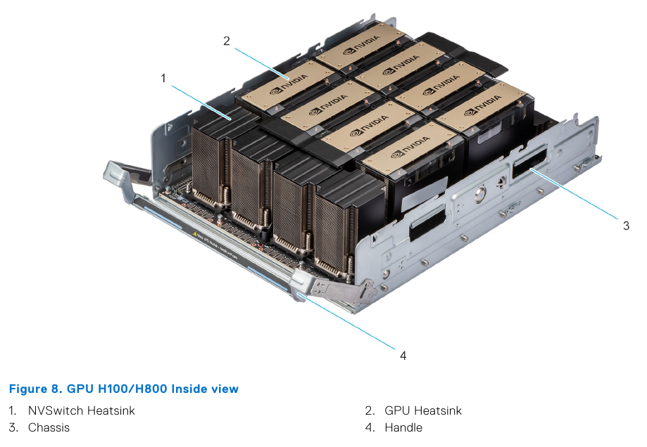
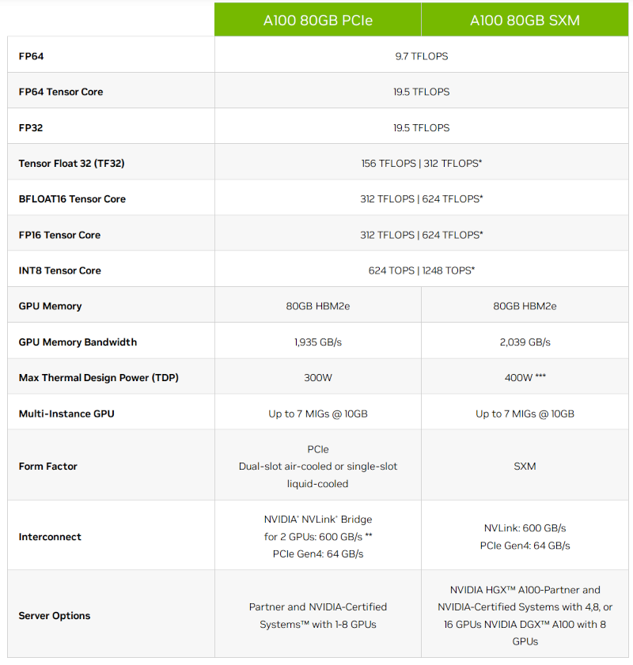
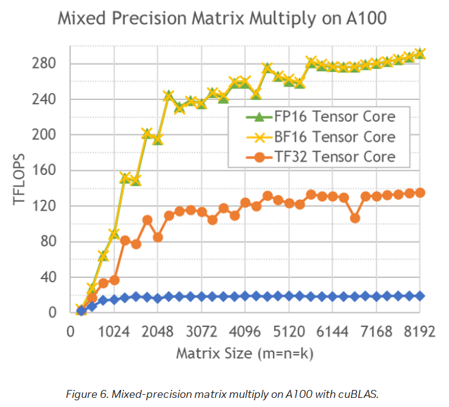
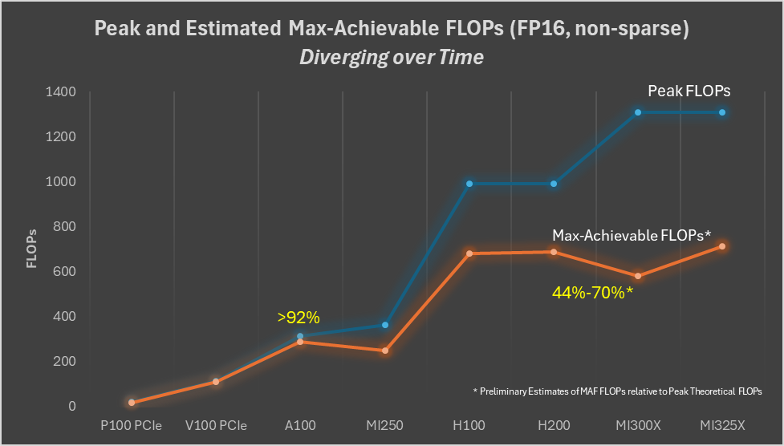

# 加速器 {#accelerators}

计算加速器是 ML 训练的主力。最初只有 GPU，但如今还有 TPU、FPGA、HPU、QPU、RDU，而且不断有新的种类被发明出来。

ML 主要有两类工作负载——训练和推理（inference）。此外还有微调（fine-tuning）工作负载，它通常与训练没有区别，除非进行的是轻得多的 [LORA 风格](https://arxiv.org/abs/2106.09685)微调。后者所需的时间和资源都比普通微调少得多。

在语言模型的推理过程中，生成是按序列进行的——一次只生成一个词元（token）。因此它必须把同一个 `forward` 调用重复数千次，每次执行一个规模不大的 `matmul`（矩阵乘法，即 GEMM）。这既可以在 GPU 这类加速器上完成，也可以在一些较新的 CPU 上完成——后者也能相当高效地处理推理。

在训练期间，整个序列长度会在一个巨大的 `matmul` 操作中一次性处理。因此，如果序列长度为 4k，那么同一个模型的训练就需要一个能处理比推理多 4k 倍运算、并且要足够快的计算单元。加速器非常擅长这类任务。事实上，需要相乘的矩阵越大，计算效率就越高。

另一个计算上的差异是：尽管训练和推理在 `forward`（前向）传播中都要执行总量相同的 `matmul`，但只针对训练进行的 `backward`（反向）传播还要额外执行 2 倍的 `matmul`，用来计算相对于输入和权重的梯度。如果使用激活重计算，则还要再执行一次 `forward`。因此，训练过程所需的 `matmul` 数量是推理的 3-4 倍。

## 子章节 {#subsections}

通用：

- [基准测试](benchmarks/README.md)

NVIDIA：

- [排查 NVIDIA GPU 的问题](nvidia/debug.md)

AMD：

- [排查 AMD GPU 的问题](amd/debug.md)
- [AMD GPU 性能](amd/performance.md)

## 高端加速器的真实现状鸟瞰 {#birds-eye-view-on-the-high-end-accelerator-reality}

尽管这种情况未来可能会改变，但与消费级 GPU 市场不同，截至 2026-08，高端加速器并没有那么多；如果你在云上租用算力，大多数云服务商能提供的加速器大致就是同样的那几款。

GPU：

- 截至目前，ML 云/HPC 平台已经配备了 B200/B300，GB200/GB300 NVL72 机架也已开始出货。Rubin 预计将于 H2-2026 出现。
- AMD 的 MI325X 现在在二线云服务商（Tier 2）上已经广泛可用。MI355X 开始现身。MI455X 希望能在 2026 年推出。新变化：大型云服务商（CSP）也开始提供 AMD GPU
- Intel 的 GPU D 系列（D270，代号 Crescent Island）是一款面向推理的 Xe3P 数据中心 GPU，在 OCP 2026 上发布，客户送样在 H2-2026。Intel 只公布了它的 FP8 峰值（1.3 PFLOPS）。参见 [Intel GPU D-series](#intel-gpu-d-series-crescent-island)

HPU：

- Intel 的 Gaudi2 和 Gaudi3 已在 Intel 云上可用。
- Falcon Shores 原定于 2025 年取代 Gaudi——更新：该项目已被取消

TPU：

- Google 的 TPU 当然也可以用，但它们并不是最理想的选择，因为你只能租用它们，而且软件在 GPU 与 TPU 之间并不能很方便地互相转换，所以许多（也许是大多数？）开发者仍然留在 GPU 阵营，因为他们不想被锁定在 Google 一家垄断的硬件上。
- Amazon 的 Trainium2 与 TPU 架构非常相似，可在 AWS 上租用

关于 Pod 与机架：

- Cerebras 的 WaferScale Engine（WSE）
- SambaNova 的 SambaRack（目前是 SN40L，SN50 从 H2-2026 起）
- 数十种不同的 Pod 与机架配置，它们用超高速互联把前述 GPU 组合起来。

截至 2026-07-31，大致就是这些。

本文档的其余部分将详细对比上述大多数产品；如果你想阅读规格参数，请前往[这里](#high-end-accelerators-for-ml-workloads)。

由于我们大多数人都只能租用算力，从来没见过它真实的样子，下面是一台 8xH100 节点在物理上的样子（这是 Dell PowerEdge XE9680 机架服务器的 GPU 托盘）：




## 术语表 {#glossary}

- BLAS: Basic Linear Algebra Subprograms（基础线性代数子程序）
- CPU: Central Processing Unit（中央处理器）
- CTS: Custom Thermal Solution（定制散热方案）——厂商支持的散热选项，允许使用高于默认值的功耗上限
- CU: Compute Unit（计算单元）——AMD 对应于 NVIDIA SM 的单元
- CUDA: Compute Unified Device Architecture——NVIDIA 的 GPU 编程平台
- DCORE：Intel 用来报告 Gaudi3 缓存容量的芯片核心（die core）；一颗 Gaudi3 有 4 个
- DGX：NVIDIA 的整机交付（turn-key）加速器服务器产品线
- ECC: Error Correcting Code（纠错码）
- FMA: Fused Multiply Add（融合乘加）
- FPGA: Field Programmable Gate Arrays（现场可编程门阵列）
- GA: Generally Available（正式可用）——指产品实际可以购买或租用，而不只是公布、送样或仅有规格
- GCD: Graphics Compute Die（图形计算裸片）
- GEMM: General Matrix Multiply（通用矩阵乘法）
- GPU: Graphics Processing Unit（图形处理器）
- HBM: High Bandwidth Memory（高带宽内存）
- HFU: Hardware FLOPS Utilization（硬件 FLOPS 利用率）
- HGX：NVIDIA 的加速器基板（baseboard），OEM 厂商围绕它构建自己的服务器
- HPC: High-performance Computing（高性能计算）
- HPU：Habana Gaudi AI Processor Unit（Habana Gaudi AI 处理器单元）
- LLC: Last Level Cache（最后一级缓存）
- MAMF: Maximum Achievable Matmul FLOPS（矩阵乘法的最大可达 FLOPS）
- MFU: Model FLOPS Utilization（模型 FLOPS 利用率）
- MIG: Multi-Instance GPU（多实例 GPU）——NVIDIA 将一块 GPU 划分为多个相互隔离实例的技术
- MME: Matrix Multiplication Engine（矩阵乘法引擎）
- MSMF: Maximum Sustainable Matmul FLOPS（矩阵乘法的最大可持续 FLOPS）
- NVL72：包含 72 块加速器的 NVLink 域；NVL8 与 NVL36 依此类推
- OAM: OCP Accelerator Module（OCP 加速器模块）——开放计算项目（Open Compute Project）的加速器外形规格
- PSU: Power Supply Unit（电源供应单元）
- PTX: Parallel Thread Execution（并行线程执行）——NVIDIA 的 GPU 中间指令集
- QPU: Quantum Processing Unit（量子处理器）
- RDU: Reconfigurable Dataflow Unit（可重构数据流单元）
- SM: Streaming Multiprocessor（流式多处理器）——NVIDIA 对应于 AMD CU 的单元
- SRAM: Static Random Access Memory（静态随机存取存储器）
- TBP：Typical Board Power（典型板卡功耗）或 Total Board Power（总板卡功耗），依厂商而异
- TDP：Thermal Design Power（热设计功耗）或 Thermal Design Parameter（热设计参数）
- TGP: Total Graphics Power（总图形功耗）
- TPC: Tensor Processing Core（张量处理核心）
- TPU: Tensor Processing Unit（张量处理单元）
- WSE: Wafer Scale Engine（晶圆级引擎）——Cerebras 的整片晶圆加速器
- XCD: Accelerator Complex Die（加速器复合裸片）——AMD 按裸片报告缓存时的口径
- XLA: Accelerated Linear Algebra（加速线性代数）——TPU 和 Trainium 上 PyTorch/JAX 背后的编译器

[补充术语表 @ Modal](https://modal.com/gpu-glossary)

## 最需要理解的一点 {#the-most-important-thing-to-understand}

我会在本书中多次重复下面这句话：仅仅购买/租用最昂贵的加速器并期待获得高投资回报率（ROI）是不够的。

衡量 ML 训练高 ROI 的两个指标是：

1. 训练完成的速度，因为如果训练比计划多花 2-3 倍的时间，你的模型可能还没发布就已经无关紧要了——在当今竞争极其激烈的 ML 市场中，时间就是一切。
2. 训练模型所花的钱（$$），因为如果训练比计划多花 2-3 倍的时间，最终你会多花 2-3 倍的钱。

如果其余购买/租用的硬件没有经过精心挑选以匹配所需的工作负载，那么很可能出现的情况是：加速器大量空闲，时间和钱都会白白损失。其中最关键的部件是[网络](../../network/README.md)，其次是[存储](../../storage/README.md)，最不重要的是 [CPU](../cpu/README.md) 和 [CPU 内存](../cpu-memory/README.md)（至少对于典型的训练负载而言如此，因为 CPU 方面的任何限制都可以通过多个 `DataLoader` 工作进程来弥补）。

如果算力是租来的，通常就没有多少选择自由——硬件要么是一成不变的，要么某些部件虽然可以更换，但选择也不多。因此有时会遇到所选云服务商提供的硬件与需求匹配得不够好，这种情况下最好另寻一家服务商。

如果你是自行购买服务器，我建议在购买前做非常深入的尽职调查。

当然，除了硬件，你还需要能够高效利用这些硬件的软件。

我们将在本书的多个章节中分别讨论硬件和软件两方面。你可以从[这里](../../training/performance/README.md)和[这里](../../training/model-parallelism/README.md)开始阅读。


## 我们关心加速器的哪些特性 {#what-accelerator-characteristics-do-we-care-for}

在接下来的各节中，我们以 NVIDIA A100 的规格作为参照。



[来源](https://www.nvidia.com/en-us/data-center/a100/)

### TFLOPS {#tflops}

ML 训练和推理所做的大部分工作都是矩阵乘法。如果你还记得代数课上的内容，矩阵乘法由大量乘法再求和构成。这些计算都可以被计数，并由此可以界定芯片在一秒内能执行多少次这样的运算。

这是评价加速器的关键特性之一。TFLOPS 这个术语表示芯片一秒内可以执行多少万亿次浮点运算（Floating Point Operations）。越多越好。不同数据类型有不同的定义。例如，下面是来自 [A100 规格](https://www.nvidia.com/en-us/data-center/a100/)理论峰值 TFLOPS 的几个条目：

| 数据类型 \ TFLOPS       | 不使用稀疏性 | 使用稀疏性 |
| :--------------------  | -----------: | ----------: |
| FP32                   |         19.5 |         n/a |
| Tensor Float 32 (TF32) |          156 |         312 |
| BFLOAT16 Tensor Core   |          312 |         624 |
| FP16 Tensor Core       |          312 |         624 |
| FP8 Tensor Core        |          624 |        1248 |
| INT8 Tensor Core       |          624 |        1248 |

注意：

* INT8 以 TeraOperations（万亿次操作）计，因为它不是浮点运算。

* FLOPS 这个术语既可能指浮点运算的总次数，例如在统计一次 Transformer 迭代需要多少 FLOPS 时；也可能指每秒浮点运算次数——所以要注意上下文。阅读加速器规格时，它几乎总是指每秒的次数。而在讨论模型架构时，它通常只是指浮点运算的总次数。

由此可见，int8 比 bf16 快 2 倍，而 bf16 又比 tf32 快 2 倍。

此外，TFLOPS 还取决于矩阵的大小，从下面这张表就可以看出来：



[来源](https://developer.nvidia.com/blog/cuda-11-features-revealed/)

正如你所看到的，由于[分块（tile）与波（wave）量化效应](../../training/performance/README.md#tile-and-wave-quantization)，性能差异是非线性的。请注意，图中的蓝线对应的是 FP32 Tensor Core。

#### 如何计算理论 TFLOPS {#how-to-calculate-theoretical-tflops}

加速器规格上公布的正是理论峰值 FLOPS。它的计算方式是：

`Theoretical FLOPS = compute_unit_clock_speed * FLOPs_per_clock_cycle_per_compute_unit * num_compute_units`

其中：

- `compute_unit_clock_speed`——计算单元的时钟每秒振荡的次数，单位为 Hz
- `flops_per_clock_cycle_per_compute_unit`——计算单元每个时钟周期能执行的浮点运算次数。
- `num_compute_units`——设备中有多少个这样的单元

每个计算单元每时钟周期的 FLOPs 数通常不会公布，但经常能查到的是每个计算单元每时钟周期的 FMA 次数。FMA 即 Fused Multiply Add（融合乘加）。由于 1 次 FMA 由 2 次 FLOP 组成，我们可以把上面的公式展开为：

`Theoretical FLOPS = compute_unit_clock_speed * FMAs_per_clock_cycle_per_compute_unit * 2 * num_compute_units`

我们来验证这个公式是否成立。计算一些 BF16（半精度）的 TFLOPS，并与公布的规格进行比较。

首先，从 [wiki](https://en.wikipedia.org/wiki/Hopper_(microarchitecture)#H100_accelerator_and_DGX_H100) 中提取所需的加速器规格。

麻烦之处在于找到 BF16（半精度）下每个 Tensor Core 每时钟周期的 FMA 次数。我在[这里](https://forums.developer.nvidia.com/t/how-to-calculate-the-tensor-core-fp16-performance-of-h100/244727/2)找到了它们。这些数字大多来自 [A100 白皮书](https://images.nvidia.com/aem-dam/en-zz/Solutions/data-center/nvidia-ampere-architecture-whitepaper.pdf)（在 pdf 中搜索 "FMA"，然后选择你所关心的目标精度下列出的那些数字）。[H100 白皮书](https://resources.nvidia.com/en-us-hopper-architecture/nvidia-h100-tensor-c)省略了许多具体的 FMA 数字，但给出了相对于 A100 白皮书所列 FMA 数字的倍数关系）。

下面计算中使用的时钟频率，以及各家厂商标出的时钟频率实际意味着什么，都收集在[时钟频率](#clock-speed)一节中。

**NVIDIA @ BF16**：

对 NVIDIA 来说，BF16 运算由 Tensor Core 执行。

| 加速器 | 时钟频率 | 每个 Tensor Core 每时钟周期的 FMA 次数 | Tensor Core 数 | 标称 TFLOPS | 备注 |
| :---------  | ------: | ---------------------------------------: | -----------: | ----------: | ----: |
| H100 SXM    | 1830MHz |                                      512 |          528 |         989 |     1 |
| A100 SXM    | 1410MHz |                                      256 |          432 |         312 |     1 |

1. `Tensor Cores` 是推算出来的：每个 SM 有 4 个 Tensor Core，H100 SXM 有 132 个 SM，A100 SXM 有 108 个 SM。


现在我们来算一下，把上表中的数字代入最后那个基于 FMA 的公式：

<!---->

- `1830*10**6 * 512 * 2 * 528 / 10**12 = 989.430` TFLOPS
- `1410*10**6 * 256 * 2 * 432 / 10**12 = 311.87` TFLOPS

两个计算结果都与公布的规格吻合——H100 SXM 为 989，A100 SXM 为 312。

请注意，这个峰值是整个加速器加总的结果——`528` 个 Tensor Core 就是 `4 x 132` 个 SM——所以单次 matmul 达不到这个水平，除非这次矩阵乘法足够大，能占满每一个 SM。至于为什么 SM 更多的芯片并不自动就提供更多 TFLOPS，参见[更多 SM 是否意味着更多 TFLOPS？](../../training/performance/README.md#do-more-sms-give-more-tflops)。

上面的 H100 SXM 时钟频率是 1830MHz，这是 NVIDIA 现在官方给出的数字。早先广泛公布的数字是 1980MHz，但它对不上：`1980*10**6 * 512 * 2 * 528 / 10**12 = 1070.530` TFLOPS，比规格值高出约 80。在 1830MHz 成为官方数字之前，其实就可以把同一个公式反过来、代入规格中的 TFLOPS 来反推出它：`989 / (512 * 2 * 528 / 10**12) / 10**6 = 1829.20`。这总体上是个有用的技巧——如果厂商公布了 TFLOPS 却没有公布时钟频率，或者公布的时钟频率算不出他们自己给出的 TFLOPS，这个公式能告诉你他们实际用的是哪个数字。

**AMD @ BF16**：

| 加速器 | 峰值引擎时钟 | 每个 Matrix Core 每时钟周期的 FMA 次数 | Matrix Core 数 | 标称 TFLOPS | 备注 |
| :---------- | ----------------: | ---------------------------------------: | -----------: | ----------: | ----: |
| MI355X      |           2400MHz |                                      512 |         1024 |        2500 |     1 |
| MI350X      |           2200MHz |                                      512 |         1024 |        2300 |     1 |
| MI300X      |           2100MHz |                                      256 |         1216 |        1307 |       |
| MI250X      |           1700MHz |                                      128 |          880 |         383 |     2 |

1. AMD 公布的 MI355X 和 MI350X 的 BF16 矩阵值是 `2.5 PFLOPS` 和 `2.3 PFLOPS`，四舍五入到两位有效数字——按公式算出来是 2516.6 和 2306.9。
2. AMD 公布了 MI355X 和 MI350X（1024）以及 MI300X（1216）的 Matrix Core 数量，但没有公布 MI250X 的，因此这里的 880 是推算出来的：每个 CU 有 4 个 Matrix Core，共 220 个 CU。

我们照旧自己算一遍：

<!---->

- `2400*10**6 * 512 * 2 * 1024 / 10**12 = 2516.6` TFLOPS——按 AMD 自己的取整方式，与其公布的 `2.5 PFLOPS` 一致
- `2200*10**6 * 512 * 2 * 1024 / 10**12 = 2306.9` TFLOPS——与 AMD 公布的 MI350X 的 `2.3 PFLOPS` 一致，MI350X 与 MI355X 是同一块硅片，只是时钟频率更低
- `2100*10**6 * 256 * 2 * 1216 / 10**12 = 1307.4` TFLOPS——与公布的规格一致，尽管你在文献中看到的多数是向下取整后的 `1300` TFLOPS。
- `1700*10**6 * 128 * 2 * 880 / 10**12 = 383.0` TFLOPS——与公布的规格完全一致

请注意，每个 Matrix Core 的 FMA 次数每代 CDNA 都会翻倍——MI250X（CDNA2）上是 128，MI300X（CDNA3）上是 256，MI355X（CDNA4）上是 512。由于 Matrix Core 的数量几乎没有变化（从 880 到 1216 再到 1024），代际之间 BF16 性能的提升几乎全部来自这种单核心的翻倍，而不是来自更多的核心。

**Intel @ BF16**：

Intel Gaudi 使用 MME 来执行 BF16 `matmul`

| 加速器 | MME 时钟 | 每个 MME 每时钟周期的 FMA 次数 | MME 数 | 标称 TFLOPS |
| :---------- | --------: | -------------------------------: | ---: | ----------: |
| Gaudi 2     |   1650MHz |                          256*256 |    2 |         432 |
| Gaudi 3     |   1600MHz |                          256*256 |    8 |        1677 |
|             |           |                                  |      |             |

我们照旧自己算一遍：

- Gaudi 2: `1650*10**6 * 256*256 * 2 * 2 / 10**12 = 432.5` TFLOPS——与公布的规格一致
- Gaudi 3: `1600*10**6 * 256*256 * 2 * 8 / 10**12 = 1677` TFLOPS——注意这与白皮书中公布的规格（1835TFLOPS）不一致，因为要达到 1835TFLOPS，时钟频率必须达到 1750MHz。也就是说，当前这一代 Gaudi3 实际运行在 1600MHz。

现在应该很容易看出来了：如果你的加速器以低于规格的加速时钟频率运行（例如过热导致加速器降频），那么预期得到的 TFLOPS 就会低于宣传值。

要查看加速器在负载下的实际时钟频率，请参见[时钟频率](#clock-speed)一节。
#### TFLOPS 对比表 {#tflops-comparison-table}

下面来看看各高端加速器支持的[数据类型](../../training/dtype.md)以及对应的理论峰值 TFLOPS 规格（不含稀疏性）。两张表都按 bf16 列排序，并共用同一组注释，注释列在两张表之后。两个 FP4 列对应两种分块缩放（block-scaled）的 FP4 格式：`mxfp4` 是 OCP 的微缩放（microscaling）格式，每 32 个元素共用一个 2 的幂次的 E8M0 缩放因子；`nvfp4` 是 NVIDIA 的格式，每 16 个元素一个 E4M3 缩放因子，外加一个张量级的 FP32 缩放因子——该选用哪一种，参见 [fp4 格式](../../training/dtype.md#fp4-formats)。

**已正式发售：**

| 加速器 \ TFLOPS  | fp32  | tf32   | fp16 | bf16 | fp8  | int8 | fp6   | mxfp4 | nvfp4 | 注释 |
| :-------------------- | ----: | -----: | ---: | ---: | ---: | ---: | ----: | ----: | ----: | ----: |
| NVIDIA GB300 SXM      |  80.0 | 1250.0 | 2500 | 2500 | 5000 | 5000 |  5000 | 15000 | 15000 |    24 |
| NVIDIA GB200 SXM      |  80.0 | 1250.0 | 2500 | 2500 | 5000 | 5000 |  5000 | 10000 | 10000 |    23 |
| AMD MI355X            | 157.3 |      ? | 2500 | 2500 | 5000 | 5000 | 10100 | 10100 |     X |    22 |
| Google TPU v7x        |     ? |      ? | 2307 | 2307 | 4614 |    ? |     ? |     ? |     ? |    25 |
| AMD MI350X            | 144.2 |      ? | 2300 | 2300 | 4600 | 4600 |  9200 |  9200 |     X |    22 |
| NVIDIA B300 SXM       |  80.0 | 1125.0 | 2250 | 2250 | 4500 | 4500 |  4500 | 13500 | 13500 |    21 |
| NVIDIA B200 SXM       |  80.0 | 1125.0 | 2250 | 2250 | 4500 | 4500 |  4500 |  9000 |  9000 |    20 |
| Intel Gaudi3          | 229.0 |  459.0 |  459 | 1677 | 1677 |    V |     X |     X |     X |  8,19 |
| AMD MI325X            | 163.4 |  653.7 | 1300 | 1300 | 2610 | 2600 |     X |     X |     X |    18 |
| AMD MI300X            | 163.4 |  653.7 | 1300 | 1300 | 2610 | 2600 |     X |     X |     X |    17 |
| NVIDIA H200 SXM       |  67.0 |  494.5 |  989 |  989 | 1979 | 1979 |     X |     X |     X |    16 |
| NVIDIA H100 SXM       |  67.0 |  494.5 |  989 |  989 | 1979 | 1979 |     X |     X |     X | 12,15 |
| NVIDIA GH200 SXM      |  67.0 |  494.5 |  989 |  989 | 1979 | 1979 |     X |     X |     X |    14 |
| Google TPU v6e        |     ? |      ? |  918 |  918 |  918 | 1836 |     X |     X |     X |    13 |
| NVIDIA H200 NVL       |  60.0 |  417.5 |  835 |  835 | 1670 | 1670 |     X |     X |     X |    29 |
| NVIDIA H100 PCIe      |  51.0 |  378.0 |  756 |  756 | 1513 | 1513 |     X |     X |     X |    12 |
| AWS Trainium2 / Ultra | 181.0 |  667.0 |  667 |  667 | 1299 |    X |     X |     X |     X |    11 |
| Google TPU v5p        |     X |      X |    X |  459 |    X |  918 |     X |     X |     X |    10 |
| Intel Gaudi2          |     V |      V |    V |  432 |  865 |    V |     X |     X |     X |   8,9 |
| AMD MI250X            |  47.9 |      X |  383 |  383 |    X |  383 |     X |     X |     X |     7 |
| NVIDIA L40S           |  91.6 |  183.0 |  362 |  362 |  733 |  733 |     X |     X |     X |     6 |
| AMD MI250             |  45.3 |      X |  362 |  362 |    X |  362 |     X |     X |     X |     5 |
| NVIDIA A100 SXM       |  19.5 |  156.0 |  312 |  312 |    X |  624 |     X |     X |     X |     4 |
| NVIDIA A100 PCIe      |  19.5 |  156.0 |  312 |  312 |    X |  624 |     X |     X |     X |   3,4 |
| Google TPU v4         |     X |      X |    X |  275 |    X |  275 |     X |     X |     X |     2 |
| Google TPU v5e        |     X |      X |    X |  197 |    X |  394 |     X |     X |     X |     1 |

**已宣布，供货情况未确认：**

| 加速器 \ TFLOPS | fp32  | tf32   | fp16 | bf16 | fp8   | int8 | fp6   | mxfp4 | nvfp4 | 注释 |
| :------------------- | ----: | -----: | ---: | ---: | ----: | ---: | ----: | ----: | ----: | ----: |
| AMD MI455X           | 315.0 |      ? | 5000 | 5000 | 10000 | 5000 | 10000 | 20000 |     X |    27 |
| NVIDIA Rubin SXM     | 130.0 | 2000.0 | 4000 | 4000 | 17500 | 2500 | 17500 | 35000 | 35000 |    26 |
| Huawei Ascend 950DT  |     X |      X |  486 |  486 |   919 |    X |     X |  1783 |     X |    28 |
| Intel GPU D270       |  20.5 |      ? |    ? |    ? |  1300 |    ? |     X |  2622 |     X |    30 |

注释与来源——两张表的 `Notes`（注释）列都指向这里。编号从最旧的硬件开始向上递增，因此新增内容会取下一个编号并排在这个列表的末尾：

1. [Google Cloud TPU v5e 文档](https://docs.cloud.google.com/tpu/docs/v5e)
2. [Google Cloud TPU v4 文档](https://docs.cloud.google.com/tpu/docs/v4)
3. 奇怪的是，据报道 NVIDIA A100 的 PCIe 与 SXM 版本的[规格](https://www.nvidia.com/en-us/data-center/a100/)给出了相同的 TFLOPS；考虑到 SXM 版本功耗高 30%、HBM 快 5%，这一点很不合理。
4. [NVIDIA A100 规格](https://www.nvidia.com/en-us/data-center/a100/)——涵盖 SXM 和 PCIe 两行
5. [AMD Instinct MI250 规格](https://www.amd.com/en/products/accelerators/instinct/mi200/mi250.html)
6. [NVIDIA L40S 规格](https://www.nvidia.com/en-us/data-center/l40s/)
7. [AMD Instinct MI250X 规格](https://www.amd.com/en/products/accelerators/instinct/mi200/mi250x.html)
8. Intel Gaudi2 和 3 只公布了部分 TFLOPS [规格](https://www.intel.com/content/www/us/en/content-details/817486/intel-gaudi-3-ai-accelerator-white-paper.html)，但它确实支持 FP32、TF32、BF16、FP16 和 FP8、INT8 以及 INT16。这些数字针对的是 MME（矩阵）计算。
9. [Intel Gaudi 2 AI 加速器白皮书](https://www.intel.com/content/www/us/en/content-details/839363/intel-gaudi-2-ai-accelerators-white-paper.html)
10. [Google Cloud TPU v5p 文档](https://docs.cloud.google.com/tpu/docs/v5p)
11. Trainium2 还支持 FP8/FP16/BF16/TF32 @ 2563TFLOPS（带 4:1 稀疏性）。参见 [AWS Trainium2 架构文档](https://awsdocs-neuron.readthedocs-hosted.com/en/latest/about-neuron/arch/neuron-hardware/trainium2.html)。
12. [NVIDIA H100 规格](https://www.nvidia.com/en-us/data-center/h100/)——涵盖 SXM 和 PCIe 两行
13. [Google Cloud TPU v6e 文档](https://docs.cloud.google.com/tpu/docs/v6e)
14. GH200——与 GB200 的说明同理——一个封装里有 2 颗 GPU，所以表中列出不带稀疏性的单芯片规格。参见 [NVIDIA GH200 Grace Hopper Superchip 规格](https://www.nvidia.com/en-us/data-center/grace-hopper-superchip/)。
15. 我没有列入 `NVIDIA H100 dual NVL`，因为嗯，它是 2 倍数量的 GPU——那样就不公平了——它的 FLOPS 与 H100 相同，但一切都是两倍，而且显存还多一点（每颗芯片 94GiB，而 H100 是 80GiB），显存也稍快一些。
16. H200 与 H100 相同，但 HBM 显存为 141GiB 而非 80GiB，并且显存更快，为 HBMe@4.8TBps，对比 HBM@3.35TBps——所以基本上 H200 解决了 H100 的显存带宽和显存容量瓶颈。参见 [NVIDIA H200 规格](https://www.nvidia.com/en-us/data-center/h200/)。
17. [AMD Instinct MI300X 规格](https://www.amd.com/en/products/accelerators/instinct/mi300/mi300x.html)
18. MI325X 的算力与 MI300X 相同，但显存更多、功耗也更高（计算效率更高）。参见 [AMD Instinct MI325X 规格](https://www.amd.com/en/products/accelerators/instinct/mi300/mi325x.html)。
19. 截至 2026-08，Gaudi3 实际运行在 1600MHz（MME），而不是计划中的 1750MHz，因此其 BF16 TFLOPS 是 1677，而不是白皮书规格中的 1835。fp8 同理，它的 TFLOPS 与 BF16 相同。
20. [NVIDIA DGX B200 数据表](https://resources.nvidia.com/en-us-dgx-systems/dgx-b200-datasheet)——`FP4 Tensor Core: 144|72` petaFLOPS 稀疏|稠密，对应 8 颗 GPU，即每颗 GPU 稠密 9000；[HGX 页面](https://www.nvidia.com/en-us/data-center/hgx/)与此一致（查阅于 2026-10-02）。NVIDIA 对 Blackwell 只公布一个 FP4 速率，其 GB200 NVL72 页面把它标注为 `NVFP4`，而 tensor core 通过同一条 `tcgen05.mma.kind::mxf4nvf4` 指令、以相同的速率运行这两种 FP4 格式（参见 [CUTLASS Blackwell 文档](https://docs.nvidia.com/cutlass/latest/media/docs/cpp/blackwell_functionality.html)），所以 NVIDIA Blackwell 每一行的 `mxfp4` 和 `nvfp4` 列填的都是同一个数字。
21. [NVIDIA DGX B300 数据表](https://resources.nvidia.com/en-us-dgx-systems/dgx-b300-datasheet)——`FP4 Tensor Core 144|108` PFLOPS 稀疏|稠密，对应 8 颗 GPU，即每颗 GPU 稠密 13500，正是数据表所宣传的相对 B200 提升 1.5 倍的稠密 FP4（"1.5x dense FP4"）；[HGX 页面](https://www.nvidia.com/en-us/data-center/hgx/)与此一致（查阅于 2026-10-02）。常被引用的 B300 的 15000，其实是 GB300 的单 GPU 数字。
22. [AMD Instinct MI355X 规格](https://www.amd.com/en/products/accelerators/instinct/mi350/mi355x.html)——这些是 AMD 给出的稠密数值。AMD 还公布了恰好为 2 倍的 `with Structured Sparsity`（带结构化稀疏）版本——OCP-FP8 为 10.1PFLOPS、FP16 矩阵为 5PFLOPS——所以别处引用的 10.1PFLOPS 的 fp8 数字是稀疏值，不是本表中的值。AMD 页面上的 `fp6` 和 `fp4` 条目没有标注稀疏性限定词，是稠密值。[MI350X](https://www.amd.com/en/products/accelerators/instinct/mi350/mi350x.html) 是同一颗芯片，运行在 2200MHz、1000W，各项数字按频率比例缩放（fp32 为 144.2 对 157.3）：AMD 公布 FP16 和 BF16 为 2.3PFLOPS，OCP-FP8 和 INT8 为 4.6PFLOPS，MXFP6 和 MXFP4 为 9.2PFLOPS，全部为稠密值，同时有同样 2 倍的 `with Structured Sparsity` 版本。
23. 由于 GB200 相当于 2 倍的 B200 芯片，表中给出的是每颗芯片的 TFLOPS，以便公平比较——要得到真正的 GB200，你需要把这些数字乘以 2——而且它似乎把 B200 芯片跑得更快一些，所以规格比单独的 B200 更高。这也意味着，你不会拿到通常那种 8 GPU 节点，而是会拿到一个 4 GPU 节点（但它相当于 8 颗 B200，算力还额外快约 10%）。参见 [NVIDIA GB200 NVL72 规格](https://www.nvidia.com/en-us/data-center/gb200-nvl72/)。
24. GB200 NVL72 与 GB300 NVL72 看起来相同，只是后者的 fp4 更快、显存更多。参见 [NVIDIA GB300 NVL72 规格](https://www.nvidia.com/en-us/data-center/gb300-nvl72/)。
25. [Google Cloud TPU v7x 文档](https://docs.cloud.google.com/tpu/docs/tpu7x)——Google 称之为 "the latest TPU available on Google Cloud"（Google Cloud 上可用的最新 TPU），并说明可通过 GKE 或 Compute Engine 使用它，所以这里把它和文中其他所有 TPU 一样视为可用，而这些全都只能租用且受容量限制。只有 fp16、bf16 和 fp8 公布了数字；该行其余是 `?`，因为 Google 尚未给出这些数值。
26. [NVIDIA Vera Rubin NVL72 规格](https://www.nvidia.com/en-us/data-center/vera-rubin-nvl72/)——属于预发布产品，所以这些是公布的数字，而不是已出货芯片的规格表。
27. AMD 的 MI455X 数字来自其[产品页面](https://www.amd.com/en/products/accelerators/instinct/mi400/mi455x.html)，查阅于 2026-08-06。`fp32` 315、`fp16` 5000、`bf16` 5000 和 `int8` 5000 是 AMD 自己给出的稠密数值。`fp8`、`fp6` 和 `fp4` 是从 AMD 公布的 20100、20100 和 40300 折半得来的，因为这三个几乎可以肯定是带稀疏性的数值，而 AMD 并未如此声明：AMD 在同一页面上为 FP16、BF16 和 INT8 的稀疏版本明确打了标签，全部为 10100，而如果按面值接受这三个未标注的数字，fp8 就会是 bf16 的 4 倍，而这里其他所有加速器都是 2 倍——MI355X 的值是 2500、5000、10100。折半恰好恢复了这种翻倍关系。AMD 没有为这颗芯片公布 TF32 数字，因此填 `?`。所有这些都还是 AMD Performance Labs 的预估，并附有 "Results subject to change when products are released in market"（产品上市后结果可能变化）的声明。
28. Ascend 950DT 的数字来自 [Ascend 社区](https://www.hiascend.com/en/hardware/cluster?tag=950)上 Atlas 950 SuperPoD 的产品规格表（查阅于 2026-08-10）：**64 颗** Ascend 950DT 在 `mxFP4` / `mxFP8/HiF8` / `FP16/BF16` 下的 `114.1 / 58.8 / 31.1` PFLOPS，除以 64 → **1783 / 919 / 486**。不要与中文页面上 1024 卡 SuperPoD 的总量混用（那些数字会得到约 1953 / 977 的 mxFP4/mxFP8，且没有 bf16）。`fp8` 列是华为公布的唯一 `mxFP8/HiF8` 速率；[HiF8](https://arxiv.org/abs/2409.16626) 是 tapered-precision（渐变精度），不是 OCP E4M3/E5M2，所以本章的 `e`/`m` 数据类型解码规则对它不适用。未公布的列填 `X`。
29. H200 NVL 是 H200 的 PCIe 插卡版本：与 H200 SXM 相同的芯片，同样配备 4.8TBps 的 141GB HBM3e，但功率上限是 600W 而不是 700W，NVIDIA 对其算力的标称值也低约 16%。`tf32`、`fp16`、`bf16`、`fp8` 和 `int8` 列是 NVIDIA 公布的带稀疏性数值 835 / 1671 / 1671 / 3341 / 3341 的一半，并按与 H200 SXM 行相同的方式向下取整。它的 NVLink 只能通过桥接器连接 2 路或 4 路卡，每颗 GPU 为 900GBps，不同桥接组中的 GPU 之间通过 PCIe Gen5 以 128GBps 通信——不像 H200 SXM，那里由 NVSwitch 连接节点的全部 8 颗 GPU。参见 [NVIDIA H200 规格](https://www.nvidia.com/en-us/data-center/h200/)。
30. Intel GPU D270（代号 Crescent Island）是 Intel 基于 Xe3P 的 GPU D 系列的第一个产品——一款仅用于推理的数据中心加速器（32 个 Xe3P 核、256 个 XMX 矩阵引擎、32MB L2），于 OCP 2026（2026-10-12）宣布，将在 H2-2026 向客户送样。Xe3P XMX 原生支持完整的精度阶梯——FP64、FP32、TF32、FP16、BF16、双格式 FP8（E4M3/E5M2）、FP4、OCP MX 格式（MXFP4/MXFP8）以及 int8/int4——所以这里的 `?` 单元格表示"支持，但速率未公布"，而不是"不支持"。Intel 公开公布的算力数字是 **稠密** FP8 的 `1.3 PFLOPS`（没有结构化稀疏），所以 `fp8` 填 1300。Intel 的产品规格还给出了 **稠密** `mxfp4` = 2622 TFLOPS（FP8 的 2 倍）和向量 `fp32` = 20.5 TFLOPS（向量 FP64 为 10.2，但表中没有对应的列）；这两项是 Intel 的官方数字，但尚未出现在任何公开页面上，所以没有来源链接——它们是厂商规格，不是估计值。其余所有受支持的格式（`tf32`、`fp16`、`bf16`、`int8`）在 Intel 公布官方速率之前一律保持 `?`（表中不收录估计值）。`fp6` 填 `X`（不在 Intel 的格式列表中），`nvfp4` 填 `X`，因为这颗芯片实现的是 OCP 微缩放 fp4（`mxfp4`），而不是 NVIDIA 的 nvfp4。参见 [Intel GPU D 系列](#intel-gpu-d-series-crescent-island)、[Intel 新闻室](https://www.intel.com/content/www/us/en/newsroom/news/artificial-intelligence/intel-accelerates-open-infrastructure-agentic-ai-era.html)、[Tom's Hardware](https://www.tomshardware.com/tech-industry/artificial-intelligence/intels-crescent-island-ai-accelerator-officially-powers-new-gpu-d-series-products-chip-delivers-1-3-peak-pflops-of-fp8-compute-and-1-5-tb-s-of-memory-bandwidth)（均查阅于 2026-10-15）。
通用注意事项：

<!---->

* int8 以 TeraOperations（万亿次操作）计量，因为它不是浮点运算。

* 如果你发现的数字是上面的两倍——那通常意味着是带稀疏性的数字（目前几乎没有人能从中获益，因为我们的矩阵都是稠密的）。

* 看规格时要非常小心你所读到的数字——许多厂商经常公布带稀疏性的 TFLOPS，因为它们大约大 2 倍，而且即便它们提到了这一点，也常常用小字注明。我曾不得不要求 NVIDIA 在其 H100 规格上加注说明那些数字是带稀疏性的，因为他们最初完全没有提及这一重要的技术事实。而截至 2026-08，99% 的情况下你都不会使用稀疏性，因此大多数时候你真正关心的实际理论 TFLOPS 是不带稀疏性的（也就是上面这张表）。

* 还要注意，如果加速器 A 公布的 TFLOPS 高于加速器 B，并不意味着 A 更快。这些是理论数字，不仅在实践中永远无法达到——实际的 TFLOPS 效率，即[硬件 FLOPS 利用率](../../training/performance/README.md#mfu-vs-hfu)（HFU），在不同厂商之间，甚至同一厂商的不同加速器架构之间，都可能差异很大。


<a id="maximum-achievable-flops"></a>

#### 最大可达且可持续的 FLOPS {#maximum-achievable-and-sustainable-flops}

宣传的理论峰值 FLOPS 的问题在于，它们是**非常**理论化的，即使提供了所有理想条件，在实践中也无法达到。每种加速器都有自己的现实可达 FLOPS，而这并不在宣传之列；社区里有一些零散报告在尽力寻找实际的最佳数值，但我还没找到任何官方报告。

如果你找到可靠的报告（论文？），能给出一款或多款本章讨论过的高端加速器实际可期望的 TFLOPS，请善意地提交一个 PR 附上这些信息。关键在于要有一条可供读者验证所提信息的来源引用。

为了让我所说的内容有具体的数量感，来看看 A100：这张卡的规格中 bf16 峰值性能为 312TFLOPS。在 FlashAttention 发明之前，人们就知道在 fp16/bf16 混合精度训练模式下，150TFLOPS 已接近所能达到的最高值。而有了 FlashAttention，大约是 180+TFLOPS。当然，这是在训练 LLM 的场景下测得的，其中涉及网络和 IO，会带来额外的开销。所以这里可达到的峰值上限大概介于 200 到 300TFLOPS 之间。

你可以用完美对齐的最大尺寸矩阵的 `matmul`，在单台加速器上实测可达到的峰值 TFLOPS。你可以使用[最大可达与可持续 Matmul FLOPS 查找工具](benchmarks/README.md#maximum-achievable-and-sustainable-matmul-flops-finder)来复现结果。当然，这只会告诉你手头这台加速器及其软件栈把 `matmul` 做得有多好——取决于工作负载，这可能就是你需要的全部信息，也可能远远不够。

MAMF 是[最大可达 Matmul FLOPS](#maximum-achievable-and-sustainable-matmul-flops-comparison-table)的缩写，这个术语出自我本人；MSMF 则是最大可持续 Matmul FLOPS——指加速器在其功率上限下饱和后仍能维持的算力。对于做性能优化工作的人来说，这两项都非常实用。

<a id="maximum-achievable-matmul-flops-comparison-table"></a>

#### 最大可达与可持续矩阵乘 FLOPS 对比表 {#maximum-achievable-and-sustainable-matmul-flops-comparison-table}

下面的测量针对输入为 BF16、FP8 和 FP4（不含稀疏性）的 `matmul` 的 TFLOPS（MAMF 与 MSMF 的含义见[最大可达与可持续 FLOPS](#maximum-achievable-and-sustainable-flops)）。**MAMF** 是短时加速时钟（boost clock）下的性能突发；**MSMF** 是芯片在功率上限下饱和后仍能维持的水平——评估训练吞吐量时应使用 MSMF。`—` 表示尚未测量 MSMF。表格按 MAMF % 排序。可用 [MAMF 查找器](benchmarks/README.md#maximum-achievable-and-sustainable-matmul-flops-finder)复现这些结果。

**BF16**：

| 加速器 | MAMF | MSMF | 理论值 | MAMF<br>% | MSMF<br>% | 同节点其他卡<br>负载 | 形状 MxNxK<br>（MAMF） | torch<br>版本 | 注释 |
| :--------------- | ---: | ---: | -----: | --------: | --------: | :----------- | :-------------------- | :------------------- | ----: |
| Intel Gaudi 2    |  419 |    — |    432 |     97.0% |         — | no           | 14336x15360x2048      | 2.6.0+hpu_1.21.2-76  |     1 |
| NVIDIA A100 PCIe |  285 |  258 |    312 |     91.3% |     82.7% | no           | 18432x1536x30720      | 2.14.1+cu130         |     2 |
| NVIDIA H200 NVL  |  761 |  665 |    835 |     91.1% |     79.6% | yes          | 2816x1536x30720       | 2.14.1+cu132         |       |
| NVIDIA A100 SXM  |  271 |    — |    312 |     86.9% |         — | no           | 1024x10240x5120       | 2.6.0+cu126          |       |
| NVIDIA H100 SXM  |  853 |  786 |    989 |     86.2% |     79.5% | yes          | 2816x1536x40960       | 2.12.0a0 (NGC 26.04) |    17 |
| NVIDIA H200 SXM  |  850 |  755 |    989 |     85.9% |     76.3% | yes          | 1536x2816x40960       | 2.14.0+cu130         |     3 |
| NVIDIA B300 SXM  | 1892 | 1519 |   2250 |     84.1% |     67.5% | no           | 10752x14336x3072      | 2.14.0+cu130         |     4 |
| NVIDIA GH200 SXM |  829 |    — |    989 |     83.8% |         — | no           | 1024x15360x4096       | 2.6.0+cu126          |     5 |
| NVIDIA B200 SXM  | 1737 | 1439 |   2250 |     77.2% |     64.0% | yes          | 4096x8192x3072        | 2.14.0+cu130         |     6 |
| Intel Gaudi 3    | 1243 |    — |   1677 |     74.1% |         — | no           | 16384x4096x768        | 2.6.0+hpu_1.21.4-3   |     1 |
| NVIDIA GB200 SXM | 1822 |    — |   2500 |     72.9% |         — | no           | 4096x9728x2048        | 2.10.0+cu130         |       |
| AMD MI355X       | 1565 |    — |   2500 |     62.6% |         — | no           | 12288x8192x8192       | 2.8.0+rocm7.0.2      |     7 |
| AMD MI350X       | 1411 | 1195 |   2300 |     61.3% |     52.0% | yes          | 4608x4096x7168        | 2.13.0+rocm10.0.0    |     8 |
| AMD MI325X       |  785 |  787 |   1300 |     60.4% |     60.5% | no           | 9216x9728x8192        | 2.9.1+rocm7.2.1      |     9 |
| AMD MI300X       |  634 |  616 |   1300 |     48.8% |     47.4% | yes          | 6144x4864x8192        | 2.13.0+rocm10.0.0    |    10 |

**FP8（`float8_e4m3fn`）**：

| 加速器 | MAMF | MSMF | 理论值 | MAMF<br>% | MSMF<br>% | 同节点其他卡<br>负载 | 形状 MxNxK<br>（MAMF） | torch<br>版本 | 注释 |
| :--------------- | ---: | ---: | -----: | --------: | --------: | :----------- | :-------------------- | :------------------- | ----: |
| Intel Gaudi 2    |  827 |    — |    865 |     95.6% |         — | no           | 6144x11264x5120       | 2.6.0+hpu_1.21.2-76  |     1 |
| NVIDIA H200 NVL  | 1366 | 1160 |   1670 |     81.8% |     69.5% | yes          | 1536x2816x40960       | 2.14.1+cu132         |       |
| NVIDIA B300 SXM  | 3608 | 2969 |   4500 |     80.2% |     66.0% | no           | 6144x18432x3072       | 2.14.0+cu130         |    11 |
| NVIDIA H100 SXM  | 1535 | 1364 |   1979 |     77.6% |     68.9% | yes          | 1280x16896x16384      | 2.12.0a0 (NGC 26.04) |    17 |
| NVIDIA GH200 SXM | 1535 |    — |   1979 |     77.6% |         — | no           | 1024x14336x14336      | 2.6.0+cu126          |     5 |
| NVIDIA H200 SXM  | 1525 | 1354 |   1979 |     77.1% |     68.4% | yes          | 1280x16896x16384      | 2.14.0+cu130         |    12 |
| Intel Gaudi 3    | 1290 |    — |   1677 |     76.9% |         — | no           | 16640x1536x3072       | 2.6.0+hpu_1.21.4-3   |     1 |
| NVIDIA B200 SXM  | 3350 | 2788 |   4500 |     74.4% |     62.0% | yes          | 6912x19968x1024       | 2.14.0+cu130         |    13 |
| NVIDIA GB200 SXM | 3616 |    — |   5000 |     72.3% |         — | no           | 19456x5120x1536       | 2.10.0+cu130         |       |
| AMD MI325X       | 1464 | 1431 |   2600 |     56.3% |     55.0% | no           | 9216x4864x8192        | 2.9.1+rocm7.2.1      |    18 |
| AMD MI300X       | 1230 | 1182 |   2600 |     47.3% |     45.5% | yes          | 6144x4864x12288       | 2.13.0+rocm10.0.0    |    14 |

**FP4（`nvfp4`、`mxfp4`）**：

| 加速器 | 格式 | MAMF | MSMF | 理论值 | MAMF<br>% | MSMF<br>% | 同节点其他卡<br>负载 | 形状 MxNxK<br>（MAMF） | torch<br>版本 | 注释 |
| :-------------- | :----- | ---: | ---: | -----: | --------: | --------: | :----------- | :-------------------- | :--------------- | ----: |
| NVIDIA B200 SXM | nvfp4  | 6746 | 5627 |   9000 |     75.0% |     62.5% | yes          | 2816x18944x14336      | 2.14.0+cu130     |    15 |
| NVIDIA B200 SXM | mxfp4  | 6183 | 5222 |   9000 |     68.7% |     58.0% | yes          | 2048x18944x16384      | 2.14.0+cu130     |    16 |
| NVIDIA B300 SXM | nvfp4  | 8909 | 7434 |  13500 |     66.0% |     55.1% | yes          | 18944x4096x12288      | 2.14.1+cu132     |    19 |
| NVIDIA B300 SXM | mxfp4  | 6607 | 5847 |  13500 |     48.9% |     43.3% | yes          | 2048x18944x19456      | 2.14.0+cu130     |    20 |

买方须知（caveat emptor）：这些数字来自 `mamf-finder.py --search auto`（或对相同或等效形状做的网格确认），使用的是测量时可用的软件栈。`Siblings` = `yes` 的行是用 [`mamf-finder-all-gpus.py`](benchmarks/mamf-finder-all-gpus.py) 测出的：该脚本在节点其余 GPU 持续跑矩阵乘法的同时，依次在节点每一块 GPU 上运行 `mamf-finder.py`，以模拟训练时所有卡同时计算的情形，并报告处于中位的那块 GPU。`Siblings` = `no` 的行是单独测量一块 GPU、其余卡空闲时的结果；对于 GPU 共享供电和散热的板卡，这个读数可能比同一块 GPU 在繁忙节点上能维持的数值更高。请在你自己的配置上重新测量，才能得到真正属于你这台机器的数字——这里的数字只是粗略估计，不是绝对值。随着软件改进，这些数字会向理论规格靠拢，因此最好每 6 个月左右重新测量一次。

**这些数字有多精确：**测量值本身就有波动，所以不要把任何一行当作精确值——而且大部分差异来自芯片之间，而不是重复运行之间。举两个例子，并非逐行说明：在一个 8x H200 节点上，每块 GPU 以同样的 685–688 W 功耗运行同一个 MSMF 形状，却能维持 745–765 TFLOPS，而且较快的 GPU 运行在更高的时钟频率上——最慢的是 1860 MHz，最快的是 1913 MHz；在一个 8x B200 节点上，同样的测试得到 1421–1460 TFLOPS，功耗为 978–987 W，时钟频率为 1399 对 1438 MHz。同样功耗下，体质更好的芯片能维持更高的时钟频率——这就是[硅片抽签（silicon lottery）](#silicon-lottery)——而在这些节点上散热几乎没有影响：每块 GPU 都是被功耗上限而不是温度限制住的，最热与最冷的 GPU 之间 8–11°C 的温差造成的影响不到它们时钟差距的十分之一（参见[散热](#cooling)）。重跑同一块 GPU 通常只会让数字变动 1% 以内，最多 2.2%。因此，`Siblings` = `yes` 的行描述的是某个节点中位 GPU 的表现，`Siblings` = `no` 的行描述的是一块 GPU，而且都是在当时的软件下测出的；换一个节点、驱动或 `torch` 版本，数字就会变化。其他 GPU 的波动幅度也可能各不相同，所以两行之间、或某一行与你自己的测量之间相差几个百分点，都应视为噪声，而不是真实的差异。

注释——上述三张表的 `Notes`（注释）列都指向这里：

1. Intel Gaudi 2 与 Intel Gaudi 3（两张表均适用）：`PT_HPU_LAZY_MODE=1`
2. NVIDIA A100 PCIe，BF16：80GB，300 W；3 次运行的中位数；MAMF @ 1395 MHz；MSMF 258 @ 2304x1536x6144，~299 W @ 1326 MHz
3. NVIDIA H200 SXM，BF16：MAMF ~148–167 W @ 1980 MHz；MSMF 755 @ 1536x2816x6144，~685–688 W @ 1860–1918 MHz，63–71°C
4. NVIDIA B300 SXM，BF16：B300 SXM6 AC 1100 W；MAMF ~286 W @ 2032 MHz；MSMF 1519 @ 8192x18432x1024，~1066 W @ 1455 MHz
5. NVIDIA GH200 SXM（两张表均适用）：900W 141GiB HBM3e 版本
6. NVIDIA B200 SXM，BF16：MAMF ~274–300 W @ 1965 MHz；MSMF 1439 @ 3072x18944x4608，~978–987 W @ 1399–1443 MHz，61–74°C
7. AMD MI355X，BF16：`PYTORCH_TUNABLEOP_ENABLED=0`
8. AMD MI350X，BF16：`PYTORCH_TUNABLEOP_ENABLED=1`，1000 W；`amdsmi` 采样到的 ~340 W @ 2181 MHz 落后于 MAMF 突发，与 MI300X 上的情况一样（见注释 10）；MSMF 1195 @ 4096x4096x8192，1000 W，74–100°C。这个节点的散热限制了它的 MSMF：4 块处于 74–77°C 的 GPU 在 1000 W 上限下维持了 1212–1274，4 块处于 95–100°C 的只有 898–1177，其中一块在 100°C 时限频到上限以下，因此散热良好的节点可能测出更高的值。由 [Amy Sartran](https://github.com/stas00/ml-engineering/pull/143#issuecomment-6049652037) 测量。
9. AMD MI325X，BF16：`PYTORCH_TUNABLEOP_ENABLED=1`、`numa_balancing=0`，1000 W。MSMF 787 @ 9216x9728x8192，1000 W @ 1577 MHz，73°C。
10. AMD MI300X，BF16：`PYTORCH_TUNABLEOP_ENABLED=1`，750 W；MAMF 不是一次加速突发——这张卡跑第一个 ~4 ms 的内核时就已触及 750 W 上限，`amdsmi` 采样到的 ~198 W @ 2088 MHz 落后于实际功耗，读数接近空闲状态（~180 W @ 2095 MHz）；MSMF 616 @ 9216x9728x8192，750 W @ 1203–1261 MHz，77–89°C。由 [Amy Sartran](https://github.com/stas00/ml-engineering/pull/143#issuecomment-6049652037) 测量。
11. NVIDIA B300 SXM，FP8：MAMF ~262 W @ 2032 MHz；MSMF 2969 @ 6144x18432x3072，~1057 W @ 1425 MHz
12. NVIDIA H200 SXM，FP8：MAMF ~154–163 W @ 1980 MHz；MSMF 1354 @ 1536x2816x10240，~683–689 W @ 1767–1848 MHz，63–72°C
13. NVIDIA B200 SXM，FP8：MAMF ~270–312 W @ 1965 MHz；MSMF 2788 @ 3072x18944x6144，~975–982 W @ 1399–1447 MHz，61–73°C
14. AMD MI300X，FP8：`float8_e4m3fnuz`、`PYTORCH_TUNABLEOP_ENABLED=1`，750 W；MAMF 不是一次加速突发，与注释 10 相同；MSMF 1182 @ 8192x4864x4096，750 W @ 1322–1378 MHz，73–86°C。由 [Amy Sartran](https://github.com/stas00/ml-engineering/pull/143#issuecomment-6049652037) 测量。
15. NVIDIA B200 SXM，nvfp4：每 16 个元素共用一个 `float8_e4m3fn` 缩放因子；MAMF ~281–323 W @ 1965 MHz；MSMF 5627 @ 18944x3328x12288，~983–991 W @ 1489–1521 MHz，60–73°C。理论值是 NVIDIA 公布的单一稠密 FP4 数值，见 [TFLOPS 对比表](#tflops-comparison-table) 下的 B200 注释。达到理论值的 75.0% / 62.5%，nvfp4 与这块 GPU 的 FP8 行（74.4% / 62.0%）基本持平，也就是说它兑现了规格所承诺的、相对 FP8 的完整 2 倍性能。
16. NVIDIA B200 SXM，mxfp4：每 32 个元素共用一个 `float8_e8m0fnu` 缩放因子；MAMF ~279–320 W @ 1965 MHz；MSMF 5222 @ 2048x18944x20480，~975–988 W @ 1452–1505 MHz，60–73°C。尽管 NVIDIA 对两种格式给出同一个 FP4 速率，而且 mxfp4 的缩放因子数量只有 nvfp4 的一半，它在 MAMF 和 MSMF 上仍落后 nvfp4 7–8%，这说明问题出在软件路径而不是硬件：torch 2.14 的 `_scaled_mm` 不接受 mxfp4，所以 `mamf-finder.py` 通过 `torch._scaled_mm_v2`（即 `torch.nn.functional.scaled_mm` 背后的算子）来运行它。

17. NVIDIA H100 SXM（两张表均适用）：在其余卡带负载的情况下，对八块 80 GB GPU 取中位数，每块 GPU 700 W，NGC 26.04，CUDA 13.2。BF16 MSMF 786 @ 2816x1536x8192，650-685 W @ 1958-1980 MHz，53-65°C。FP8 MSMF 1364 @ 1536x2816x12288，667-681 W @ 1902-1974 MHz，52-63°C。
18. AMD MI325X，FP8：`float8_e4m3fnuz`、`PYTORCH_TUNABLEOP_ENABLED=1`、`numa_balancing=0`，1000 W。MSMF 1431 @ 9216x4864x8192，1000 W @ 1528 MHz，74°C。
19. NVIDIA B300 SXM，nvfp4：每 16 个元素共用一个 `float8_e4m3fn` 缩放因子；B300 SXM6 AC 1100 W；MAMF ~271–300 W @ 2032 MHz；MSMF 7434 @ 18944x4096x12288，~1063–1075 W @ 1402–1435 MHz，64–69°C。torch 2.14.1+cu132 自带 cuBLAS 13.4，它使用基于 B300 更快的 `sm_103a` FP4 路径的 `sm103` 内核来运行；而 torch 2.14.0+cu130 里的 cuBLAS 13.1 会选择 `sm100` 内核，只能达到 7526 / 6410。
20. NVIDIA B300 SXM，mxfp4：每 32 个元素共用一个 `float8_e8m0fnu` 缩放因子；MAMF ~267–307 W @ 2032 MHz；MSMF 5847 @ 2048x18944x19456，~1065–1076 W @ 1534–1621 MHz，64–74°C。它运行在 torch 自己的 `sm100` 内核上，而不是 cuBLAS 的内核，所以无论 torch 2.14.0+cu130 还是 2.14.1+cu132，都用不到 B300 更快的 `sm_103a` FP4 路径。

通用说明：

<!---->

- 完整的理论值集合见[理论加速器 TFLOPS](#tflops-comparison-table)
- `MAMF %` / `MSMF %` 就是 `MAMF/Theory*100` 和 `MSMF/Theory*100`
- 虽然大多数用户关心的可能是 `mean`（平均值），但脚本同时报告 `max`、`median` 和 `mean`，以防你想要其他数字。
- `Shape` 列给出的是 MAMF 形状；MSMF 的形状、它的功耗、时钟频率和 GPU 温度都在编号注释里。性能几乎相同的形状通常有很多——这里列出它们是为了可复现。
- `Siblings` = `yes`：在节点其余 GPU 持续跑矩阵乘法的同时，测量节点上的每一块 GPU，MAMF 和 MSMF 取中位 GPU 的结果。`Siblings` = `no`：只测量一块 GPU，其余卡空闲。`mamf-finder.py` 如何测量这两种情况，[这里](benchmarks/README.md#maximum-achievable-and-sustainable-matmul-flops-finder)有说明。
- 如果你得到的性能明显低于表中的数字，请检查目标硬件的散热是否充分——加速器过热时通常会把性能降下来。当然，这里的前提是供电符合规格。供电在数据中心里很少成为问题，但散热不良并不是没听说过。
- 用什么软件可能带来巨大差别——例如，在 MI300X 上用 ROCm-6.1 我测到过 450TFLOPS，但你可以看到 ROCm-6.2 带来了巨大改进，又惊人地多了 300TFLOPS。BLAS 库的类型/版本也可能有很大影响。
- 此外还有各种系统层面的优化——例如对 MI300X 来说，必须在内核设置中禁用 numa_balancing。
- 各行之间并不总是完全可比的。每一行都是针对*那块*加速器找到的最佳形状，而且往往是在不同的 `torch`/CUDA 或 ROCm 版本上测的，所以任意两行之间的差距都混杂了硬件、形状和软件三方面因素。不过，用来和理论规格对比，它仍是足够好的参考。随着软件演进需要重新测量，而且结果很可能更好，但我本人接触不到所有 GPU，尤其是老型号，因此非常欢迎读者投稿。测量并提交一行的方法见[如何报告 MAMF/MSMF 条目](benchmarks/README.md#how-to-report-mamfmsmf-entries)。
- 在所有有 MSMF 的行中，H200、B200 和 A100 PCIe 是用 `mamf-finder.py` 的基准测试第 4 版测的（报告头部会打印该版本号），而 B300 和 MI300X 用的是更早的版本，两个版本对 MAMF 和 MSMF 这两个指标的定义不同，所以这两行与其他行只能粗略比较。
- MI325X 是在 2026-10-05 用未改动的第 4 版查找器、在 [`30ddd970`](https://github.com/stas00/ml-engineering/commit/30ddd97054eb01035c0a5079a58f011df603b525) 提交上、其余卡空闲时测得的。这些是取得最佳 MAMF 的单次运行配对结果，不是重复测量的中位数，也不是整节点结果。FP8 的输入和输出使用所列出的厂商格式。重复运行的波动范围以及另一些独立运行得到的更高 MSMF，见[测量细节](https://github.com/stas00/ml-engineering/pull/140)。
- AMD MI250X 有 2 个 GCD——所以理论 TFLOPS 需要减半，因为单个矩阵乘法只会用到其中 1 个，而 383TFLOPS 是 2 个 GCD 的标称值。

**为什么 MSMF 远低于理论值（以及这为什么不代表 GPU 有故障）：**宣传的峰值假定了芯片处于*加速*时钟（例如 B200 ~1965 MHz → 2250 bf16 TFLOPS）。而真正占满 SM 的稠密矩阵乘法会拉满 TDP（B200 1000 W / B300 1100 W / H200 700 W——这些是*规格*上限，而不是低于规格的某个“上限”），所以 SM 的时钟频率会稳定在远低于加速时钟的水平。粗略上限：`Theory × sustained_clk / boost_clk` ≈ `2250 × 1410/1965 ≈ 1615`（在 B200 上）——与实测的 MSMF 1439 相差不远（其余部分是真实内核的开销）。稀疏布局可以在同样贴着 TDP 的情况下维持*更高*的饱和时钟频率（H200 的 MSMF 在 ~1900 MHz，B300 的 MSMF 在 1455 MHz）；这个数字仍然是可持续的。

**为什么 MAMF 高于 MSMF：**MAMF 是一段短暂的未饱和突发。这两个指标常常落在*不同*的形状上——一个“胖”的 GEMM 可能产生更强的加速突发，而一个更“瘦”的形状反而能给出更好的可持续速率（也可能反过来）。具体例子（B300）：`10752×14336×3072` 在 **2032 MHz / 286 W 下突发到 1892 TFLOPS**（MAMF），但饱和后只能维持 1487 TFLOPS；`8192×18432×1024` 突发较低，只有 1809，却能维持 **1455 MHz / 1066 W → 1519 TFLOPS**（MSMF）。`mamf-finder.py` 在一段空闲之后对排队的突发计时，并报告采样时钟频率达到加速时钟的 5 个最快迭代的中位数，所以降频/基础时钟下的读数不可能冒充 MAMF。给出两个指标后，它会把每个胜出形状在两种状态下的结果都打印出来。AMD MI300X 没有这样的突发：它在第一个 ~4 ms 的内核内就达到 750 W 上限，所以它的 MAMF 只比 MSMF 高 1-3%，实际上是对同一个降频状态的带噪声读数——请以 MSMF 为准。

还要理解一点：知道某个特定形状（如 `4352x3840x13568`）下的最大可达矩阵乘 TFLOPS，并不意味着你能在真实应用里得到同样的性能，因为你很可能永远碰不到完全一样的形状。相反，要想真正了解你的系统，应该用模型在训练中实际使用的形状去跑 [MAMF 查找器](benchmarks/README.md#maximum-achievable-and-sustainable-matmul-flops-finder)。这正是这个工具真正的初衷。把你的训练所报告的 TFLOPS 与你在这个具体加速器集群上测得的最大可达矩阵乘 TFLOPS 作对比，你就能很好地判断什么时候可以停止优化。

在结束本节之前，我想再次强调：**这里的意图不是要评判哪款加速器不如另一款高效，而是帮助你弄清各是什么情况、如何看待这些理论规格，并帮你理解什么时候需要继续优化你的系统、什么时候应该停手。所以，请把这些说明和数字当作起点，然后测量你自己的用例，并以后面的这个测量结果来取得最佳效果。**

更新：这个新指标开始流行了。AMD 发布了这张图，并[解释了为什么加速器的效率会随着它们变得更快反而下降](https://rocm.blogs.amd.com/software-tools-optimization/Understanding_Peak_and_Max-Achievable_FLOPS/README.html)：



[来源](https://rocm.blogs.amd.com/software-tools-optimization/Understanding_Peak_and_Max-Achievable_FLOPS/README.html)

#### 并非所有加速器生来平等 {#not-all-accelerators-are-created-equal}

在测量加速器的性能表现时，你需要意识到：虽然测量能给你大致范围内的性能数字，但其他加速器很可能表现略有不同。我在一个 8 GPU 的节点上见过 5% 甚至更高的差异。

这部分与制造工艺有关，也与每块加速器安装得是否到位有关，而更多取决于每块加速器的散热是否均匀。例如，使用风冷时，离冷源更近的加速器很可能比更远的表现更好，尤其因为从一排排出的热风会被吹到下一排加速器上。液冷应该会好一些。

##### 硅片抽签 {#silicon-lottery}

即使是同一块晶圆上下来的两颗芯片也不完全相同。制造过程中的微小差异意味着每颗裸片（die）最终都有略有不同的晶体管特性：有的漏电更多，有的需要在给定频率下用更高的电压才能可靠翻转，还有的在同样负载下能跑得更凉或更热。这就是所谓的**硅片抽签**：你可能买到两块型号和 SKU 完全相同的 GPU，却测出明显不同的性能和功耗表现。

描述这种差异的方式是每颗芯片各自的 **V-F-T 曲线**（电压-频率-温度曲线）。每颗裸片都有自己的曲面，描述在给定频率和温度下稳定运行所需的最低电压。“体质好”的裸片可以用更低的电压跑到更高的频率（发热更少、功耗更低、距降频的余量更大）；“体质弱”的裸片为了同样的时钟频率需要更高电压，从而产生更多热量，进而在负载下更早被迫降频。所以这些曲线并不平行。两颗空闲时表现相同的裸片，一旦发热并持续计算，就可能显著拉开差距。

在数据中心加速器上，加速时钟和 TDP 规格定得比较保守，以便每颗经过出厂分选（binning）的芯片都能达标，但*实际可持续性能*仍会落在某个分布的任意位置上。再叠加不均匀的散热（见上文），这就解释了为什么在同一台 8 GPU 节点上，即使所有卡都通过了同样的出厂分选，GPU 之间的 MAMF 仍可能有 5% 以上的差距。

因此，你应当测量节点上所有加速器的性能，而且是同时测量。例如，在 NVIDIA 节点上，如果每个基准测试只测一块加速器，你可以这样做：
```bash
CUDA_VISIBLE_DEVICES=0 ./some-benchmark &
CUDA_VISIBLE_DEVICES=1 ./some-benchmark &
...
CUDA_VISIBLE_DEVICES=7 ./some-benchmark &
wait
```

这里你要关注的是最慢的性能，因为这些卡作为整体一起使用时，最慢的那块加速器（掉队者，straggler）会给所有其他加速器定下速度。

如果你做多节点训练，那自然要把所有节点都测一遍。

所以，如果你打算计算你实际可达的 [MFU](../../training/performance/README.md#mfu-vs-hfu)（而不是理论 MFU），就应当在所有参与的加速器上测量各自可达的 FLOPS，并取最慢那块加速器的数值。（如果它确实是一个离群值，你也可以考虑把它更换掉。）

##### 一个实测示例 {#a-measured-example}

曾有一台 8x B200 节点，用 [`mamf-finder-all-gpus.py`](benchmarks/mamf-finder-all-gpus.py) 在 8 块 GPU 同时计算时测量，各 GPU 的 MAMF 在 1693 到 1766 TFLOPS 之间，相差 4.3%；[MSMF](#maximum-achievable-and-sustainable-matmul-flops-comparison-table) 在 1421 到 1460 之间，相差 2.7%。这不是测量噪声：把同一测量重复 5 轮，每块 GPU 始终待在整段范围中属于它自己的那一小段（GPU0 的 MSMF 平均为 1417 TFLOPS，GPU5 为 1472），而任何单块 GPU 逐轮之间的波动最多只有 1.7%。一台 8x H200 节点也呈现出同样的情况，MSMF 相差 2.7%。

在同步训练中，每一步都要等最慢的 GPU，所以这台节点按 1421 TFLOPS 训练，而不是按其中位 GPU 的 1439 训练；一个多节点作业则以其所有节点中最慢的那块 GPU 为准。一块比其他卡慢 5% 的 GPU，会让一个 1,024 卡的作业整体计算慢约 5%——就好像其中约 50 块 GPU 闲置了一样。

所以要摸清你最慢的那块 GPU，并更换其中远低于所在节点中位数的卡。差几个百分点是正常的硅片抽签，每个节点都有最慢的 GPU：这里的 GPU0 比中位数低 1.3%，这并不构成更换它的理由。如果某块 GPU 低得更多——[evaluate-cluster 技能](https://github.com/CodingPracticeGroup/ml-engineering/blob/master/skills/evaluate-cluster/SKILL.md)会把连续三轮都低于所在节点中位数 5% 以上的卡标记出来——那就值得先检查是否存在散热问题；如果差距仍然在，再请你的服务商更换它。
### 加速器的显存容量与速度 {#accelerator-memory-size-and-speed}

加速器使用[高带宽内存（High Bandwidth Memory）](https://en.wikipedia.org/wiki/High_Bandwidth_Memory)（HBM），它是 SDRAM 内存的 3D 版本。例如，80GiB 的 A100-SXM 配的是 HBM2e，带宽为 2.0TBps；80GiB 的 H100-SXM 配的是 HBM3，带宽为 3.35TBps（完整数据见下文按加速器列出的完整表格）。

规格如下：

| 类型  | 每引脚最大数据<br>传输速率（Gbps） | 堆叠<br>高度 | 每通道<br>位数 | 每个堆叠的<br>裸片<br>数量 | 每个堆叠的裸片<br>容量<br>（GiB） | 每个堆叠最大<br>容量（GiB） | 每个堆叠最大数据<br>速率（GBps） |
| :---- | -----------------------------------------: | ---------------: | -------------------: | -------------------------------: | ------------------------------------: | ------------------------------------: | -------------------------------------: |
| HBM1  |                                        1.0 |                8 |                  128 |                                4 |                                     1 |                                     4 |                                    128 |
| HBM2  |                                        2.4 |                8 |                  128 |                                8 |                                     1 |                                     8 |                                    307 |
| HBM2e |                                        3.6 |                8 |                  128 |                               12 |                                     2 |                                    24 |                                    461 |
| HBM3  |                                        6.4 |               16 |                   64 |                               12 |                                     2 |                                    24 |                                    819 |
| HBM3e |                                        9.6 |               16 |                   64 |                               16 |                                     3 |                                    48 |                                   1229 |
| HBM4  |                                        8.0 |               32 |                   64 |                               16 |                                     4 |                                    64 |                                   2048 |

注：

- 我在为这张表做调研时，发现上面这些数字在不同来源之间差异很大。我认为原因要么是存在不同的实现，要么是规格被修改过好几次，而不同的出版物采用了不同版本的规格。上面的表格来自 [wikipedia](https://en.wikipedia.org/wiki/High_Bandwidth_Memory)。
- 由于 HBM 是多颗 DRAM 芯片堆叠而成的，*堆叠高度（Stack Height）*指的就是每个器件里有多少颗芯片。

要注意，内存规格有时并不会说清楚 GB 到底指什么。有时它其实是 GiB（`2**30` 字节），却写成 GB；有时它又真的是 GB（`10**9` 字节）。带宽（`GBps`、`TBps`）则几乎总是十进制单位（`1GBps = 10**9` 字节每秒）。把 GiB 换算成 GB：`x * 2**30 / 10**9`。把 GB 换算成 GiB：`x * 10**9 / 2**30`。大多数时候，内存容量用的是 GiB（只是省略了 `i`），而带宽用的是十进制的 GBps 或 TBps。

更让人困惑的是，标称容量并不等于你实际能用到的容量。对于 NVIDIA B200 同时出现 192GB 和 180GB 这两个数字，一种可能的解释是：它物理上有 192GiB 的 HBM3e——8 个堆叠，每个 24GiB（这里的单位是 GiB，不是十进制的 GB：DRAM 裸片密度天生就是二进制的，所以 8 颗 24Gbit 裸片构成的一个堆叠是 `8*24*2**30/8 = 24GiB`，8 个堆叠共 192GiB——厂商只是把它印成 “192GB”）。按这种解释，在 HGX/DGX 系统中实际可用的只有大约 180GiB，其余部分被保留，例如用于 ECC；`192*15/16 = 180` 恰好吻合，说明有 1/16 被扣了下来。这样一来，192 与 180 的差别就是物理容量对可用容量，而不是 GB 对 GiB，这也正是下表采用 NVIDIA 给出的 180GB 硬件/平台数值的原因。不过，192GiB 的物理容量、八个堆叠的布局、二进制单位的解释以及 1/16 的保留比例都是由算术推导出来的： NVIDIA 并没有正式说明过这种关系，实际的硬件布局或内存核算方式可能不同。

通常，加速器片上内存越多，性能就越好。在任何给定时刻，模型的大部分权重其实都没在被使用，而是在等待轮到它们被处理，因此更大的内存可以让模型的更大部分驻留在加速器内存中，立即可被访问和更新。当内存不够时，有时就必须把模型拆分到多颗加速器上，或者把部分权重卸载（offload）到 CPU 和/或磁盘上。

以下是近期高端加速器的显存规格（其中一些尚未正式发售），按显存容量排序，容量相同再按带宽排序：

**已正式发售：**

| 加速器                  | 显存<br>（GB） | 类型  | 峰值<br>带宽<br>（TBps） |
| :-------------------- | -------------: | :---- | --------------------------: |
| NVIDIA B300 SXM       |            288 | HBM3e |                        8.00 |
| AMD MI355X            |            288 | HBM3e |                        8.00 |
| AMD MI350X            |            288 | HBM3e |                        8.00 |
| AMD MI325X            |            256 | HBM3e |                        6.00 |
| AMD MI300X            |            192 | HBM3  |                        5.30 |
| NVIDIA GB200 SXM      |            186 | HBM3e |                        8.00 |
| NVIDIA B200 SXM       |            180 | HBM3e |                        8.00 |
| NVIDIA GH200 SXM (2)  |            141 | HBM3e |                        4.80 |
| NVIDIA H200 SXM       |            141 | HBM3e |                        4.80 |
| NVIDIA H200 NVL       |            141 | HBM3e |                        4.80 |
| Intel Gaudi3          |            128 | HBM2e |                        3.70 |
| AMD MI250             |            128 | HBM2e |                        3.28 |
| AMD MI250X            |            128 | HBM2e |                        3.28 |
| NVIDIA GH200 SXM (1)  |             96 | HBM3  |                        4.00 |
| Intel Gaudi2          |             96 | HBM2e |                        2.46 |
| AWS Trainium2 / Ultra |             96 | HBM3  |                        2.90 |
| Google TPU v5p        |             95 | HBM2e |                        2.76 |
| NVIDIA H100 SXM       |             80 | HBM3  |                        3.35 |
| NVIDIA A100 SXM       |             80 | HBM2e |                        2.00 |
| NVIDIA H100 PCIe      |             80 | HBM3  |                        2.00 |
| NVIDIA A100 PCIe      |             80 | HBM2e |                        1.94 |
| NVIDIA L40S           |             48 | GDDR6 |                        0.86 |
| Google TPU v4         |             32 | HBM2  |                        1.20 |
| Google TPU v5e        |             16 | HBM2  |                        0.82 |

**已宣布发布，供货情况未确认：**

| 加速器                  | 显存<br>（GB） | 类型    | 峰值<br>带宽<br>（TBps） |
| :-------------------- | -------------: | :------ | --------------------------: |
| Intel GPU D270        |            480 | LPDDR5X |                        1.50 |
| AMD MI455X            |            432 | HBM4    |                       23.30 |
| NVIDIA Rubin SXM      |            288 | HBM4    |                       19.20 |
| Huawei Ascend 950DT   |             96 | ?       |                        4.00 |


注：

* Intel GPU D270（Crescent Island）是这张表里显存容量的异类：它用的是 LPDDR5X 而不是 HBM，以带宽换取容量和成本。`480` 是 ODM（原始设计制造商）的最大配置；Intel 自家的参考 PCIe 卡出厂配的是 `160GB`。`1.5TBps` 来自一条 1280 位宽的总线以 9.6Gbps 运行 LPDDR5X——对 LPDDR 来说已经很高，但远远低于上面的那些 HBM 产品。资料来源见 [TFLOPS 表格中的注 30](#tflops-comparison-table)。

* 表中列出的容量数值保留了厂商自己公布的 `GB` 标签。截至 2026-07-29，NVIDIA 的 [HGX AI Factory 组件](https://docs.nvidia.com/enterprise-reference-architectures/hgx-ai-factory/latest/components.html)页面把 B200 列为 180GB，其 [MIG 表](https://www.nvidia.com/en-gb/technologies/multi-instance-gpu/)把 B200 列为 180GB、GB200 列为 186GB。而 NVIDIA 的 [OpenFold2 支持矩阵](https://docs.nvidia.com/nim/bionemo/openfold2/2.0.0/support-matrix.html)则把 B200 列为 192GB，且没有解释这一差异反映的是物理容量、可用容量、被保留的容量，还是不同的报告口径。本表遵循硬件和平台数值；上文那种可能的物理容量/ECC 解释只是算术推导，并非 NVIDIA 正式记载的规格。

* `NVIDIA Rubin SXM` 这一行是标准的 Rubin GPU（即 `288`GB HBM4 的那款，有时被称为 `R200`）。`19.20 TBps` 是 NVIDIA 当前在 [Vera Rubin NVL72](https://www.nvidia.com/en-us/data-center/vera-rubin-nvl72/) 规格页上给出的每 GPU 数值——单 GPU 一列中写着 `288 GB HBM4 | 19.2 TB/s`——比早先 `22` 的目标值有所下调。Rubin CPX（一款独立的产品，是单芯片的预填充（prefill）GPU；NVIDIA 官方只列出 `128GB GDDR7` 和 `30` PFLOPS NVFP4，没有给出每 GPU 带宽）以及更晚的 Rubin Ultra（HBM4e）都是各有自己内存配置的独立型号，不在这一行的覆盖范围内。

* 我没有收录 `NVIDIA H100 dual NVL`，因为它是 2 颗 H100 GPU，每颗芯片多出 14GiB 显存，显存也略快一些（3.9TBps 对 3.35TBps）——把它放进上面的表里会有不公平的优势，因为表里其他条目都是按单芯片计的。（我猜 AMD250 也是 2 个 GCD，不过它们本来也没什么竞争力，很快就会在这张表里被更新的产品取代。）

#### 如何计算理论显存带宽 {#how-to-calculate-theoretical-memory-bandwidth}

上面的 `Peak Bandwidth` 数值不是实测出来的——和[理论 TFLOPS](#how-to-calculate-theoretical-tflops)一样，它们由三个数字推算得出：

```
bandwidth (bytes/sec) = memory clock (Hz) * bus width (bytes) * 2
```

其中的 `*2` 是因为 HBM 和所有双倍数据速率（Double Data Rate）内存一样，在时钟的上升沿和下降沿都各传输一次——也就是每半个周期一次传输，而不是每个周期一次。总线宽度是指把所有堆叠加在一起的*整个*内存接口宽度，而不是单个堆叠的宽度，这也是三项输入里最容易搞错的一项。

拿 B200 实际算一遍：`nvidia-smi -q -d CLOCK` 报告的显存时钟是 3996MHz，总线是 8192 位，即 1024 字节：

- `3996*10**6 * 1024 * 2 / 10**12 = 8.184` TBps

对照 NVIDIA 公布、本表沿用的 8.00TBps。2.3% 的差距是因为公布数值是向下取整的结果，并不是算术有错——这是常见的结果，也正是值得把它当作*交叉验证*、而不是当作求数手段的原因。如果算出的结果差得很远，而不只是差百分之几，那说明三个输入中有一个是错的。

这三项输入都可以从加速器本身读取，所以完全不必从规格表上抄录任何东西：

```python
import torch
p = torch.cuda.get_device_properties(0)
# memory_clock_rate 是*峰值*时钟，单位 kHz；memory_bus_width 是位宽，单位 bit
bw = p.memory_clock_rate * 1e3 * (p.memory_bus_width / 8) * 2 / 1e12
print(f"{p.name}: {p.memory_clock_rate/1e6:.3f}GHz x {p.memory_bus_width}-bit bus -> {bw:.2f}TBps")
```

有两点要注意。第一，要取**峰值**显存时钟，而不是当前时钟——空闲的加速器会把显存降频，所以 `nvidia-smi` 的 `Clocks` 一节会显示很低的数值，而 `Max Clocks` 显示的才是这套算术需要的数值；PyTorch 的 `memory_clock_rate` 本身就已经是峰值。第二，这样得到的是*理论*上限；真实工作负载能达到的高度要更低，这两者的关系就如同[最大可达 Matmul FLOPS](#maximum-achievable-and-sustainable-matmul-flops-comparison-table)之于 TFLOPS——关于聚合峰值与实际吞吐量为何会偏离，一般性的原因见[更多的 SM 能带来更多 TFLOPS 吗？](../../training/performance/README.md#do-more-sms-give-more-tflops)。

显存速度（带宽）当然非常重要，因为它如果不够快，计算部分就会空闲下来，等待数据被搬进、搬出内存。


### 缓存 {#caches}

高性能缓存用于存放频繁使用的指令和数据。L1 通常是最小、最快的，接着 L2 会稍大一些、也稍慢一些，还可能有 L3 缓存，它更大也更慢。所有这些缓存都大幅减少了对 HBM 的访问次数。

跑基准测试时，缓存大小往往很关键——因为需要在每次实验之间重置缓存。

缓存规格很难在各厂商之间归一化，因为它们描述的是不同的资源和不同的报告口径。例如，NVIDIA 给出的是每 SM 一个 L1/纹理/共享内存合并的可配置容量，AMD 按每 CU 报告 L1、按每 XCD 报告 L2，而 Intel Gaudi 包含软件管理的 SRAM 和可配置的缓存模式，无法直接对应到常规的 GPU 缓存层级。

因此，下表保留厂商文档中使用的口径，不会把私有本地缓存相乘来推算每颗加速器的总量。没有直接可比的、有文档记载的数值的加速器，宁可略去，也不用估计值填充。

第一个表比较的是大范围共享的片上缓存的容量，按**共享容量**降序排列，再按**大约发布时间**降序排列。对于合并多产品的行，给出的日期是该行中最新产品的发布时间。它有助于回答“哪款加速器公布了更多的大范围共享缓存容量”，但它不是缓存性能排名：缓存类型、带宽、延迟、共享域以及工作负载的命中率仍然各不相同。厂商的单位标签按原样保留，因此 `MB` 与 `MiB` 数值之间的排序只是近似的。

| 共享容量        | 加速器 / 架构                      | 缓存类型                       | 作用范围 / 限定说明         | 大约<br>发布时间 | 来源 |
| :-------------- | :------------------------------- | :----------------------------- | :-------------------- | :------------------- | :--- |
| 256MiB          | AMD MI350X / MI355X              | Infinity Cache（LLC）          | 每加速器                | 2025-06              | 1    |
| 256MiB          | AMD MI300X / MI325X              | Infinity Cache（LLC）          | 每加速器                | 2024-10              | 2    |
| 192MB           | AMD MI455X                       | 全局 L2                        | 每加速器                | 2026-06              | 3    |
| 126MB           | NVIDIA Blackwell（以 GB200 为例） | L2                            | 每 GPU                | 2024-03              | 4    |
| 96MiB           | Intel Gaudi3                     | 可配置为 L3 或 4 个 L2 分片    | 每加速器                | 2024-04              | 5    |
| 50MiB           | NVIDIA Hopper（以 H100 为例）    | L2                             | 每加速器                | 2022-03              | 6    |
| 40MiB           | NVIDIA Ampere（以 A100 为例）    | L2                             | 每加速器                | 2020-05              | 7    |

来源：

1. AMD MI350X / MI355X [缓存规格说明](https://rocm.docs.amd.com/projects/ai-ecosystem/en/latest/optimization/workload-optimization.html)和[发布公告](https://newsroom.amd.com/news/amd-unveils-vision-for-an-open-ai-ecosystem-detai/)
2. AMD MI300X / MI325X [缓存规格说明](https://rocm.docs.amd.com/projects/ai-ecosystem/en/latest/optimization/workload-optimization.html)和[发布公告](https://www.amd.com/en/newsroom/press-releases/2024-10-10-amd-delivers-leadership-ai-performance-with-amd-in.html)
3. [AMD Instinct MI455X 规格与发布公告](https://www.amd.com/en/products/accelerators/instinct/mi400/mi455x.html)
4. NVIDIA Blackwell [缓存规格说明](https://docs.nvidia.com/cuda/blackwell-tuning-guide/index.html)和[发布公告](https://nvidianews.nvidia.com/news/nvidia-blackwell-platform-arrives-to-power-a-new-era-of-computing)
5. Intel Gaudi3 [缓存规格说明](https://www.intel.com/content/www/us/en/content-details/817486/intel-gaudi-3-ai-accelerator-white-paper.html)和[发布公告](https://newsroom.intel.com/artificial-intelligence/vision-2024-enterprise-ai-gaudi-3-open-systems-strategy)
6. NVIDIA Hopper [缓存规格说明](https://docs.nvidia.com/cuda/hopper-tuning-guide/index.html)和[发布公告](https://nvidianews.nvidia.com/news/nvidia-announces-dgx-h100-systems-worlds-most-advanced-enterprise-ai-infrastructure)
7. NVIDIA Ampere [缓存规格说明](https://docs.nvidia.com/cuda/ampere-tuning-guide/index.html)和[发布公告](https://nvidianews.nvidia.com/news/nvidias-new-ampere-data-center-gpu-in-full-production)

第二个表保留厂商原生的本地资源，按**厂商**升序排列，再按**大约发布时间**降序排列。

| 厂商   | 加速器 / 架构                | 大约<br>发布时间 | 厂商公布的本地资源                                | 作用范围            | 来源 |
| :----- | :------------------------- | :------------------- | :---------------------------------------------- | :------------------ | :--- |
| AMD    | MI455X                     | 2026-06              | 在所引用的公开规格说明中未披露                    |                     | 1    |
| AMD    | MI350X / MI355X            | 2025-06              | 32KiB L1 数据缓存；4MiB L2 缓存                  | 每 CU；每 XCD       | 2    |
| AMD    | MI300X / MI325X            | 2024-10              | 32KiB L1 数据缓存；4MiB L2 缓存                  | 每 CU；每 XCD       | 3    |
| Intel  | Gaudi3                     | 2024-04              | 24MiB 可配置缓存                                  | 每 DCORE；4 个 DCORE | 4    |
| Intel  | Gaudi2                     | 2022-05              | 48MiB 软件管理的 SRAM                             | 每加速器             | 5    |
| NVIDIA | Blackwell（以 GB200 为例） | 2024-03              | 256KB L1/纹理/共享内存合并容量                    | 每 SM               | 6    |
| NVIDIA | Hopper（以 H100 为例）     | 2022-03              | 256KiB L1/纹理/共享内存合并容量                   | 每 SM               | 7    |
| NVIDIA | Ampere（以 A100 为例）     | 2020-05              | 192KiB L1/纹理/共享内存合并容量                   | 每 SM               | 8    |

来源：

1. [AMD Instinct MI455X 规格与发布公告](https://www.amd.com/en/products/accelerators/instinct/mi400/mi455x.html)
2. AMD MI350X / MI355X [缓存规格说明](https://rocm.docs.amd.com/projects/ai-ecosystem/en/latest/optimization/workload-optimization.html)和[发布公告](https://newsroom.amd.com/news/amd-unveils-vision-for-an-open-ai-ecosystem-detai/)
3. AMD MI300X / MI325X [缓存规格说明](https://rocm.docs.amd.com/projects/ai-ecosystem/en/latest/optimization/workload-optimization.html)和[发布公告](https://www.amd.com/en/newsroom/press-releases/2024-10-10-amd-delivers-leadership-ai-performance-with-amd-in.html)
4. Intel Gaudi3 [缓存规格说明](https://www.intel.com/content/www/us/en/content-details/817486/intel-gaudi-3-ai-accelerator-white-paper.html)和[发布公告](https://newsroom.intel.com/artificial-intelligence/vision-2024-enterprise-ai-gaudi-3-open-systems-strategy)
5. Intel Gaudi2 [架构规格说明](https://docs.habana.ai/en/latest/Gaudi_Overview/Gaudi_Architecture.html)和[发布公告](https://www.intel.com/content/www/us/en/developer/articles/technical/habana-gaudi2-processor-for-deep-learning.html)
6. NVIDIA Blackwell [缓存规格说明](https://docs.nvidia.com/cuda/blackwell-tuning-guide/index.html)和[发布公告](https://nvidianews.nvidia.com/news/nvidia-blackwell-platform-arrives-to-power-a-new-era-of-computing)
7. NVIDIA Hopper [缓存规格说明](https://docs.nvidia.com/cuda/hopper-tuning-guide/index.html)和[发布公告](https://nvidianews.nvidia.com/news/nvidia-announces-dgx-h100-systems-worlds-most-advanced-enterprise-ai-infrastructure)
8. NVIDIA Ampere [缓存规格说明](https://docs.nvidia.com/cuda/ampere-tuning-guide/index.html)和[发布公告](https://nvidianews.nvidia.com/news/nvidias-new-ampere-data-center-gpu-in-full-production)

第三个表恢复了此前对比表中按产品列出的细节，同时把厂商原生口径与推算出的分布式容量区分开。它按**厂商**升序排列，再按**加速器 / 产品**升序排列。`分布式容量`是把各个私有单元做算术求和得到的，并不意味着任何一次操作都能把它当作一个共享缓存来访问。

| 厂商   | 加速器 / 产品                   | 厂商原生细节                                          | 分布式容量                 | 共享缓存 / LLC              | 对此前条目的限定说明                                                          | 来源 |
| :----- | :-------------------------------- | :--------------------------------------------------- | :------------------------- | :------------------------ | :------------------------------------------------------------------------ | :--- |
| AMD    | MI300X                            | 32KiB L1/CU；4MiB L2/XCD；8 个 XCD                    | 32MiB L2；L1 未推算        | 256MiB Infinity Cache     | 此前的 0.25MiB L1 总量是把每 CU 的数值乘以八个 XCD 得出的                   | 1    |
| AMD    | MI325X                            | 32KiB L1/CU；4MiB L2/XCD；8 个 XCD                    | 32MiB L2；L1 未推算        | 256MiB Infinity Cache     | 此前的 0.25MiB L1 总量是把每 CU 的数值乘以八个 XCD 得出的                   | 1    |
| AMD    | MI350X / MI355X                   | 32KiB L1/CU；4MiB L2/XCD；8 个 XCD                    | 32MiB L2；L1 未推算        | 256MiB Infinity Cache     | 此前的 0.25MiB L1 总量是把每 CU 的数值乘以八个 XCD 得出的                   | 1    |
| Intel  | Gaudi2                            | 每加速器 48MiB 软件管理的 SRAM                         | 不适用                     | 没有常规 GPU 的 LLC       | 此前 48MiB L2 的标签在此保留，并保留其软件管理的实际含义                    | 2    |
| Intel  | Gaudi3                            | 24MiB 可配置缓存/DCORE；4 个 DCORE                     | 96MiB                      | 可配置为 L3 或 4 个 L2    | 此前 24MiB x 4 = 96MiB 的算术在此保留，并附上其缓存模式                     | 3    |
| NVIDIA | A100 PCIe                         | 192KiB L1/纹理/共享内存合并容量/SM；108 个 SM          | 20.25MiB                   | 40MiB L2                  | 此前的行写的是 128KiB/SM，但其 20.25MiB 的总量用的是 192KiB/SM              | 4    |
| NVIDIA | A100 SXM                          | 192KiB L1/纹理/共享内存合并容量/SM；108 个 SM          | 20.25MiB                   | 40MiB L2                  | 此前的行写的是 128KiB/SM，但其 20.25MiB 的总量用的是 192KiB/SM              | 4    |
| NVIDIA | B200 SXM                          | 在所引用的资料中未按具体产品形式披露                   | 未推算                     | 未披露                    | 此前的 `???` 占位符在此以 `not disclosed` 保留                             | 5    |
| NVIDIA | B300 SXM                          | 在所引用的资料中未按具体产品形式披露                   | 未推算                     | 未披露                    | 此前的 `???` 占位符在此以 `not disclosed` 保留                             | 5    |
| NVIDIA | GH100 完整实现                    | 256KiB L1/纹理/共享内存合并容量/SM；144 个 SM          | 36MiB                      | 最高 60MB L2              | 此前的 `GH100 SXM` 把 132 个启用 SM 与整颗芯片的 60MB L2 混在了一起         | 6, 7 |
| NVIDIA | GH200 SXM（原始标签）             | 使用其搭载的 Hopper GPU 的缓存层级                     | 未推算                     | 以该 GPU 的配置为准       | 此前的 256KiB x 132 = 33MiB 与 60MiB L2 混淆了产品/整芯片两种口径           | 6, 7 |
| NVIDIA | H100 SXM                          | 256KiB L1/纹理/共享内存合并容量/SM；132 个 SM          | 33MiB                      | 50MiB L2                  | 此前 192KiB x 132 = 24.75MiB 的分布式容量数值在此保留                       | 6, 7 |
| NVIDIA | H200 NVL                          | 256KiB L1/纹理/共享内存合并容量/SM；132 个 SM          | 33MiB                      | 60MiB L2                  | 新增行                                                                      | 8    |
| NVIDIA | H200 SXM                          | 256KiB L1/纹理/共享内存合并容量/SM；132 个 SM          | 33MiB                      | 50MiB L2                  | 此前 192KiB x 132 = 24.75MiB 的分布式容量数值在此保留                       | 6, 7 |

来源：

1. [AMD Instinct MI300 系列 / MI350 系列工作负载优化](https://rocm.docs.amd.com/projects/ai-ecosystem/en/latest/optimization/workload-optimization.html)
2. [Intel Gaudi 架构](https://docs.habana.ai/en/latest/Gaudi_Overview/Gaudi_Architecture.html)
3. [Intel Gaudi3 白皮书](https://www.intel.com/content/www/us/en/content-details/817486/intel-gaudi-3-ai-accelerator-white-paper.html)
4. [NVIDIA Ampere 调优指南](https://docs.nvidia.com/cuda/ampere-tuning-guide/index.html)
5. [NVIDIA Blackwell 调优指南](https://docs.nvidia.com/cuda/blackwell-tuning-guide/index.html)
6. [NVIDIA Hopper 调优指南](https://docs.nvidia.com/cuda/hopper-tuning-guide/index.html)
7. [NVIDIA Hopper 架构白皮书](https://resources.nvidia.com/en-us-hopper-architecture/nvidia-h100-tensor-c)
8. [NVIDIA H200 规格说明](https://www.nvidia.com/en-us/data-center/h200/)

比较这些规格时：

<!---->

- 先比较作用范围。每 SM 或每 CU 的缓存只归某个本地计算单元私有，而 L2、L3、LLC 或 Infinity Cache 可能由加速器中远为更大的部分共享。
- 核对语义。硬件管理的缓存、可配置的共享内存和软件管理的 SRAM，容量可能相近，但对编程方式和访存模式的要求可能非常不同。
- 不要把私有缓存的总和当作一个大的共享缓存。这样的总量描述的是物理容量，而不是任何一次操作实际能访问到的缓存量。
- 容量只是因素之一。缓存带宽、延迟、相联度、共享域以及工作负载的命中率可能影响更大，所以性能比较要用能代表工作负载的基准测试。

注：

<!---->

1. AMD 提供 L3 缓存 AMD Infinity Cache，它在规格里也被称为最后一级缓存（Last Level Cache，LLC）

2. Gaudi 的架构与 GPU 不同。在 Gaudi 上，矩阵乘法引擎（Matrix Multiplication Engine，MME）和张量处理核心（Tensor Processing Core，TPC）带有私有缓冲区，承担 L1 缓存的部分功能，这些缓冲区叫作悬挂缓冲区（Suspension Buffers）。这些缓冲区提供的主要作用是数据复用：直接从缓冲区取数据，而不是从 L2/L3/HBM 多次读取相同的数据。Gaudi2 和 Gaudi3 的 TPC 与 MME 使用的悬挂缓冲区是相同的。

3. Gaudi2 没有常规的 GPU 缓存层级。它有的是暂存式（scratchpad）SRAM，也就是说由软件决定哪些内容进出 SRAM。另有专用的 DMA 引擎，需要软件对其编程，才能完成 SRAM 与 HBM 之间的数据搬移。

4. Gaudi3 的 96MiB 缓存可以由软件配置为单个 L3 缓存，或配置为 4 个 24MiB 的 L2 缓存分片（这是在张量粒度上配置的）。L2 配置比 L3 快 2 倍。


### 时钟频率 {#clock-speed}

这一规格也叫[时钟速率（clock rate）](https://en.wikipedia.org/wiki/Clock_rate)，它告诉我们这张卡以多高的频率运行。随着硬件越来越快，新的世代通常会提高时钟频率。

加速器的规格说明可能给出基础频率（base clock）、加速/峰值频率（boost 或 peak clock），或者干脆不给出计算频率（compute clock）：

- 基础频率是厂商定义的名义运行点，不是空闲时的最低频率。
- 加速、峰值或最高频率是厂商定义的上层运行目标。它并不是在任何工作负载下都有保证，因为实际频率取决于加速器的 SKU、功率上限、温度和工作负载。

在同一架构内部，时钟频率有助于[计算理论 TFLOPS](#how-to-calculate-theoretical-tflops)，但单凭原始的 MHz 数值无法在不同架构之间对性能排序。

同一加速器家族在不同 SKU 和不同系统配置下的时钟频率也可能不同，所以务必核对你手上这颗加速器的具体频率。

下表按计算频率排序，最高的在前；厂商未公布计算频率的产品按字母顺序排在后面。`not disclosed` 表示在 2026-07-28 核查时，所链接的产品规格说明没有公布计算频率。

**已正式发售：**

| 加速器           | 计算频率（MHz） | 注释                                         |
| :--------------- | ------------------: | :------------------------------------------- |
| AMD MI355X       |                2400 | 1；峰值引擎频率                              |
| AMD MI350X       |                2200 | 14；峰值引擎频率                             |
| AMD MI300X       |                2100 | 3；峰值引擎频率                              |
| AMD MI325X       |                2100 | 4；峰值引擎频率                              |
| NVIDIA GB200 SXM |                2062 | 5；设备上报的最大 SM 频率                    |
| NVIDIA B200 SXM  |                1965 | 5；设备上报的最大 SM 频率                    |
| NVIDIA H200 SXM  |                1830 | 12                                           |
| NVIDIA H100 SXM  |                1830 | 12                                           |
| Intel Gaudi2     |                1650 | 6,10,11；设备上报的 MME 频率；TPC=1800       |
| Intel Gaudi3     |                1600 | 6,10,11；设备上报的 MME 频率；TPC=1600       |
| NVIDIA A100 SXM  |                1410 | 7；GPU Boost 频率                            |
| NVIDIA A100 PCIe |                1410 | 7；GPU Boost 频率                            |
| NVIDIA B300 SXM  |       not disclosed | 8                                            |
| NVIDIA GB300 SXM |       not disclosed | 8                                            |
| NVIDIA H200 NVL  |       not disclosed | 13                                           |

**已宣布发布，供货情况未确认：**

| 加速器           | 计算频率（MHz） | 注释                                         |
| :--------------- | ------------------: | :------------------------------------------- |
| AMD MI455X       |                2400 | 2；峰值引擎频率                              |
| NVIDIA Rubin GPU |       not disclosed | 9                                            |

注：

1. [AMD Instinct MI355X 规格](https://www.amd.com/en/products/accelerators/instinct/mi350/mi355x.html)
2. [AMD Instinct MI455X 规格](https://www.amd.com/en/products/accelerators/instinct/mi400/mi455x.html)
3. [AMD Instinct MI300X 规格](https://www.amd.com/en/products/accelerators/instinct/mi300/mi300x.html)
4. [AMD Instinct MI325X 规格](https://www.amd.com/en/products/accelerators/instinct/mi300/mi325x.html)
5. [NVIDIA 系统管理接口文档](https://docs.nvidia.com/deploy/nvidia-smi/)
6. [Intel Gaudi `hl-smi` 文档](https://docs.habana.ai/en/latest/Management_and_Monitoring/Embedded_System_Tools_Guide/System_Management_Interface_Tool.html)
7. [NVIDIA A100 架构白皮书](https://images.nvidia.com/aem-dam/en-zz/Solutions/data-center/nvidia-ampere-architecture-whitepaper.pdf)
8. [NVIDIA GB300 NVL72 规格](https://www.nvidia.com/en-us/data-center/gb300-nvl72/)
9. [NVIDIA Vera Rubin NVL72 规格](https://www.nvidia.com/en-us/data-center/vera-rubin-nvl72/)
10. [Intel Gaudi 架构文档](https://docs.habana.ai/en/latest/Gaudi_Overview/Gaudi_Architecture.html)
11. Intel Gaudi 的矩阵乘法引擎（MME）和张量处理核心（TPC）各自有单独公布的频率。
12. 1830MHz 是 NVIDIA 为 H200 和 H100 公布的官方计算频率，取代了此前广泛流传的 1980MHz。它还是自洽的：代入 [TFLOPS 计算](#how-to-calculate-theoretical-tflops)能恰好复现 989TFLOPS 的 bf16 规格，而用 1980MHz 算出来会是 1070。
13. [NVIDIA H200 规格说明](https://www.nvidia.com/en-us/data-center/h200/)没有为 H200 NVL 公布任何频率。假如它与 H200 SXM 拥有相同的 132 个 SM——NVIDIA 对 NVL 版本同样没有公布这一点——那么由它 835TFLOPS 的 bf16 规格通过 [TFLOPS 计算](#how-to-calculate-theoretical-tflops)反推，得到的大约是 1545MHz。
14. [AMD Instinct MI350X 规格](https://www.amd.com/en/products/accelerators/instinct/mi350/mi350x.html)


下面说明如何获取实际的时钟频率（尤其是在你的加速器正处于负载之下时）：

<!---->

- NVIDIA：有 X-server 时用 `nvidia-settings -q GPUCurrentClockFreqs`；无头（headless）环境下用 `nvidia-smi -q -d CLOCK -i 0 | grep -B2 " SM " | head -3`（如果不是在测量 gpu0，请相应调整 `-i 0`，或者删掉它以显示所有可用的 GPU）。去掉 `grep` 可以得到完整输出——`Max Clocks` 显示的是理论时钟。下面是带时间戳的持续记录同一内容的命令：`nvidia-smi --query-gpu=index,timestamp,power.draw,clocks.sm,clocks.mem,clocks.gr --format=csv -l 1 -i 0`
- AMD：实际频率用 `rocm-smi -g`，理论频率用 `amd-smi metric --clock`
- Intel：实际频率用 `hl-smi -Q clocks.current.soc --format=csv`，理论频率用 `hl-smi -Q clocks.max.soc --format=csv` 或 `hl-smi -Q clocks.limit.soc --format=csv`
### 功耗 {#power-consumption}

加速器厂商以若干名称公布功耗规格：Thermal Design Power 或 Thermal Design Parameter（TDP，热设计功耗）、Total Graphics Power（TGP，总图形功率），以及 Typical Board Power 或 Total Board Power（TBP，典型板卡功耗）。

这些术语彼此相关，因为它们各自描述一种用于配置电力和散热的功率或热包络。其背后的物理范围可以是嵌套的：先是芯片或封装，然后是加速卡板卡或模块，最后是完整系统。范围越宽，包含的组件越多，但仅凭缩写本身并不能可靠地指明这个范围。因此，TDP、TGP 和 TBP 无法被普适地排序或换算。

在厂商文档明确定义了范围和限定条件时，这些关系是有用的：

- [NVIDIA 对 TGP 的定义](https://docs.nvidia.com/mission-control/docs/systems-administration-guide/2.3.0/wpps/concepts.html#tgp-total-graphics-power)是 GPU 核心、板载显存和板载配套电路的总电功率。其 [DGX B200 功耗控制](https://docs.nvidia.com/dgx/dgxb200-user-guide/power-capping.html)页面分别给出了 1000W 的 TGP 上限、700W 的默认设定值、当前配置的设定值以及实测的当前功率。
- [AMD 列出 MI250X](https://www.amd.com/en/products/accelerators/instinct/mi200/mi250x.html)的 TDP 为 500W、峰值 TBP 为 560W，因此对这块 OAM 模块来说，公布的峰值 TBP 比其 TDP 高 60W。
- NVIDIA 的 [GB300 机柜规划示例](https://docs.nvidia.com/mission-control/docs/systems-administration-guide/2.3.0/prs/faq.html)把四颗 1.4kW 的 GPU 和一颗 1kW 的 CPU 计入 6.6kW 的受管节点预算，再加 0.9kW 的节点静态功率，然后把这个 7.5kW 的节点预算乘以 18 个节点，得到 135kW 的机柜预算。

这些例子都是针对具体产品的关系，不是换算规则。在比较数值之前，先确认该规格描述的是电输入还是热设计、包含哪些组件，以及该数值是典型值、默认值、最大值、峰值还是可配置值。实际功耗随工作负载和配置的功率上限而变化。

如果你是云上算力用户，通常不用关心这些数值，因为功耗已经包含在你的套餐里了。对于自己托管硬件的人来说，这些数值有助于确定需要配置多少电力和散热，才不至于触发功率限制或热降频。

除了为电力和冷却基础设施定规模，这些规格也有助于解释持续性能。在散热充足的前提下，更多的功率余量可能减少功率限制降频，让加速器维持更高的性能，但更高的功率规格本身并不能证明更快的算力或更高的能效。能效需要可比较的单位能量工作量测量，例如 FLOP/J 或 tokens/J。例如，AMD 为 MI325X 和 MI300X 公布了相同的峰值算术吞吐，但 MI325X 配的是 1000W 而非 750W 的峰值 TBP，同时多了 33% 的 HBM 容量和 13% 的显存带宽；因此它的标称峰值每瓦算力反而低 25%，而在受显存带宽限制的工作负载上，实测能效可能有差别。

下表按 **Power spec (W)**（功率规格，单位 W）从高到低排序，其后是 `N/A` 条目。数值是每个加速器的，而不是每个节点或每个机柜的。`N/A` 表示 2026-07-29 核查时，所引用的规格没有公布该产品的功率数值。

**已正式发售：**

| 加速器                | 功耗<br>规格 (W) | 厂商术语                    | 备注                     |
| :-------------------- | ----------------: | :-------------------------- | :----------------------- |
| NVIDIA GB300 SXM      |              1400 | per-GPU maximum power       | 1                        |
| AMD MI355X            |              1400 | Typical Board Power         | 2                        |
| NVIDIA GB200 SXM      |              1200 | per-GPU maximum power       | 1                        |
| AMD MI325X            |              1000 | Typical Board Power         | 3；峰值                  |
| AMD MI350X            |              1000 | Typical Board Power         | 4                        |
| NVIDIA B200 SXM       |              1000 | maximum TGP                 | 5                        |
| NVIDIA B300 SXM       |              1000 | maximum TGP                 | 6                        |
| Intel Gaudi3          |               900 | TDP                         | 7                        |
| AMD MI300X            |               750 | Typical Board Power         | 8；峰值                  |
| NVIDIA H100 SXM       |               700 | maximum TDP                 | 9                        |
| NVIDIA H200 SXM       |               700 | maximum TDP                 | 10                       |
| AMD MI350P            |               600 | maximum Typical Board Power | 11；可配置至 450W        |
| Intel Gaudi2          |               600 | TDP                         | 12                       |
| NVIDIA H200 NVL       |               600 | maximum TDP                 | 10                       |
| NVIDIA RTX PRO 6000   |               600 | maximum power consumption   | 13；可配置               |
| AMD MI250X            |               560 | Typical Board Power         | 14；峰值；500W TDP       |
| NVIDIA H100 NVL       |               400 | maximum TDP                 | 9；可配置 350-400W       |
| NVIDIA A100 SXM       |               400 | maximum TDP                 | 15；CTS 最高 500W        |
| NVIDIA L40S           |               350 | maximum power consumption   | 16                       |
| NVIDIA A100 PCIe      |               300 | maximum TDP                 | 15                       |
| AWS Trainium2 / Ultra |               N/A |                             | 18                       |
| Google TPUs           |               N/A |                             | 20                       |

**已发布，供货情况未确认：**

| 加速器                | 功耗<br>规格 (W) | 厂商术语                    | 备注                     |
| :-------------------- | ----------------: | :-------------------------- | :----------------------- |
| Intel GPU D270        |               350 | power envelope              | 21                       |
| AMD MI455X            |               N/A |                             | 17                       |
| NVIDIA Rubin GPU      |               N/A |                             | 19                       |

注释：

1. [NVIDIA Mission Control 电源管理常见问题](https://docs.nvidia.com/mission-control/docs/systems-administration-guide/2.3.0/prs/faq.html)
2. [AMD Instinct MI355X 规格](https://www.amd.com/en/products/accelerators/instinct/mi350/mi355x.html)
3. [AMD Instinct MI325X 规格](https://www.amd.com/en/products/accelerators/instinct/mi300/mi325x.html)
4. [AMD Instinct MI350X 规格](https://www.amd.com/en/products/accelerators/instinct/mi350/mi350x.html)
5. [NVIDIA DGX B200 功耗上限](https://docs.nvidia.com/dgx/dgxb200-user-guide/power-capping.html)
6. [NVIDIA DGX B300 功耗上限](https://docs.nvidia.com/dgx/dgxb300-user-guide/power-capping.html)
7. [Intel Gaudi 3 AI 加速器白皮书](https://www.intel.com/content/www/us/en/content-details/817486/intel-gaudi-3-ai-accelerator-white-paper.html)
8. [AMD Instinct MI300X 规格](https://www.amd.com/en/products/accelerators/instinct/mi300/mi300x.html)
9. [NVIDIA H100 规格](https://www.nvidia.com/en-us/data-center/h100/)
10. [NVIDIA H200 规格](https://www.nvidia.com/en-us/data-center/h200/)
11. [AMD Instinct MI350P 规格](https://www.amd.com/en/products/accelerators/instinct/mi350/mi350p.html)
12. [Intel Gaudi 2 AI 加速器白皮书](https://www.intel.com/content/www/us/en/content-details/839363/intel-gaudi-2-ai-accelerators-white-paper.html)
13. [NVIDIA RTX PRO 6000 Blackwell Server Edition 规格](https://www.nvidia.com/en-us/data-center/rtx-pro-6000-blackwell-server-edition/)
14. [AMD Instinct MI250X 规格](https://www.amd.com/en/products/accelerators/instinct/mi200/mi250x.html)
15. [NVIDIA A100 规格](https://www.nvidia.com/en-us/data-center/a100/)
16. [NVIDIA L40S 规格](https://www.nvidia.com/en-us/data-center/l40s/)
17. [AMD Instinct MI455X 规格](https://www.amd.com/en/products/accelerators/instinct/mi400/mi455x.html)
18. [AWS Trainium2 架构文档](https://awsdocs-neuron.readthedocs-hosted.com/en/latest/about-neuron/arch/neuron-hardware/trainium2.html)
19. [NVIDIA Vera Rubin NVL72 规格](https://www.nvidia.com/en-us/data-center/vera-rubin-nvl72/)
20. Google 不公布较新型 TPU 的功耗规格，较早型号的功耗规格可以在[这里](https://en.wikipedia.org/wiki/Tensor_Processing_Unit#Products)找到
21. Intel GPU D270（Crescent Island）——Intel 给出的规格是 350W 风冷的 PCIe 5.0 x16 设计。来源见 [TFLOPS 表中的注释 30](#tflops-comparison-table)。


#### 给自己的卡供电 {#supplying-power-to-your-own-cards}

一些高端消费级 GPU 卡有 2 个、有时甚至是 3 个 PCIe 8-Pin 供电插座。请确保插入卡上的独立 12V PCIe 8-Pin 线缆数量与插座数量相同。不要用同一根线缆一端的两个分接头（这种线也叫 pigtail 一分二线）。也就是说，如果你的 GPU 上有 2 个插座，你应该用 2 根从电源（PSU）接到卡上的 PCIe 8-Pin 线缆，而不是一根末端带 2 个 PCIe 8-Pin 接头的线！否则你无法发挥这张卡的全部性能。

每根 PCIe 8-Pin 电源线都必须接到电源一侧的 12V 供电轨上，每根最多可供电 150W。

另一些卡使用 PCIe 12-Pin 接头，这种接头最高可输送 500-600W 的功率。

低端卡可能使用 6-Pin 接头，最高供电 75W。

此外，你要选电压稳定的高端电源。一些低质量电源可能无法为显卡提供其全速工作所需的稳定电压。

当然，电源还要有足够未使用的瓦数来给这张卡供电。


### 散热 {#cooling}

关于散热，唯一重要的实际认知是：如果加速器没有得到充分降温，它们就会降低计算时钟频率、拖慢一切，有时甚至会崩溃，尽管降频本应就是为了防止崩溃。

很难说 GPU 在高负载下最理想的目标温度究竟是多少，但大概低于 +80C 都可以，越低越好——也许 70-75C 是一个很理想的区间。降频很可能在 84-90C 左右开始。而且除了性能下降，长期处于很高的温度也可能缩短 GPU 的寿命。

要理解的是，在现代 GPU 上，降频并不是温度到极限才出现的硬悬崖，加速时钟（boost clock）本身就是温度（以及功率和电流）的连续函数。NVIDIA 的 GPU Boost（以及 AMD 在 Instinct 上的对应机制）会持续采样芯片温度、板卡功耗和每路电流，并在芯片的 [V-F-T 曲线](#silicon-lottery)上选出能同时满足所有这些预算的最高稳定点。越过其中任何一条，时钟就会降档；退回到阈值以下，时钟又升回来。哪一条预算先成为瓶颈取决于工作负载：繁重的矩阵乘法（matmul）通常先撞上功率上限，此后更凉的 GPU 收益很小，直到接近其降速温度（见下文的实测例子）。确实运行得偏热的 GPU——散热器没装好或风道受阻的那种——会先撞上温度预算，成为明显的掉队者。

**降速点以下的温度有什么影响——一个实测例子。** 我们在一台 8 卡 H200 节点和一台 8 卡 B200 节点上，让全部 8 张 GPU 同时运行同一个矩阵乘法 10 分钟，从低温空闲状态开始，每秒记录每张 GPU 的温度、功耗、时钟以及驱动给出的时钟限制原因。整个过程中，每张 GPU 都是被功率上限限制住的（H200 为 700 W，B200 为 1000 W），从不是被温度限制住的：热降速标志一次都没有触发，GPU 最高只到 65–75°C，比其降速点低 11–26°C（最热的那张 H200 GPU 距离降速点也只有 6°C）。在每张 GPU 升温 10–13°C 的过程中，其时钟几乎没变——H200 上每 °C 的中位变化只有 0.3 MHz，B200 上为 1 MHz——整个升温过程损失的中位吞吐不到 1%，受影响最重的 B200 GPU 约为 2%。位于较热槽位的 GPU 比较冷槽位高 8–11°C，但这种差距只能解释 H200 各 GPU 之间 40 MHz 时钟差中的 2 MHz、B200 各 GPU 之间 142 MHz 时钟差中的 11 MHz；其余来自芯片本身（见[芯片体质差异](#silicon-lottery)）。这是这两台节点的数字，换一批 GPU 可能不同，但规律应当成立：在像大型矩阵乘法这样受功率限制的工作负载上，明显低于降速温度的 GPU 从更低的温度中几乎得不到好处；散热的价值在于让 GPU 远离其降速点——到了那里，温度才会接管时钟。要看看是哪种限制在拖累你的 GPU，在负载下运行 `nvidia-smi --query-gpu=temperature.gpu,temperature.gpu.tlimit,clocks_event_reasons.sw_power_cap,clocks_event_reasons.sw_thermal_slowdown,clocks_event_reasons.hw_thermal_slowdown --format=csv -l 1`：`temperature.gpu.tlimit` 表示该 GPU 距离其最高工作温度还有多少 °C。

要在 NVIDIA GPU 上检查你的 GPU 是否被降频，运行 `nvidia-smi -q -d PERFORMANCE`——如果 `SW Thermal Slowdown` 或其他某些条目显示 `Active`，那么你就没有获得 GPU 的全部性能，需要研究更好的散热。


## 面向 ML 工作负载的高端加速器 {#high-end-accelerators-for-ml-workloads}

### 云端加速器 {#cloud-accelerators}

最常见的、既可以在算力云上租用也可以购买的加速器：

NVIDIA：

- [Vera Rubin NVL72](https://www.nvidia.com/en-us/data-center/vera-rubin-nvl72/)——以 NVLink 速率互联的 72 GPU 超节点，采用 Grace Rubin 方案——36 个「2x Rubin GPU + Vera CPU」模块
- [GB300 NVL72](https://www.nvidia.com/en-us/data-center/gb300-nvl72/)——以 NVLink 速率互联的 72 GPU 超节点，内含 B300（Grace Blackwell——36 个「2x B300 + Grace CPU」模块）
- [GB200 NVL72](https://www.nvidia.com/en-us/data-center/gb200-nvl72/)——以 NVLink 速率互联的 72 GPU 超节点，内含 B200。（Grace Blackwell——36 个「2x B200 + Grace CPU」模块）
- [B300](https://www.nvidia.com/en-us/data-center/hgx/)——NVIDIA 现已公布 HGX B300 平台的正式规格，并将其列为已出货状态，截至 2026-07-31。注意那些是 8 GPU 整板的数字（144PFLOPS FP4 稀疏、总计 2.1TB 显存、14.4TBps NVLink 总带宽），所以单 GPU 数值需要自行除出来，而且那里仍然没有公布 HBM 带宽——要查这个，[DGX B300 数据手册](https://resources.nvidia.com/en-us-dgx-systems/dgx-b300-datasheet)仍然是最实际的来源
- [B200](https://www.nvidia.com/en-us/data-center/hgx/)——同样的情况：HGX B200 平台的正式规格已公布并已出货（144PFLOPS FP4 稀疏、总计 1.4TB 显存、14.4TBps NVLink 总带宽），平台页面没写的内容可由 [DGX B200 数据手册](https://resources.nvidia.com/en-us-dgx-systems/dgx-b200-datasheet)补齐。值得知道的是，B300 大幅削减了 FP64——按同一张表，B300 只有 10TFLOPS，而 B200 是 296TFLOPS——所以对双精度工作而言它并不是严格的升级
- [H200](https://www.nvidia.com/en-us/data-center/h200/)——基本与 H100 相同，但显存更多、更快！截至 2026-07-31 已广泛供货。
- [H100](https://www.nvidia.com/en-us/data-center/h100)——比 A100 快 2-3 倍（半精度），fp8 快 6 倍，自 2023 Q4 起已可在所有 Tier-1（一线）算力云上租用。
- [GH200](https://www.nvidia.com/en-us/data-center/grace-hopper-superchip/)——一张卡上有 2 个芯片——(1) H100，配 96GiB HBM3 或 144GiB HBM3e；(2) Grace CPU，配 624GiB RAM——截至 2026-07-31 已可获得。不要与 H200 混淆，那是另一张不同的卡。
- [L40S](https://www.nvidia.com/en-us/data-center/l40s/)——一张很强的卡，据说价格比 H100 便宜一半以上，而且它比 A100 更强。
- [A100](https://www.nvidia.com/en-us/data-center/a100/#specifications)——供货量巨大，但已经开始过时。不过由于成本远低于 H100，这仍然是很划算的 GPU。

AMD：

- [MI455X](https://www.amd.com/en/products/accelerators/instinct/mi400/mi455x.html) ≈ Rubin，按公布的数字还略高于它——但那些出自 AMD Performance Labs 的预测，附有「产品在市场发布后结果可能变化」的声明，而且截至 2026-07-31 还买不到。见 [TFLOPS](#tflops) 和[显存](#accelerator-memory-size-and-speed)表，它位于 `Announced, availability not confirmed` 那一半
- [MI355X](https://www.amd.com/en/products/accelerators/instinct/mi350/mi355x.html) ≈ B200——刚开始出现，主要见于 Tier-2（二线）云
- [MI350X](https://www.amd.com/en/products/accelerators/instinct/mi350/mi350x.html) ≈ B200——与 MI355X 相同的芯片，风冷，1000W、2200MHz；截至 2026-10-07 可在二线云上按需租用
- [MI325X](https://www.amd.com/en/products/accelerators/instinct/mi300/mi325x.html) ≈ H200——主要在二线云上供应
- [MI300X](https://www.amd.com/en/products/accelerators/instinct/mi300/mi300x.html) ≈ H100——主要在二线云上供应（大量新创公司）
- [MI250](https://www.amd.com/en/products/accelerators/instinct/mi200/mi250.html) ≈ A100——很少有云提供它


Intel：

- Falcon Shores——已取消
- [Gaudi3](https://habana.ai/products/gaudi3/)，按理论 TFLOPS 略低于 B200——已在 Intel 云上提供——[规格](https://www.intel.com/content/www/us/en/content-details/817486/intel-gaudi-3-ai-accelerator-white-paper.html)
- GPU D 系列 / D270（Crescent Island）——推理 GPU，于 OCP 2026 发布，H2-2026 送样；160GB LPDDR5X（ODM 方案最高 480GB）@ 1.5TBps / 350W，FP8 1.3 PFLOPS（唯一公布的算力数字）——参见 [Intel GPU D 系列](#intel-gpu-d-series-crescent-island)
- [Gaudi2](https://habana.ai/products/gaudi2/)，按理论 TFLOPS 介于 A100 和 H100 之间 [规格](https://docs.habana.ai/en/latest/Gaudi_Overview/Gaudi_Architecture.html)——可在 Intel 云上租用。AWS 通过 [DL1 实例](https://aws.amazon.com/ec2/instance-types/dl1/)提供较旧的 Gaudi1。它也有经由 Supermicro 和 WiWynn 提供的本地部署方案。

Amazon：

- [Trainium2](https://awsdocs-neuron.readthedocs-hosted.com/en/latest/about-neuron/arch/neuron-hardware/trainium2.html) < H100——可在 AWS 上使用（经由 PyTorch XLA 工作）


Google：

- [TPU7x](https://docs.cloud.google.com/tpu/docs/tpu7x)（Ironwood）——每芯片 2307TFLOPS bf16 和 192GB HBM，以 4 芯片虚拟机提供，最大可扩展到 9216 芯片的 pod。与每一代 TPU 一样，只能在 GCP 上租用
- [TPU v6e](https://docs.cloud.google.com/tpu/docs/v6e)（Trillium）和 [TPU v5p](https://docs.cloud.google.com/tpu/docs/v5p)——前两代产品，目前都仍在提供


SambaNova：

- [SN40L](https://sambanova.ai/products/rdu-ai-chips)——第四代 RDU，每台 SambaRack 16 颗；面向推理，而不是训练用产品
- [SN50](https://sambanova.ai/blog/introducing-the-sn50-rdu-purpose-built-for-agentic-inference)——第五代，2026 年 2 月发布，「将于 2026 年下半年开始向客户发货」


### Cerebras 本地集群 {#cerebras-on-premises-clusters}

基于 WaferScale Engine（WSE）的 [Cerebras](https://www.cerebras.ai/) 集群与系统。


### 仅可通过云使用的方案 {#cloud-only-solutions}

这些只能通过云来使用：

Google 的 [TPU](https://cloud.google.com/tpu)、[规格](https://docs.cloud.google.com/tpu/docs/system-architecture-tpu-vm)——厂商锁定，无法像 NVIDIA -> AMD 那样切换到另一家供应商

近期架构的规格：

- [v7x](https://docs.cloud.google.com/tpu/docs/tpu7x)
- [v6e](https://docs.cloud.google.com/tpu/docs/v6e)
- [v5p](https://docs.cloud.google.com/tpu/docs/v5p)

Cerebras：

- [云服务](https://www.cerebras.ai/cloud)


### 新硬件初创公司 {#new-hardware-startups}

这些是未来可能与几家大厂竞争的公司。

它们通常瞄准推理。

- [TensTorrent](https://tenstorrent.com)，[n150s/n300s 规格](https://docs.tenstorrent.com/aibs/wormhole/index.html#specificationsrequirements)
- [d-Matrix](https://www.d-matrix.ai)，[规格](https://www.d-matrix.ai/product/)


### 如何拿到最优价格 {#how-to-get-the-best-price}

请记住，只要你愿意批量购买/租用，或者按 1-3 年的期限租用，标出来的价格几乎总是可以谈的。你会发现，最终付出的价格可能比公开的「挂牌」价低好几倍。有些云服务商在你于其网站上选择更长承诺期时，就已经把折扣包含在内了，但最好的做法永远是直接与他们的销售团队谈判。除了美元折扣，或者作为美元折扣的替代，你也可能获提供一些有用的功能/升级。

如果你公司有风险投资的投资人——提到这一点会很有帮助，因为这样云服务商就知道你以后很可能购买更多算力，也就更愿意给出更大的折扣。

二线云商很可能比一线云商给出更好的价格。截至 2026-08，一线（Tier 1）云商是 AWS、OCI、Azure 和 GCP。

至于基础价格，应该很容易找到几家持续提供各云之间最新公开价格对比的网站——搜索类似 [cloud gpu pricing comparison](https://www.google.com/search?q=cloud+gpu+pricing+comparison) 的关键词即可。一些不错的起点：[vast.ai](https://cloud.vast.ai/create/)，以及专门针对集群的 [gpulist.ai](https://gpulist.ai)。

此外，Lantern Works 会跟踪多家供应商的[按需 GPU 云租用价格](https://thelanternworks.com/gpu/price-comparison/)。

选购方案时请记住，只租最强大的加速器是不够的。你还需要快速的[节点内](../../network/README.md#intra-node-networking)和[节点间](../../network/README.md#inter-node-networking)互联，以及足够快的[存储](../../storage/README.md)——没有这些，昂贵的加速器只能闲置等待数据到达，你会浪费大量资金、损失时间。


## 各加速器详解 {#accelerators-in-detail}

### NVIDIA {#nvidia}

缩写：

- CUDA：Compute Unified Device Architecture（NVIDIA 专有）

NVIDIA 特有的 GPU 关键特性：

- CUDA 核心（CUDA Cores）——类似 CPU 核心，但与通常只有 10-100 个强大核心的 CPU 不同，CUDA 核心单个较弱、数量数以千计，可以进行大规模通用计算（并行化）。与 CPU 核心一样，每个 CUDA 核心在每个时钟周期执行一次操作。
- Tensor 核心（Tensor Cores）——专门设计的计算单元，用于快速执行乘法和加法运算，例如矩阵乘法。它们在每个时钟周期执行多次操作。它们能以极快的速度在低精度或混合精度数据类型上进行计算，伴随一定损失（fp16、bf16、tf32、fp8 等）。这些核心是专为 ML 工作负载设计的。
- 流式多处理器（Streaming Multiprocessors，SM）——由 CUDA 核心、Tensor 核心及其他组件组成的簇。

例如，A100-80GB 拥有：

- 6912 个 CUDA 核心
- 432 个 Tensor 核心（第 3 代）
- 108 个流式多处理器（SM）

H100 拥有：

- 16896 个 FP32 CUDA 核心
- 528 个 Tensor 核心（第 4 代）
- 132 个流式多处理器（SM）


### AMD {#amd}

AMD 特有的 GPU 关键特性：

- 流处理器（Stream Processors）——功能上与 CUDA 核心类似，也就是并行计算单元。但二者并不相同，所以不能拿 CUDA 核心数和流处理器数直接比较 2 张 GPU。
- 计算单元（Compute Units）——由流处理器及其他组件组成的簇

例如，AMD MI250 拥有：

- 13,312 个流处理器
- 208 个计算单元

[AMD 比较其高端 GPU 的表格](https://rocm.docs.amd.com/en/latest/reference/gpu-specs.html)

### Intel Gaudi {#intel-gaudi}

[架构](https://docs.habana.ai/en/latest/Gaudi_Overview/Gaudi_Architecture.html)

- 片上集成 24 个 100 Gigabit 以太网（RoCEv2）端口——其中 21 个用于节点内、3 个用于节点间（因此节点内为 `21*8=168` 张卡（每颗 Gaudi 芯片 262.5GBps），节点间为 `3*8=24` 张卡（节点间 2.4Tbps）
- 板载 96GiB HBM2E 显存，每颗芯片带宽 2.45TBps，每个节点总计 768GiB

一台服务器/节点由 8 个 Gaudi 加速器构成，之后可以用成排的这种服务器进行扩展。

官方没有公布 TFLOPS 信息（与一位 Intel 代表交流后得知，他们没有公布的打算。）他们公布了[以下基准测试结果](https://www.intel.com/content/www/us/en/developer/platform/gaudi/model-performance.html)，但我不确定这些结果能否用来把这种算力与其他供应商做比较。

对比：据称 Gaudi2 可与 NVIDIA H100 竞争

关于 Gaudi 之后的产品：Falcon Shores 本是用来取代它的，已被取消。Gaudi3 仍是 Intel 目前的训练级加速器。已公布的下一代数据中心 GPU 是 [Intel GPU D 系列（Crescent Island）](#intel-gpu-d-series-crescent-island)。

### Intel GPU D 系列（Crescent Island） {#intel-gpu-d-series-crescent-island}

Intel GPU D 系列，代号 Crescent Island，是 Intel 面向推理的 Xe3P 数据中心加速器；首款产品是 **Intel GPU D270**，于 OCP 2026（2026-10-12）发布，客户送样在 H2-2026。它是纯推理芯片——Intel 移除了 3D 图形和光线追踪硬件——由 32 个 Xe3P 核心、256 个 XMX 矩阵引擎和 32MB 统一 L2 缓存构成。

它的标志性选择是用 LPDDR5X 取代 HBM：Intel 自己的 PCIe 卡配 160GB，ODM 合作伙伴可以做出最高 480GB 的卡，带宽为 1.5TBps（一条 1280-bit 总线以 9.6Gbps 运行 LPDDR5X）——用 HBM 级别的带宽换大容量和更低成本，面向受显存带宽限制的推理（Intel 举例称单卡最多约 300B 参数、一台 8 GPU 服务器超过 1T 参数）。这是一张 350W 风冷的 PCIe 5.0 x16 卡。

Xe3P 的 XMX 引擎原生支持完整的精度阶梯——FP64、FP32、TF32、FP16、BF16、双格式 FP8、FP4、OCP 的 MX 格式（MXFP4/MXFP8）以及 int8/int4——但截至发布时，Intel 公布的唯一算力数字是 **1.3 PFLOPS 稠密 FP8**；其他精度没有给出官方速率，在表格中保持未量化状态（见 [TFLOPS 表](#tflops-comparison-table)中的注释 30）。[Intel 新闻室](https://www.intel.com/content/www/us/en/newsroom/news/artificial-intelligence/intel-accelerates-open-infrastructure-agentic-ai-era.html)、[Intel GPU D270 产品页](https://www.intel.com/content/www/us/en/products/details/discrete-gpus/data-center-gpu/d-series.html)、[OCP 公告](https://newsroom.intel.com/artificial-intelligence/intel-to-expand-ai-accelerator-portfolio-with-new-gpu)、[Hot Chips 2026](https://newsroom.intel.com/client-computing/intel-outlines-architectures-for-agentic-ai-at-hot-chips-2026)


### AWS Trainium {#aws-trainium}

AWS 特有的词汇：

- NeuronCore——计算单元。一颗 Trainium2 芯片包含「八个 NeuronCore-V3 核心」
- NeuronLink——芯片间互联。Trainium2 使用「NeuronLink-v3 芯片间互联，每颗芯片提供 1.28 TB/sec 带宽」
- CC-Cores——专用的集合通信引擎；「16 个 CC-Cores 负责编排实例内与实例之间的 Trainium2 芯片间的集合通信」

一台 `trn2.48xlarge` 实例容纳 16 颗 Trainium2 芯片，而 UltraServer 把 NeuronLink 扩展到「横跨四台 Trn2 实例的 64 颗 Trainium2 芯片」。内存池化覆盖「最多 64 颗芯片」，上一代是 16 颗。

你要通过 Neuron SDK 和 PyTorch XLA 而不是 CUDA 来编程，这是最主要的移植成本。AWS 只公布了 1.28TBps 的聚合带宽，没有公布单链路速率或链路数量，因此无法推算点对点带宽——参见[节点内带宽表格](../../network/README.md#all-to-all-bandwidth)。

规格：[Trainium2](https://awsdocs-neuron.readthedocs-hosted.com/en/latest/about-neuron/arch/neuron-hardware/trainium2.html)、[Trn2 实例](https://aws.amazon.com/ec2/instance-types/trn2/)。

### Google TPU {#google-tpu}

TPU 特有的词汇：

- TensorCore 和 SparseCore——计算单元。一颗 TPU7x 芯片有「2 个 TensorCore 和 4 个 SparseCore」，分布在两个 chiplet 上，由 die-to-die 接口连接
- ICI（inter-chip interconnect，芯片间互联）——纵向扩展（scale-up）网络，一个三维环面（torus），每颗芯片「与 3 个维度上紧邻的芯片直接相连」
- slice、cube、pod——资源分配的单位；slice 是「全部位于同一个 TPU Pod 内、由高速芯片间互联（ICI）连接的一组芯片」

TPU7x（Ironwood）每颗芯片：192GB HBM，带宽「约 7.37 TB/s」，2307TFLOPS bf16 和 4614TFLOPS fp8，以及每芯片「双向芯片间互联（ICI）带宽（GBps）」1200。环面承载「每轴 200 GBps 的双向带宽」，这与 6 个邻居合计 1200 相吻合。一台 VM 始终是 4 颗芯片，一个 pod 可达「9,216 芯片的规模」。

问题不在性能，而在锁定：TPU 只能在 GCP 上租用，软件路径是 XLA，因此依赖自定义 CUDA 内核的代码库无法免费迁移过来。

规格：[TPU7x](https://docs.cloud.google.com/tpu/docs/tpu7x)、[TPU 系统架构](https://docs.cloud.google.com/tpu/docs/system-architecture-tpu-vm)。

### Huawei Ascend {#huawei-ascend}

这里是大多数读者买不到的一家厂商，也是文档最难获取的一家——但它出货规模很大，所以哪怕只作背景了解也应该收录。

华为特有的词汇：

- Ascend——加速器产品线；Atlas——基于它们构建的服务器和机柜级 SuperPoD
- UB Link（UnifiedBus）——纵向扩展互联，华为对 [NVLink](../../network/README.md#nvlink) 和 [UALink](../../network/README.md#ultra-accelerator-link-ualink) 的回应
- HiF8——华为自有的 8-bit 浮点格式，与 OCP 的 `mxFP8` 标准并列引用，而不是替代它
- CANN——计算架构与工具链，第一方框架是 MindSpore，同时提供 PyTorch/TensorFlow 适配层

截至 2026-08，华为的中文页面载有完整的规格表，英文页面几乎什么都没有，所以请使用中文页面。对于 Atlas 950 SuperPoD，中文页面给出最多 1024 颗 Ascend 950DT 加速器，片上内存最多 1024 x 96GB、带宽最高 4.0TBps，AI 算力最高 1EFLOPS mxFP8/FP8/HiF8 和 2EFLOPS mxFP4，每机柜互联总带宽最高 64 x 1.68TBps 双向。

按 1024 颗加速器摊分，约合每颗 Ascend 950DT 977TFLOPS mxFP8 和 1953TFLOPS mxFP4，配 96GB @ 4.0TBps 显存，以及每颗 840GBps 单向的 [UB Link](../../network/README.md#ub-link-unifiedbus) 纵向扩展带宽——这将略低于 NVLink 5。与英文页面不同，这种摊分是安全的而非推断：加速器数量是明确给出的，而且能两处交叉验证——1024 颗加速器分摊到标称的 16 个计算柜，正好是每柜 64 颗，与带宽行的说法一致；1024 x 1.68TBps 也等于同一页面声称的 1.72PBps 总带宽。

有两点需要注意。表中 Ascend 950DT 的 TFLOPS 和显存对比行用的是英文 Ascend Community 页上 **64 卡** Atlas 950 SuperPoD 的产品规格表（`114.1 / 58.8 / 31.1` PFLOPS @ mxFP4 / mxFP8-HiF8 / FP16-BF16，以及 `64 × 96GB` 片上内存、4.0TBps）——再按加速器数量摊分——而不是中文页面上 1024 卡 SuperPoD 的总量（约 1953 / 977 mxFP4/mxFP8，无 bf16）。这两种配置不是同一部件的简单放大；不要在两者之间混用数字。显存类型在表里标为 `?`，因为华为只公布「On-chip Memory」/片上内存，不给出 HBM 代次。而 `HiF8` 与 `mxFP8` 并列引用为同一个公布速率，所以 `fp8` 列承载的是这一对——HiF8 本身是变精度（tapered-precision，[arxiv:2409.16626](https://arxiv.org/abs/2409.16626)），不是 OCP 的 `E4M3`/`E5M2`，本章的数据类型解读说明对它不适用。

规格：[Ascend Community](https://www.hiascend.com/en)。要注意，华为的两个网站都是 JavaScript 应用，对普通下载器只返回一个页面外壳——`e.huawei.com` 返回 255KB 的 HTML，其中一次都没有出现 `PFLOPS`、`TB/s` 甚至 `Ascend`。Ascend Community 站点恰好内联了足够的文本，可以读出 Atlas 950 的规格；产品页面则不行。因此这些数字比这里任何其他厂商的都更难核实，二手的 UB Link 或 Ascend 数字在追溯到华为官方来源之前都应视为未经验证。

### Cerebras {#cerebras}

思路上的异类：不是连接许多芯片，而是把整个集群放在一片晶圆上。WSE-3 的尺寸为「46,225 mm2，包含 4 万亿个晶体管」，通过「900,000 个 AI 优化核心」提供算力，标称「125 petaflops 的 AI 算力」。

晶圆级设计用一个陌生的问题换掉了一个常见的问题。这里没有可跑基准测试的节点内网络，也没有跨加速器的模型并行切分，因为它是一台设备——但你也无法像本章其余部分假设的那样在一个节点里买 8 台，而且软件栈完全是自成一体的。良率问题是从架构上解决的，而不是回避掉的，「采用冗余计算核心、冗余路由和 fail-in-place（故障原位接管）架构」。

尽管芯片页面上有一个承诺给出这两项数据的标题，但片上 SRAM 容量和显存带宽并未公布，所以对训练工作负载最重要的两个数字还得从数据手册里找。

规格：[Cerebras WSE](https://www.cerebras.ai/chip)。

### SambaNova {#sambanova}

推理优先，而且这一点是被明确宣示的——无论是术语体系还是产品线，都是围绕模型服务（serving）而非训练来组织的。

SambaNova 特有的术语：

- RDU（Reconfigurable Dataflow Unit，可重构数据流单元）——即其加速器。“第四代 RDU SN40”和“第五代 SN50”是当前在售的型号
- 数据流架构（Dataflow architecture）——其执行模型：围绕模型的计算图来重新配置芯片，而不是调度内核（kernel）
- SambaRack——其机架；“16 个 SN40L RDU 组合成一个单一的高性能机架”
- 三级内存——HBM 加上大容量内存再加上 SRAM，使得“驻留在 HBM 和 SRAM 中的模型可以在毫秒内完成热替换”

SN50 于 2026 年 2 月作为第五代产品发布，并“将于 2026 年下半年开始向客户出货”，所以今天你实际能部署的是 SN40L。一个 SambaRack SN50 将 16 颗芯片组合在一起，实现“每颗加速器五倍的算力和四倍的网络带宽”，可扩展到“跨多个机架最多 256 颗芯片”，面向“规模最高 10 万亿参数”、上下文长度“最长 1000 万词元”的模型。

三级内存和毫秒级的模型热替换才是这里真正与众不同的思路——它针对的是在一台机器上服务许多模型，这与本章其余部分所优化的问题并不是同一个问题。不要把 SambaNova 与 B200 对比的吞吐量数字当作训练数字来读；它们是智能体推理（agentic-inference）的数字。

规格：[RDU AI 芯片](https://sambanova.ai/products/rdu-ai-chips)、[SambaRack](https://sambanova.ai/products/sambarack)。

## API {#api}

部署这些高端加速器需要哪些软件？


### NVIDIA {#nvidia}

NVIDIA GPU 运行在 [CUDA](https://developer.nvidia.com/cuda/toolkit) 之上

### AMD {#amd}

AMD GPU 运行在 [ROCm](https://www.amd.com/en/products/software/rocm.html) 之上——注意，PyTorch 有意在 ROCm 上复用同一套 `torch.cuda` Python API，因此许多只使用 PyTorch API 的程序无需改动就能在受支持的 AMD GPU（如 MI250 和 MI300X）上运行！包含自定义 CUDA 或 PTX 代码、NVIDIA 专用库或不受支持的算子的软件，可能仍需要移植或替换，并加以验证。

### Intel Gaudi {#intel-gaudi}

其 API 通过 [Habana SynapseAI® SDK](https://habana.ai/intel-gaudi-software/) 提供，该 SDK 支持 PyTorch 和 TensorFlow。

有用的集成：

- [HF Optimum Habana](https://github.com/huggingface/optimum-habana)，其中还包含 - [DeepSpeed](https://github.com/deepspeedai/DeepSpeed) 集成。


## 公平对比 {#apples-to-apples-comparison}

要比较不同产品的规格是非常困难的，因为几乎所有竞争对手都会使出营销花招，以至于人们无法拿两份规格表对比一下就看清实际的差异。

- [经由 MLCommons 发布的 MLPerf](https://mlcommons.org/) 会发布测量训练、推理、存储及其他任务性能的各种硬件基准测试。这些轮次的数据每年更新几次，所以请直接去基准套件的页面，而不是某个固定版本——[训练](https://mlcommons.org/benchmarks/training/)和[推理：数据中心](https://mlcommons.org/benchmarks/inference-datacenter/)页面各自展示最新的结果。

    但我完全不知道该如何利用它——几乎不可能看懂这个视图，也没法控制它。在我看来，这是一个很棒的初衷，却迷失在过度工程之中，也没有考虑用户能从中获得什么好处。例如，我并不关心 CV 数据，我只想快速看到 LLM 那几行，却做不到。而且这些对比本身也仍然不是同基准的，那到底怎么可能判断出哪种硬件更好，我不知道。
