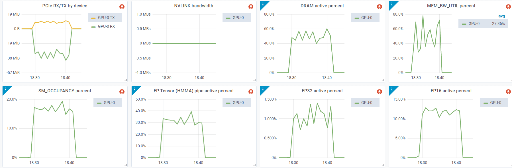

# 排查 NVIDIA GPU 问题 {#troubleshooting-nvidia-gpus}

## 术语表 {#glossary}

- DBE：双比特 ECC 错误（Double Bit ECC Error）
- DCGM：（NVIDIA）数据中心 GPU 管理器（Data Center GPU Manager）
- ECC：纠错码（Error-Correcting Code）
- FB：帧缓冲（Frame Buffer）
- SBE：单比特 ECC 错误（Single Bit ECC Error）
- SDC：静默数据损坏（Silent Data Corruption）

## 错误与诊断 {#errors-and-diagnostics}

另见[诊断崩溃、挂起并跟踪执行](https://github.com/CodingPracticeGroup/ml-engineering/blob/master/debug/pytorch.md#diagnosing-crashes-hangs-and-tracing-execution)，其中介绍了如何从软件一侧诊断崩溃。

### Xid 错误 {#xid-errors}

没有硬件是完美的。由于制造问题或使用中的磨损（尤其是长期暴露在高温之下），GPU 很可能出现各种硬件问题。其中很多问题会被自动纠正，并不需要真正弄清楚发生了什么。如果应用还能继续运行，通常没什么可担心的。如果应用因为硬件问题而崩溃，重要的是弄清楚原因，以及该如何应对。

只使用几块 GPU 的普通用户可能永远不需要了解与 GPU 相关的硬件问题，但只要你的工作接近大规模 ML 训练——那里很可能会用到数百乃至数千块 GPU——你就肯定需要了解各种硬件问题。

在系统日志中，你可能偶尔会看到类似这样的 Xid 错误：

```
NVRM: Xid (PCI:0000:10:1c): 63, pid=1896, Row Remapper: New row marked for remapping, reset gpu to activate.
```

用下面任意一种方法都可以取到这些日志：
```bash
sudo grep Xid /var/log/syslog
sudo dmesg -T | grep Xid
```

通常，只要训练没有崩溃，这些错误往往指示的是那些会被硬件自动纠正的问题。

Xid 错误的完整列表及其解读见[这里](https://docs.nvidia.com/deploy/xid-errors/latest/index.html)。

许多 Xid 日志行包含的字段远比上面那条多，而且十分晦涩。[Xid 31 MMU Faults: What Causes Them and How to Fix Production GPU Crashes](https://www.abhik.ai/articles/gpu-xid31-mmu-faults) 就是一篇教你怎么解读其中一条的好例子：它把 `dmesg` 中一条 Xid 31 日志的每个字段都解码出来——出错的引擎与硬件单元、虚拟地址、`FAULT_PDE` 与 `FAULT_PTE` 的区别、以及访问类型——并顺着它们追到根因：PyTorch、CuPy 和 NVDEC 三个内存分配器之间的 use-after-free（释放后使用）。它也表明并非每个 Xid 都是硬件问题——这一条就是由软件引起的。

NVIDIA 的 [Xid Catalog](https://docs.nvidia.com/deploy/xid-errors/analyzing-xid-catalog.html)（Xid 目录）针对 Ampere 及更新的 GPU 走得更远：它为每个 Xid 列出了哪些 GPU 会记录它、什么会触发它、以及该采取什么措施——既包括需要立即采取的行动（例如 `RESTART_APP` 或 `CONTACT_SUPPORT`），也包括后续行动（例如 `CHECK_APP/CUDA`）。它可以作为电子表格下载，当你想把日志中的 Xid 自动映射为处理动作时会很有用。对于 Xid 13 和 31，该目录称它们通常是应用中的 bug，其首条建议是使用 Compute Sanitizer 的 `memcheck`——如何在 PyTorch 程序上运行它，参见[使用 `compute-sanitizer` 调试 CUDA 内核内存错误](https://github.com/CodingPracticeGroup/ml-engineering/blob/master/debug/pytorch.md#debugging-cuda-kernel-memory-errors-with-compute-sanitizer)。

你可以运行 `nvidia-smi -q`，看看是否报告了任何错误计数。例如在 Xid 63 这种情况中，你会看到类似这样的内容：

```
Timestamp                                 : Wed Jun  7 19:32:16 2023
Driver Version                            : 510.73.08
CUDA Version                              : 11.6

Attached GPUs                             : 8
GPU 00000000:10:1C.0
    Product Name                          : NVIDIA A100-SXM4-80GB
    [...]
    ECC Errors
        Volatile
            SRAM Correctable              : 0
            SRAM Uncorrectable            : 0
            DRAM Correctable              : 177
            DRAM Uncorrectable            : 0
        Aggregate
            SRAM Correctable              : 0
            SRAM Uncorrectable            : 0
            DRAM Correctable              : 177
            DRAM Uncorrectable            : 0
    Retired Pages
        Single Bit ECC                    : N/A
        Double Bit ECC                    : N/A
        Pending Page Blacklist            : N/A
    Remapped Rows
        Correctable Error                 : 1
        Uncorrectable Error               : 0
        Pending                           : Yes
        Remapping Failure Occurred        : No
        Bank Remap Availability Histogram
            Max                           : 639 bank(s)
            High                          : 1 bank(s)
            Partial                       : 0 bank(s)
            Low                           : 0 bank(s)
            None                          : 0 bank(s)
[...]
```

这里我们可以看到，Xid 63 对应的是：

```
ECC page retirement or row remapping recording event
```

它可能有 3 种成因：硬件错误 / 驱动错误 / 帧缓冲（FB）损坏

这个错误意味着某条内存行出了故障，而在重启和/或重置 GPU 之后，将会从 640 条备用内存行（以 A100 为例）中取出一条来替换出问题的那一行。因此我们在上面的报告中看到，只剩 639 个 bank（原本有 640 个）。

上面 `ECC Errors` 报告中的 Volatile 部分，指的是自上次重启 / GPU 重置以来记录的错误。Aggregate 部分则记录自该 GPU 首次使用以来的同类错误。

现在，错误有 2 种类型——可纠正（Correctable）和不可纠正（Uncorrectable）。可纠正的错误是单比特 ECC 错误（SBE），即使内存有故障，驱动仍然能恢复出正确的值。不可纠正的错误是超过一个比特出了故障，称为双比特 ECC 错误（DBE）。通常，如果在同一内存地址发生 1 次 DBE 或 2 次 SBE 错误，驱动会把整个内存页退役。完整信息见[这份文档](https://docs.nvidia.com/deploy/dynamic-page-retirement/index.html)

可纠正错误不会影响应用，不可纠正错误则会让应用崩溃。包含不可纠正 ECC 错误的内存页会被列入黑名单，在 GPU 重置之前都不可访问。

如果有页面被排定退役，你会在 `nvidia-smi -q` 的输出中看到类似这样的内容：

```
    Retired pages
        Single Bit ECC             : 2
        Double Bit ECC             : 0
        Pending Page Blacklist    : Yes
```

每个退役的页面都会减少应用可用的总显存。但退役页面总共最多只有 4MiB，所以对可用 GPU 显存总量的削减并不多。

想进一步深入 GPU 调试，请参考[这份文档](https://docs.nvidia.com/deploy/gpu-debug-guidelines/index.html)——其中有一张很有用的分诊流程图，帮助判断何时应该把 GPU 送去 RMA（返厂维修）。这份文档还包含关于 Xid 63 类错误的额外信息

例如它建议：

> 如果与 XID 94 相关联，则遇到该错误的应用需要重启。系统中的其他所有应用可以继续照常运行，直到有合适的时机进行重启，以使行重映射生效。

如果重启之后，同一内存地址再次出现同样的情况，说明内存重映射失败，会报告 Xid 64。如果重启后仍然反复发生，这块 GPU 就需要 RMA。

发生这种情况时，它会出现在与上面相同的 `Remapped Rows` 块中，只是失败标志被置位，并且有一个 bank 已经用尽了备用行。这正是 [Crusoe Cloud 公布的](https://docs.crusoecloud.com/resources/troubleshooting)符合更换条件的 GPU 特征：

```
Remapped Rows
        Correctable Error                 : 0
        Uncorrectable Error               : 0
        Pending                           : No
        Remapping Failure Occurred        : Yes
        Bank Remap Availability Histogram
            Max                           : 639 bank(s)
            High                          : 0 bank(s)
            Partial                       : 0 bank(s)
            Low                           : 0 bank(s)
            None                          : 1 bank(s)
```

注意，没有任何一行被成功重映射，却记录了失败，并且有一个 bank 处于 `None` 状态——它已经没有可用于重映射的保留行。正是这种组合，把需要更换的 GPU 与只需要重置的 GPU 区分开来。如果只想读取这个块而不是整份报告，请使用 `nvidia-smi -q -d ROW_REMAPPER`。

另一些时候，你可能遇到 Xid 63 或 64 并且应用崩溃，这通常还会产生额外的 Xid 错误，但大多数时候这意味着该错误是不可纠正的（即属于某种 DBE 错误，那时就会是 Xid 48）。

如前所述，要重置 GPU，你可以直接重启机器，或者运行：

```bash
nvidia-smi -r -i gpu_id
```

其中 `gpu_id` 是你想重置的 GPU 的序号，例如第一块 GPU 是 `0`。不带 `-i` 时会重置所有 GPU。

#### 出现“uncorrectable ECC error encountered”错误 {#uncorrectable-ecc-error-encountered}

如果你遇到如下错误：
```
CUDA error: uncorrectable ECC error encountered
```
和上一节一样，检查 `nvidia-smi -q` 的输出、这次寻找 `ECC Errors` 条目，就能知道是哪块 GPU 有问题。但如果你只是想快速检查一下，以便在节点上只要有一块 GPU 有此问题就回收这台节点，你可以直接这样做：

```bash
$ nvidia-smi -q | grep -i correctable | grep -v 0
            SRAM Uncorrectable            : 1
            SRAM Uncorrectable            : 5
```
在一台好的节点上，这应当什么都不返回，因为所有计数器都应为 0。但在上面的示例中我们有一块坏 GPU——之所以有两条结果，是因为完整的记录是：

```
    ECC Errors
        Volatile
            SRAM Correctable              : 0
            SRAM Uncorrectable            : 1
            DRAM Correctable              : 0
            DRAM Uncorrectable            : 0
        Aggregate
            SRAM Correctable              : 0
            SRAM Uncorrectable            : 5
            DRAM Correctable              : 0
            DRAM Uncorrectable            : 0
```
第一条是 `Volatile`（自上次 GPU 驱动重新加载以来计数的错误），第二条是 `Aggregate`（该 GPU 整个生命周期的总错误计数）。在这个示例中，我们看到 SRAM 不可纠正错误的 Volatile 计数是 1，而生命周期计数是 5——也就是说这不是这块 GPU 第一次遇到这个问题了。

这通常对应 Xid 94 错误（参见：[Xid 错误](#xid-errors)，很可能不带 Xid 48）。

要克服这个问题，与上一节一样，重置出问题的 GPU：
```bash
nvidia-smi -r -i gpu_id
```
重启机器也能达到同样的效果。

现在，说到 Aggregate 中的 SRAM 不可纠正错误，如果你的数量超过 4，那通常就是对那块 GPU 申请 RMA 的理由。


### 运行诊断 {#running-diagnostics}

如果你怀疑某台节点上有一块或多块 NVIDIA GPU 坏了，`dcgmi` 是一个能快速找出坏 GPU 的极好工具。

NVIDIA® Data Center GPU Manager（DCGM）的文档见[这里](https://docs.nvidia.com/datacenter/dcgm/latest/user-guide/index.html)，可以从[这里](https://github.com/NVIDIA/DCGM#quickstart)下载。

下面是一个 Slurm 脚本示例，它会运行非常深入的诊断（`-r 3`），在一台 8 GPU 的节点上大约需要 10 分钟才能完成：

```bash
$ cat dcgmi-1n.slurm
#!/bin/bash
#SBATCH --job-name=dcgmi-1n
#SBATCH --nodes=1
#SBATCH --ntasks-per-node=1
#SBATCH --cpus-per-task=96
#SBATCH --gres=gpu:8
#SBATCH --exclusive
#SBATCH --output=%x-%j.out

set -x -e
echo "START TIME: $(date)"
srun --cpus-per-task=$SLURM_CPUS_PER_TASK --output=%x-%j-%N.out dcgmi diag -r 3
echo "END TIME: $(date)"
```

现在要在指定节点上运行它：
```bash
sbatch --nodelist=node-115 dcgmi-1n.slurm
sbatch --nodelist=node-151 dcgmi-1n.slurm
sbatch --nodelist=node-170 dcgmi-1n.slurm
```
把 nodelist 参数改成要运行的节点名。

如果节点处于 drained 或 downed 状态，你无法用这台节点启动 Slurm 作业，那就直接 `ssh` 登录该节点，在节点上直接运行命令：
```bash
dcgmi diag -r 3
```
如果诊断没有发现任何问题，但应用仍然无法工作，就用第 4 级重新运行诊断，这一次需要 1 个多小时才能完成：
```bash
dcgmi diag -r 4
```

脚注：显然，静默数据损坏（SDC）只能用 `dcgmi diag -r 4` 检测，而且即便如此也可能漏掉一些。这个问题偶尔会发生，你甚至可能意识不到你的 GPU 时不时会把 `matmul` 算错。我很确定我们遇到过这种情况，因为训练时我们会看到奇怪的异常现象，我和 NVIDIA 团队花了很多天诊断这个问题，但没能诊断出来——后来问题消失了，很可能是因为那几块坏 GPU 因上报的故障而被更换了。

例如，如果你遇到反复出现的 Xid 64 错误，诊断报告很可能会包含：

```
+---------------------------+------------------------------------------------+
| Diagnostic                | Result                                         |
+===========================+================================================+
|-----  Deployment  --------+------------------------------------------------|
| Error                     | GPU 3 has uncorrectable memory errors and row  |
|                           |  remappings are pending                        |
```

于是你现在知道了：如果重映射失败，就应该对那块有问题的 GPU 申请 RMA。

但实际上，我发现大多数时候 `-r 2` 就已经能检测到有故障的 GPU，而且它只需要几分钟就能完成。下面是在一台有故障的节点上 `-r 2` 输出的示例：

```
| GPU Memory                | Pass - GPUs: 1, 2, 3, 4, 5, 6, 7               |
|                           | Fail - GPU: 0                                  |
| Warning                   | GPU 0 Thermal violations totaling 13.3 second  |
|                           | s started at 9.7 seconds into the test for GP  |
|                           | U 0 Verify that the cooling on this machine i  |
|                           | s functional, including external, thermal mat  |
|                           | erial interface, fans, and any other componen  |
|                           | ts.
```

`dcgmi` 工具还包含其他多种级别的诊断，其中一些几分钟就能完成，可以作为快速诊断放在 SLURM 作业的收尾脚本（epilogue）里运行，以确保节点已准备好为下一个 SLURM 作业服务，而不是等用户启动了作业、作业崩了之后才发现。

提交 RMA 报告时，你会被要求运行 `nvidia-bug-report.sh` 脚本，你需要把它的输出连同 RMA 申请一起提交。

我通常也会用下面某条命令顺手把日志保存下来，以备日后查阅：
```bash
dcgmi diag -r 2 | tee -a dcgmi-r2-`hostname`.txt
dcgmi diag -r 3 | tee -a dcgmi-r3-`hostname`.txt
dcgmi diag -r 4 | tee -a dcgmi-r4-`hostname`.txt
```

## 健康检查与设备盘点 {#health-and-inventory-checks}

### 如何获取 VBIOS 信息 {#how-to-get-the-vbios-info}

在排查问题时，GPU 的 VBIOS 版本可能很重要。我们把名称和总线 id 加入查询，得到：

```bash
$ nvidia-smi --query-gpu=gpu_name,gpu_bus_id,vbios_version --format=csv
name, pci.bus_id, vbios_version
NVIDIA H100 80GB HBM3, 00000000:04:00.0, 96.00.89.00.01
[...]
NVIDIA H100 80GB HBM3, 00000000:8B:00.0, 96.00.89.00.01
```

提示：要查询其他几十种信息，运行：
```bash
nvidia-smi --help-query-gpu
```

### 如何检查你的 GPU 支持哪一代 PCIe {#how-to-check-if-your-gpus-pcie-generation-is-supported}

从系统的启动消息中查看 PCIe 带宽报告：

```bash
$ sudo dmesg | grep -i 'limited by'
[   10.735323] pci 0000:04:00.0: 252.048 Gb/s available PCIe bandwidth, limited by 16.0 GT/s PCIe x16 link at 0000:01:00.0 (capable of 504.112 Gb/s with 32.0 GT/s PCIe x16 link)
[...]
[   13.301989] pci 0000:8b:00.0: 252.048 Gb/s available PCIe bandwidth, limited by 16.0 GT/s PCIe x16 link at 0000:87:00.0 (capable of 504.112 Gb/s with 32.0 GT/s PCIe x16 link)
```

在这个示例中，由于 PCIe 5 规格是 504Gbps，你可以看到这台节点上只有一半的可能带宽可用，因为 PCIe 交换机是 gen4（第 4 代）。有关 PCIe 规格的说明见[这里](https://github.com/CodingPracticeGroup/ml-engineering/blob/master/network/README.md#pcie)。

由于你的 GPU 之间很可能由 [NVLink](https://github.com/CodingPracticeGroup/ml-engineering/blob/master/network/README.md#nvlink) 互相连接，这对 GPU 之间的通信应该没有影响；但它会拖慢 GPU 与主机之间的任何数据搬运，因为数据传输速度受最慢链路的限制。


### 如何检查 NVLink 链路的错误计数器 {#how-to-check-error-counters-of-nvlink-links}

如果你担心 NVLink 工作不正常，可以检查它的错误计数器：
```bash
$ nvidia-smi nvlink -e
GPU 0: NVIDIA H100 80GB HBM3 (UUID: GPU-abcdefab-cdef-abdc-abcd-abababababab)
         Link 0: Replay Errors: 0
         Link 0: Recovery Errors: 0
         Link 0: CRC Errors: 0

         Link 1: Replay Errors: 0
         Link 1: Recovery Errors: 0
         Link 1: CRC Errors: 0

         [...]

         Link 17: Replay Errors: 0
         Link 17: Recovery Errors: 0
         Link 17: CRC Errors: 0
```

另一个有用的命令是：
```bash
$ nvidia-smi nvlink --status
GPU 0: NVIDIA H100 80GB HBM3 (UUID: GPU-abcdefab-cdef-abdc-abcd-abababababab)
         Link 0: 26.562 GB/s
         [...]
         Link 17: 26.562 GB/s
```
这条会告诉你每条链路的当前速度

运行 `nvidia-smi nvlink -h` 可以发现更多功能（报告信息、重置计数器等）。


### 如何检查 GPU 显存行重映射的健康状况 {#how-to-check-gpu-memory-row-remapping-health}

行重映射是 Ampere 及之后的 GPU 处理已经损坏的内存的方式——一个正在退化的 bank 行会被同一个 HBM bank 为此预留的备用行之一替换。它是 [NVIDIA 用来取代早期世代所用页面退役机制](https://docs.nvidia.com/deploy/a100-gpu-mem-error-mgmt/latest/row-remapping.html)的方案，并且预算大得多：帧缓冲最多可重映射 512 行，而此前只能退役 64 页。[Xid 错误](#xid-errors)介绍了 GPU 抛出 Xid 63 或 64 之后这会是什么样子——本节讲的是主动去检查它，趁作业还没挂掉。

那一节是从 `nvidia-smi -q` 中读取状态，它对每块 GPU 都会打印很长一个块。如果要检查整台节点，有一个 CSV 查询，改为每块 GPU 只输出一行：

```bash
$ nvidia-smi --query-remapped-rows=gpu_name,gpu_bus_id,remapped_rows.failure,remapped_rows.pending,remapped_rows.correctable,remapped_rows.uncorrectable --format=csv
gpu_name, gpu_bus_id, remapped_rows.failure, remapped_rows.pending, remapped_rows.correctable, remapped_rows.uncorrectable
NVIDIA H200, 00000000:59:00.0, No, No, 0, 0
[...]
NVIDIA H200, 00000000:A5:00.0, No, No, 0, 0
```

这就是一台健康的节点——没有失败，没有待处理事项，没有行被重映射。想看看另一头的样子，[Xid 错误](#xid-errors)展示了一块行重映射已经失败的 GPU 的同样字段。解读一份不全是 `No` 和 `0` 的报告时：

- `correctable` 和 `uncorrectable` 统计的是已经被重映射的行数，前者是在反复出现 SBE 之后重映射的，后者是在出现一次 DBE 之后重映射的。计数非零本身并不是把 GPU 撤出服务的理由——这说明备用机制尽到了职责。
- `pending: Yes` 表示已经决定进行一次重映射，但在 GPU 重置之前不会生效；它并不会让正在运行的作业有碰到那个坏存储单元的风险。不过它确实会改变那块 GPU 可用的显存量：当触发原因是不可纠正错误时，驱动会立即把包含它的页下线，而这个页会一直被排除在可分配池之外，直到重置在硬件中完成行重映射、把地址空间交还——所以一个按填满 HBM 来定规模的作业，可能开始在这块 GPU 上遇到 OOM，而放到健康 GPU 上却还放得下。
- `failure: Yes` 表示尝试过重映射但没有成功。这一项才是意味着要 RMA、而不是重置后归还的情况。

如果你想把这些字段与其他每块 GPU 的列放在一起，`--query-gpu` 也提供同样的字段，例如 `nvidia-smi --query-gpu=gpu_bus_id,remapped_rows.pending,remapped_rows.failure --format=csv`。

提示：要查看完整字段列表（包括 `remapped_rows.sbe`/`.dbe` 别名），运行：
```bash
nvidia-smi --help-query-remapped-rows
```


### 如何检测节点是否缺少 GPU {#how-to-detect-if-a-node-is-missing-gpus}

如果你拿到一台新的 VM，偶尔会出现 GPU 数量少于预期的情况。下面是一种快速检验你是否确实拿到了 8 块 GPU 的方法：

```bash
cat << 'EOT' >> test-gpu-count.sh
#!/bin/bash

set -e

# 测试该节点有 8 块 GPU
test $(nvidia-smi -q | grep UUID | wc -l) != 8 && echo "broken node: not exactly 8 gpus" && false
EOT
```
然后：

```bash
bash test-gpu-count.sh
```


### 如何检测是否一再拿到同一台故障节点 {#how-to-detect-if-you-get-the-same-broken-node-again-and-again}

这主要与租用 GPU 节点的云用户有关。

假设你启动了一台新的虚拟机，发现它有一块或多块坏掉的 NVIDIA GPU。你把它丢弃，又启动了一台新的，结果 GPU 又是坏的。

很可能你拿到的是同一台节点和同样那几块坏 GPU。下面是怎么确认这一点。

在丢弃当前节点之前，运行下面的命令并记录输出：

```bash
$ nvidia-smi -q | grep UUID
    GPU UUID                              : GPU-2b416d09-4537-ecc1-54fd-c6c83a764be9
    GPU UUID                              : GPU-0309d0d1-8620-43a3-83d2-95074e75ec9e
    GPU UUID                              : GPU-4fa60d47-b408-6119-cf63-a1f12c6f7673
    GPU UUID                              : GPU-fc069a82-26d4-4b9b-d826-018bc040c5a2
    GPU UUID                              : GPU-187e8e75-34d1-f8c7-1708-4feb35482ae0
    GPU UUID                              : GPU-43bfd251-aad8-6e5e-ee31-308e4292bef3
    GPU UUID                              : GPU-213fa750-652a-6cf6-5295-26b38cb139fb
    GPU UUID                              : GPU-52c408aa-3982-baa3-f83d-27d047dd7653
```

这些 UUID 对每块 GPU 都是唯一的。

当你重新创建 VM 之后，再运行一次这条命令——如果 UUID 相同——你就知道拿到的还是那几块坏 GPU。

要把这个过程自动化、让这份数据始终在手边（如果你已经重启了 VM 就来不及了），在你的启动流程中的某处加上：

```bash
nvidia-smi -q | grep UUID > nvidia-uuids.$(hostname).$(date '+%Y-%m-%d-%H:%M').txt
```

你会希望把日志文件保存在某个持久文件系统上，以便它能在重启后留存。如果没有持久文件系统，就把它保存在本地并立即复制到云上。这样在你需要它的时候，它总会在那里。

有时候仅仅重启节点就能拿到新硬件。有些情况下几乎每次重启都会拿到新硬件，另一些情况下则不会。而且这种行为可能因云服务商而异。

如果你总是拿到同一台坏节点——一个应对办法是：在让坏 VM 保持运行的同时分配一台新 VM，等新 VM 运行起来之后，再丢弃那台坏的。这样你肯定能拿到新的 GPU——只是无法保证它们也不会是坏的。如果用例合适，考虑使用静态集群，在那里更容易让硬件保持良好的状态。

当 GPU 不是立刻出问题、而是在使用一段时间之后才出问题时，这种方法就格外关键，因为那时不容易看出有问题。即使你把这台节点上报给了云服务商，技术人员也可能不会马上发现问题，又把坏节点放回归环。所以如果你用的不是静态集群、而是按需随机拿到 VM，你可能希望保存一份坏 UUID 的日志，好让自己一拿到节点就知道它是“柠檬机”（次品），而不是在节点已经用了 10 个小时之后才发现。

云服务商通常都有上报坏节点的机制。因此，除了丢弃坏节点之外，上报坏节点对你自己和其他用户都是有帮助的。因为大多数时候用户只是丢弃坏节点，下一个用户就会拿到它们。我见过在某些情况下，用户拿到坏节点的比例非常高。


## 指标 {#metrics}

### 如何获取真实的 GPU 利用率指标 {#how-to-get-the-real-gpu-utilization-metrics}

正如[这里](https://arthurchiao.art/blog/understanding-gpu-performance/)所解释的，`nvidia-smi` 输出中的 `GPU-Util` 列并不是在告诉你 GPU 利用率。它告诉你的是：有一或多个内核在 GPU 上执行的时间所占的百分比。它不会告诉你是一个 SM（流式多处理器）被用上了还是全部都在被使用。所以即使你一直只运行一个很小的 `matmul`，你也可能看到非常高的 GPU 利用率，而 GPU 的绝大部分其实什么都没做。

脚注：我曾看到，当一块 GPU 停止响应时，所有 GPU 的 GPU util 列都显示 100%，整个机器都阻塞在等待那块 GPU 响应。我就是由此发现，它显示的根本不可能是真正的 GPU 利用率。

你真正应该度量的，是 GPU 对可用容量的利用程度，也就是所谓的“饱和”（saturation）。可惜，`nvidia-smi` 并不提供这个信息。要获得这些信息，你需要安装 [dcgm-exporter](https://github.com/NVIDIA/dcgm-exporter)（而它目前反过来需要一个较新的 golang、DCGM（`datacenter-gpu-manager`）以及 root 权限）。

请注意，这个工具只对高端数据中心级 NVIDIA GPU 有效，如果你的 GPU 是消费级的，它就不管用。

安装好前置依赖后，我构建了该工具：
```bash
git clone https://github.com/NVIDIA/dcgm-exporter.git
cd dcgm-exporter
make binary
```

然后，借助下面这个 `dcgm-exporter` 配置文件，我就能够到文中所描述的“真实”利用率指标：

```bash
$ cat << EOT > dcp-metrics-custom.csv
DCGM_FI_PROF_SM_OCCUPANCY,       gauge, The ratio of number of warps resident on an SM.
DCGM_FI_PROF_PIPE_TENSOR_ACTIVE, gauge, Ratio of cycles the tensor (HMMA) pipe is active.
DCGM_FI_PROF_PIPE_FP16_ACTIVE,   gauge, Ratio of cycles the fp16 pipes are active.
DCGM_FI_PROF_PIPE_FP32_ACTIVE,   gauge, Ratio of cycles the fp32 pipes are active.
EOT
```

然后我启动了守护进程（需要 root）：
```bash
$ sudo cmd/dcgm-exporter/dcgm-exporter -c 500 -f dcp-metrics-custom.csv
[...]
INFO[0000] Starting webserver
INFO[0000] Listening on                                  address="[::]:9400"
```

`-c 500` 表示每 0.5 秒刷新一次

现在我可以这样轮询它：
```bash
watch -n 0.5 "curl http://localhost:9400/metrics"
```
在一个终端里运行它，同时在另一个终端里启动一个 GPU 负载。输出的最后一列是这些指标的利用率（其中 `1.0 == 100%`）。

仓库里的 `etc/dcp-metrics-included.csv` 包含所有可用的指标，你可以据此添加更多指标。

这是一种快捷做法，但它的本意是与 [Prometheus](https://prometheus.io/) 配合使用，后者能给你画出漂亮的图表。例如，那篇文章中包含一个示例，你可以在图表的第二行看到 SM 占用率、Tensor core、FP16 和 FP32 核心的利用率：



（[来源](https://arthurchiao.art/blog/understanding-gpu-performance/)）

为完整起见，下面是同一篇文章中的另一个示例：GPU 利用率为 100%，而那个 CUDA 内核在计算上什么都没做，只是占用了一个流式多处理器（SM）：

```bash
$ cat << EOT > 1_sm_kernel.cu
__global__ void simple_kernel() {
    while (true) {}
}

int main() {
    simple_kernel<<<1, 1>>>();
    cudaDeviceSynchronize();
}
EOT
```

我们来编译它：
```bash
nvcc 1_sm_kernel.cu -o 1_sm_kernel
```
现在在终端 A 中运行：
```bash
$ ./1_sm_kernel
```
然后在终端 B 中：
```bash
$ nvidia-smi
Tue Oct  8 09:49:34 2024
+-----------------------------------------------------------------------------------------+
| NVIDIA-SMI 550.90.12              Driver Version: 550.90.12      CUDA Version: 12.4     |
|-----------------------------------------+------------------------+----------------------+
| GPU  Name                 Persistence-M | Bus-Id          Disp.A | Volatile Uncorr. ECC |
| Fan  Temp   Perf          Pwr:Usage/Cap |           Memory-Usage | GPU-Util  Compute M. |
|                                         |                        |               MIG M. |
|=========================================+========================+======================|
|   0  NVIDIA A100 80GB PCIe          Off |   00000000:01:00.0 Off |                    0 |
| N/A   32C    P0             69W /  300W |     437MiB /  81920MiB |    100%      Default |
|                                         |                        |             Disabled |
```

你可以看到 `100%` 的 GPU-Util。所以这里只用了 1 个 SM，而 A100-80GB PCIe 有 108 个 SM！而且它甚至没有任何计算，只是在跑一个什么都不做的无限循环。
