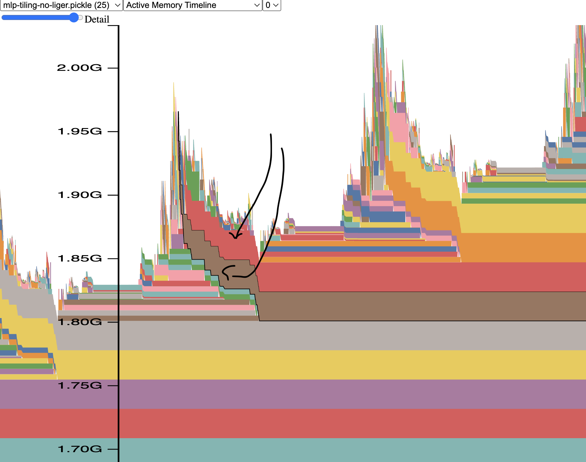
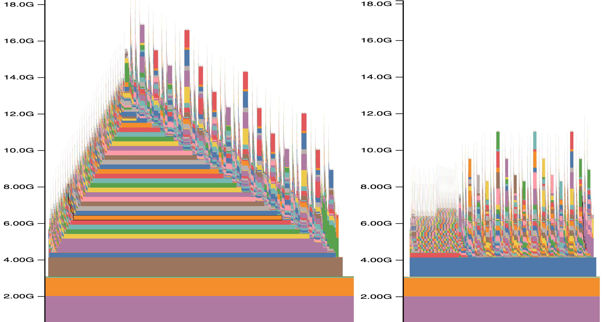
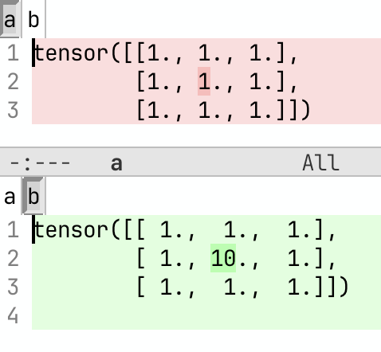

# 调试 PyTorch 程序 {#debugging-pytorch-programs}

## 快速调试 PyTorch 模型 {#fast-debug-of-pytorch-models}

### 用微型模型、分词器和数据集加快调试与开发 {#faster-debug-and-development-with-tiny-models-tokenizers-and-datasets}

如果你一边调试问题，一边用完整尺寸的模型和分词器做开发，那么你的工作方式很可能并不高效。这不仅会让问题更难解决，光是等待程序重启、跑到你想要的位置，就可能耗费大量时间——日积月累，这会极大地消磨一个人的积极性和生产力，更不用说解决问题本身要花长得多的时间，甚至可能根本解决不了。

解决办法很简单：

**除非你是在测试模型的质量，否则始终使用随机的微型模型，必要时搭配微型分词器。**

此外，大模型往往需要海量资源，这些资源通常价格不菲，还会让调试过程变得极其复杂。例如，任何调试器都能处理单个进程，但如果你的模型放不进去、需要某种依赖多进程的[并行化](../training/model-parallelism/README.md)，大多数调试器要么直接失效，要么给不出你想要的结果。理想的开发环境是单进程，而微型模型保证能放进哪怕是最便宜、最小的单张消费级 GPU。如果手边没有 GPU，你甚至可以在紧要关头用免费的 [Google Colab](https://colab.research.google.com/) 来做开发。

所以，更新后的 ML 开发箴言就变成了：

- 模型越大，最终产品生成的质量越好
- 模型越小，最终产品的训练就能越快开始

脚注：近期研究表明更大并不总是更好，但这样表述足以传达我想强调的重点。

一旦代码能跑通了，就要切换到真实模型来测试你的生成质量。但即使在这种情况下，也应先尝试能产出合格结果的最小模型。只有当你看到生成的结果大体正确时，才用最大的模型来检验你的工作是否万无一失。

#### 制作微型模型 {#making-a-tiny-model}

重要：鉴于 HF [`transformers`](https://github.com/huggingface/transformers/) 模型的流行程度以及设计精良、简洁的 API，我将以它家的模型为例来讨论。但同样的原则可以套用到任何其它模型上。

太长不看（TLDR）：制作一个微型 HF `transformers` 模型轻而易举：

1. 获取一个完整尺寸模型的 config 对象
2. 缩小 hidden size（隐藏维度），也许还有其它几个对模型体量贡献最大的参数
3. 用这份缩小后的 config 创建模型
4. 保存这个模型。完成！

脚注：务必记住，这样生成的是一个随机模型，所以不要指望它的输出有任何质量可言。

脚注：这些说明是以 HF Transformers 模型为前提写的。如果你使用的是其它建模库，可能需要对其中一些做法做些调整。

现在我们来看实际的代码，把 ["google/mt5-small"](https://huggingface.co/google/mt5-small/tree/main) 转换成它的微型随机版本。

```python
from transformers import MT5Config, MT5ForConditionalGeneration

mname_from = "google/mt5-small"
mname_very_small = "mt5-tiny-random"

config = MT5Config.from_pretrained(mname_from)

config.update(dict(
    d_model=64,
    d_ff=256,
))
print("new config", config)

very_small_model = MT5ForConditionalGeneration(config)
print(f"num of params {very_small_model.num_parameters()}")

very_small_model.save_pretrained(mname_very_small)
```

如你所见，这做起来轻而易举。如果你不需要 hidden size 至少为 64，还可以把它做得更小，比如试试 8——你只需要确保注意力头的数量不大于 hidden size。

另外请注意，做这件事不需要任何 GPU，你甚至可以在像 [BLOOM-176B](https://huggingface.co/bigscience/bloom) 这样巨大的 176B 参数模型上做这件事。因为你从头到尾都不会加载真正的原始模型，只会加载它的 config 对象。

在修改 config 之前，你可以先把原始参数打印出来，然后选择缩小更多维度。例如，使用更少的层能让它更小、也更容易调试。所以你也可以改成这样：

```
config.update(dict(
    d_model=64,
    d_ff=256,
    d_kv=8,
    num_layers=8,
    num_decoder_layers=8,
    num_heads=4,
    relative_attention_num_buckets=32,
))
```

注意，这个编码器-解码器模型两个层数都要设置。只有在没有设置 `num_decoder_layers` 时，它才会回退去用 `num_layers`，而从真实检查点加载的 config 里它已经是设好的，所以只削减 `num_layers` 会让解码器保持原来的完整深度。其它编码器-解码器架构的拆分方式不同——BART、Marian、Pegasus 和 Whisper 把这一对命名为 `encoder_layers` 和 `decoder_layers`——但规则是相同的：两者都要缩小。

原始的 ["google/mt5-small"](https://huggingface.co/google/mt5-small/tree/main) 模型文件有 1.2GB。做了上述改动（再加上后面几节介绍的词表缩减）之后，我们把它降到了 126MB。

如果你处理的是多层嵌套的 config，就得分别更新每一层的子 config 对象。例如在 [IDEFICS](https://huggingface.co/HuggingFaceM4/idefics-9b/blob/main/config.json) 中，有 1 个主对象和 2 个嵌套对象：
```
config
config.perceiver_config
config.vision_config
```
如果你想缩小这个模型，就要用更小的值来更新 `config` 和 `config.vision_config`：
```
config.update(dict(
    hidden_size=64,
    intermediate_size=37,
    num_hidden_layers=5,
    num_attention_heads=4,
    max_position_embeddings=64,
    max_sequence_length=64,

))
# 子对象需要直接更新
config.vision_config.update(dict(embed_dim=64))
```
完整可运行的脚本见 [idefics-make-tiny-model.py](tiny-scripts/idefics-make-tiny-model.py)（我没有费心加上词表缩减，因为这里只是想演示如何更新嵌套的 config 对象）。

还有一个相关的陷阱：交错排布不同块类型的架构，会在一个 `layer_types` 列表里把这种模式逐层写出来，每层一个条目。[Qwen/Qwen-AgentWorld-35B-A3B](https://huggingface.co/Qwen/Qwen-AgentWorld-35B-A3B/blob/main/config.json#L19) 除了 `"num_hidden_layers": 40` 之外，还带着 40 个 `linear_attention`/`full_attention` 条目，两者必须一起削减——并且，和上面的嵌套情形一样，这两个键都位于 `text_config` 之下。

两者不匹配会导致两种不同的失败方式。保存缩小后的 config 再把它加载回来，它会直接拒绝：

```
StrictDataclassClassValidationError: Class validation error for validator 'validate_layer_type':
    ValueError: `num_hidden_layers` (2) must be equal to the number of `layer_types` (40)
```

而如果只是修改内存中的 config 对象，则什么异常都不会抛出——模型会悄悄地用那个未改动列表的前 2 个条目构建出你的 2 层，而这个模型的 full attention 块直到索引 3 才第一次出现，于是你得到的是两个 linear-attention 层，完全没有你想保留的那种块。所以要同步等比地削减这个列表：

```python
config.text_config.update(dict(
    num_hidden_layers=4,
    layer_types=config.text_config.layer_types[:4],
))
```

如果你是直接编辑 `config.json`，也可以改为删掉 `layer_types` 条目，让 config 在新的层数下根据 `full_attention_interval` 重新生成这种模式。无论用哪种方式，都要选一个能覆盖这种模式一整个周期的层数——对这个模型来说是 4 层而不是 2 层——否则你想保留的那种变化就消失了。

我们还可以在保存之前把模型转换成 fp16 或 bf16（视目标而定），从而把微型模型的体积再缩小一半：

```
very_small_model.half() # 转换为 fp16
#very_small_model.bfloat16() # 转换为 bf16
very_small_model.save_pretrained(mname_very_small)
```
这样就把文件降到了 64MB。

做到这里就可以停下来了，你的程序启动速度已经会快得多得多。

而要让它真正做到“微型”，还可以再走一步。

到目前为止我们还没有缩减词表维度，所以 64x250k（hidden*vocab）仍然很大。诚然，这个 250k 词表的模型并不典型——通常模型词表约为 30-50k，但就算只有 30k，对于想要真正微型的模型来说也仍然太多了。

接下来我们会研究各种缩减分词器的技术，因为分词器决定了词表大小。

#### 制作微型分词器 {#making-a-tiny-tokenizer}

取决于底层的分词器，这项任务的难度会从相对简单的流程到复杂得多的工序不等。

下面这些做法出自 HuggingFace 的几位出色的分词器专家，我又按照自己的需求做了改编。

在真正用到它们之前，你多半不需要理解它们是如何工作的，所以如果你是第一次读到这里，可以放心跳过这些做法，直接去看[用微型分词器制作微型模型](#making-a-tiny-model-with-a-tiny-tokenizer)。

##### Anthony Moi 的版本 {#anthony-mois-version}

[Anthony Moi](https://github.com/n1t0) 的分词器缩减器：

```python
import json
from transformers import AutoTokenizer
from tokenizers import Tokenizer

vocab_keep_items = 5000
mname = "microsoft/deberta-base"

tokenizer = AutoTokenizer.from_pretrained(mname, use_fast=True)
assert tokenizer.is_fast, "This only works for fast tokenizers."
tokenizer_json = json.loads(tokenizer._tokenizer.to_str())
vocab = tokenizer_json["model"]["vocab"]
if tokenizer_json["model"]["type"] == "BPE":
    new_vocab = { token: i for token, i in vocab.items() if i < vocab_keep_items }
    merges = tokenizer_json["model"]["merges"]
    new_merges = []
    for i in range(len(merges)):
        a, b = merges[i].split()
        new_token = "".join((a, b))
        if a in new_vocab and b in new_vocab and new_token in new_vocab:
            new_merges.append(merges[i])
    tokenizer_json["model"]["merges"] = new_merges
elif tokenizer_json["model"]["type"] == "Unigram":
    new_vocab = vocab[:vocab_keep_items]
elif tokenizer_json["model"]["type"] == "WordPiece" or tokenizer_json["model"]["type"] == "WordLevel":
    new_vocab = { token: i for token, i in vocab.items() if i < vocab_keep_items }
else:
    raise ValueError(f"don't know how to handle {tokenizer_json['model']['type']}")
tokenizer_json["model"]["vocab"] = new_vocab
tokenizer._tokenizer = Tokenizer.from_str(json.dumps(tokenizer_json))
tokenizer.save_pretrained(".")
```

我后来发现，gpt2 似乎有一个特殊词元 `"<|endoftext|>"` 被藏在词表的最末尾，所以它会被丢掉，代码随之出错。于是我变通地把它加了回去：
```python
if "gpt2" in mname:
        new_vocab = { token: i for token, i in vocab.items() if i < vocab_keep_items-1 }
        new_vocab["<|endoftext|>"] = vocab_keep_items-1
    else:
        new_vocab = { token: i for token, i in vocab.items() if i < vocab_keep_items }
```

##### Lysandre Debut 的版本 {#lysandre-debuts-version}

[Lysandre Debut](https://github.com/LysandreJik) 的使用 `train_new_from_iterator` 的缩减器：

```python
from transformers import AutoTokenizer

mname = "microsoft/deberta-base" # 或任何带有 fast tokenizer 的检查点。
vocab_keep_items = 5000

tokenizer = AutoTokenizer.from_pretrained(mname)
assert tokenizer.is_fast, "This only works for fast tokenizers."
tokenizer.save_pretrained("big-tokenizer")
# 应当是一个文本列表的生成器。
training_corpus = [
    ["This is the first sentence.", "This is the second one."],
    ["This sentence (contains #) over symbols and numbers 12 3.", "But not this one."],
]
new_tokenizer = tokenizer.train_new_from_iterator(training_corpus, vocab_size=vocab_keep_items)
new_tokenizer.save_pretrained("small-tokenizer")
```
但这个做法需要一个训练语料，于是我想取个巧：直接用分词器自己的原始词表来训练新分词器，结果得到了：

```python
from transformers import AutoTokenizer

mname = "microsoft/deberta-base"
vocab_keep_items = 5000

tokenizer = AutoTokenizer.from_pretrained(mname)
assert tokenizer.is_fast, "This only works for fast tokenizers."
vocab = tokenizer.get_vocab()
training_corpus = [ vocab.keys() ] # 应当是一个文本列表的生成器。
new_tokenizer = tokenizer.train_new_from_iterator(training_corpus, vocab_size=vocab_keep_items)
new_tokenizer.save_pretrained("small-tokenizer")
```

这几乎完美，只是它现在不再有每个词/字符的频率信息（大多数分词器正是这样计算词表的；如果你需要这个信息，可以这样修复：让每个键出现 `len(vocab) - ID times`，即：

```
training_corpus = [ (k for i in range(vocab_len-v)) for k,v in vocab.items() ]
```
这会让脚本的完成时间变得长得多得多。

但对微型模型（测试）的需求来说，频率根本无关紧要。


##### 直接修改分词器文件的做法 {#hack-the-tokenizer-file-approach}

有些分词器可以直接在文件层面手动截断。例如，把 Llama2 的分词器缩减到 3k 个词条：

```python
# 缩减原始词表以保持体积小巧（只需大到能给任意单词分词即可，也就是字母+符号）
# ElectraTokenizerFast 完全由 tokenizer.json 定义，其中包含词表和 id，
# 所以我们只要明智地把截断位置选好就行
import subprocess
import shlex
from transformers import LlamaTokenizerFast

mname = "meta-llama/Llama-2-7b-hf"
vocab_keep_items = 3000

tokenizer_fast = LlamaTokenizerFast.from_pretrained(mname)
tmp_dir = f"/tmp/{mname}"
tokenizer_fast.save_pretrained(tmp_dir)
# 调整 tokenizer.json 的大小（vocab.txt 会在 save_pretrained 时自动调整）
# perl  -0777 -pi -e 's|(2999).*|$1},"merges": []}}|msg' tokenizer.json # 索引从 0 开始，所以是 vocab_keep_items-1！
closing_pat = '},"merges": []}}'
cmd = (f"perl -0777 -pi -e 's|({vocab_keep_items-1}).*|$1{closing_pat}|msg' {tmp_dir}/tokenizer.json")
#print(f"Running:\n{cmd}")
result = subprocess.run(shlex.split(cmd), capture_output=True, text=True)
# 用修改后的分词器重新加载
tokenizer_fast_tiny = LlamaTokenizerFast.from_pretrained(tmp_dir)
tokenizer_fast_tiny.save_pretrained(".")
```
请记住，其结果只适用于功能性测试，不适合质量方面的工作。

这里给出同时包含模型和分词器缩减的完整版本 [make_tiny_model.py](https://huggingface.co/stas/tiny-random-llama-2/blob/main/make_tiny_model.py)。


##### SentencePiece 词表缩减 {#sentencepiece-vocab-shrinking}

先把 SentencePiece 克隆到一个父目录中：
```bash
git clone https://github.com/google/sentencepiece
```
下面开始缩减：
```python
# 绕过 fast tokenizer 的 protobuf 问题的变通办法，而且这样也快得多！
os.environ["PROTOCOL_BUFFERS_PYTHON_IMPLEMENTATION"] = "python"

from transformers import XLMRobertaTokenizerFast

mname = "xlm-roberta-base"

# 缩减原始词表以保持体积小巧
vocab_keep_items = 5000
tmp_dir = f"/tmp/{mname}"
vocab_orig_path = f"{tmp_dir}/sentencepiece.bpe.model" # 这个名字可能不同
vocab_short_path = f"{tmp_dir}/spiece-short.model"
# HACK：需要 sentencepiece 源码才能得到 sentencepiece_model_pb2，因为它不会被安装
sys.path.append("../sentencepiece/python/src/sentencepiece")
import sentencepiece_model_pb2 as model
tokenizer_orig = XLMRobertaTokenizerFast.from_pretrained(mname)
tokenizer_orig.save_pretrained(tmp_dir)
with open(vocab_orig_path, 'rb') as f: data = f.read()
# 改编自 https://blog.ceshine.net/post/trim-down-sentencepiece-vocabulary/
m = model.ModelProto()
m.ParseFromString(data)
print(f"Shrinking vocab from original {len(m.pieces)} dict items")
for i in range(len(m.pieces) - vocab_keep_items): _ = m.pieces.pop()
print(f"new dict {len(m.pieces)}")
with open(vocab_short_path, 'wb') as f: f.write(m.SerializeToString())
m = None

tokenizer_fast_tiny = XLMRobertaTokenizerFast(vocab_file=vocab_short_path)
tokenizer_fast_tiny.save_pretrained(".")
```


#### 用微型分词器制作微型模型 {#making-a-tiny-model-with-a-tiny-tokenizer}

现在你可以把词表大小缩减到分词器允许的最小值，也就是说，你至少要有足够的词元来覆盖目标字符表和特殊字符，而通常 3-5k 个词元就绰绰有余了。有时你甚至可以做得更小，毕竟原始的 ASCII 字符集也只有 128 个字符。

如果接着本章前面 MT5 的代码继续往下做，加上上一节的分词器缩减代码，我们就得到了这个脚本 [mt5-make-tiny-model.py](https://huggingface.co/stas/mt5-tiny-random/blob/main/mt5-make-tiny-model.py)，运行它之后，最终的模型文件真正做到微型——只有 3.34MB！如你所见，脚本中还有一段代码用来验证模型确实能配合修改后的分词器工作。输出的结果会是垃圾，但目的是检验新模型和分词器在功能上是可用的。

这里还有一个例子 [fsmt-make-super-tiny-model.py](https://huggingface.co/stas/tiny-wmt19-en-ru/blob/main/fsmt-make-super-tiny-model.py)——在这里你可以看到我是从零开始创建一个全新的微型词表。

我还建议始终把构建脚本和模型一起保存，这样你就能快速修复问题，或者制作该模型的类似版本。

另外要注意，由于 HF `transformers` 自身的测试就需要微型模型，你很可能会在 https://huggingface.co/hf-internal-testing 上直接找到每种架构现成的微型模型（只是他们没有附上制作这些模型的代码，不过你现在可以根据这些说明自己弄清楚）。

另一个提示：如果你需要一个略有不同的微型模型，也可以从一个已有的微型模型出发去改造它。由于它本来就是随机模型，实际上只要把维度弄对就行。例如，你找到的微型模型只有 2 层而你需要 8 层，那就用这个更大的维度重新保存一遍它，事情就完成了。


#### 制作微型数据集 {#making-a-tiny-dataset}

和模型、分词器一样，为你经常使用的数据集准备一个趁手的微型版本也很有帮助。和往常一样，这对质量测试没有帮助，但非常适合作为让程序极快启动的手段。

脚注：如果你使用的是已经预建索引的 Arrow 文件数据集，使用微型数据集带来的收益不会像使用微型模型那么显著，因为那些数据集本身已经快得离谱。但比如说，你想让迭代器在 10 步内跑完一个 epoch。与其修改代码来截断数据集，你可以直接改用一个微型数据集。

制作微型数据集这件事比较难讲清楚，因为它取决于原始数据集的构建方式，彼此之间可能差别很大，但也许你可以把我的这些做法对应到你自己的数据集上。

不过概念仍然非常简单：

1. 克隆完整数据集的 git 仓库
2. 用只包含少量样本的微型数据 tar 包，替换其中的完整数据 tar 包
3. 把微型成果发布为 Hub 无需自定义脚本即可加载的数据文件（Parquet、Arrow、JSON/JSONL、CSV，或图像/文本文件夹），再加一张数据集卡片——完成！

脚注：从 [`datasets` 4.0](https://github.com/huggingface/datasets/releases/tag/4.0.0) 起，`load_dataset` 不再执行托管在 Hub 上的 Python 加载脚本。请把任何构建器/解包器的 `.py` 文件留在仓库里，作为微型数据集制作方式的文档，也用于在本地重新生成，但远程用户加载的必须是数据文件本身。参见[数据集仓库结构](https://huggingface.co/docs/datasets/repository_structure)。

下面是一些例子：

- [stas/oscar-en-10k](https://huggingface.co/datasets/stas/oscar-en-10k/blob/main/oscar-en-10k.py)
- [stas/c4-en-10k](https://huggingface.co/datasets/stas/c4-en-10k/blob/main/c4-en-10k.py)
- [stas/openwebtext-10k](https://huggingface.co/datasets/stas/openwebtext-10k/blob/main/openwebtext-10k.py)

在以上所有例子中，我都是拿原始的 tar 包，抓取前 10k 条记录，重新打成 tar 包，然后用这个更小的 tar 包，就这么简单。构建器脚本的其余部分基本保持原样。

下面是一些合成数据集的例子。在这些例子里，我没有仅仅缩减原始 tar 包，而是把它解开，手动挑选有代表性的示例，然后写了一个脚本，基于那几个有代表性的样本来构建任意大小的所需数据集：
- [stas/general-pmd-synthetic-testing](https://huggingface.co/datasets/stas/general-pmd-synthetic-testing/blob/main/general-pmd-synthetic-testing.py) 和它的[解包器](https://huggingface.co/datasets/stas/general-pmd-synthetic-testing/blob/main/general-pmd-ds-unpack.py)
- [stas/cm4-synthetic-testing](https://huggingface.co/datasets/stas/cm4-synthetic-testing/blob/main/cm4-synthetic-testing.py) - 以及它的[解包器](https://huggingface.co/datasets/stas/cm4-synthetic-testing/blob/main/m4-ds-unpack.py)

这些也是比较复杂的例子：每个示例不止是一条文本条目，还可能包含多条文本条目和图像。

解包器负责把每个复杂的多记录示例展开成它自己的子目录，这样你就能轻松地去按自己的喜好调整它。你可以添加图像、删除图像、把文本记录改小，等等。你还会注意到，我把大图像缩小成了 32x32 的微小图像，也就是说，我在所有不破坏目标代码库要求的维度上，都在贯彻“微型”这一重要原则。

然后主脚本就利用那个结构来构建任意所需长度的数据集。

这里再举一个例子，下面是为 [stas/general-pmd-synthetic-testing](https://huggingface.co/datasets/stas/general-pmd-synthetic-testing/) 部署这些脚本的说明：

```bash
# 准备数据集仓库
https://huggingface.co/new-dataset => stas/general-pmd-synthetic-testing
git clone https://huggingface.co/datasets/stas/general-pmd-synthetic-testing
cd general-pmd-synthetic-testing

# 挑选几条种子记录，使其中有长有短、有带图和不带图的记录，
# 以及每种类型的若干变体
rm -rf data
python general-pmd-ds-unpack.py --dataset_name_or_path \
general_pmd/image/localized_narratives__ADE20k/train/00000-00002 --ids 1-10 --target_path data

cd data

# 缩小到最大 32x32，保持宽高比
mogrify -format jpg -resize 32x32\> */*jpg

# 调整一条记录，让它既没有图像也没有文本
cd 1
rm image.jpg text.txt
touch image.null text.null
cd -

cd ..

# 创建 tar 包
tar -cvzf data.tar.gz data

# 补全数据集仓库
echo "This dataset is designed to be used in testing. It's derived from general-pmd/localized_narratives__ADE20k \
dataset" >> README.md

# 测试数据集——必须能在没有远程加载脚本的情况下直接从普通数据文件加载
cd ..
python -c 'from datasets import load_dataset; print(load_dataset("general-pmd-synthetic-testing"))'
```

我还建议始终把构建脚本和数据集一起保存，这样你就能快速修复问题，或者制作该数据集的类似版本。

和微型模型一样，你能在 https://huggingface.co/hf-internal-testing 下找到许多微型数据集。


#### 结论 {#conclusion}

虽然在 ML 领域我们有数据集、模型和分词器——它们每一个都可以做成微型版本，从而以很低的资源需求实现超高速开发——但如果你来自其它行业，也可以把本章讨论的这些思想调整、应用到你自己所在领域的工件/负载上。


#### 本章所有脚本的备份 {#backup-of-all-scripts-in-this-chapter}

如果本章指向的原始脚本消失了，或者你读到这里时 HF hub 恰好不可用，这里是[它们全部内容的本地备份](./tiny-scripts/README.md)。

给自己的备忘：要为本章所链接的文件制作最新备份，请运行：
```bash
perl -lne 'while (/(https.*?.py)\)/g) { $x=$1; $x=~s/blob/raw/; print qq[wget $x] }' make-tiny-models.md
```

### 减少大型模型的层数 {#reducing-the-number-of-layers-for-large-models}

调试 PyTorch 工作流时，正如[使用小负载](https://github.com/stas00/the-art-of-debugging/blob/master/methodology/README.md#2-small-payload)一文所解释的，你通常会尝试使用微型随机模型（本节前文[已经介绍过](#faster-debug-and-development-with-tiny-models-tokenizers-and-datasets)）。但由于有些问题只在规模很大时才会出现，你很可能会不得不使用完整尺寸的模型，而它可能要花很长时间加载和运行，才能到达到达问题出现的那个值得关注的位置。

鉴于 ML 模型架构的特点，它们通常会使用一连串前后重复的相同层。因此，如果一个模型比如有 48 层，你可以把它缩减到只有 2 层，这会大幅加快代码的加载和运行。当然，定性的结果会很差，但当工作负载挂起或崩溃时，我们并不关心质量。

因此，本节将讨论如何把模型的隐藏层数从很多减少到只有 1-2 层。如果这些层并不相同（例如有些混合专家（MoE）模型在两种不同的块配置之间交替），那就确保每种变体至少保留一个。为了演示，下面我们将使用这个 MoE 模型 [Qwen/Qwen3-30B-A3B-Instruct-2507](https://huggingface.co/Qwen/Qwen3-30B-A3B-Instruct-2507)。从它的[配置文件](https://huggingface.co/Qwen/Qwen3-30B-A3B-Instruct-2507/blob/main/config.json)可以看到，它有 48 个隐藏层。

这个模型可能有 2 种交替出现的 Transformer 块，所以我们需要至少保留 2 层。（`Qwen/Qwen3-Next-80B-A3B-Instruct` 每 4 层才使用一次 full attention 块，所以对那种模型你需要至少保留 4 层。）

我们想要修改的 config 条目是 [`num_hidden_layers`](https://huggingface.co/Qwen/Qwen3-30B-A3B-Instruct-2507/blob/e67ac5d/config.json#L24)。有些架构会把它与一个必须同步削减的伴生条目配对——解码器侧的层数，或者一个 `layer_types` 列表——参见[制作微型模型](#making-a-tiny-model)。

我们先快速跑一个测试，演示哪怕只是模型加载时间也能大幅缩短，然后再来看计算时间上的巨大提速：

```bash
git clone https://huggingface.co/Qwen/Qwen3-30B-A3B-Instruct-2507
time python -c 'import sys; from transformers import AutoModelForCausalLM; \
AutoModelForCausalLM.from_pretrained(sys.argv[1])' ./Qwen3-30B-A3B-Instruct-2507
perl -pi -e 's|"num_hidden_layers": 48|"num_hidden_layers": 2|' Qwen3-30B-A3B-Instruct-2507/config.json
time python -c 'import sys; from transformers import AutoModelForCausalLM; \
AutoModelForCausalLM.from_pretrained(sys.argv[1])' ./Qwen3-30B-A3B-Instruct-2507
```

这里我们先把模型克隆到本地，然后测量加载基础模型需要多久：
```
real    5m59.857s
user    128m28.088s
sys     16m33.861s
```
然后我们把层数从 48 减少到 2，再重复一次模型加载。这一次我们得到：
```
real    0m20.398s
user    2m9.101s
sys     2m29.587s
```

看 `real` 这一项（墙钟时间，wallclock time），完整模型要加载 6 分钟，而缩减后的 2 层模型只要 20 秒——快了 18 倍，省下了约 5.5 分钟的等待时间！对这种基准测试来说，`real` 才是关键，因为它才是你实际经历的等待；`user` 和 `sys` 这两个数字比它大得多，是因为它们统计的是所有忙碌核心的 CPU 时间之和，而不是经过的时间——本章后面的 [time](#time) 会解释这三者。

有 3 种方法可以做到这一点。

在这段讨论中，我们假定你使用的是基于 HF Transformers 的模型，但同样的方法也可以转换到其它建模框架。

#### 1. 本地克隆并修改配置 {#1-local-clone-with-config-edits}

在 https://huggingface.co/ 上找到目标模型后，把它的 git 仓库克隆到本地磁盘，修改 `config.json` 里的 `num_hidden_layers` 条目，然后从这个本地克隆加载模型（和刚才测量模型加载时间时展示的做法相同）。

```bash
git clone https://huggingface.co/Qwen/Qwen3-30B-A3B-Instruct-2507
perl -pi -e 's|"num_hidden_layers": 48|"num_hidden_layers": 2|' Qwen3-30B-A3B-Instruct-2507/config.json
python -c 'import sys; from transformers import AutoModelForCausalLM; \
AutoModelForCausalLM.from_pretrained(sys.argv[1])' ./Qwen3-30B-A3B-Instruct-2507
```
请务必确认加载的是本地克隆的版本，也就是说：
```
- ... from_pretrained("Qwen/Qwen3-30B-A3B-Instruct-2507")
+ ... from_pretrained("./Qwen3-30B-A3B-Instruct-2507")
```

这种做法很有用，因为你不需要改动用户端的代码。

#### 2. 动态修改配置对象 {#2-editing-the-config-object-on-the-fly}

另一种更简单的做法是就地修改 config 对象。这不需要本地克隆，恐怕是最省事的方案，尽管它需要修改最终用户的代码：
```bash
python -c 'import sys; from transformers import AutoModelForCausalLM, AutoConfig; \
c=AutoConfig.from_pretrained(sys.argv[1]); c.num_hidden_layers=2; \
m=AutoModelForCausalLM.from_pretrained(sys.argv[1], config=c)' Qwen/Qwen3-30B-A3B-Instruct-2507
```

而且反正你最终得到的是一个不完整的模型，它本来也只会输出随机结果，你还可以把加载原始模型权重的开销也省掉，直接像这样即时创建模型：

```bash
python -c 'import sys; from transformers import AutoModelForCausalLM, AutoConfig; \
c=AutoConfig.from_pretrained(sys.argv[1]); c.num_hidden_layers=2; \
m=AutoModelForCausalLM.from_config(c)' Qwen/Qwen3-30B-A3B-Instruct-2507
```

#### 3. 修改架构建模代码 {#3-hacking-the-architecture-modeling-code}

如果你需要处理多个相同架构的模型，又不想修改最终用户的代码，这种做法最有用。

首先克隆 HF Transformers 并安装它的可编辑版本：
```
git clone https://github.com/huggingface/transformers/tree/main/src/transformers
cd transformers
pip install -e .[dev]
```
现在我们可以修改 `src/transformers` 下的代码，它在使用中的 Python 环境里会立即可见。

继续以使用 `Qwen/Qwen3-30B-A3B-Instruct-2507` 模型为例，我们在 HF Transformers 代码库中找到它的架构建模代码所在的位置。例如，可以查看[模型 config](https://huggingface.co/Qwen/Qwen3-30B-A3B-Instruct-2507/blob/e67ac5d/config.json#L3) 中的 `architectures` 字段，它给出的是 `Qwen3MoeForCausalLM`。然后我们在 HF Transformers 代码库中找到它所在的 Python 模块：

```bash
$ grep -Ir "class Qwen3MoeForCausalLM" src/transformers/models
src/transformers/models/qwen3_moe/modeling_qwen3_moe.py:class Qwen3MoeForCausalLM(Qwen3MoePreTrainedModel, GenerationMixin):
src/transformers/models/qwen3_moe/modular_qwen3_moe.py:class Qwen3MoeForCausalLM(MixtralForCausalLM):
```

所以我们知道它在 `src/transformers/models/qwen3_moe/modeling_qwen3_moe.py`（这种情况下我们不用管 `modular_qwen3_moe.py`，因为实际加载的是 `modeling_qwen3_moe.py`）。

现在我们用编辑器打开 `src/transformers/models/qwen3_moe/modeling_qwen3_moe.py`，搜索 `num_hidden_layers` 的用法，找到初始化层的地方，在本例中就是这里：

```python
class Qwen3MoeModel(Qwen3MoePreTrainedModel):
    def __init__(self, config: Qwen3MoeConfig):
        super().__init__(config)
        [...]
        self.layers = nn.ModuleList(
            [Qwen3MoeDecoderLayer(config, layer_idx) for layer_idx in range(config.num_hidden_layers)]
        )
```

所以现在只要改掉 `num_hidden_layers` 的值就可以了：
```python
class Qwen3MoeModel(Qwen3MoePreTrainedModel):
    def __init__(self, config: Qwen3MoeConfig):
        super().__init__(config)
        [...]
        config.num_hidden_layers = 2
        self.layers = nn.ModuleList(
            [Qwen3MoeDecoderLayer(config, layer_idx) for layer_idx in range(config.num_hidden_layers)]
        )
```
接下来，只要这个版本的 HF Transformers 以可编辑方式（`pip install -e .`）安装在运行中的 Python 环境里，`Qwen3MoeForCausalLM` 类型的模型就只会使用最前面的 2 层，就像它本来就是完整模型一样。

如果你需要加载完整模型，但只想运行其中几层，那可以修改模型 `forward` 中遍历各层的循环。如果 `Qwen3MoeModel.forward` 中的原始代码是：

```python
for decoder_layer in self.layers[: self.config.num_hidden_layers]):
    hidden_states = decoder_layer(...)
```
你可以改成：
```python
KEEP_N_LAYERS = 2
for idx, decoder_layer in enumerate(self.layers[: self.config.num_hidden_layers]):
    # 注意：走捷径，以便快得多地完成
    if idx+1 > KEEP_N_LAYERS: continue
    hidden_states = decoder_layer(...)
```


#### 补充说明 {#additional-notes}

当你在缩短层堆叠的同时加载一个预训练模型，你会看到一连串的警告，告诉你有些权重被忽略了。

另外再提醒一次：你最终得到的模型将用于做功能性检查和调优——内存占用、性能，等等。它会输出垃圾，如果你测量损失，它会非常高（尽管不应该是 `NaN`）。

你现在可以用比如 2 层和 4 层分别测量性能，用两者的差值算出每一层带来多少开销，并据此外推完整模型的需要。

就内存占用而言，只要没有内存泄漏，在第一层运行完之后，后续各层就不应该再消耗任何额外的 CPU 或 GPU 内存（峰值内存除外），前提是没有使用激活检查点（activation checkpointing），也没有清空 `torch.cuda` 的内存缓存。如果启用了激活检查点，那么预期每一层都会和前一层消耗同样多的额外内存（大小相当于被检查点的张量）。
#### 其他缩减堆栈的用例 {#other-shrink-the-stack-use-cases}

你可以把类似的技巧用在其他同样拥有一叠代码上完全相同的块的组件上。例如，你可以减少注意力头（attention heads）的数量，这样注意力机制就会运行得快得多（当然，产出的结果毫无意义，而当我们专注于功能性调试时，这在大多数情况下无关紧要）；或者干脆跳过大部分注意力块。

我在用 [ALST](https://arxiv.org/abs/2506.13996) 调试 15M 序列长度的训练时，只在最后一层运行自注意力（self-attention），而在前面的各层中跳过它——这把我的测试时间从几个小时缩短到了几分钟，因为就所注意的序列长度而言，完整的自注意力具有 O(2) 的二次方复杂度特性。

假设我们只在最后一层运行注意力：

在注意力的 `__init__` 中我们设置几个标志，这里以 `Qwen3MoeAttention` 为例：
```python
    def __init__(self, config: Qwen3MoeConfig, layer_idx: int):
        super().__init__()
        self.skip_all_but_last_attention_debug_mode = True
        self.rotating_layer_counter = 0
```

然后在 `Qwen3MoeAttention.forward` 中，把：
```python
attn_output, attn_weights = attention_interface((self, query_states, ...)
```

（注意这里的 `...` ——为了便于举例，大多数参数被删掉了），替换为：
```python
import einops
if not self.skip_all_but_last_attention_debug_mode:
    attn_output, attn_weights = attention_interface(self, query_states, ...)
else:
    self.rotating_layer_counter = (self.rotating_layer_counter + 1) % self.num_hidden_layers
    # 由于我们知道模型一共有多少层，我们靠模块计数来识别最后一层
    if self.rotating_layer_counter % self.num_hidden_layers == 0:
        attn_output, attn_weights = attention_interface(self, query_states, ...)
    else:
        # 这里馈入的是形状正确、并接入计算图的无意义数据——用于调试已经足够
        attn_output = einops.rearrange(query_states, "bs hc sl ... -> bs sl hcl ...")
        attn_weights = None
```
当然，还需要 `pip install einops`，上面的代码才能工作。

## 内存使用 {#memory-usage}

GPU 显存恐怕是最宝贵的资源，往往比算力更重要，而且我们永远觉得不够用。所以，了解如何不浪费它很有好处。

我们都想避免的那一种错误就是内存耗尽（Out of Memory，又称 CUDA OOM）：
```
CUDA out of memory. Tried to allocate 15.41 GiB. GPU 3 has a total capacity of 79.10 GiB of which 15.40 GiB is free
```

### 调试 `forward` 中的 CUDA OOM {#debugging-cuda-oom-in-forward}

我们先演示一个简单的 CUDA OOM 场景。创建一个简单的模型，对它做一次 `forward`/`backward` 调用：

```python
import torch
class MyModel(torch.nn.Module):
    def forward(self, x):
        y = x.div(2)
        z = y.add(10)
        l = z.mul(2.0)
        return l.sum()

x = torch.rand(int(15e9), device="cuda", requires_grad=True) # 15B 个元素
net = MyModel()

loss = net(x) # 隐式 forward
loss.backward()
```

在配备 180GiB HBM 显存的 NVIDIA B200 上，上面的脚本会 OOM：

```bash
$ python mem-oom.py
Traceback (most recent call last):
  File "/base/mem-oom.py", line 12, in <module>
    loss = net(x)
           ^^^^^^
  File "/home/stas/miniconda3/envs/dev/lib/python3.12/site-packages/torch/nn/modules/module.py", line 1775, in _wrapped_call_impl
    return self._call_impl(*args, **kwargs)
           ^^^^^^^^^^^^^^^^^^^^^^^^^^^^^^^^
  File "/home/stas/miniconda3/envs/dev/lib/python3.12/site-packages/torch/nn/modules/module.py", line 1786, in _call_impl
    return forward_call(*args, **kwargs)
           ^^^^^^^^^^^^^^^^^^^^^^^^^^^^^
  File "/base/mem-oom.py", line 6, in forward
    l = z.mul(2.0)
        ^^^^^^^^^^
torch.OutOfMemoryError: CUDA out of memory. Tried to allocate 55.88 GiB. GPU 0 has a total capacity of 178.35 GiB of which 10.00 GiB is free. Including non-PyTorch memory, this process has 168.34 GiB memory in use. Of the allocated memory 167.64 GiB is allocated by PyTorch, and 4.62 MiB is reserved by PyTorch but unallocated. ...
```

回溯信息确切地告诉我们问题出在哪里：
```bash
  File "/base/mem-oom.py", line 6, in forward
    l = z.mul(2.0)
```
现在我们可以很容易地采取措施，例如缩短序列长度、减小批次大小、选择更小的模型，或者看看能否改进代码使其更节省内存。

脚注：如果你的 GPU 容量不同，你需要把 `x` 调大或调小。

### 调试 `backward` 中的 CUDA OOM {#debugging-cuda-oom-in-backward}

那么，如果 CUDA OOM 发生在 `backward` 里呢？

除非你自己编写 `torch.autograd` 类，否则 PyTorch 会为它执行的每个 `forward` 自动生成对应的 `backward` 函数。而正因为它是自动生成的，一旦 `backward` 中出现问题，就很难找到是哪一个 `forward` 调用（以及具体哪一行）对它负有责任，从而也就难以理解问题的成因。

要写一个简单的脚本、在自动生成的 `backward` 中触发 CUDA OOM 其实挺难的，因为当 `backward` 开始时，PyTorch 会立即丢弃 `forward` 中的临时张量，腾出内存，使得 `backward` 中的内存分配几乎总能成功。

因此，我们修改上一节的脚本，故意制造一个临时的内存泄漏：从 `forward` 返回中间张量，这样它们的引用计数就不会归零，在 `backward` 开始时也就不会被回收，它们占用的 CUDA 内存也就不会被释放。

同时把 `x` 缩小到 10B 个元素，这样 `forward` 不会 OOM，但会消耗掉大部分内存，从而导致 `backward` 中出现 CUDA OOM。

```python
import torch
class MyModel(torch.nn.Module):
    def forward(self, x):
        y = x.div(2)
        z = y.add(10)
        l = z.mul(2.0)
        return l.sum(), y, z, l

x = torch.rand(int(10e9), device="cuda", requires_grad=True) # 10B 个元素
net = MyModel().cuda()

loss, y, z, l = net(x)
loss.backward()
```

运行它：
```bash
$ python mem-oom.py
Traceback (most recent call last):
  File "/base/mem-oom.py", line 13, in <module>
    loss.backward()
  File "/home/stas/miniconda3/envs/dev/lib/python3.12/site-packages/torch/_tensor.py", line 625, in backward
    torch.autograd.backward(
  File "/home/stas/miniconda3/envs/dev/lib/python3.12/site-packages/torch/autograd/__init__.py", line 354, in backward
    _engine_run_backward(
  File "/home/stas/miniconda3/envs/dev/lib/python3.12/site-packages/torch/autograd/graph.py", line 841, in _engine_run_backward
    return Variable._execution_engine.run_backward(  # Calls into the C++ engine to run the backward pass
           ^^^^^^^^^^^^^^^^^^^^^^^^^^^^^^^^^^^^^^^^^^^^^^^^^^^^^^^^^^^^^^^^^^^^^^^^^^^^^^^^^^^^^^^^^^^^^^
torch.OutOfMemoryError: CUDA out of memory. Tried to allocate 37.25 GiB. GPU 0 has a total capacity of 178.35 GiB of which 28.63 GiB is free. Including non-PyTorch memory, this process has 149.71 GiB memory in use. Of the allocated memory 149.01 GiB is allocated by PyTorch, and 6.11 MiB is reserved by PyTorch but unallocated. ...
```

如你所见，这个回溯信息丝毫没有告诉我们问题出在哪里。因此在真实世界里，模型中可能有几十个类和层，几乎不可能找出对应的 `forward` 调用，除非对 `forward` 调用做一些巧妙的二分排查（每次短路掉几个），而这会相当困难、非常耗时，而且容易出错。

幸运的是，PyTorch 有一个特殊的[用于检测异常的 autograd 机制](https://docs.pytorch.org/docs/stable/autograd.html#debugging-and-anomaly-detection)。启用之后，它会在 `backward` 的回溯信息中附上触发这段 `backward` 代码的 `forward` 调用的回溯信息。

我们把隐式的 `forward` 调用和显式的 `backward` 调用放进 `torch.autograd.detect_anomaly()` 上下文管理器中：

```python
with torch.autograd.detect_anomaly():
    loss, y, z, l = net(x)
    loss.backward()
```

完整代码现在变成：

```python
import torch
class MyModel(torch.nn.Module):
    def forward(self, x):
        y = x.div(2)
        z = y.add(10)
        l = z.mul(2.0)
        return l.sum(), y, z, l

x = torch.rand(int(10e9), device="cuda", requires_grad=True) # 10B 个元素
net = MyModel().cuda()

with torch.autograd.detect_anomaly():
    loss, y, z, l = net(x)
    loss.backward()
```

脚注：`forward` 和 `backward` 调用都必须位于这个上下文管理器内部，这一点至关重要。

运行这个更新后的脚本：

```bash
$ python mem-oom.py
/base/mem-oom.py:12: UserWarning: Anomaly Detection has been enabled. This mode will increase the runtime and should only be enabled for debugging.
  with torch.autograd.detect_anomaly():
/home/stas/miniconda3/envs/dev/lib/python3.12/site-packages/torch/autograd/graph.py:841: UserWarning: Error detected in MulBackward0. Traceback of forward call that caused the error:
  File "/base/mem-oom.py", line 13, in <module>
    loss, y, z, l = net(x)
  File "/home/stas/miniconda3/envs/dev/lib/python3.12/site-packages/torch/nn/modules/module.py", line 1775, in _wrapped_call_impl
    return self._call_impl(*args, **kwargs)
  File "/home/stas/miniconda3/envs/dev/lib/python3.12/site-packages/torch/nn/modules/module.py", line 1786, in _call_impl
    return forward_call(*args, **kwargs)
  File "/base/mem-oom.py", line 6, in forward
    l = z.mul(2.0)
 (Triggered internally at /pytorch/torch/csrc/autograd/python_anomaly_mode.cpp:122.)
  return Variable._execution_engine.run_backward(  # Calls into the C++ engine to run the backward pass
Traceback (most recent call last):
  File "/base/mem-oom.py", line 14, in <module>
    loss.backward()
  File "/home/stas/miniconda3/envs/dev/lib/python3.12/site-packages/torch/_tensor.py", line 625, in backward
    torch.autograd.backward(
  File "/home/stas/miniconda3/envs/dev/lib/python3.12/site-packages/torch/autograd/__init__.py", line 354, in backward
    _engine_run_backward(
  File "/home/stas/miniconda3/envs/dev/lib/python3.12/site-packages/torch/autograd/graph.py", line 841, in _engine_run_backward
    return Variable._execution_engine.run_backward(  # Calls into the C++ engine to run the backward pass
           ^^^^^^^^^^^^^^^^^^^^^^^^^^^^^^^^^^^^^^^^^^^^^^^^^^^^^^^^^^^^^^^^^^^^^^^^^^^^^^^^^^^^^^^^^^^^^^
torch.OutOfMemoryError: CUDA out of memory. Tried to allocate 37.25 GiB. [...]
```

现在，除了原本的回溯信息之外，我们还得到了对应的 `forward` 回溯信息：

```
Traceback of forward call that caused the error:
  File "/base/mem-oom.py", line 13, in <module>
    loss, y, z, l = net(x)
  File "/home/stas/miniconda3/envs/dev/lib/python3.12/site-packages/torch/nn/modules/module.py", line 1775, in _wrapped_call_impl
    return self._call_impl(*args, **kwargs)
  File "/home/stas/miniconda3/envs/dev/lib/python3.12/site-packages/torch/nn/modules/module.py", line 1786, in _call_impl
    return forward_call(*args, **kwargs)
  File "/base/mem-oom.py", line 6, in forward
    l = z.mul(2.0)
 (Triggered internally at /pytorch/torch/csrc/autograd/python_anomaly_mode.cpp:122.)
```

特别地，我们可以把范围缩小到这一处：

```
  File "/base/mem-oom.py", line 6, in forward
    l = z.mul(2.0)
```

这样我们就确切知道了 `forward` 代码中是哪一处出了问题、并在 `backward` 中被触发，现在可以着手修复它了。

除了使用上下文管理器，你还可以在训练循环之前的某处用 `torch.autograd.set_detect_anomaly(True)` 全局启用它。

此外，你还可以用 `torch.autograd.set_detect_anomaly(True, check_nan=False)` 禁用 `NaN` 检查器，让速度稍快一些。

重要：在实际投入使用之前，务必关闭异常检测模式，因为它会拖慢运行速度。

### 克服由内存碎片化引起的 CUDA OOM {#overcoming-cuda-oom-due-to-memory-fragmentation}

在开发 [Arctic Long Sequence Training](https://arxiv.org/abs/2506.13996) 时，有大量工作涉及为了序列并行（Sequence Parallelism）而对张量做强制的（`contiguous`）重塑，这导致 HBM 利用率非常差，因为重塑会引起内存碎片化。

解决办法是使用：

```bash
export PYTORCH_ALLOC_CONF=expandable_segments:True
```
这带来了显著的正面效果：可以使用长得多的序列长度，而不会触发 CUDA OOM。

就这个项目的具体情况而言，我没有观察到任何明显的性能下降，但如果你使用它，请务必分别在启用和未启用的情况下跑基准测试，确认它不会让你的工作负载的性能变差。

脚注：最初的环境变量名是 `PYTORCH_CUDA_ALLOC_CONF`，但在较新的 PyTorch 版本中已被重命名。

### 探明 CPU 和 GPU 在 OOM 之前各能分配多少 GB {#discovering-how-many-gbs-is-allocatable-before-oom-for-cpu-and-gpu}

下面是 2 个简单的一行命令，可以告诉你能在 CPU 和 GPU 上各分配多少内存。我们将使用一台 H200 节点，它有约 2TiB 的 CPU 内存，GPU 各有 144GiB 的 HBM 显存。

在 CPU 上：

```bash
$ python -c 'import torch; [(torch.ones((1024*2**18)), print(c)) for c in range(2000)]'
0
1
2
[...]
1996
1997
Killed
```
这一行命令尝试以每次 1GiB 的方式分配 2TiB 的内存，并报告每一次成功的递增分配。可以看到，程序在成功分配约 1997GiB 之后遭遇了 cpu-oom。

如果你的管理员设置了 `cgroups`，使得某个用户累计使用的 CPU 内存达到某个特定大小时就对单个程序触发 cpu oom，这就是发现该值的方法。例如，在一台共享的 8 GPU 节点上，它有 2TiB 的 CPU 内存，而你只申请了 1 块 GPU——你很可能只会得到该节点总资源的 1/8——因此即使 `top` 显示有完整的 2TiB 可用，你的任何进程也可能在分配到 250GiB（`2000/8`）时被 cpu-oom 杀掉。

现在对 GPU 做同样的测试（把张量移到 `cuda` 设备之后）：

```bash
$ python -c 'import torch; [(torch.ones((1024*2**18)).cuda().contiguous(), print(c)) for c in range(200)]'
0
1
2
3
[...]
137
138
Traceback (most recent call last):
  File "<string>", line 1, in <module>
torch.OutOfMemoryError: CUDA out of memory. Tried to allocate 1024.00 MiB.
GPU 0 has a total capacity of 139.80 GiB of which 289.25 MiB is free. [...]]
```

没错，H200 大约是 140GiB，所以这说得通。你可能会问这有什么用。这种探明容量的代码在以下情况很有用：你需要应对多个系统访问同一块 GPU 的情形——例如 VLLM 和 VeRL 共用同样的 GPU，而 PyTorch 的内存使用计数器[完全是错的](https://github.com/vllm-project/vllm/issues/33625)；或者你想在一块更大的 GPU 上模拟更小的 GPU 显存（用例：你必须让超参数适配 H200，但你失去了对它的使用权限，手上只有更大的 B300 GPU——那就先用掉那么多 GiB，这样你的 B300 在显存容量上就和 H200 一样了）

这两个一行命令在下一节的排查过程中都会派上用场。

### 克服一致性内存的不确定行为 {#overcoming-the-coherent-memory-uncertain-behavior}

近期 NVIDIA 产品（如 DGX Station、Spark、GH200、GB300）引入的一致性内存（coherent memory）/统一内存（unified memory），让内存记账变得非常令人困惑，内存使用模式难以理解，行为也不稳定。

例如，在 DGX Spark 上，你甚至无法从 GPU 一侧读到内存数据——`nvidia-smi` 不会报告内存使用情况，而是显示 `Not Supported`，而 `pynvml.nvmlDeviceGetMemoryInfo()` 会断言失败。在这里，你永远无法预知一个使用 CPU 内存的程序会不会抢走 GPU 程序的内存并让它 OOM（或者反过来）。同一个 GPU 负载，有时能正常运行，有时却会 OOM，取决于 CPU 一侧正在运行什么。

至少在我最近针对 DGX Station 的实验中，情况似乎是这样的。在默认设置下，当 Linux 耗尽了它的 LPDDR5 内存时，它可能会借用 GPU 的 HBM 显存，但反过来不行——因为截至 2026-08，PyTorch 还没有实现向 CPU 内存借用的功能。

我们将使用上一节的 2 个一行命令来看看在这里能做到什么。我们将使用一台 DGX Station，它有 277GiB 的 GPU HBM 显存和 496GiB 的 LPDDR5 CPU 内存——`top` 报告的一致性内存总量约为 770GiB。

在 CPU 上：

```bash
python -c 'import torch; [(torch.ones((1024*2**18)), print(c)) for c in range(900)]'
```
这个程序会尝试以每次 1GiB 的方式分配 900GiB 的内存，并报告每一次成功的递增分配。于是在 DGX Station 上，当 GPU 未被使用时，我们得到：
```bash
$ python -c 'import torch; [(torch.ones((1024*2**18)), print(c)) for c in range(900)]'
0
1
2
3
...
748
749
750
Killed
```
程序在约 750GiB 处发生 CPU OOM，因为系统程序占用了大约 20GiB。这样我们就知道了：如果没有别的东西在运行，我们可以用掉全部的一致性内存——一旦 CPU 内存被完全占用，它就会开始使用 GPU 的 HBM 显存。（但要注意，`nvidia-smi` / NVML 不会报告这部分用量！）

现在来看看我们在 GPU 上能分配多少：
```bash
$ python -c 'import torch; [(torch.ones((1024*2**18)).cuda().contiguous(), print(c)) for c in range(500)]'
0
1
2
3
[...]
272
273
274
Traceback (most recent call last):
  File "<string>", line 1, in <module>
torch.OutOfMemoryError: CUDA out of memory. Tried to allocate 1024.00 MiB.
GPU 0 has a total capacity of 276.50 GiB of which 797.44 MiB is free. [...]]
```

好的，可以看到 PyTorch（至少截至写作时）不会去打 CPU 内存的主意，而是在 HBM 的大小处硬性止步。

案例研究：当我想在 DGX Station 上用 Qwen3-32B 模型探明做后训练（post-training）最多能支持多长的序列时，我不停地交替遭遇 CPU-OOM 和 GPU-OOM。原因在于：单块 GB300 GPU 上的 HBM 显存不足以同时装下权重和优化器状态，于是我把优化器状态卸载（offload）到了 CPU 内存；但 CPU 内存同样没有那么多，于是 Linux 就开始去拿 GPU 的“饼干罐”，把 GPU 显存偷走。这段经历非常令人不安，因为我不得不跑几十个实验，其中大多数都以某种 OOM 告终，为什么会这样？因为取决于 CPU 侧正在运行哪些进程（想想各种 Linux 守护进程和用户程序），不同时刻可用的 CPU 内存量都不同，行为就变得不可预测。

解决办法：为了防止 CPU 抢占 GPU 显存，从默认的 NUMA 模式切换到 CDMM 模式（如 [这篇帖子](https://developer.nvidia.com/blog/understanding-memory-management-on-hardware-coherent-platforms/) 所链接的那篇论文解释的），方法是运行：
```bash
$ echo options nvidia NVreg_CoherentGPUMemoryMode=driver | sudo tee /etc/modprobe.d/nvidia-openrm.conf
```
并重启。系统恢复后，验证它是否设置正确：
```bash
$ grep Coherent /proc/driver/nvidia/params
CoherentGPUMemoryMode: "driver"
```
如果不是 "driver"，说明没有生效。

好了，现在你又回到了那个可靠且可预测的世界：“CPU 内存就是 CPU 内存，GPU 显存就是 GPU 显存”。不会再有奇怪的意外，各种内存计数器也都反映了真实情况。

切换到 CDMM 模式后重新运行第一个一行命令，你现在会看到：
```bash
$ python -c 'import torch; [(torch.ones((1024*2**18)), print(c)) for c in range(900)]'
0
1
...
475
Killed
```
由于 LPDDR5 只有 496GiB，而且系统进程占用了大约 20GiB，我们现在可以清楚地看到 CPU 不再被允许去打 GPU 显存的主意（运行这个测试时我没有使用 GPU——它的显存是完全空闲可用的。）还记得吗，最初这个一行命令报告进程在约 750GiB 处被 CPU-OOM 杀掉。

对于 DGX Spark 的情况，它只有 120GiB 的 LPDDR5 内存，由 CPU 和 GPU 共享，并且 HBM 显存为 0。理想情况下，开发者应该能够指定多少内存分给 GPU、多少分给 CPU——例如分别分 80 和 40——这样开发者就能可靠地规划自己的工作负载，避免程序崩溃。我已经把这个需求反馈给了 NVIDIA 团队，看看他们是否会给我们拿出一个解决方案。

### PyTorch 内存分析器 {#pytorch-memory-profiler}

PyTorch 内存分析器（memory profiler）用起来相当简单。它分 2 个阶段。

阶段 1。进行插桩（instrument），并在 `torch.cuda.memory` 分析器下运行代码

```python
import torch
torch.cuda.memory._record_memory_history(max_entries=int(1e9))
# 你的张量创建代码放在这里，例如：
t = torch.zeros(100,100, device="cuda")
torch.cuda.memory._dump_snapshot("/tmp/mem.pickle")
```

这里我们只是分配了一个很小的全零张量。

如果你在多 GPU 环境下，你应当为每个 rank 各写一份剖析转储到单独的文件：
```python
rank = torch.distributed.get_rank() # 假设 torch.dist 已经初始化
torch.cuda.memory._dump_snapshot(f"/tmp/mem-{rank}.pickle")
```
或者，如果一切都是对称的，也可以只保存某一个 rank。我第一次就忽略了这个细节，得到了很奇怪的结果，因为我撞上了不同 rank 写同一个文件的竞态条件（race condition），渲染出来看似没有损坏，但实际结果一团糟。

对于较大的代码库，你会希望记录尽可能多的内存分配/释放事件，所以我通常在 `_record_memory_history` 调用中使用一个相当大的值，比如 `max_entries=int(1e9)`。

阶段 2。把保存下来的剖析信息渲染成可视化表示

在这个阶段，你通常会打开 https://docs.pytorch.org/memory_viz ，把你在阶段 1 生成的内存剖析 pickle 文件拖进该 URL 对应的浏览器页面。那里最有用的功能是 `Active memory profile` 下拉菜单。

为了让你感受一下它是什么样子，这里给一个内存剖析的渲染示例，它对应我在实现一个棘手的 [`TiledMLP` `torch.autograd.Function`](https://github.com/deepspeedai/DeepSpeed/blob/02da3732934efbf10b72e143758747386d45f724/deepspeed/runtime/sequence_parallel/ulysses_sp.py#L836) 时发现的一处内存泄漏。



你可以看到那些棕色和红色的连续横条（我用黑色箭头指向了它们）。这些横条的最左端，就是某一层的 `forward` 期间创建 2 个大张量的时刻，但你可以看到，这 2 个横条不像其他颜色的横条那样很快结束，而是一直延续到最右侧。下一个尖峰处发生的情况完全相同，那不过是紧接着的下一层在运行自己的 `forward` 时的内存分配——你可以看到黄色和橙色的横条展示了同样的泄漏，因为它没有被清除。所以这里的每一层 `forward` 都泄漏几 MB 内存，很快就累积起来。这里用的是一个非常小的模型，所以泄漏的绝对量很小，但一旦换成真实的模型，这些 MB 就会变成 GB，我们很快就会把内存用完。

你可以点击所有这些横条，分析器会显示创建相应内存分配的代码的堆栈跟踪。由于 PyTorch 在底层运行的是 C++ CUDA 代码，除非你理解那里发生了什么，否则它无助于你理解泄漏在代码中的位置。但如果你沿着堆栈跟踪向上追溯到 Python 的领域，你实际上会看到一些你熟悉的函数的引用，比如 `torch.zeros()` 这样的调用。

只要问题出在 `forward` 函数里，找到代码中泄漏的来源就相对容易。但如果是 `backward`，情况就会复杂得多——除非你在调试一个自定义的 autograd 函数。即便如此，它也应该能提供足够的信息，让你在自己解决不了时能够去求助。这种情况下最好的办法，是尽量把代码缩减为一个最小可复现的 Python 脚本，让别人也能复现这个问题，然后到 PyTorch 开发者聚集的地方提问——例如，我发现 PyTorch Slack 工作区的 `#questions` 频道是一笔无价的资源。如果你没有那个 Slack 工作区的访问权限，也不用担心，https://discuss.pytorch.org/ 同样管用。更好的是，使用后一个论坛还能帮助其他人在日后找到同一个问题的答案。

除了剖析内存泄漏，这个功能还有助于展示同一算法的不同实现会占用多少不同的 GPU 显存。例如，下面这个可视化就是我为 [Arctic Long Sequence Training 论文](https://arxiv.org/abs/2506.13996)制作的：



这个可视化展示的是一次 `forward`-`backward` 迭代期间的 PyTorch 内存剖析。左图：常规设置。右图：启用了把激活检查点卸载到 CPU。

左图的可视化非常直白地展示了 `forward` 和 `backward` 调用中 GPU 显存的使用方式：你可以看到图的左侧约占整幅图的 1/3，是逐层的 `forward` 调用；右侧是剩下的 2/3，是逐层的 `backward` 调用。你还可以看到 `backward` 的耗时是 `forward` 的 2 倍，因为它必须计算相对于权重和输入的梯度。你还能看到，通常 `forward` 会分配大量内存，随后由 `backward` 逐步释放，同时 `backward` 自己也会做一些小量的分配。

右图的可视化则展示了截然不同的内存使用模式：我们不在 GPU 上存储任何中间张量，而是把它们卸载到 CPU 内存。你可以看到同样的 `forward` 和 `backward` 调用，但现在内存曲线是平的，所以你可以增加多得多的层，它仍然只占用同样多的 GPU 显存；而左图则表明，如果层数太多就会撞上 OOM，因为内存这座“山坡”会不断攀升。如果你好奇的话——两张图中 `backward` 期间的大尖峰都是跨 GPU 的梯度归约。

这说明，即使你并不怀疑自己的代码中有内存泄漏，把它放到内存分析器里跑一遍仍然是个好主意：你可能会获得如何减少内存用量的思路，或者至少能更清楚地了解你的代码对 GPU 显存做了什么。

其他重要注意事项：
- 尽量把分析器的转储限制在少数几个迭代内，否则当你尝试在浏览器中渲染结果时很可能会崩溃。你至少需要 2 个迭代，因为第一个迭代永远是异常值。我通常做 3 个迭代。

其他资源：
- [Understanding GPU Memory 1: Visualizing All Allocations over Time](https://pytorch.org/blog/understanding-gpu-memory-1/)
- HF 团队做了一个[改进版的渲染工具](https://huggingface.co/spaces/Leiyre/memory-viz)。


### 策略性地追踪内存分配 {#strategic-memory-allocation-tracing}

虽然外部内存剖析器可能非常有用，但你往往需要自己控制何时采样 GPU 和 CPU 的内存占用。`see-mem-usage` 这个调试工具是由 [DeepSpeed 项目](https://github.com/deepspeedai/deepspeed)开发的，我对它做了一些小的调整：

[see-mem-usage.py](code/see-mem-usage.py)

你要确保先运行过一次 `pip install nvidia-ml-py`，这样报告里不仅包含 CUDA 内存报告，还包含 GPU 的总内存占用，因为并不总是在使用 CUDA 内存分配器。例如，NCCL 的内存分配对 CUDA 是不可见的，因此不会被计入，但它可能占用数 GB 的 GPU 内存。报告中和 `nvidia-smi` 报告的总内存占用一致的，是 `NV` 列。

追踪 GPU 内存占用时有一个关键的细节：如果你释放了一个包含张量的 Python 变量，并不意味着这个张量会被立即释放。Python 的垃圾回收是按计划运行的，因此（在调试的时候）释放掉关键的大型环境变量之后、在对内存占用采样之前，务必运行 `gc.collect()`，然后再采样，这个库会在幕后替你完成这件事。

不用说，你不会想在生产环境中使用这个库，因为频繁调用 `gc.collect` 和 nvml 采样会带来不可忽略的运行时开销。所以记得把 `force=True` 改回 `force=False`，之后如果你愿意，就可以把这段调试代码留在生产代码里。

那么，我们来跑一个小程序：它分配一个张量，把它复制到 cpu，然后在 gpu 上释放它，再释放 cpu 上的副本。

```python
    device = "cuda" if torch.cuda.is_available() else "cpu"
    see_memory_usage("before alloc", force=True)
    t1 = torch.zeros(100_000,10_000, device=device)
    t2 = torch.zeros(100_000,10_000, device=device)
    del t2
    see_memory_usage("after alloc", force=True)
    c1 = t1.cpu()
    see_memory_usage("after copy to cpu", force=True)
    del t1
    see_memory_usage("after freeing on gpu", force=True)
    del c1
    see_memory_usage("after freeing on cpu", force=True)

```

我们来看看输出。上面这个程序就在 `see-mem-usage.py` 库的末尾)

```bash
$ python see-mem-usage.py
[0] mp: before alloc
[0] mp: MA 0.00 GiB | Max_MA 0.00 GiB | CA 0.00 GiB | Max_CA 0.00 GiB | NV 0.71 GiB | CPU mem: proc 0.51 GiB / node 84.09 GiB (4.2%)
[0] mp: after alloc
[0] mp: MA 3.73 GiB | Max_MA 7.45 GiB | CA 7.45 GiB | Max_CA 7.45 GiB | NV 8.87 GiB | CPU mem: proc 0.70 GiB / node 84.26 GiB (4.2%)
[0] mp: after copy to cpu
[0] mp: MA 3.73 GiB | Max_MA 3.73 GiB | CA 7.45 GiB | Max_CA 7.45 GiB | NV 8.87 GiB | CPU mem: proc 4.42 GiB / node 88.02 GiB (4.4%)
[0] mp: after freeing on gpu
[0] mp: MA 0.00 GiB | Max_MA 3.73 GiB | CA 7.45 GiB | Max_CA 7.45 GiB | NV 8.87 GiB | CPU mem: proc 4.42 GiB / node 88.01 GiB (4.4%)
[0] mp: after freeing on cpu
[0] mp: MA 0.00 GiB | Max_MA 0.00 GiB | CA 7.45 GiB | Max_CA 7.45 GiB | NV 8.87 GiB | CPU mem: proc 0.70 GiB / node 85.41 GiB (4.3%)
```

图例：

- `MA`：`torch.cuda.memory_allocated()` - 此刻已经分配了多少内存
- `Max_MA`：`torch.cuda.max_memory_allocated()` - 到目前为止的峰值内存用量（我们也会在每次运行之后重置这个计数器，所以它显示的是自上次调用 `see_mem_usage` 以来的峰值内存）
- `CA `：`torch.cuda.memory_reserved()`
- `Max_CA`：`torch.cuda.max_memory_reserved()`
- `NV`：当前的总内存占用，类似 `nvidia-smi` 的报告，它几乎总是高于 torch.cuda 报告的值（即 `MA` 列）
- `CPU mem`：来自 `psutil` 的两个时间点的 CPU RAM 读数 - `proc` 是*本*进程的常驻内存（RSS，`psutil.Process().memory_info().rss`），调试你自己的程序时通常想看的就是这个；`node` 是整台主机正在使用的 RAM（`total - available`），并附上其占总量的 `percent` 百分比。在共享节点上，`node` 这个数字包含所有其他人的内存，所以要盯住你进程的 `proc`，只用 `node` 来看整台机器离满载有多近。两者都是瞬时快照，不是峰值 - 要查看 CPU 峰值用量，见[获取程序的 CPU 峰值内存占用](#getting-programs-cpu-peak-memory-usage)

既然我们知道了每一列代表什么，就来分析这个程序的输出。

```
[0] mp: before alloc
[0] mp: MA 0.00 GiB | Max_MA 0.00 GiB | CA 0.00 GiB | Max_CA 0.00 GiB | NV 0.71 GiB | CPU mem: proc 0.51 GiB / node 84.09 GiB (4.2%)
```

如果你看 `NV` 列，会发现 GPU 已经在使用 0.71GiB 内存了，尽管还没有分配任何张量。这是因为第一次执行 `import torch` 时 CUDA 就会加载计算内核 - 注意 `torch.cuda` 并没有把这部分报告出来！它的所有列都是零。在 CPU 这边，`proc` 是 0.51GiB，这仅仅是执行 `import torch` 之后 Python 进程占用的常驻内存。

然后我们执行：
```
    t1 = torch.zeros(100_000,10_000, device=device)
    t2 = torch.zeros(100_000,10_000, device=device)
    del t2
```
对应的日志及其上下文是：

```
[0] mp: before alloc
[0] mp: MA 0.00 GiB | Max_MA 0.00 GiB | CA 0.00 GiB | Max_CA 0.00 GiB | NV 0.71 GiB | CPU mem: proc 0.51 GiB / node 84.09 GiB (4.2%)
[0] mp: after alloc
[0] mp: MA 3.73 GiB | Max_MA 7.45 GiB | CA 7.45 GiB | Max_CA 7.45 GiB | NV 8.87 GiB | CPU mem: proc 0.70 GiB / node 84.26 GiB (4.2%)
[0] mp: after copy to cpu
```

于是我们可以看到 `MA` 是 `Max_MA` 的一半 - 因为我们分配了 2 个大小相同的张量，并释放了其中一个。所以 7.45GiB 的 CUDA 峰值内存是当前 CUDA 内存用量的 2 倍。这一点非常重要。软件往往恰恰是在峰值内存用量时触发 OOM 的。例如，如果某个中间张量没有被足够快地释放，就可能导致 OOM - 另外也请参考前面关于 Python 垃圾回收的说明，在少数几种情况下，一次放置得当的 `gc.collect` 调用就能挽救局面、避免 OOM。

`CA` 和 `MaxCA` 列报告的是被缓存的内存，我常常觉得它们对内存调试没什么用处，有时我甚至会加上：

```
torch.cuda.empty_cache()
```

以免缓存妨碍统计，不过这一句肯定会拖慢速度。这段代码片段就在 `see_memory_usage` 里，只是被注释掉了。

但缓存会让 `nvidia-smi` 或本报告中的 `NV` 列把被缓存的内存也报告出来。在上面 `after alloc` 这一行你可以看到，虽然 `torch.cuda` 报告的实际分配内存（`MA`）只有 3.73GiB，`NV` 却是 8.87GiB，因为一部分内存被缓存了（`CA` 为 7.45GiB），但即便如此，数字仍然不完全对得上。

`8.87-7.45=1.42` GiB，而在分配张量之前的上一次 `see_mem_usage` 报告的是 `NV` 0.71GiB，换句话说，又发生了一些 `torch.cuda` 没有计入的其他 GPU 内存分配，而我们完全不知道它们是什么！要留意 CUDA 各列与 NV 列之间的差值，有时你会发现有好几 GiB 内存去向不明。

这里发生的情况很可能是 PyTorch 的 `torch.zeros` 调用加载了一些额外的 CUDA 内核，又占用了半 GB 的 GPU 内存（同样没有被计入）。使用 NCCL 的 `torch.distributed` 是“丢失”的 GPU 内存的另一个大头。

接下来，我们复制一个张量到 cpu 内存：
```
    c1 = t1.cpu()
```
得到：
```
[0] mp: after alloc
[0] mp: MA 3.73 GiB | Max_MA 7.45 GiB | CA 7.45 GiB | Max_CA 7.45 GiB | NV 8.87 GiB | CPU mem: proc 0.70 GiB / node 84.26 GiB (4.2%)
[0] mp: after copy to cpu
[0] mp: MA 3.73 GiB | Max_MA 3.73 GiB | CA 7.45 GiB | Max_CA 7.45 GiB | NV 8.87 GiB | CPU mem: proc 4.42 GiB / node 88.02 GiB (4.4%)
```
我们看到 `torch.cuda` 和 NV 计数器保持不变，但 CPU 的 `proc` 读数从 0.70GiB 跳到了 4.42GiB - 差值约 3.73GiB，正好等于我们刚复制到 CPU 的那个张量的大小（`100_000*10_000*4 bytes = 3.73GiB`，fp32 下）。这就是跟踪进程 RSS 而不是整机内存的好处：这个差值就是你程序自己的分配，不受节点上其他运行内容的干扰。`node` 列也动了（84.26 -> 88.02GiB），但它的噪声更大 - 它会随着这台机器上的其他每一个进程漂移。

这里还有一点值得注意：`MA 3.73 GiB | Max_MA 3.73 GiB` - 当前内存用量和峰值内存用量相同，因为在这一步 gpu 上没有发生任何内存分配或释放。

接下来我们删除 CUDA 上剩下的那个张量（`t1`）：

```
[0] mp: after copy to cpu
[0] mp: MA 3.73 GiB | Max_MA 3.73 GiB | CA 7.45 GiB | Max_CA 7.45 GiB | NV 8.87 GiB | CPU mem: proc 4.42 GiB / node 88.02 GiB (4.4%)
[0] mp: after freeing on gpu
[0] mp: MA 0.00 GiB | Max_MA 3.73 GiB | CA 7.45 GiB | Max_CA 7.45 GiB | NV 8.87 GiB | CPU mem: proc 4.42 GiB / node 88.01 GiB (4.4%)
```

我们看到 `MA` 降到了 0，这正是我们预期的，CUDA 上不再有任何活动张量。注意峰值内存并不是零，因为自上次在 `see_mem_usage` 调用中重置那个计数器以来，峰值正好就是那次张量分配的大小。CPU 的 `proc` 读数保持在 4.42GiB - 我们释放的是 GPU 张量，但 CPU 副本 `c1` 仍然驻留在内存里。

最后我们释放 cpu 上的张量：

```
[0] mp: after freeing on gpu
[0] mp: MA 0.00 GiB | Max_MA 3.73 GiB | CA 7.45 GiB | Max_CA 7.45 GiB | NV 8.87 GiB | CPU mem: proc 4.42 GiB / node 88.01 GiB (4.4%)
[0] mp: after freeing on cpu
[0] mp: MA 0.00 GiB | Max_MA 0.00 GiB | CA 7.45 GiB | Max_CA 7.45 GiB | NV 8.87 GiB | CPU mem: proc 0.70 GiB / node 85.41 GiB (4.3%)
```

现在 CPU 的 `proc` 读数从 4.42GiB 降回了 0.70GiB - 释放 `c1` 归还了它当初占用的那约 3.73GiB，重新回到 `import` 之后的基线水平。`node` 列也降了下来，不过并没有降回到起始值，因为它跟踪的是整台主机，在此期间其他进程也在变化。

从 `CA` 和 `Max_CA` 列可以看出，CUDA 的内存缓存仍然在那里，而 `NV` 反映的是这些缓存再加上前面讨论过的一些非 CUDA 分配。

如果我们在最末尾加上：
```
torch.cuda.empty_cache()
see_memory_usage("after empty cache", force=True)
```

我们会看到：
```
[0] mp: after empty cache
[0] mp: MA 0.00 GiB | Max_MA 0.00 GiB | CA 0.00 GiB | Max_CA 7.45 GiB | NV 1.42 GiB | CPU mem: proc 0.70 GiB / node 85.41 GiB (4.3%)
```

注意 `CA` 列现在变成了 0，`Max_CA` 列仍然非零，因为它报告的是峰值；如果我们再调用一次 `see_memory_usage`，它也会归 0。

但这里另一个有意思的数字是 `NV 1.42 GiB`，它告诉我们有 1.42GiB 的内存是在 `torch.cuda` 管辖范围之外分配的 - 而且它正好等于我们在 `after alloc` 那一行注意到的 `NV - CA` 差值 `8.87-7.45=1.42`GiB，如今缓存被清空，这笔内存不再被它掩盖。当我调试那些位于 PyTorch 内部的内存泄漏时，我会在 `see_memory_usage` 里启用 `torch.cuda.empty_cache()`，因为它会替我把差值报告出来，我就不用自己做任何计算了。

你无法想象我在日常工作中有多大程度依赖这个调试工具。我不时会在怀疑的关键位置周围安插这些调用，逐块梳理内存走向，然后逐步缩小到可疑区域。例如，一个很有用的用法是在 `forward`、`backward` 和 `step` 之前运行这份报告，观察每次训练迭代是否泄漏了一点内存、泄漏在哪里：

```
    see_memory_usage("before fwd", force=True)
    output = model(**inputs)
    see_memory_usage("before bwd", force=True)
    output.loss.backward()
    see_memory_usage("before step", force=True)
    optimizer.step()
    see_memory_usage("after step", force=True)
```

举例来说，这就是我发现 `all_gather_object` 中存在一个内存泄漏的经过，你可以从这个 [Issue](https://github.com/pytorch/pytorch/issues/150798) 中看到。用这个工具我还在 PyTorch 中发现过其他几个类似的泄漏 - 它们后来都已经被修复了。当然，更常见的情况是，内存泄漏出现在我自己的代码里 ;)

### CPU 内存 {#cpu-memory}

#### 调试 CPU 内存 OOM {#debugging-cpu-memory-oom}

这类问题往往非常难调试，尤其当计算节点是与其他人共享的、每个用户只能分到可用 CPU 内存的一小部分时。

一旦常驻 CPU 内存（即 `top` 中的 RSS）达到预设上限，程序就会被杀掉。它不会像 CUDA 内存耗尽那样给出明确的 OOM 消息，你只会看到一条消息：

```
Killed
```

这条消息非常容易被忽视。这通常是通过 [cgroups](https://docs.kernel.org/admin-guide/cgroup-v2.html) 执行的 `oom-kill`。`SIGKILL` 是无法被捕获的，所以程序本身报告不了任何东西 - 但内核可以：在配套书籍中参阅 [dmesg](https://github.com/stas00/the-art-of-debugging/tree/master/unix#dmesg)，其中的条目会说明被杀掉的进程是哪一个、它当时占用着多少内存、触及了哪个上限，此外还有无需 `sudo` 就能记录这次终止操作的 cgroup 计数器。

注意：此外，在某些情况下，比如在较新的 kubernetes 实现中，用户会被踢出自己的作业分配，这让调试变得更加困难。参见 [Kubernetes Silent Pod Killer](https://itnext.io/kubernetes-silent-pod-killer-104e7c8054d9)。这个 k8s “特性”对我来说毫无道理。

在机器学习领域，如果你在做大规模并行的数据预处理，或者把内容从 GPU 内存卸载（offloading）到 CPU 内存，你很可能会遇到这个问题。但更常见的场景是，你在为 Flash Attention 2 这类大型包构建 python wheel 时，没有把 `MAX_JOBS` 定义成一个相当小的值。

#### 获取程序的 CPU 峰值内存占用 {#getting-programs-cpu-peak-memory-usage}

[策略性地追踪内存分配](#strategic-memory-allocation-tracing) 一节讨论过一种办法：在程序执行期间插入 `see_memory_usage`，但这种方式侵入性太强，并不总是容易做到，尤其是当引发问题的并不是一个 Python 程序的时候。此外，它的 CPU `proc`/`node` 列是瞬时快照，不是峰值 - 只有 GPU 的 `Max_*` 列会跟踪峰值用量（自上次重置以来的），所以除非某次调用恰好落在最高点，否则它不会告诉你真实的 CPU 峰值。

那我们来看看能报告 CPU 峰值内存占用的工具，无需动用完整的内存剖析器。

##### /usr/bin/time {#usrbintime}

我们要看的第一个程序是 `/usr/bin/time`。不要把它和 Bash 的内建 `time` 弄混，后者只报告运行时长统计。除 Bash 之外的其他 shell 也可能有内建版本。

我们运行一个示例：

```bash
$ /usr/bin/time -v python -c "import torch"
        Command being timed: "python -c import torch"
        User time (seconds): 8.12
        System time (seconds): 0.24
        Percent of CPU this job got: 629%
        Elapsed (wall clock) time (h:mm:ss or m:ss): 0:01.33
        Average shared text size (kbytes): 0
        Average unshared data size (kbytes): 0
        Average stack size (kbytes): 0
        Average total size (kbytes): 0
        Maximum resident set size (kbytes): 640688
        Average resident set size (kbytes): 0
        Major (requiring I/O) page faults: 3
        Minor (reclaiming a frame) page faults: 75005
        Voluntary context switches: 489
        Involuntary context switches: 19
        Swaps: 0
        File system inputs: 0
        File system outputs: 8
        Socket messages sent: 0
        Socket messages received: 0
        Signals delivered: 0
        Page size (bytes): 4096
        Exit status: 0
```

虽然你可以看到它确实提供了与 Bash 的 `time` 相同的测量项：
```
        User time (seconds): 8.12
        System time (seconds): 0.24
        Elapsed (wall clock) time (h:mm:ss or m:ss): 0:01.33
```

但这次我们想要的是这一行：
```
        Maximum resident set size (kbytes): 640688
```
这给出的是程序使用的峰值内存，即程序在运行期间的任一时刻用到的最高 CPU 内存量。所以，如果你测出你的程序需要比如说 200GiB 的 CPU RAM，然后你想在只有 132GiB CPU 内存的另一台机器上运行它，那是行不通的（如果配置了 cgroups，它多半会被以 [cpu-oom](#debugging-cpu-memory-oom) 方式杀掉）。

注意：说到 CPU 内存耗尽，无论你使用哪种内存占用报告工具 - 你通常要跟踪的都是常驻集大小（Resident Set Size）这个指标，也叫 RSS（例如，它是 `top` 输出中的列名之一）。还有很多其他指标，但对这一特定需求来说通常没什么用。

我写到这里时正碰到这样一个问题：我想把一个巨大的模型装进给定数量的 GPU 里，由于无法把它们全部装进 GPU 内存，我不得不把一部分模型参数卸载到 CPU 内存，可 CPU 内存也快用完了。所以我做的事情是缩小配置，去掉模型一半的层数，用这个缩减版来测量内存占用，然后我应该就能推算出完整模型所需的内存。当然，另一种方式是做数学计算，算出每个张量消耗多少内存，但通常凭经验直接测量用量反而更快，因为计算往往不够周全 - 有些组成部分会在计算中被漏掉。或者，你也可以去搞到更多 CPU 内存 ;)

观察：近年来每一代 GPU 的内存容量都有可观的增长，但不知为何，CSP（云服务商）给每个计算节点配的 CPU 内存量仍然和以前那些内存更小的老 GPU 时代一样，这导致了多个问题和限制。如果有 CSP 正在读这段文字，请考虑让未来的节点至少配备与该节点 GPU 内存总量相当甚至更多的 CPU 内存 - 最好是两倍或三倍。谢谢！

如果你只关心你启动的程序的 CPU 峰值内存报告，可以使用 ` -f '%M'` 选项：

```bash
$ /usr/bin/time -f '%M' python -c "import torch"
640684
```
现在你可以，比如说，把这个数字喂给另一个程序 - 假设你想以人类可读的格式得到峰值内存用量：
```bash
$ /usr/bin/time -f '%M' python -c "import torch" |& perl -ne 'chomp; printf "%0.2fGiB\n", $_/2**20'
0.61GiB
```

你可以看到，它和前面“Maximum resident set size”的值基本一致。

注意：Unix 的内存测量往往不精确，因为内存管理非常复杂，所以如果你反复运行这个示例，会看到略有不同的结果。

现在，在我们把它当作可靠的测量工具之前，先检查一下报告出的 RSS 内存用量是否对得上：

```bash
/usr/bin/time -f '%M' python -c "import torch"
640704
$ /usr/bin/time -f '%M' python -c "import torch; t=torch.zeros(2**14,2**14)"
1549504
$ /usr/bin/time -f '%M' python -c "import torch; t=torch.zeros(2**14,2**15)"
2588624
```

第一次运行是测量执行 `import torch` 时用到的峰值内存，约合 ~625MiB（`640704 / 2**10`）。

第二次运行给出的是同样的值，再加上分配一个 `2**14` 乘 `2**14` 的 fp32（`torch` 的默认 `dtype`）张量所需的内存 - 所以预期的额外内存用量是 `2**14*2**14*4 = 1073741824`（fp32 `dtype` 每个元素需要 4 字节），即 1024MiB（`1073741824/2**20`）。那我们来比较一下差值：`(1549504 - 640704) / 2**10` => 887.5MiB，也就是说，报告出的内存比我们预期的要少不少。

第三次运行预计会用到第二次运行额外内存的两倍，因为我们这次分配了一个大一倍的张量，形状为 `2**14` 乘 `2**15` - 照同样的算法，那个张量需要 2048MiB 的额外 CPU 内存。而差值是 `(2588624 - 640704) / 2**10` => 1902MiB，所以我们短缺的量又一次和第二次相对第一次时差不多。

然而，如果我们比较第二次和第三次运行之间报告内存用量的差值：`(2588624- 1549504) / 2**10` => 1014MiB，这次就对得非常近了，因为预期的内存差值是 1024MiB。

那这是怎么回事呢？这里测量的其实是峰值内存占用：当我们启动 `import torch` 时，它分配了一些内存，但也释放了一些，所以当我们追加其他命令时，它们的内存分配会用上 `import torch` 结束时释放出来的部分内存。现在你就能理解，如果有内存在被分配之后又被释放，那么比较峰值内存占用就会很棘手。

因此，这个工具在告诉你最高点的内存用量时总是很好用的，但要比较程序不同变体的内存占用就会有坑。

接下来你大概会问：如果你用的是一个会派生其他子进程的启动器呢？它也会测量那些子进程的峰值内存占用吗？通常会，但我想我见过不这样的场合。那我们就来派生一个子进程，让它运行同样的 `import torch`：

```bash
$ /usr/bin/time -f '%M' sh -c 'python -c "import torch" & wait'
640744
$ /usr/bin/time -f '%M' python -c "import torch"
640836
```
有没有子进程，我们得到的报告都非常接近。

如果我没记错的话，它只跟踪直接子进程，不会继续往下，因为如果我用一个先去调用另一个启动器、由后者再运行 PyTorch 进程的启动器，报告出来的内存就会少很多。

##### cgmemtime {#cgmemtime}

[`cgmemtime`](https://github.com/gsauthof/cgmemtime) 是一个堪称瑰宝的小巧 C 程序，它利用 cgroups v2 来测量一个进程及其所有后代的 CPU 峰值内存占用，无论其后有多少代。

构建它极其简单：
```bash
git clone https://github.com/gsauthof/cgmemtime
cd cgmemtime
make
```
现在把这个二进制文件复制到你的 `$PATH` 中的某个目录（提示：运行 `echo $PATH` 看看有哪些选项），就可以开始使用了。

```bash
$ cgmemtime python -c "import torch"

user:   0.856 s
sys:    0.101 s
wall:   0.989 s
child_RSS_high:     389572 KiB
group_mem_high:     209240 KiB

$ cgmemtime sh -c 'python -c "import torch" & wait'

user:   0.875 s
sys:    0.085 s
wall:   0.961 s
child_RSS_high:     389416 KiB
group_mem_high:     206520 KiB
```

可以看到，它既报告耗时，也报告峰值内存占用。

我们来和 `/usr/bin/time` 比较一下：
```
$ /usr/bin/time -f '%M' sh -c 'python -c "import torch" & wait'
389748
```
两者几乎一模一样：`389416` 对 `389748` - Linux 的 CPU 内存报告本来就是个浮动的东西，对同一条命令你很可能会得到略有差别的报告。

注意：在进行比较之前，一定要先重新校准你的工具。对于同样的命令，你在本书不同章节会看到不同的数字，因为它们很可能是在不同时间、不同系统上用不同版本运行的。

截至 2026-08，大多数 Unix 系统已经转向 cgroups v2，但仍可能找到一些使用 cgroups v1 的较老发行版。如果是这种情况，可以看看 `cgmemtime` 的旧版本，因为它最初是为 cgroups v1 编写的。

请求：我还没弄明白怎么让它在 k8s pod 上工作，大概和容器没有正确配置以允许自定义 cgroups 组有关。如果你知道该怎么做，请分享解决方案。


## 调试张量 {#debugging-tensors}

在开发软件、处理训练或推理过程中的一些 bug，或者编写单元测试时，我们经常需要检查张量 - 它们的数据、它们的属性，或者两者都要。在接下来的小节中，我们将深入探讨更高效地完成这些工作的方法。
### 导出张量值的多种方法 {#many-ways-to-dump-tensors-values}

有时候，只要把张量的内容打印出来做一下目视比较就够了。导出的内容可以通过 `torch.set_printoptions` 来控制。下面是最有用的几个配置选项，并附有说明：

```python
torch.set_printoptions(
    threshold=100000000, # 打印全部数据（不做 ... 省略）- 可能会非常长！
    sci_mode=False,      # 按同一个数量级（1）打印所有数据（这会关闭科学计数法）
    precision=6,         # 浮点数打印 X 位小数（默认 4）
    edgeitems=5,         # 当数据很大而被省略时，控制每条边打印多少个元素
    linewidth=120,       # 重新定义打印输出中被 \n 折行时使用的行宽（默认 80）
                         # 如果设置了 threshold，矩阵打印会忽略这个设置
    profile="full",      # 打印预设："default"、"short"、"full"
)
```

```bash
$ python -c "import torch; t = torch.rand(100,100); print(t)"
tensor([[0.5171, 0.5535, 0.4281,  ..., 0.3363, 0.4250, 0.4631],
        [0.0597, 0.0126, 0.8424,  ..., 0.2475, 0.6926, 0.1892],
        [0.3671, 0.1032, 0.5224,  ..., 0.5822, 0.1384, 0.2008],
        ...,
        [0.1887, 0.9825, 0.8571,  ..., 0.9336, 0.5340, 0.6141],
        [0.0550, 0.9550, 0.4814,  ..., 0.7614, 0.0469, 0.7668],
        [0.3372, 0.4856, 0.9879,  ..., 0.8719, 0.7916, 0.1137]])
```

我经常发现，当张量里的数值相差很大时，强制使用科学计数法格式有助于比较 2 个张量：

```bash
$ python -c "import torch; t = torch.rand(100,100); torch.set_printoptions(sci_mode=True); print(t)"
tensor([[5.7340e-01, 6.1205e-02, 5.5568e-01,  ..., 9.7872e-01, 6.3079e-01, 1.4958e-01],
        [6.5187e-01, 7.1725e-01, 7.4311e-01,  ..., 1.6829e-01, 2.9124e-01, 9.6725e-01],
        [2.0276e-01, 7.1093e-01, 1.5570e-01,  ..., 8.5468e-01, 3.3631e-02, 7.2699e-01],
        ...,
        [1.3556e-01, 4.1345e-02, 1.1752e-01,  ..., 5.0029e-01, 9.4572e-01, 1.4204e-01],
        [8.9816e-01, 1.4840e-01, 7.5320e-01,  ..., 2.6070e-01, 8.3193e-01, 9.8864e-01],
        [2.9861e-01, 8.4406e-01, 6.4992e-01,  ..., 2.2556e-01, 7.4448e-01, 1.7672e-01]])
```

有时候默认的 4 位小数不够用，于是我们可以用 `precision=6` 要求显示 6 位：

```bash
$ python -c "import torch; t = torch.rand(100,100); torch.set_printoptions(precision=6); print(t)"
tensor([[0.496257, 0.768222, 0.088477,  ..., 0.604651, 0.109958, 0.212090],
        [0.970375, 0.836909, 0.281987,  ..., 0.670873, 0.202043, 0.489091],
        [0.521034, 0.822312, 0.122040,  ..., 0.127788, 0.704833, 0.331873],
        ...,
        [0.871615, 0.080840, 0.672732,  ..., 0.029196, 0.967139, 0.003688],
        [0.296027, 0.953120, 0.260675,  ..., 0.031883, 0.182623, 0.509600],
        [0.273938, 0.079908, 0.413711,  ..., 0.252290, 0.399835, 0.980202]])
```

你可以看到，现在每个元素显示的是小数点后 6 位，而不是默认的 4 位——当两个张量在 4 位小数下看起来完全相同、只是在更靠后的位上有差异时，这一点很有用。

在到目前为止的所有示例中，大部分元素都被省略了，只导出了最前面和最后面的 3 行、最前面和最后面的 3 列。但有时候张量很小，我们会希望看到更多数据，那来让每条边显示 4 个元素：

```bash
$ python -c "import torch; t = torch.rand(100,100); torch.set_printoptions(edgeitems=4); print(t)"
tensor([[0.0840, 0.9232, 0.3730, 0.9597,  ..., 0.9191, 0.0434, 0.2139, 0.5933],
        [0.9864, 0.9947, 0.9185, 0.4594,  ..., 0.3290, 0.4087, 0.8190, 0.9482],
        [0.5856, 0.2450, 0.8197, 0.0203,  ..., 0.1945, 0.5485, 0.1075, 0.8870],
        [0.9267, 0.1619, 0.2912, 0.3130,  ..., 0.2847, 0.0935, 0.7931, 0.5177],
        ...,
        [0.0474, 0.9387, 0.7414, 0.3986,  ..., 0.8736, 0.9317, 0.3980, 0.3655],
        [0.8092, 0.1236, 0.3780, 0.8210,  ..., 0.8251, 0.1988, 0.8153, 0.1905],
        [0.7281, 0.0439, 0.4908, 0.4739,  ..., 0.7540, 0.4446, 0.8081, 0.0948],
        [0.0794, 0.0217, 0.4084, 0.8729,  ..., 0.9080, 0.2556, 0.8687, 0.2528]])
```

`threshold` 允许你打印比默认更多的数据。举个例子，如果你是在大海里捞针——大部分数据点都相同，只有少数几行或几个元素不对——你可以把整个张量导出到一个文件里，然后对两份导出结果运行 `diff -u a b`。为了演示，我们取一个很小的、全由 1 组成的 3x3 张量，然后在第 2 个张量的 `[1,1]` 位置（正中间）插入 10，把它当作那根“针”：

```bash
$ python -c "import torch; t = torch.ones(3,3); torch.set_printoptions(threshold=1e10); print(t)" > a
$ python -c "import torch; t = torch.ones(3,3); t[1,1]=10; torch.set_printoptions(threshold=1e10); print(t)" > b
$ diff -u a b
--- a   2025-11-12 02:46:18.000000000 +0000
+++ b   2025-11-12 02:46:25.000000000 +0000
@@ -1,3 +1,3 @@
-tensor([[1., 1., 1.],
-        [1., 1., 1.],
-        [1., 1., 1.]])
+tensor([[ 1.,  1.,  1.],
+        [ 1., 10.,  1.],
+        [ 1.,  1.,  1.]])
```

现在我们可以看到那根“针”了。当然，你实际会把它用在大得多的张量上，而且大概会想在某个好用的可视化编辑器里跑 diff，这样更容易看出差异。下面是在 Emacs 中比较 `a` 和 `b` 的一个例子：



差异处会被高亮显示，很容易看出来，尤其是当真实的张量是带很多位小数的浮点数时。

没错，3x3 的张量并不需要设置 `set_printoptions(threshold=1e10)`，所以你可以把上面的做法用在 100x100 的张量上。如果你不设置 `set_printoptions(threshold=1e10)`，而那根“针”恰好落在被 `torch` 藏进 `...` 里的部分，你就找不到它。用 `set_printoptions(profile="full")` 也能做到类似的效果，下一段会解释。

为了便利，你还可以通过 `profile` 参数设置若干预设档位——例如，要得到完整的张量就设置：`set_printoptions(profile="full")`。截至 2026-08，预设档位有 3 种：
 - “default”：你通常得到的输出，即张量每条边显示 3 个元素，浮点数保留 4 位小数。
 - “short”：显示 2 个元素，浮点数保留 2 位小数。
 - “full”：用科学计数法打印所有元素。

我们演示一下 “short” 档位：

```bash
$ python -c "import torch; t = torch.rand(100,100); torch.set_printoptions(profile='short'); print(t)"
tensor([[0.01, 0.29,  ..., 0.02, 0.41],
        [0.55, 0.34,  ..., 0.42, 0.36],
        ...,
        [0.33, 0.93,  ..., 0.76, 0.25],
        [0.21, 0.22,  ..., 0.37, 0.43]])
```

VSCode、PyCharm 这类可视化调试器在展示张量内容方面非常出色，而且比 `pdb` 更容易浏览和理解——在 `pdb` 里你得自己手动控制可视化。我以前经常单步走到某个断点，把一个张量在前后两个状态下的内容复制粘贴到 2 个文件里，然后对这 2 个文件做比较，看差异在哪里。

如果你想导出的不只是张量的数值以及可能附带的几个默认属性（例如 `device`、`dtype`），而是它的全部属性，可以使用 `rich.inspect`

```bash
$ python -c "import torch, rich; t = torch.rand(2,3); rich.inspect(t)"
╭─────────────────────────────────── <class 'torch.Tensor'> ───────────────────────────────────╮
│ ╭──────────────────────────────────────────────────────────────────────────────────────────╮ │
│ │ tensor([[0.2276, 0.8454, 0.6496],                                                        │ │
│ │ │   │   [0.9643, 0.5291, 0.8428]])                                                       │ │
│ ╰──────────────────────────────────────────────────────────────────────────────────────────╯ │
│                                                                                              │
│          data = tensor([[0.2276, 0.8454, 0.6496],                                            │
│                         [0.9643, 0.5291, 0.8428]])                                           │
│        device = device(type='cpu')                                                           │
│         dtype = torch.float32                                                                │
│          grad = None                                                                         │
│       grad_fn = None                                                                         │
│             H = tensor([[0.2276, 0.9643],                                                    │
│                         [0.8454, 0.5291],                                                    │
│                         [0.6496, 0.8428]])                                                   │
│          imag = RuntimeError('imag is not implemented for tensors with non-complex dtypes.') │
│        is_cpu = True                                                                         │
│       is_cuda = False                                                                        │
│        is_ipu = False                                                                        │
│       is_leaf = True                                                                         │
│       is_maia = False                                                                        │
│       is_meta = False                                                                        │
│     is_mkldnn = False                                                                        │
│        is_mps = False                                                                        │
│       is_mtia = False                                                                        │
│     is_nested = False                                                                        │
│  is_quantized = False                                                                        │
│     is_sparse = False                                                                        │
│ is_sparse_csr = False                                                                        │
│     is_vulkan = False                                                                        │
│        is_xla = False                                                                        │
│        is_xpu = False                                                                        │
│      itemsize = 4                                                                            │
│        layout = torch.strided                                                                │
│            mH = tensor([[0.2276, 0.9643],                                                    │
│                         [0.8454, 0.5291],                                                    │
│                         [0.6496, 0.8428]])                                                   │
│            mT = tensor([[0.2276, 0.9643],                                                    │
│                         [0.8454, 0.5291],                                                    │
│                         [0.6496, 0.8428]])                                                   │
│          name = None                                                                         │
│         names = (None, None)                                                                 │
│        nbytes = 24                                                                           │
│          ndim = 2                                                                            │
│     output_nr = 0                                                                            │
│          real = tensor([[0.2276, 0.8454, 0.6496],                                            │
│                         [0.9643, 0.5291, 0.8428]])                                           │
│ requires_grad = False                                                                        │
│  retains_grad = False                                                                        │
│         shape = torch.Size([2, 3])                                                           │
│             T = tensor([[0.2276, 0.9643],                                                    │
│                         [0.8454, 0.5291],                                                    │
│                         [0.6496, 0.8428]])                                                   │
╰──────────────────────────────────────────────────────────────────────────────────────────────╯

```
这能让你快速窥探张量对象的内部。只不过信息可能太多了。


### 获取张量属性 {#getting-tensor-attributes}

#### shape {#shape}

调试时最有用的属性大概要数 `t.shape` 了，因为人们最可能碰到的错误就是：

```bash
$ python -c "import torch; x=torch.ones(2,3); y=x@x"
[...]
RuntimeError: mat1 and mat2 shapes cannot be multiplied (2x3 and 2x3)
```
于是你会用 `print(x.shape)` 查看各个张量的形状，然后把代码改成正确的写法——比如在上面这个故意举的傻例子里，你需要把第 2 个张量转置：

```bash
$ python -c "import torch; x=torch.ones(2,3); y=x@x.T"
```
错误就消失了。

查看张量的形状，只要写 `t.shape`：

```bash
$ python -c "import torch; x=torch.ones(2,3); print(x.shape)"
torch.Size([2, 3])
```

用它来取模型的各项维度也极其方便，你经常会看到这样的代码：

```
batch_size, seqlen, hidden_size = hidden_states.shape
batch_size = hidden_states.shape[0]
```
`t.shape` 与 `t.size()` 是等价的，区别只在于后者是一个可调用对象，而且 `t.size()[1]` 不像 `t.shape[1]` 那样直观。

#### device {#device}

忘记把张量或模型搬到正确的设备上，会造成第二常见的错误：

```bash
$ python -c "import torch; x=torch.ones(2,3); y=x.T.clone().cuda(); x@y"
[...]
RuntimeError: Expected all tensors to be on the same device, but got mat2 is on
cuda:0, different from other tensors on cpu
```

把两个张量都搬到同一个设备上——在这个例子里是 `cuda`——就能解决问题：

```bash
$ python -c "import torch; x=torch.ones(2,3); y=x.T.clone().cuda(); x=x.cuda(); x@y"
```

一种好的做法是提前创建好你要使用的 device，然后所有张量都在那个设备上创建。例如，先创建一个指向第一块 gpu 的 `device` 变量，然后直接在该设备上分配张量：

```python
import torch
device = torch.device(f"cuda:0")
x = torch.ones(2,3, device=device)
```

查看张量所在的设备，只要写 `t.device`：

```bash
$ python -c "import torch; x=torch.ones(2,3); print(x.device)"
cpu
```

有哪些设备取决于你使用的硬件：`cpu` 始终存在；`meta` 是一种特殊设备，它不需要硬件、不占用任何存储，只保存张量的元数据；`cuda` 用于 gpu；此外还有许多其他设备。

如果同一类型的设备有多个，可以用 `:index` 来索引它们——例如 `cuda:2` 通常表示第 3 块 gpu（不过 `CUDA_VISIBLE_DEVICES` 环境变量可以改变 GPU 的物理顺序）。

你大概见过 ML 代码里最常见的那一行：

```
device = torch.device("cuda" if torch.cuda.is_available() else "cpu")
```
它会在 gpu 可用时自动选用第一块 gpu，否则退回到 cpu。


#### dtype {#dtype}

张量的精度由它的 `dtype` 定义，涉及它的典型错误是：

```bash
$ python -c "import torch; x=torch.ones(2, dtype=torch.float16); \
y=torch.ones(2, dtype=torch.bfloat16); x@y"
[...]
RuntimeError: dot : expected both vectors to have same dtype, but found Half and BFloat16
```
这里的意思是，第一个 fp16 张量无法与第二个 bf16 张量做 `matmul`。不过，普通乘法没有任何问题：

```bash
$ python -c "import torch; x=torch.ones(2, dtype=torch.float16); \
y=torch.ones(2, dtype=torch.bfloat16); z=x*y; print(z.dtype)"
torch.float32
```
我事先其实并不知道结果的 dtype 会是什么——令人意外的是，fp16 乘以 bf16 的结果是 fp32！现在你也知道该怎么查看张量的 `dtype` 了。

要修正第一个问题，需要让两个张量具有相同的 `dtype`：

```bash
$ python -c "import torch; x=torch.ones(2, dtype=torch.float16); \
y=torch.ones(2, dtype=torch.float16); x@y"
```
这次没有报错了。

### 导出多个张量属性 {#dumping-multiple-tensor-attributes}

做复杂的调试时，我们经常需要一次导出张量的多个属性。这里 Python 的自描述写法 `f"{x=}` 能让代码更易维护、更易读：

```bash
$ python -c "import torch; x=torch.ones(2, dtype=torch.float16); \
print(f'x: {x.dtype=} {x.device=} {x.shape}')"
x: x.dtype=torch.float16 x.device=device(type='cpu') torch.Size([2])
```
如果你经常做这件事，而且想一次拿到大量张量属性，那么用一个调试辅助函数可以省掉很多敲字的功夫。例如，下面这些就是调试 PyTorch 应用程序时你可能用到的最常见属性：

```python
def get_tensor_metadata(t, tensor_name=None, formatted=False):
    """ dump useful tensor attributes
        Args:
        - `t`: tensor
        - `tensor_name`: tensor name (Optional)
        - `formatted`: whether to pretty format (by default just a space separated string)
        Returns: string with passed tensor attributes
    """
    # 按定义好的顺序，把可调用的和不可调用的张量属性混在一起
    attrs = """
        device
        dtype
        shape
        numel
        requires_grad
        grad
        stride
        is_contiguous
        data_ptr
    """.split()

    def get_attr_may_be_callable(t, attr):
        a = getattr(t, attr)
        return a() if callable(a) else a

    txt = [f"{a}={get_attr_may_be_callable(t, a)}" for a in attrs]
    if tensor_name is not None:
        txt.insert(0, f"{tensor_name}:")
    if formatted:
        return "\n".join(txt)
    else:
        return ", ".join(txt)
```

请注意，这些属性中有些是属性（property），有些是可调用对象，因此你要写 `t.shape`，但必须写 `t.numel()`。

现在你可以调用它，看到这个张量的许多细节：

```python
x = torch.ones(2, dtype=torch.float16)
print(get_tensor_metadata(x, "x", formatted=True))
x:
device=cpu             # 设备类型
dtype=torch.float16    # 精度
shape=torch.Size([2])  # 形状
numel=2                # 张量里有多少个元素
requires_grad=False    # 是否需要梯度？
grad=None              # .grad 字段
stride=(1,)            # 数据在存储中的布局
is_contiguous=True     # 存储布局是否连续
data_ptr=483278528     # 内存中唯一的数据指针
```
我在输出里给每个属性都加了注释，方便你不熟悉某些属性时对照。

如果你要做大量比较，单行格式会更好用——我们只要设置 `formatted=False`，或者干脆把它去掉，因为它本来就是默认值：

```python
print(get_tensor_metadata(x, "x"))
```
它会打印：
```
x:, device=cpu, dtype=torch.float16, shape=torch.Size([2]), numel=2,
requires_grad=False, grad=None, stride=(1,),
is_contiguous=True, data_ptr=483278528
```
注：为了适配这里的宽度，我编辑了输出，把这一长行拆成了多行。

直到不久前，Python 还无法告诉我们传给函数的变量名，因此我们不得不把变量名作为字符串传进去。从 Python 3.14 起有办法克服这一点了，也就是使用 [模板字符串（template strings，t-strings）](https://peps.python.org/pep-0750/)。f-string 会立刻求值成一个 `str`，并且丢掉它的值来自何处；t-string（写作 `t"..."`）则不同，它求值后得到一个 `string.templatelib.Template` 对象，既保留每处插值的*值*，也保留产生这个值的表达式的原始*源文本*。那段源文本正是我们一直缺少的变量名：

```python
def dbg(template):
    for item in template.interpolations:
        print(f"{item.expression} = {item.value!r}")

x = 5
data = [1, 2, 3]

dbg(t"{x}")
dbg(t"{data}")
dbg(t"{x + 1}")
```
它会打印：

```
x = 5
data = [1, 2, 3]
x + 1 = 6
```

每个 `Interpolation` 都带有 `.expression`（源文本，例如 `"x"`）和 `.value`（求值得到的对象），因此调试辅助函数可以自动报告变量的名字，而不必让你再单独传一个字符串进去；不过你得把它包在 `t{}` 里，所以这算不上自动，你还是得修改所有调用处。

把这一点用到我们的辅助函数上，下面是 `get_tensor_metadata` 的一个变体：它去掉了 `tensor_name` 参数，直接从 t-string 中还原出名字：

```python
def get_tensor_metadata_py314(template, formatted=False):
    """ like get_tensor_metadata, but recovers the tensor name from a t-string

        e.g. instead of `get_tensor_metadata(x, "x")` you now call `get_tensor_metadata_py314(t"{x}")`
    """
    interpolation = template.interpolations[0]
    return get_tensor_metadata(interpolation.value, interpolation.expression, formatted=formatted)
```

请注意，你确实必须在调用处把张量包在 t-string 里——直接写成 `get_tensor_metadata_py314(x)` 是不行的，因为普通参数传进来的只是一个值，没有任何关于产生它的 `x` 表达式的记录。t-string 给你带来的好处是不必再把名字作为单独的字符串重复一遍——`t"{x}"` 同时带着这个值和 `"x"` 这个名字，这看上去更像是一种取巧的做法，但它确实管用。

```python
x = torch.ones(2, dtype=torch.float16)
print(get_tensor_metadata_py314(t"{x}", formatted=True))
```
它会打印：
```
x:
device=cpu
dtype=torch.float16
[...] # 为节省篇幅，输出已截断
```

有时候导出的数据太多反而会让调试过程变慢，所以在调试时导出多少个、导出哪些属性，取决于你自己的取舍。

在极少数非常复杂的情况下，你可能想导出所有可能的属性。有一个私有的内部工具可以替你做这件事：

```bash
$ python -c "import torch; x=torch.ones(2, dtype=torch.float16); \
print(torch._subclasses.meta_utils.MetaTensorDescriber().describe_tensor(x))"
MetaTensorDesc(id=0, ndim=1, dtype=torch.float16, device=device(type='cpu'),
size=torch.Size([2]), dynamo_dynamic_indices=[], layout=torch.strided,
is_inference=False, is_leaf=True, requires_grad=False, is_sparse=False,
is_mkldnn=False, is_functorch_wrapped=False, is_batchedtensor=False,
is_legacy_batchedtensor=False, is_gradtrackingtensor=False, is_view=False,
is_nested=False, nested_int=None, is_traceable_wrapper_subclass=False,
is_functional=False, is_conj=False, is_neg=False, is_parameter=False, stride=(1,),
storage_offset=0, storage=MetaStorageDesc(id=0, size=4, data=None), sparse_dim=None,
dense_dim=None, is_coalesced=None, crow_indices=None, col_indices=None,
ccol_indices=None, row_indices=None, values=None, unwrapped=None, bdim=None,
base=None, attrs=None, creation_meta=None, grad=None, ctx=None, type=None,
fake_mode=None, view_func=_CustomViewFunc(func=<built-in method _view_func_unsafe of
Tensor object at 0x100c30230>), level=None, current_level=None, functorch_stack=None,
autograd_meta_from=None, data=None)
```
属性可真多！但它缺少 `t.data_ptr` 这样的属性，而且大概还缺别的。

还记得前面提到的 `torch.set_printoptions` 吗？另一种私有的属性导出方式是下面这个上下文管理器：

```python
with torch._tensor_str.printoptions(threshold=0, edgeitems=0): print(x)
```
它打印的是：`tensor([...], size=(2,), dtype=torch.float16)`，因为我们告诉它把数据本体隐藏起来，结果它只导出了最常见的 `shape/size` 和 `dtype` 属性。

现在你已经掌握了好几种通过查看张量属性来辅助调试的方法。

### 自动导出你想要的张量属性 {#auto-dumping-desired-tensor-attributes}

假设你一直在代码中几个关键位置用 `print` 导出张量的内容。

```python
print(t)
```

现在你碰上了 PyTorch 最常见的那类问题：某个运算里张量形状不匹配。你可以去把那些张量导出改成打印形状：`print(t.shape)`，或者额外再加一句打印：

```python
print(t)
print(t.shape)
```
但这样做太费劲了。

当你执行：

```python
t = torch.rand((2,3))
print(t)
```
背后其实调用了 `torch.Tensor.__repr__`——这是 Python 的一个特殊方法：如果对象提供了它，Python 在打印该对象的自定义表示之前就会调用它。上面这段代码会打印：

```
tensor([[0.6220, 0.7673, 0.9156],
        [0.8413, 0.4410, 0.9822]])
```

那为什么不改造 `__repr__`，让它直接做我们想做的事呢？我们可以在 Python 模块的顶部加上：

```python
import torch
torch.Tensor.__repr_orig__ = torch.Tensor.__repr__
torch.Tensor.__repr__ = lambda t: f"{t.shape} {torch.Tensor.__repr_orig__(t)}"
```

现在这段代码：

```python
t = torch.rand((2,3))
print(t)
```
会同时打印张量的形状和内容：

```
torch.Size([2, 3]) tensor([[0.6220, 0.7673, 0.9156],
        [0.8413, 0.4410, 0.9822]])
```


如果你关心的只是形状，那么这样就可以了：

```python
import torch
torch.Tensor.__repr_orig__ = torch.Tensor.__repr__
torch.Tensor.__repr__ = lambda t: f"{t.shape}"
```

现在这段代码：

```python
t = torch.rand((2,3))
print(t)
```
只打印张量的形状：

```
torch.Size([2, 3])
```

你还可以进一步调整它，让它导出你选择的其他张量属性。

#### lovely-tensors {#lovely-tensors}

另外还有一个 [lovely-tensors](https://github.com/xl0/lovely-tensors/) 库，它的设计目标就是让张量导出更有用的过程自动化，并提供形状、统计信息、nan/inf 的数量、张量的内存占用等。

```bash
pip install lovely-tensors
```

```python
import lovely_tensors as lt
lt.monkey_patch()
t = torch.rand((2,3))
print(t)
```

打印：
```
tensor[2, 3] n=6 x∈[0.295, 0.897] μ=0.512 σ=0.229 [[0.651, 0.897, 0.295], [0.446, 0.310, 0.472]]
```

它会打印形状、元素个数、各种统计信息以及一小段数值片段。在这个例子里张量非常小，所以它把所有数值都打印出来了。

它还会标记出 `inf` 和 `nan`：

```python
import lovely_tensors as lt
lt.monkey_patch()
t = torch.rand((1024,1024))
t[100,100] = float('inf')
t[100,101] = float('nan')
print(t)
```
打印：
```
tensor[1024, 1024] n=1048576 (4MiB) x∈[2.980e-07 |██████▇███| 1.000] μ=0.500 σ=0.288 +Inf! NaN!
```
所以输出里带有 `+Inf! NaN!`。另外这里的张量足够大，于是它还会打印张量的大小 4MiB。

如果你想在其他属性之外也看到原始的张量导出，使用 `t.v`：

```python
print(t.v)
```
得到：
```
tensor[1024, 1024] n=1048576 (4MiB) x∈[2.980e-07 |██████▇███| 1.000] μ=0.500 σ=0.288 +Inf! NaN!
tensor([[0.8077, 0.8768, 0.7949,  ..., 0.4144, 0.2792, 0.6595],
        [0.1443, 0.7482, 0.0300,  ..., 0.6591, 0.1642, 0.2081],
        [0.2470, 0.1187, 0.4105,  ..., 0.3548, 0.8849, 0.3677],
        ...,
        [0.8501, 0.3632, 0.5207,  ..., 0.7146, 0.2554, 0.6134],
        [0.3375, 0.6647, 0.5794,  ..., 0.2235, 0.3606, 0.7333],
        [0.3291, 0.9476, 0.3935,  ..., 0.9475, 0.6077, 0.5302]])
```

如果张量的 `t.grad is not None`，它还会在输出里打印关于梯度的有用统计信息：

```python
import lovely_tensors as lt
lt.monkey_patch()
t = torch.rand((2,2), requires_grad=True)
print(t)
y = t.sum().backward()
print(t)
```
于是我们也得到了梯度的统计信息：
```
tensor[2, 2] n=4 x∈[0.184, 0.831] μ=0.500 σ=0.353 grad=None [[0.779, 0.184], [0.207, 0.831]]
tensor[2, 2] n=4 x∈[0.184, 0.831] μ=0.500 σ=0.353 grad={ x∈[1.000, 1.000] μ=1.000 σ=0. } [[0.779, 0.184], [0.207, 0.831]]
```

它在处理图像张量方面也有很多功能。

### 检测有问题的张量值 {#detecting-problematic-tensor-values}

另见训练章节中的 [数值不稳定（Numerical instabilities）](../training/instabilities/README.md#numerical-instabilities)，那里讲了 `inf`/`nan` 值在训练层面的成因与解决办法。

#### Inf {#inf}

在机器学习的语境里，无穷大（Infinity）通常出现在某次计算导致张量的一个或多个元素上溢的时候。

我们用 fp16 浮点表示来演示数值是怎么变成无穷大的。65504 是 fp16 精度所能表示的最大规格化（normal）浮点数。由于这种 16 位数的表示方式，它比 `2**16` 略小一点。细节见[这里](https://en.wikipedia.org/wiki/Half-precision_floating-point_format)。

于是我们可以观察到：
```bash
$ python -c "import torch; print(torch.tensor(65504, dtype=torch.float16))"
tensor(65504., dtype=torch.float16)
$ python -c "import torch; print(torch.tensor(65504, dtype=torch.float16) + 50)"
tensor(inf, dtype=torch.float16)
```
第一个张量没问题，但最后一个在我给它加上 `50` 之后上溢了，于是我们得到了 `inf`。如果你还记得，早年间模型是在 fp16 混合精度模式下训练的，当时这种 `inf` 经常出现，所以要专门用一个 scaler（缩放器）把数值搬到安全的数值范围内。这也是 [bf16 取代 fp16](../training/dtype.md#ml-dtype-progression) 的原因：bf16 虽然精度更低，但它的动态范围几乎和 fp32 一样大，尽管它只有 16 位，而 fp32 有 32 位。

要按需创建一个 `inf` 值：
```bash
$ python -c "import torch; print(torch.tensor(float('inf')))"
tensor(inf)
```

要检查张量中是否含有 `inf` 值：
```python
torch.isinf(t).any() # 至少有一个 Inf
torch.isinf(t).all() # 所有值都是 Inf
```

我做了一个专门的小工具，用来帮助逐层检测上溢（Overflow）和下溢（Underflow）值，可以在[下溢与上溢检测](#underflow-and-overflow-detection)找到它。

#### NaN {#nan}

`NaN` 表示 not-a-number，即“非数值”——你最可能在模型训练的损失里看到它。这通常发生在这样的时候：学习率太高，或者数据实在太差，优化器没能完成它的工作，损失直接崩坏，变成一个 `NaN`。

上一节我们说明了浮点数上溢时会变成 `inf`。`inf` 和 `nan` 关系非常密切，因为 `inf` 很容易就变成 `nan`，例如用 `0` 去乘 `inf`：
```bash
$ python -c "import torch; print(0*torch.tensor(float('inf')))"
tensor(nan)
```
大多数时候，`nan` 出现在 `backward`（反向传播）过程中的一个或多个梯度值上；而一旦 `loss` 变成 NaN，就不可能再从中恢复了。

要检查张量中是否含有 `nan` 值：
```python
torch.isnan(t).any() # 至少有一个 NaN
torch.isnan(t).all() # 所有值都是 NaN
```

所以要调试，就得找出是哪一层、哪些模型参数碰到了 `nan` 梯度。但有些情况下，出问题的是损失函数。这里举一个例子：
```python
from transformers import AutoModelForCausalLM
model = AutoModelForCausalLM.from_pretrained("gpt2")
loss = model.loss_function(
    logits=torch.rand(3, 100),
    labels=torch.tensor([-100, -100, -100]),
    vocab_size=100,
)
```
在 `transformers==4.57.1` 版本上，上面这段代码会给你 `loss=tensor(nan)`。这里的问题在于：特殊的 `-100` 标签会把词元掩码起来，使其不参与损失计算；而在上面的例子中，没有被掩码的词元有 0 个，因为所有标签都是 `-100`。遗憾的是，损失函数在这里失败并返回了一个 NaN，而不是 `0`——这很可能是损失函数实现中的一个缺陷，因为它假定一个样本至少有一个未被掩码的词元。但如果你在做序列分片，并且使用 SFT，样本中可能有非常大的部分被掩码掉，你很容易就会遇到某个样本分片里所有词元都被掩码掉的情况。我在开发 [Arctic Long Sequence Training](https://arxiv.org/abs/2506.13996) 时就碰到了这个问题。我当时最初用的解决办法是：
```python
if all((shift_labels == -100).squeeze()):
    loss = (logits.sum() * 0.0).float()
```

这样就避免了 `loss=NaN` 的情况，而是人为构造一个 `0` 损失，它同样会让 `backward` 中的所有梯度都变成 `0`——其效果类似于拿到满分：梯度全为零，模型不需要做任何调整。

你可以在[这里](https://github.com/deepspeedai/DeepSpeed/blob/df59f203f40c8a292dd019ae68c9e6c88f107026/deepspeed/runtime/sequence_parallel/ulysses_sp.py#L1184-L1186)看到它在上下文中的样子。不过这段代码后来又有演进，你可以在[这里](https://www.deepspeed.ai/tutorials/ulysses-alst-sequence-parallelism/#part-1-ulysses-sequence-parallelism-for-hf-transformers)的“跨序列并行各 rank 的损失计算”一节中找到更完善的版本。
### 下溢与上溢检测 {#underflow-and-overflow-detection}

本节我们将使用 [underflow_overflow](./underflow_overflow.py) 库。

如果你开始看到 `loss=NaN`，或者由于激活值或权重中出现 `inf` 或 `nan`，模型表现出其他某种异常行为，就需要找出第一次发生下溢或上溢的位置，以及导致它的原因。幸运的是，只需启用一个专门的模块让它自动完成检测，就能轻松做到这一点。

我们用一个 `t5-large` 模型来做这个演示。

```python
from .underflow_overflow import DebugUnderflowOverflow
from transformers import AutoModel

model = AutoModel.from_pretrained("t5-large")
debug_overflow = DebugUnderflowOverflow(model)
```

[`underflow_overflow.DebugUnderflowOverflow`] 会在模型中插入钩子（hook），每次前向调用（forward call）刚一结束，这些钩子就会检测输入和输出变量，以及对应模块的权重。只要在激活值或权重的至少一个元素中检测到 `inf` 或 `nan`，程序就会触发断言（assert）并打印出类似下面这样的报告（这是在 fp16 混合精度下用 `google/mt5-small` 捕获到的）：

```
Detected inf/nan during batch_number=0
Last 21 forward frames:
abs min  abs max  metadata
                  encoder.block.1.layer.1.DenseReluDense.dropout Dropout
0.00e+00 2.57e+02 input[0]
0.00e+00 2.85e+02 output
[...]
                  encoder.block.2.layer.0 T5LayerSelfAttention
6.78e-04 3.15e+03 input[0]
2.65e-04 3.42e+03 output[0]
             None output[1]
2.25e-01 1.00e+04 output[2]
                  encoder.block.2.layer.1.layer_norm T5LayerNorm
8.69e-02 4.18e-01 weight
2.65e-04 3.42e+03 input[0]
1.79e-06 4.65e+00 output
                  encoder.block.2.layer.1.DenseReluDense.wi_0 Linear
2.17e-07 4.50e+00 weight
1.79e-06 4.65e+00 input[0]
2.68e-06 3.70e+01 output
                  encoder.block.2.layer.1.DenseReluDense.wi_1 Linear
8.08e-07 2.66e+01 weight
1.79e-06 4.65e+00 input[0]
1.27e-04 2.37e+02 output
                  encoder.block.2.layer.1.DenseReluDense.dropout Dropout
0.00e+00 8.76e+03 input[0]
0.00e+00 9.74e+03 output
                  encoder.block.2.layer.1.DenseReluDense.wo Linear
1.01e-06 6.44e+00 weight
0.00e+00 9.74e+03 input[0]
3.18e-04 6.27e+04 output
                  encoder.block.2.layer.1.DenseReluDense T5DenseGatedGeluDense
1.79e-06 4.65e+00 input[0]
3.18e-04 6.27e+04 output
                  encoder.block.2.layer.1.dropout Dropout
3.18e-04 6.27e+04 input[0]
0.00e+00      inf output
```

为了简洁，示例输出的中间部分已被裁剪。

第二列显示的是绝对值最大的元素的值，所以如果你仔细看看最后几帧，会发现输入和输出都在 `1e4` 的量级。因此当这次训练在 fp16 混合精度下进行到最后一步时发生了上溢（因为在 `fp16` 下，`inf` 之前的最大数值是 `64e3`）。要避免在 `fp16` 下发生上溢，激活值必须远远低于 `1e4`，因为 `1e4 * 1e4 = 1e8`，所以任何涉及较大激活值的矩阵乘法都会导致数值上溢。

在跟踪输出的最开头，你可以发现问题发生在第几个批次（这里的 `Detected inf/nan during batch_number=0` 意味着问题发生在第一个批次）。

每个被报告的帧都先声明该帧所对应模块的完全限定条目。例如，考虑这一帧：

```
                  encoder.block.2.layer.1.layer_norm T5LayerNorm
8.69e-02 4.18e-01 weight
2.65e-04 3.42e+03 input[0]
1.79e-06 4.65e+00 output
```

这里，`encoder.block.2.layer.1.layer_norm` 表示这是编码器 `block.2` 的 `layer.1` 中的一个层归一化（layer norm）（两者都从 0 开始计数，即第 3 个 block 的第 2 个子层）。而 `forward` 中被调用的具体对象是 `T5LayerNorm`。

我们来看看那份报告的最后几帧：

```
Detected inf/nan during batch_number=0
Last 21 forward frames:
abs min  abs max  metadata
[...]
                  encoder.block.2.layer.1.DenseReluDense.wi_0 Linear
2.17e-07 4.50e+00 weight
1.79e-06 4.65e+00 input[0]
2.68e-06 3.70e+01 output
                  encoder.block.2.layer.1.DenseReluDense.wi_1 Linear
8.08e-07 2.66e+01 weight
1.79e-06 4.65e+00 input[0]
1.27e-04 2.37e+02 output
                  encoder.block.2.layer.1.DenseReluDense.wo Linear
1.01e-06 6.44e+00 weight
0.00e+00 9.74e+03 input[0]
3.18e-04 6.27e+04 output
                  encoder.block.2.layer.1.DenseReluDense T5DenseGatedGeluDense
1.79e-06 4.65e+00 input[0]
3.18e-04 6.27e+04 output
                  encoder.block.2.layer.1.dropout Dropout
3.18e-04 6.27e+04 input[0]
0.00e+00      inf output
```

最后一帧报告的是 `Dropout.forward` 函数，第一个条目是它唯一的输入，第二个是它唯一的输出。你可以看到它是在 `DenseReluDense` 类内部通过属性 `dropout` 被调用的。我们可以看到它发生在 `block.2` 的 `layer.1`（第 3 个 block 的第 2 个子层），而且是在第一个批次期间。最后，绝对值最大的输入元素是 `6.27e+04`，输出的绝对值最大元素则是 `inf`。

你可以看到，`T5DenseGatedGeluDense.forward` 产生了输出激活值，其绝对最大值约为 62.7K，非常接近 fp16 的上限 64K。下一帧是 `Dropout`，它在把一些元素置零之后会对权重重新归一化，这把绝对最大值推高到超过 64K，于是我们得到了一个上溢（`inf`）。

如你所见，当数值开始变得对 fp16 来说过大时，我们需要查看的是之前的那些帧。

我们把这份报告和 [`models/t5/modeling_t5.py`](https://github.com/huggingface/transformers/blob/main/src/transformers/models/t5/modeling_t5.py) 中的代码对照一下：


```python
class T5DenseGatedGeluDense(nn.Module):
    def __init__(self, config):
        super().__init__()
        self.wi_0 = nn.Linear(config.d_model, config.d_ff, bias=False)
        self.wi_1 = nn.Linear(config.d_model, config.d_ff, bias=False)
        self.wo = nn.Linear(config.d_ff, config.d_model, bias=False)
        self.dropout = nn.Dropout(config.dropout_rate)
        self.gelu_act = ACT2FN["gelu_new"]

    def forward(self, hidden_states):
        hidden_gelu = self.gelu_act(self.wi_0(hidden_states))
        hidden_linear = self.wi_1(hidden_states)
        hidden_states = hidden_gelu * hidden_linear
        hidden_states = self.dropout(hidden_states)
        hidden_states = self.wo(hidden_states)
        return hidden_states
```

现在很容易就能看到 `dropout` 调用，以及之前的所有调用。

由于检测是在一个 forward 钩子中进行的，这些报告会在每个 `forward` 返回后立即打印出来。

回到完整报告：要据此采取行动并修复问题，我们需要往上回溯几帧，找到数值开始升高的地方，并很可能在这里切换到 `fp32` 模式，这样数值在相乘或求和时就不会上溢。当然，可能还有其他解决办法。例如，如果启用了 `amp`，我们可以暂时把它关掉——先把原来的 `forward` 移进一个辅助包装器（wrapper），像这样：

```python
import torch

def _forward(self, hidden_states):
    hidden_gelu = self.gelu_act(self.wi_0(hidden_states))
    hidden_linear = self.wi_1(hidden_states)
    hidden_states = hidden_gelu * hidden_linear
    hidden_states = self.dropout(hidden_states)
    hidden_states = self.wo(hidden_states)
    return hidden_states

def forward(self, hidden_states):
    if torch.is_autocast_enabled():
        with torch.amp.autocast("cuda", enabled=False):
            return self._forward(hidden_states)
    else:
        return self._forward(hidden_states)
```

由于自动检测器只报告完整帧的输入和输出，一旦你知道该往哪里看，可能还会想分析某个特定 `forward` 函数的中间阶段。这种情况下，你可以使用 `detect_overflow` 辅助函数，把检测器注入到你想要的位置，例如：

```python
from underflow_overflow import detect_overflow


class T5LayerFF(nn.Module):
    [...]

    def forward(self, hidden_states):
        forwarded_states = self.layer_norm(hidden_states)
        detect_overflow(forwarded_states, "after layer_norm")
        forwarded_states = self.DenseReluDense(forwarded_states)
        detect_overflow(forwarded_states, "after DenseReluDense")
        return hidden_states + self.dropout(forwarded_states)
```

可以看到我们添加了 2 处这样的调用，现在如果在中间某处检测到 `forwarded_states` 中出现 `inf` 或 `nan`，我们都能追踪到。

实际上，检测器已经会报告这些，因为上面例子中的每个调用都是一个 `nn.Module`，但如果你有一些局部的直接计算，就可以照这样来做。

另外，如果你在自己的代码中实例化这个调试器，可以调整打印的帧数，而不使用其默认值，例如：

```python
from .underflow_overflow import DebugUnderflowOverflow

debug_overflow = DebugUnderflowOverflow(model, max_frames_to_save=100)
```

#### 特定批次的绝对最小值与最大值跟踪 {#specific-batch-absolute-min-and-max-value-tracing}

同一个调试类也可以用于按批次跟踪，只需把下溢/上溢检测功能关掉。

假设你想观察某个指定批次中每次 `forward` 调用所有组成成分的绝对最小值和最大值，并且只对批次 1 和 3 这样做。那么你可以这样实例化这个类：

```python
debug_overflow = DebugUnderflowOverflow(model, trace_batch_nums=[1, 3])
```

现在，完整的批次 1 和 3 将使用与下溢/上溢检测器相同的格式进行跟踪。

批次编号从 0 开始。

如果你知道程序在某个批次号之后开始行为异常，这就很有用，因为你可以直接快进到那个区域。下面是这种配置下一个被裁剪过的输出示例：

```
                  *** Starting batch number=1 ***
abs min  abs max  metadata
                  shared Embedding
1.01e-06 7.92e+02 weight
0.00e+00 2.47e+04 input[0]
5.36e-05 7.92e+02 output
[...]
                  decoder.dropout Dropout
1.60e-07 2.27e+01 input[0]
0.00e+00 2.52e+01 output
                  decoder T5Stack
     not a tensor output
                  lm_head Linear
1.01e-06 7.92e+02 weight
0.00e+00 1.11e+00 input[0]
6.06e-02 8.39e+01 output
                   T5ForConditionalGeneration
     not a tensor output

                  *** Starting batch number=3 ***
abs min  abs max  metadata
                  shared Embedding
1.01e-06 7.92e+02 weight
0.00e+00 2.78e+04 input[0]
5.36e-05 7.92e+02 output
[...]
```

这里你会得到大量倾倒出来的帧——数量和你模型中 forward 调用的次数一样多，所以这未必是你想要的，但有时用于调试反而比普通的调试器更方便。例如，如果问题从第 150 个批次开始发生，你就可以倾倒批次 149 和 150 的跟踪，然后比较数值从哪里开始发散。

你还可以指定在哪个批次号之后停止训练：

```python
debug_overflow = DebugUnderflowOverflow(model, trace_batch_nums=[1, 3], abort_after_batch_num=3)
```

### 不同设备上的浮点数计算差异 {#floating-point-math-discrepancies-on-different-devices}

另见[可复现性（Reproducibility）](../training/reproducibility/README.md#achieve-determinism-in-randomness-based-software)，了解如何在不同的软件和硬件配置下实现确定性。

重要的是要理解：浮点数计算在哪个设备上执行，结果可能会有所不同。例如，在 CPU 和 GPU 上执行同样的浮点数运算可能得到不同的结果；使用两种不同的 GPU 架构时也是如此；如果它们是两种不同类型的加速器（例如 NVIDIA 与 AMD 的 GPU），情况更是如此。

下面是我在 11 代 Intel i7 CPU 和一块 NVIDIA A100 80GB (PCIe) GPU 上执行同样的简单浮点数计算时得到的差异示例：

```python
import torch

def do_math(device):
    inv_freq = (10 ** (torch.arange(0, 10, device=device) / 10))
    print(f"{inv_freq[9]:.20f}")
    return inv_freq.cpu()

a = do_math(torch.device("cpu"))
b = do_math(torch.device("cuda"))

torch.testing.assert_close(a, b, rtol=0.0, atol=0.0)
```
当我们运行它时，10 个元素中有 2 个不匹配：
```
7.94328212738037109375
7.94328308105468750000
[...]
AssertionError: Tensor-likes are not equal!

Mismatched elements: 2 / 10 (20.0%)
Greatest absolute difference: 9.5367431640625e-07 at index (9,)
Greatest relative difference: 1.200604771156577e-07 at index (9,)
```


这只是一个简单的低维示例，但在现实中张量要大得多，最终通常会出现更多不匹配。

你可能会说，`1e-6` 的差异可以安全地忽略。只要这是最终结果，情况往往确实如此。但如果把上面例子中的这个张量再送入 100 层 `matmul`，这个微小的差异就会不断累积并扩散，影响到许多其他元素，最终结果与在另一类设备上执行同样操作得到的结果会有相当大的差别。

例如，参见这个[讨论](https://github.com/deepspeedai/DeepSpeed/issues/4932)——用户报告说，在做 Llama-2-7b 推理时，根据模型初始化方式的不同，他们得到了差别相当大的 logits。需要说明的是，最初的讨论是关于 DeepSpeed 可能才是问题所在，但在后面的评论中你可以看到，问题最终归结为模型的缓冲区（buffer）是在哪个设备上初始化的。训练好的权重不是问题，它们是从检查点加载的；但缓冲区在加载模型时会从头重新创建，所以问题就出在那里。

微小的变化会造成大差异的情况并不多见，但有时候这种差别可以清楚看到，就像这个例子中在 CPU 和 MPS 设备上生成的同一张图像。


这张截图和相关说明来自这个 [PyTorch Issue 讨论串](https://github.com/pytorch/pytorch/issues/84936#issuecomment-1246084645)。

如果你好奇这段代码是我从哪里来的——它是对 [modeling_llama.py](https://github.com/huggingface/transformers/blob/3f69f415adcbdaedec154ba8eac220ef3276975d/src/transformers/models/llama/modeling_llama.py#L130) 中这段原始代码的简化提炼：

```python
class LlamaRotaryEmbedding(nn.Module):
    def __init__(self, dim, max_position_embeddings=2048, base=10_000, device=None):
        super().__init__()

        self.dim = dim
        self.max_position_embeddings = max_position_embeddings
        self.base = base
        inv_freq = 1.0 / (self.base ** (torch.arange(0, self.dim, 2).float().to(device) / self.dim))
        self.register_buffer("inv_freq", inv_freq, persistent=False)
```

## 诊断崩溃、挂起并跟踪执行 {#diagnosing-crashes-hangs-and-tracing-execution}

如果你怀疑崩溃是由硬件故障而不是你的代码引起的，另见[排查 NVIDIA GPU 问题（Troubleshooting NVIDIA GPUs）](../compute/accelerator/nvidia/debug.md#errors-and-diagnostics)。

### 应对异步 CUDA 错误 {#dealing-with-async-cuda-bugs}

使用 CUDA 时，出错的 pytorch 程序生成的 python 堆栈跟踪往往毫无意义，或者让人无从下手。这是因为 CUDA 是异步的——当某个 CUDA 内核在执行时，程序已经继续往下走了，等到错误发生时，程序的上下文已经不在那里。异步功能是为了让事情更快，这样当 GPU 在忙于计算某个 `matmul` 时，CPU 上的程序就已经可以开始做别的事情了。

另一些时候，系统的某些部分实际上会告诉你它们无法生成正确的堆栈跟踪，就像这个错误：

```
[E ProcessGroupNCCL.cpp:414] Some NCCL operations have failed or timed out. Due to the
asynchronous nature of CUDA kernels, subsequent GPU operations might run on corrupted/
incomplete data. To avoid this inconsistency, we are taking the entire process down.
```

有几种解决办法。

如果故障是即时发生的，并且能在 CPU 上复现（并非所有程序都能跑在 CPU 上），只需把 GPU 隐藏起来后重新运行一次即可。做法如下：

```bash
CUDA_VISIBLE_DEVICES="" python my-pytorch-program.py
```

环境变量 `CUDA_VISIBLE_DEVICES` 用于手动限制被执行程序可见的 GPU。例如，如果你有 8 块 GPU，想让 program1.py 使用前 4 块、program2.py 使用剩下的 2 块，你可以这样做：

```bash
CUDA_VISIBLE_DEVICES="0,1,2,3" python my-pytorch-program1.py
CUDA_VISIBLE_DEVICES="4,5,6,7" python my-pytorch-program2.py
```
第二个程序不会察觉到自己用的并不是 GPU 0-3。

但在调试的情形下，我们是通过设置 `CUDA_VISIBLE_DEVICES=""` 来隐藏所有 GPU 的。

现在程序跑在 CPU 上，你会得到一个非常清晰的堆栈跟踪，马上就能修复问题。

当然，如果你的程序需要多块 GPU，这招就行不通了。于是有了另一个解决办法。

在设置这个环境变量后重新运行你的程序：

```bash
CUDA_LAUNCH_BLOCKING=1 python my-pytorch-program.py
```

这个变量告诉 pytorch（或任何基于 CUDA 的其他程序）在所有地方关闭其异步特性，现在所有操作都是同步的。所以当程序崩溃时，你现在应该会得到一个完美的堆栈跟踪，从而确切知道你的程序出了什么毛病。

理论上，启用这个变量应该会让一切都变得非常慢，但实际上这真的很取决于你的软件。我们使用 `CUDA_LAUNCH_BLOCKING=1` 配合 [`Megatron-DeepSpeed`](https://github.com/bigscience-workshop/Megatron-DeepSpeed) 完成了 BLOOM-176B 的整个训练，速度没有任何下降——我们不得不使用它，因为没有它 pytorch 就会挂起，而我们没有时间把挂起的问题弄清楚。

所以，没错，当你从异步切换到同步时，往往能掩盖一些微妙的竞态条件，因此有时候挂起会像我上面举的那个例子一样消失了。所以请在启用和不启用这个标志两种情况下分别测量吞吐量，有时候它不仅有助于获得带上下文的堆栈跟踪，甚至可能直接把你的问题解决掉。

注意：[随 `pytorch==1.13` 一起发布的 NCCL==2.14.3 在使用 `CUDA_LAUNCH_BLOCKING=1` 时会挂起](https://github.com/NVIDIA/nccl/issues/750)。所以不要在该版本的 pytorch 上使用它。该问题已在 `nccl>=2.17` 中修复，`pytorch==2.0` 应该会包含修复后的版本。


### 使用 `compute-sanitizer` 调试 CUDA 内核内存错误 {#debugging-cuda-kernel-memory-errors-with-compute-sanitizer}

上一节中的 `CUDA_VISIBLE_DEVICES=""` 和 `CUDA_LAUNCH_BLOCKING=1` 能给你一个带上下文的 Python 堆栈跟踪，指出是*哪个*算子失败了——但它们看不到 CUDA 内核的*内部*。当缺陷是一次错误的内存访问、一个竞态，或者使用了未初始化的设备内存时，NVIDIA 的 `compute-sanitizer`（随 CUDA 工具包一起发布；它取代了旧的 `cuda-memcheck`）会对内核进行插桩，并报告出问题的访问。

它有四个子工具，用 `--tool` 来选择：
- `memcheck`（默认）——越界和对齐错误的设备内存访问；加上 `--leak-check full` 时，还会报告从未被释放的设备内存。
- `racecheck`——同一个 block 内各线程之间的共享内存数据竞争。
- `initcheck`——对未初始化的设备全局内存的读取。
- `synccheck`——无效的 `__syncthreads()` / 屏障使用。

它可以作用于任何启动 CUDA 内核的进程，包括 `python`——只需在你的常规命令前面加上它：

```bash
compute-sanitizer --tool memcheck python my-program.py
```

每个内核都会被插桩，所以要预期会出现很大的性能下降；请把范围缩小到一个可复现问题的步骤，并使用 `--launch-count`/`--launch-skip` 只检查可疑的那几次启动。

除非你主动要求，否则不会报告泄漏，而“没有泄漏报告”与一次干净的运行是无法区分的——不带 `--leak-check full` 时，一个分配了 1 兆字节且从不释放的程序仍然会以 `ERROR SUMMARY: 0 errors` 结束。在 PyTorch 上开启它有一个需要注意的地方：进程退出时缓存分配器（caching allocator）仍然持有它的内存段（segment），每一个段都会被报告为一次泄漏。一个只分配了单个小张量的正确脚本会报告 `LEAK SUMMARY: 2097156 bytes leaked in 2 allocations`——一个 2MiB 的分配器内存段加上一个 4 字节的块。在退出前丢弃你的引用并调用 `torch.cuda.empty_cache()`，会释放这个段而只剩下那 4 个字节，这是快速区分你自己的泄漏和分配器自身记账的一种办法。

首先，什么时候你*不*需要它：现代 PyTorch 自带的 indexing / gather / scatter / take 内核会在设备上进行边界检查并 `assert`，所以一个越界的索引会中止并给出清晰的消息，例如：

```
.../IndexKernel.cu:339: ... Assertion `idx < numel ... index out of bounds` failed.
```

对于这些情况，`CUDA_LAUNCH_BLOCKING=1` 加上那条 assert 已经能指出是哪个算子，并且（在同步模式下）还能指出你确切的 Python 行——不需要 sanitizer（措辞和 PyTorch 源码位置因版本而异）。当内核*不会*自我检查时，才需要动用 `compute-sanitizer`：比如你自己或第三方的扩展悄悄破坏了内存，只在稍后某个无关的地方才崩溃。

我们用一个很小的有缺陷的内核，用两种方式构建它。它用 8 个线程向一个 4 个 int 的缓冲区写入，所以线程 4-7 会写到缓冲区末尾之外（[kernel_oob.cu](code/kernel_oob.cu)）：

```cpp
#include <torch/extension.h>
#include <cuda_runtime.h>

__global__ void write_oob(int *p)
{
    int i = threadIdx.x;
    p[i] = i;   // 8 个线程，4 个 int 的缓冲区 -> 线程 4-7 写到末尾之外
}

void run()
{
    int *d;
    cudaMalloc(&d, 4 * sizeof(int));   // 恰好 16 字节的紧凑分配
    write_oob<<<1, 8>>>(d);
    cudaDeviceSynchronize();
    cudaFree(d);
}

PYBIND11_MODULE(TORCH_EXTENSION_NAME, m)
{
    m.def("run", &run, "launch the buggy kernel");
}
```

#### 没有内核源码时 {#when-you-dont-have-the-kernel-source}

常见的情形：内核位于预构建的 wheel 里——那是一个没有行信息的发布构建，而你手头没有 `.cu` 文件。为了看看那究竟是什么样子，我们按 wheel 发布的方式来构建我们的内核——*不带* `-lineinfo`（[kernel_oob_prebuilt.py](code/kernel_oob_prebuilt.py)）：

```python
#!/usr/bin/env python
import torch
from torch.utils.cpp_extension import load

# 按 PyPI wheel 的发布方式构建：发布构建，不带 -lineinfo / -G
ext = load(
    name="kernel_oob_prebuilt",
    sources=["kernel_oob.cu"],
    verbose=False,
)
ext.run()
torch.cuda.synchronize()
```

```bash
compute-sanitizer --tool memcheck python kernel_oob_prebuilt.py
```

memcheck 仍然能捕获这次错误的写入，并把它定位到内核和你的 Python 调用处——只是给不出内核内部的源码行：

```
========= Invalid __global__ write of size 4 bytes
=========     at write_oob(int *)+0x50
=========     by thread (4,0,0) in block (0,0,0)
=========     Access to 0x7f...10 is out of bounds
=========     and is 1 bytes after the nearest allocation at 0x7f...00 of size 16 bytes
=========     Saved host backtrace up to driver entry point at kernel launch time
=========         Host Frame: run() in kernel_oob_prebuilt.so
=========         [ ... pybind frames ... ]
=========         Host Frame: <module> in kernel_oob_prebuilt.py:11
========= ERROR SUMMARY: 8 errors
```

你能得到内核名（`write_oob(int *)+0x50`）、确切的越界量（越过一个 16 字节分配之后 1 个字节），以及你的 Python 启动位置（`kernel_oob_prebuilt.py:11`）——只是没有*内核内部*的行号，而在你不拥有对应构建成品时这是不可能的。对于一个真正的第三方算子，这通常已经足够：哪个内核、涉及你的哪个张量、哪次调用——然后修正输入，或者向上游提交缺陷报告。

有一个 PyTorch 特有的坑：如果越界发生在普通的 `torch` 张量上，缓存分配器是从一大块 `cudaMalloc` 连续内存（slab）中切出子区域分发的，所以小的越界仍然落在这块大内存的*内部*，memcheck 什么也看不到。此时可以禁用缓存，让它能检测到：

```bash
PYTORCH_NO_CUDA_MEMORY_CACHING=1 compute-sanitizer --tool memcheck python my-program.py
```

（我们的演示是用原始的 `cudaMalloc` 分配缓冲区的，所以不加这个也能触发——对真实张量上的越界访问（OOB），你才需要它。）

#### 拥有内核源码时 {#when-you-have-the-kernel-source}

如果内核是*你自己的*，构建就由你掌控，所以加上 `-lineinfo`，memcheck 就会额外指出确切的出错行（[kernel_oob.py](code/kernel_oob.py)）：

```python
#!/usr/bin/env python
import torch
from torch.utils.cpp_extension import load

ext = load(
    name="kernel_oob",
    sources=["kernel_oob.cu"],
    extra_cuda_cflags=["-lineinfo"],
    verbose=True,
)
ext.run()
torch.cuda.synchronize()
```

```bash
compute-sanitizer --tool memcheck python kernel_oob.py
```

同样的报告，现在带上了源码行：

```
========= Invalid __global__ write of size 4 bytes
=========     at write_oob(int *)+0x50 in kernel_oob.cu:7
=========     Access to 0x7f...10 is out of bounds
=========     and is 1 bytes after the nearest allocation at 0x7f...00 of size 16 bytes
=========         Host Frame: run() in kernel_oob.so
=========         [ ... pybind frames ... ]
=========         Host Frame: <module> in kernel_oob.py:11
========= ERROR SUMMARY: 8 errors
```

与预构建成品的运行相比，唯一的差别就是 `in kernel_oob.cu:7`——那条确切的存储指令。使用 `-lineinfo`（保留优化），或者用 `-G` 做完整的调试构建（禁用优化，慢得多）。Triton 内核也可以这样用，并且默认就会输出行信息。

#### 用 `racecheck` 检查共享内存竞争 {#shared-memory-races-with-racecheck}

memcheck 回答的是内核是否访问了不该访问的内存。`racecheck` 回答的是同一个 block 的两个线程是否在没有任何顺序约束的情况下访问了同一个 `__shared__` 位置——这是一个每次运行都返回略有不同的数字、而不是崩溃的内核背后的缺陷。它只能看到共享内存，所以它是给手写内核用的工具；一个只是调用 PyTorch 算子的程序并没有自己的共享内存可供检查。

[kernel_race.cu](code/kernel_race.cu) 犯了一个经典的错误——每个线程写入一个值并读取相邻线程的值，中间没有任何 `__syncthreads()`（由 [kernel_race.py](code/kernel_race.py) 以 `-lineinfo` 构建，因此报告能指出具体的行）：

```cpp
__global__ void race(int *out)
{
    __shared__ int s[64];
    int i = threadIdx.x;
    s[i] = i;                    // 由线程 i 写入 ……
    out[i] = s[(i + 1) % 64];    // …… 由线程 i-1 读取，中间没有屏障
}
```

```bash
compute-sanitizer --tool racecheck python kernel_race.py
```

```
========= Error: Race reported between Write access at race(int *)+0xc0 in kernel_race.cu:8
=========     and Read access at race(int *)+0xf0 in kernel_race.cu:9 [256 hazards]
========= RACECHECK SUMMARY: 1 hazard displayed (1 error, 0 warnings)
```

这就是默认的 `analysis` 模式——每一对竞争记录一条，后面附上危害（hazard）计数。改用 `--racecheck-report hazard` 则会改为逐条打印那 256 个危害，每条指出两个线程、共享地址以及所看到的值，外加一段主机回溯——所以要配合 `--print-limit` 来限制输出量，并用 `--print-level error` 只保留跨越 warp 边界的危害（这里的 256 个中有 8 个）；其余是标记为 `(Warp Level Programming)` 的警告，因为 warp 同步的代码有时是有意依赖它们的。要想在不重新运行被插桩程序的情况下重新查看发现结果，可以用 `--save race.log` 把它们记录下来，再用 `--read race.log` 打印回来；文件名中可以用 `%p` 表示进程的 pid，这样各个 `torchrun` 进程（rank）就不会互相覆盖。

主要参考资料：[NVIDIA Compute Sanitizer](https://docs.nvidia.com/compute-sanitizer/)。


### 用 `cuda-gdb` 进入内核内部单步调试 {#stepping-inside-a-kernel-with-cuda-gdb}

`compute-sanitizer` 会告诉你内核做了什么错事、发生在何处。同一工具包中的 `cuda-gdb` 则能让你停下来进入内核内部查看——它是带设备支持的 `gdb`：可以在 `__global__` 函数中设断点、逐线程检查，并读取设备内存。

构建内核时改用 `-G` 而不是 `-lineinfo`——完整的设备调试信息、关闭优化（[kernel_oob_gdb.py](code/kernel_oob_gdb.py)）——并把你的常规命令放在 `--args` 之后。第一次运行时的漫长等待是编译而不是调试器造成的：这个示例第一次用了 102s，之后编译好的扩展已有缓存，再跑只要 17s。有一个 PyTorch 特有的小波折：`cpp_extension.load` 是在程序已经开始运行之后才编译内核的，所以调试器启动时符号并不存在，必须允许断点保持挂起状态：

```bash
$ cuda-gdb -ex 'set breakpoint pending on' -ex 'break write_oob' -ex run --args python kernel_oob_gdb.py
Function "write_oob" not defined.
Breakpoint 1 (write_oob) pending.
[Switching focus to CUDA kernel 0, grid 1, block (0,0,0), thread (0,0,0), device 0, sm 124, warp 0, lane 0]

CUDA thread hit Breakpoint 1.1, write_oob<<<(1,1,1),(8,1,1)>>> (p=0x7ffc6fe00000) at kernel_oob.cu:6
6	    int i = threadIdx.x;
```

接下来常规的 `gdb` 命令都能用，并附有面向设备的扩展：`print p[0]` 读取设备内存，`info args` 显示内核的参数，`cuda thread (4,0,0)` 把焦点切换到特定线程——在这段内核里这正是你想要的，因为线程 0-3 没有问题，只有 4-7 越到了末尾之外。

参考资料：[NVIDIA cuda-gdb](https://docs.nvidia.com/cuda/cuda-gdb/)。

### 段错误与从 core 文件获取堆栈跟踪 {#segfaults-and-getting-a-backtrace-from-a-core-file}

一个复杂的 PyTorch 程序发生段错误（segfault）并留下一个 core 文件，这种情况并不少见。尤其是当你使用像 NCCL 这样复杂的扩展时。

core 文件是程序在低层崩溃时生成的——例如在使用某个 Python 扩展时，比如某个 CUDA 内核，或者真的是任何直接用某种 C 方言或其他语言编写、再通过某种绑定 API 暴露给 Python 的库。段错误最常见的原因是这类软件访问了它并未分配的内存。例如，程序可能试图释放一块它并没有分配过的内存。但也可能有很多其他原因。

发生段错误时，Python 无能为力，俗话说就是"脚下的地毯被猛地抽走了"，所以它既无法生成异常，甚至也无法向输出里写任何东西。

在这种情况下，必须去分析导致段错误的那些 libC 层调用，而幸运的是，这些信息都保存在 core 文件里。

一般性的机制——开启 core dump（`ulimit -c unlimited` 和 `kernel.core_pattern`）、把 core 文件加载进 `gdb`、以及 `bt` / `bt full` / `thread apply all bt` 这些命令——在 [Segmentation fault, core files and gdb](https://github.com/stas00/the-art-of-debugging/blob/master/compiled-programs/README.md#segmentation-fault-core-files-and-gdb) 中已有讲解。这里我们只关注 PyTorch 特有的注意事项。

如果你的程序崩溃了，你往往会看到一个类似这样的文件：`core-python-3097667-6`

一个 PyTorch 特有的坑：你必须用运行该崩溃程序的那个一模一样的 python 可执行文件来加载 core 文件。如果你有多个 Python 环境，必须先激活正确的那一个，否则 `gdb` 可能无法解析这个 core 文件。所以我通常会这样做：

```bash
conda activate my-env
gdb python core-python-3097667-6
```
- 把 `my-env` 换成你实际使用的环境名，或者不用 conda，改用你激活 Python 环境的任何方式——也许你用的是系统自带的 python，那就不需要激活任何东西。
- 把 core 文件名换成你实际拿到的那个文件——有可能存在很多个——那就挑最新的那个。

接下来 `gdb` 会忙上一阵，然后给你一个提示符，你在其中输入：`bt`。这里我们使用一个真实的 core 文件：

```
(gdb) bt
#0  0x0000147539887a9f in raise () from /lib64/libc.so.6
#1  0x000014753985ae05 in abort () from /lib64/libc.so.6
#2  0x000014751b85a09b in __gnu_cxx::__verbose_terminate_handler() [clone .cold.1] () from /lib64/libstdc++.so.6
#3  0x000014751b86053c in __cxxabiv1::__terminate(void (*)()) () from /lib64/libstdc++.so.6
#4  0x000014751b860597 in std::terminate() () from /lib64/libstdc++.so.6
#5  0x000014751b86052e in std::rethrow_exception(std::__exception_ptr::exception_ptr) () from /lib64/libstdc++.so.6
#6  0x000014750bb007ef in c10d::ProcessGroupNCCL::WorkNCCL::handleNCCLGuard() ()
   from .../python3.8/site-packages/torch/lib/libtorch_cuda_cpp.so
#7  0x000014750bb04c69 in c10d::ProcessGroupNCCL::workCleanupLoop() ()
   from.../python3.8/site-packages/torch/lib/libtorch_cuda_cpp.so
#8  0x000014751b88cba3 in execute_native_thread_routine () from /lib64/libstdc++.so.6
#9  0x000014753a3901cf in start_thread () from /lib64/libpthread.so.0
#10 0x0000147539872dd3 in clone () from /lib64/libc.so.6
```

喏，就是这样。这该怎么看懂呢？

方法是：从栈底的最后一行往栈顶看。你可以看出，最先是 `libc` 里发起了一次 `clone` 调用，接着调用了 `libpthread` 中的 `start_thread`，再往上就都是 torch 库里的一连串调用，最后我们看到程序自行终止，以来自 `libc` 的 `raise` 收尾——它告诉 Linux 内核杀掉这个程序并生成 core 文件。

这不是一份容易看懂的堆栈跟踪。

脚注：是的，Python 把这种东西叫作 *traceback*，而在其他地方它叫作 *backtrace*——这确实令人困惑，但它们基本上是同一回事。

实际上，我不得不向 PyTorch 的开发者求助，并得到了这样的解释：

- PyTorch 的 `ProcessGroup` 看门狗（watchdog）线程捕获到了一个来自 NCCL 的异步错误
- 这个错误是 `“unhandled system error”`（未处理的系统错误），在本例的具体情形中，结果发现是一个 IB-OPA 错误
- `ProcessGroup` 的 `WorkCleanUp` 线程重新抛出了这个错误，好让主进程崩溃、让用户得到通知（否则这个异步错误就不会浮出水面）

请相信，有些时候即使你没什么经验，堆栈跟踪提供的线索也足以告诉你应该从哪里着手排查。

不过别担心——大多数时候你并不需要看懂这份堆栈跟踪。理想的做法是直接把 core 文件附在你提交的 Issue 里。但它随随便便就可能大到 5GB。所以那些打算帮你的开发者会请你生成一份 `gdb` 堆栈跟踪，而现在你知道该怎么做了。

由于大多数现代程序都运行多个线程，而 `bt` 只显示主线程，你可以在 `(gdb)` 提示符下使用 `thread apply all bt`，获得每个线程的堆栈跟踪（详见上面的链接）。

我没有承诺这会容易，我只是给你指出该从哪里开始。


### strace {#strace}

和 [py-spy](#py-spy) 一样，`strace` 是一个极为有用的工具，它能在低层系统调用——例如 `libC` 之类——的层面跟踪任何正在运行的应用程序。

例如，运行：
```bash
strace python -c "print('strace')"
```
你就会看到上面这个程序运行时在系统调用层面所做的一切。

但更有用的场景通常是这样的：有一个卡住的程序，把所有 CPU 核心都跑满 100%，却什么也没发生，而你想知道它在干什么。这种情形下，你只需像下面这样附加到正在运行的程序上：

```bash
strace --pid PID
```
其中 PID 可以从 `top` 或 `ps` 的输出中取得，举例来说。通常我直接复制粘贴那个占用 CPU 最多的程序的 PID——`top` 一般把它列在清单的最顶端。

和 `py-spy` 一样，附加到一个已在运行的进程可能需要 `sudo` 权限——这完全取决于你的系统设置。但你随时可以像我在最初的示例中演示的那样，直接用 `strace` 启动一个程序。

我们来看 `strace python -c "print('strace')"` 输出中一个非常小的片段

```
write(1, "strace\n", 7strace
)                 = 7
```
这里可以看到，在文件描述符 `1` 上执行了一次 write 调用，而 `1` 几乎总是 `stdout`（`stdin` 是 0，`stderr` 是 2）。

如果你不确定一个文件描述符指向什么，通常从 `strace` 的输出本身就能看出来。但你也可以这样做：

```bash
ls -l /proc/PID/fd
```
其中 PID 是你正想调查的、当前运行中的程序的 pid。

例如，我在带 GPU 运行一个 pytest 测试的同时执行上面的命令，得到（部分输出）：
```
l-wx------ 1 stas stas 64 Mar  1 17:22 5 -> /dev/null
lr-x------ 1 stas stas 64 Mar  1 17:22 6 -> /dev/urandom
lrwx------ 1 stas stas 64 Mar  1 17:22 7 -> /dev/nvidiactl
lrwx------ 1 stas stas 64 Mar  1 17:22 8 -> /dev/nvidia0
lr-x------ 1 stas stas 64 Mar  1 17:22 9 -> /dev/nvidia-caps/nvidia-cap2
```
于是你可以看到，设备 `/dev/null` 以 FD（file descriptor，文件描述符）5 被打开，`/dev/urandom` 以 FD 6 打开，等等。

`lsof` 不用经过 `/proc` 就能给出同样的映射，而且还会附上文件类型和访问模式：

```bash
$ lsof -p PID
COMMAND     PID USER   FD   TYPE DEVICE SIZE/OFF        NODE NAME
python  1876037 stas  cwd    DIR  9,127      143 22548711123 /tmp/enospc
python  1876037 stas  rtd    DIR  0,285     4096 12884906136 /
python  1876037 stas  txt    REG  0,285 30598912 19864359926 /home/stas/envs/dev/bin/python3.12
python  1876037 stas    0r   CHR    1,3      0t0           6 /dev/null
python  1876037 stas    1w  FIFO   0,15      0t0  2216140539 pipe
python  1876037 stas    2w  FIFO   0,15      0t0  2216140540 pipe
python  1876037 stas    3w   REG  9,127        1 22548711151 /tmp/enospc/holdme.txt
python  1876037 stas    4r   CHR    1,9      0t0          11 /dev/urandom
...
```

`FD` 列带有打开模式——`3w` 表示 FD 3 以写入方式打开，`4r` 表示 FD 4 以读取方式打开——而 `cwd`、`rtd` 和 `txt` 这些特殊条目分别是工作目录、根目录和可执行文件本身。加上 `-n` 可以跳过主机名解析，加上 `-P` 可以跳过端口名解析，在一台繁忙的机器上，这两项都能让它明显快不少。

它还能回答一个 `/proc` 回答不了的问题——*是谁*打开着这个文件：

```bash
$ lsof /tmp/enospc/holdme.txt
COMMAND     PID USER   FD   TYPE DEVICE SIZE/OFF        NODE NAME
python  1876037 stas    3w   REG  9,127        1 22548711151 /tmp/enospc/holdme.txt
```

这就是你找出那个仍持有一个已删除但尚未释放的文件的进程、或者使某个挂载点一直忙碌的进程的办法。

现在我们再来看这次 `strace` 运行结果中的另一个片段。

```
access("/etc/ld.so.preload", R_OK)      = -1 ENOENT (No such file or directory)
```
这里它想查看文件 `/etc/ld.so.preload` 是否存在，但正如我们所见，它并不存在——当某个共享库缺失时，这会很有用——你可以看到它在试图从哪些位置加载。

我们再看一个：
```
openat(AT_FDCWD, "/lib/x86_64-linux-gnu/libpthread.so.0", O_RDONLY|O_CLOEXEC) = 3
read(3, "\177ELF\2\1\1\0\0\0\0\0\0\0\0\0\3\0>\0\1\0\0\0\0\0\0\0\0\0\0\0"..., 832) = 832
newfstatat(3, "", {st_mode=S_IFREG|0644, st_size=21448, ...}, AT_EMPTY_PATH) = 0
mmap(NULL, 16424, PROT_READ, MAP_PRIVATE|MAP_DENYWRITE, 3, 0) = 0x7f8028807000
mmap(0x7f8028808000, 4096, PROT_READ|PROT_EXEC, MAP_PRIVATE|MAP_FIXED|MAP_DENYWRITE, 3, 0x1000) = 0x7f8028808000
mmap(0x7f8028809000, 4096, PROT_READ, MAP_PRIVATE|MAP_FIXED|MAP_DENYWRITE, 3, 0x2000) = 0x7f8028809000
mmap(0x7f802880a000, 8192, PROT_READ|PROT_WRITE, MAP_PRIVATE|MAP_FIXED|MAP_DENYWRITE, 3, 0x2000) = 0x7f802880a000
close(3)
```
这里可以看到它打开了 `/lib/x86_64-linux-gnu/libpthread.so.0` 并把它分配为 FD 3，然后从 FD 3 读取 832 个字符（我们还可以看到开头的几个字符是 ELF——它代表一种共享库格式），接着对文件做内存映射，然后关闭该文件。

在接下来这个示例中，我们看到一个 Python 缓存文件被打开，其文件指针被移动到 0，然后被读取并关闭。
```
openat(AT_FDCWD, "/home/stas/anaconda3/envs/py38-pt113/lib/python3.8/__pycache__/abc.cpython-38.pyc", O_RDONLY|O_CLOEXEC) = 3
fstat(3, {st_mode=S_IFREG|0664, st_size=5329, ...}) = 0
lseek(3, 0, SEEK_CUR)                   = 0
lseek(3, 0, SEEK_CUR)                   = 0
fstat(3, {st_mode=S_IFREG|0664, st_size=5329, ...}) = 0
brk(0x23bf000)                          = 0x23bf000
read(3, "U\r\r\n\0\0\0\0\24\216\177c\211\21\0\0\343\0\0\0\0\0\0\0\0\0\0\0\0\0\0\0"..., 5330) = 5329
read(3, "", 1)                          = 0
close(3)
```
重要的是要注意，文件描述符会被复用，所以我们两次看到了同一个 FD 3，但每次它打开的都是不同的文件。

例如，如果你的程序正试图访问 Internet，你也能从 `strace` 中辨认出这些调用，因为程序会从一个套接字文件描述符中读取数据。

那么，我们在一个从 HF hub 下载文件的程序上跑一个示例：
```bash
strace python -c 'import sys; from transformers import AutoConfig; AutoConfig.from_pretrained(sys.argv[1])' t5-small
```

下面是与本次讨论有关的一段：
```
socket(AF_INET6, SOCK_STREAM|SOCK_CLOEXEC, IPPROTO_TCP) = 3
setsockopt(3, SOL_TCP, TCP_NODELAY, [1], 4) = 0
ioctl(3, FIONBIO, [1])                  = 0
connect(3, {sa_family=AF_INET6, sin6_port=htons(443), sin6_flowinfo=htonl(0), inet_pton(AF_INET6, "2600:1f18:147f:e850:e203:c458:10cd:fc3c
", &sin6_addr), sin6_scope_id=0}, 28) = -1 EINPROGRESS (Operation now in progress)
poll([{fd=3, events=POLLOUT|POLLERR}], 1, 10000) = 1 ([{fd=3, revents=POLLOUT}])
getsockopt(3, SOL_SOCKET, SO_ERROR, [0], [4]) = 0
[...]
write(3, "\26\3\3\0F\20\0\0BA\4\373m\244\16\354/\334\205\361j\225\356\202m*\305\332\275\251\17J"..., 126) = 126
read(3, 0x2f05c13, 5)                   = -1 EAGAIN (Resource temporarily unavailable)
poll([{fd=3, events=POLLIN}], 1, 9903)  = 1 ([{fd=3, revents=POLLIN}])
read(3, "\24\3\3\0\1", 5)               = 5
read(3, "\1", 1)                        = 1
read(3, "\26\3\3\0(", 5)                = 5
read(3, "\0\0\0\0\0\0\0\0\344\v\273\225`\4\24m\234~\371\332%l\364\254\34\3472<\0356s\313"..., 40) = 40
ioctl(3, FIONBIO, [1])                  = 0
poll([{fd=3, events=POLLOUT}], 1, 10000) = 1 ([{fd=3, revents=POLLOUT}])
write(3, "\27\3\3\1.\0\374$\361\217\337\377\264g\215\364\345\256\260\211$\326pkR\345\276,\321\221`-"..., 307) = 307
ioctl(3, FIONBIO, [1])                  = 0
read(3, 0x2ef7283, 5)                   = -1 EAGAIN (Resource temporarily unavailable)
poll([{fd=3, events=POLLIN}], 1, 10000) = 1 ([{fd=3, revents=POLLIN}])
```

你可以看到，这里又是使用了 FD 3，但这次打开的不是文件，而是一个 INET6 套接字。你可以看到它随后连接到那个套接字，并对其轮询、读取和写入。

当异常给不出"是哪个文件？"的答案时，一个失败的系统调用可以。一份 "No space left on device" 的堆栈跟踪会指出执行写入的那行代码，却不会指出它是写向什么的：

```
Traceback (most recent call last):
  File "save.py", line 10, in <module>
    save("x" * 100000)
  File "save.py", line 8, in save
    f.write(data)
OSError: [Errno 28] No space left on device
```

这个路径是在运行时算出来的，所以它在堆栈跟踪的任何地方都不会出现。用带 `-y` 的 `strace` 重新运行——`-y` 会为每个文件描述符标注它所指向的文件——并把过滤范围缩小到那些关键的调用：

```bash
strace -y -e trace=openat,write -o strace.txt python save.py
grep ENOSPC strace.txt
```

```
write(3</dev/full>, "xxxxxxxxxxxxxxxxxxxxxxxxxxxxxxxx"..., 100000) = -1 ENOSPC (No space left on device)
```

罪魁祸首就在这儿。（这个示例写入 `/dev/full`，这是一个永远报告 `ENOSPC` 的设备，所以你不用真的写满一块磁盘就能复现这个失败。）

`-y` 需要一个比较新版本的 `strace`。没有它，你只会得到一条光秃秃的 `write(3, ...)`，然后不得不向前翻找返回 FD 3 的那个 `openat`——和上面一样，又是一次从 FD 到路径的对应工作。

如果你想按需复现磁盘写满的失败，而不是坐等它发生，参见 [emulating an almost full disk partition](https://github.com/stas00/the-art-of-debugging/tree/master/methodology#emulating-an-almost-full-disk-partition)。

从这个工具的使用中，还能获得许多其他极为有用的认识。

顺带一提，如果你不想来回滚动，也可以把输出保存到一个文件：
```bash
strace -o strace.txt python -c "print('strace')"
```

现在，你可能还想从一开始就对程序做 strace，例如为了厘清分布式文件系统上的某种竞态条件（race condition），那就需要让它跟踪所有 fork 出来的进程。这就是 `-f` 标志的用途：


```bash
strace -o log.txt -f torchrun --nproc_per_node=4 --nnodes=1 --tee 3 test.py
```

这样我们启动了 4 个进程，最终至少会对其中 5 个运行 `strace`——启动器加上 4 个进程（其中每个还可能再派生出更多子进程）。

它会贴心地在每一行前面加上程序的 pid，所以应该很容易分辨哪个系统调用是哪个进程发起的。

但如果你想让每个进程单独一份日志，那就用 `-ff` 代替 `-f`。

`strace` 的 man 手册页里还有大量其他有用的选项。

虽然本文中的方法是在处理多节点、多 GPU 的基于 PyTorch 的训练工作时总结出来的，但它们当然也能帮助解决任何多进程、多节点 Python 程序的问题。

### 辅助工具 {#helper-tools}

请尝试使用下面的脚本 [torch-distributed-gpu-test.py](torch-distributed-gpu-test.py) 来诊断情况。

这主要有助于发现网络相关的问题，也能帮你快速理解多 GPU 通信是如何工作的。

与代码相关的问题，请阅读本文档的其余部分。

### 诊断多 GPU 挂起 / 死锁的方法 {#approaches-to-diagnosing-multi-gpu-hanging--deadlocks}

#### py-spy {#py-spy}

首先执行 `pip install py-spy`。

现在你可以用下面的命令逐个附加到每个进程：

```bash
py-spy dump -n -p PID
```
它会告诉你进程挂起在哪里（很多时候是某个 nccl 集合通信函数或一次 `barrier`）。

- `PID` 是挂起的 Python 进程的进程 id。
- 如果你想看到用 C、C++ 等语言编写的 Python 扩展的堆栈跟踪，`-n` 会很有用，因为程序可能挂起在某个扩展中
- 你可能需要在命令前加上 `sudo`——更多细节见 [this note](https://github.com/benfred/py-spy/blob/master/README.md#when-do-you-need-to-run-as-sudo)。

如果你没有 `sudo` 权限，你的系统管理员也许能代你执行：
```bash
sudo echo 0 > /proc/sys/kernel/yama/ptrace_scope
```
这将允许你在不需要 `sudo` 的情况下运行 `py-spy`（以及 `strace`）。注意其中可能的[安全影响](https://wiki.ubuntu.com/SecurityTeam/Roadmap/KernelHardening#ptrace_Protection)——不过通常来说，如果你的计算节点无法从 Internet 访问，风险就相对较小。

如果上面的命令报 "Permission denied" 错误而失败，以下两种方法中任一种应该都能奏效：
```bash
sudo sysctl -w kernel.yama.ptrace_scope=0
sudo bash -c "echo 0 > /proc/sys/kernel/yama/ptrace_scope"
```

要让这个改动永久生效，请编辑 `/etc/sysctl.d/10-ptrace.conf` 并设置：
```
kernel.yama.ptrace_scope = 0
```

下面是一份 `py-spy dump` 的 Python 堆栈跟踪示例：
```
Thread 835995 (active): "MainThread"
    broadcast (torch/distributed/distributed_c10d.py:1191)
    _aggregate_total_loss (deepspeed/runtime/pipe/engine.py:540)
    train_batch (deepspeed/runtime/pipe/engine.py:330)
    train_step (megatron/training.py:436)
    train (megatron/training.py:851)
    pretrain (megatron/training.py:187)
    <module> (pretrain_gpt.py:239)
```
最上面的第一行就是程序卡住的位置。

如果挂起发生在某个 CPP 扩展内部，给 `py-spy` 加上 `--native`，它就会显示其中的非 Python 代码（如果有的话）。

如果进程有多个线程，它会显示每个线程的堆栈跟踪。例如：

```
Thread 0x7F6D3C29D740 (idle): "MainThread"
    wait (threading.py:312)
    result (concurrent/futures/_base.py:435)
    main (slurmeventd.py:208)
    <module> (slurmeventd.py:217)
Thread 0x7F6CF5FFB700 (idle): "Thread-CallbackRequestDispatcher"
    wait (threading.py:312)
    get (queue.py:171)
    _get_many (pubsub_v1/subscriber/_protocol/helper_threads.py:56)
    __call__ (pubsub_v1/subscriber/_protocol/helper_threads.py:103)
    run (threading.py:892)
    _bootstrap_inner (threading.py:954)
    _bootstrap (threading.py:912)
```

`MainThread` 是主进程。

##### 多进程 py-spy {#multi-process-py-spy}

那么，多个进程该怎么做？逐个处理太慢了。所以我们一次性搞定。

如果启动命令是 `python`，你要这样做：
```bash
pgrep -P $(pgrep -o python) | xargs -I {} py-spy dump --pid {}
```

如果是 `deepspeed`：
```bash
pgrep -P $(pgrep -o deepspeed) | xargs -I {} py-spy dump --pid {}
```

如果是 `accelerate`：
```bash
pgrep -P $(pgrep -o accelerate) | xargs -I {} py-spy dump --pid {}
```

你可以举一反三。

这个具体方法只会分析主进程，而不会分析这些进程派生出的各种其他子进程/线程。所以如果你有 8 块 GPU 和 8 个进程，上面的命令会生成 8 份堆栈跟踪。

然后你可以把输出接到这个额外有用的过滤器里：
```bash
pgrep -P $(pgrep -o deepspeed) | xargs -I {} py-spy dump --pid {} | grep -A5 MainThread
```
这样它会显示每份 `MainThread` 堆栈跟踪的前 5 个条目。

如果之前运行的进程留下了僵尸进程，它们已经处于 defunct 状态且无法被杀掉，那你多半需要改用 `pgrep -n` 去匹配最新的进程，而不是最老的进程（`pgrep -o`）。
```bash
pgrep -P $(pgrep -n deepspeed) | xargs -I {} py-spy dump --pid {}
```

有些情况下，如果外面额外包了一层启动器包装、比如它会去调用 `deepspeed` 启动器，你会发现最终多出了一个 Python 父进程，这时你需要再加上一层 `pgrep -P`：
```bash
pgrep -P $(pgrep -P $(pgrep -n deepspeed)) | xargs -I {} py-spy dump --pid {}
```

如果你想涵盖所有进程及其子进程，那就直接运行：
```bash
pgrep -f python | xargs -I {} py-spy dump --pid {}
```
（和前文一样，如果启动器程序不叫 `python`，就把 `python` 换成它的名字）


##### 通过 srun 实现多节点 py-spy {#multi-node-py-spy-via-srun}

如果你有多个节点怎么办？

你当然可以逐台交互式地 `ssh` 登录到每个节点去转储堆栈跟踪。

如果你使用的是 SLURM 环境，可以用 `srun` 在所有节点上替你完成这件事。

现在，在另一个终端里获取 `SLURM_JOBID`（或者从 `salloc` 日志里获取）：
```bash
squeue -u `whoami` -o "%.16i %9P %26j %.8T %.10M %.8l %.6D %.20S %R"
```

现在，先把 jobid 调整为本句上方那条命令输出结果中的 `SLURM_JOBID`，再使用以下 `srun` 命令：
```bash
srun --jobid=2180718 --gres=gpu:0 --nodes=40 --tasks-per-node=1 --output=trace-%N.out sh -c 'ps aux | grep python | egrep -v "grep|srun" | grep `whoami` | awk "{print \$2}" | xargs -I {} py-spy dump --native --pid {}' || echo "failed"
```

注意：
- 监视用的 `srun` 必须使用 `--gres=gpu:0`，否则它会一直阻塞，直到主 `srun`（运行训练的那个）退出。
- 每个节点都会生成自己专属的日志文件，名为 `trace-nodename.out`——这会帮助你确定哪个（些）节点有问题。如果你想把所有内容都转储到 stdout，可以去掉 `--output=trace-%N.out`
- 在某些 SLURM 版本中，你可能还需要加上 `--overlap`
- 在某些 SLURM 版本中，jobid 可能与 `squeue` 报告的不一致，因此你必须从自己试图"附加"的那个作业的日志里取得正确的 `SLURM_JOB_ID`——也就是你的那个分配了 GPU 的 `srun` 作业。
- 有时 `bash` 不行，但 `sh` 可以。我想这和哪些点文件（dot file）被 `source` 了有关
- 你可能还需要激活一个自定义 Python 环境，可以这样做：
```bash
srun --jobid=2180718 --gres=gpu:0 --nodes=40 --tasks-per-node=1 --output=trace-%N.out sh -c 'conda activate myenvname; ps auxc | ... ' || echo "failed"
```
或者你也可以在 `~/.bashrc` 或你决定使用的任何 shell 的 rc 文件里来做。

如前所述，如果你只想要主进程，就改用这条：
```bash
srun --jobid=2180718 --gres=gpu:0 --nodes=40 --tasks-per-node=1 --output=trace-%N.out sh -c 'pgrep -P $(pgrep -o python) | xargs -I {} py-spy dump --pid {}' || echo "failed"
```
如有需要，按照[多进程 py-spy](#multi-process-py-spy)一节中的说明调整 `python`。

前面那条更长的命令会给出所有 Python 进程的堆栈跟踪。

如果你什么输出都拿不到，先从像这样最基本的调试开始：

```bash
srun --jobid=2180718 --gres=gpu:0 --nodes=40 --tasks-per-node=1 --output=trace-%N.out sh -c 'date'
```
一旦确认你确实能对所有节点发话，就可以逐层展开调用的深度，比如：

```bash
srun --jobid=2180718 --gres=gpu:0 --nodes=40 --tasks-per-node=1 sh -c 'date'
srun --jobid=2180718 --gres=gpu:0 --nodes=40 --tasks-per-node=1 sh -c 'pgrep -o python'
srun --jobid=2180718 --gres=gpu:0 --nodes=40 --tasks-per-node=1 sh -c 'pgrep -P $(pgrep -o python) '
srun --jobid=2180718 --gres=gpu:0 --nodes=40 --tasks-per-node=1 sh -c 'pgrep -P $(pgrep -o python) | xargs -I {} py-spy dump --pid {}'
```
并在每一步检查输出是否合理——例如第 2 次和第 3 次调用时，你应该能拿到那些进程的 PID。


##### 通过 pdsh 实现多节点 py-spy {#multi-node-py-spy-via-pdsh}

`pdsh` 似乎是完成多节点远程工作的一种简单好用的工具。假设你在两个节点上运行，主机名为 `nodename-5` 和 `nodename-8`，那么只需下面这条命令获取所有这些主机上的 `date`，就能快速检验远程执行是否可用：
```bash
$ PDSH_RCMD_TYPE=ssh pdsh -w nodename-[5,8] "date"
nodename-5: Wed Oct 25 04:32:43 UTC 2023
nodename-8: Wed Oct 25 04:32:45 UTC 2023
```

脚注：`pdsh` 应该能通过普通的操作系统包安装程序装好

测试过 `date` 可行之后，就该转到 `py-spy` 了。

要对所有属于子进程的 Python 进程做 `py-spy`，命令是：
```bash
PDSH_RCMD_TYPE=ssh pdsh -w nodename-[5,8] 'pgrep -P $(pgrep -o python) | xargs -I {} py-spy dump --pid {}'
```
但由于你很可能需要让 `~/.bashrc` 生效，你需要把它克隆一份到 `~/.pdshrc`，把这份克隆精简到运行所必需的内容（例如修改 `PATH`、`activate conda`），然后 `source` 它，像这样：

```bash
PDSH_RCMD_TYPE=ssh pdsh -w nodename-[5,8] 'source ~/.pdshrc; pgrep -P $(pgrep -o python) | xargs -I {} py-spy dump --pid {}'
```

你需要一个启动脚本，是因为通常 `~/.bashrc` 的开头是这样的：
```bash
# 如果不在交互式运行，什么都不做
case $- in
    *i*) ;;
      *) return;;
esac
```
所以当你运行这类非交互式工作流时，Bash 不会正常处理它的 `~/.bashrc`（会提前退出），于是任何依赖这个启动脚本的东西都无法工作。因此，你要么删掉上面那段非交互即退出的代码，要么把 `~/.bashrc` 复制出一个只包含远程命令成功所需内容的启动文件。


脚注：`~/.pdshrc` 这个文件名本身没有什么特别的——换成任何别的名字都行，因为是你手动 `source` 它的。


而如果你的系统没有像前面几节所讲的那样，配置成可以不用 `sudo` 就运行 `py-spy`，那你就需要类似这样的命令：

```bash
PDSH_RCMD_TYPE=ssh pdsh -w nodename-[5,8] 'sudo bash -c "source ~/.pdshrc; pgrep -P $(pgrep -o python) | xargs -I {} py-spy dump --pid {}"'
```

当然，你可能需要修改 `pgrep` 那部分，以缩小你想观察的进程范围。

此外，为了避免在你尚未登录过的每一台新节点上都被询问：
```
Are you sure you want to continue connecting (yes/no/[fingerprint])?
```
你可以用下面的方式禁用这个检查：
```bash
echo "Host *" >> ~/.ssh/config
echo "  StrictHostKeyChecking no" >> ~/.ssh/config
```
这里我假设你处在一个隔离的集群上，被替换的节点经常更换它们的主机密钥，所以你不必担心安全问题，因此绕过这样的检查多半是没问题的。


##### 通过 ds_ssh 实现多节点 py-spy {#multi-node-py-spy-via-ds_ssh}

这又是一种方法，但请务必先阅读 [`pdsh` 一节](#multi-node-py-spy-via-pdsh)。

下面的说明需要先 `pip install deepspeed`。

在某个 SLURM 环境里，我也尝试过通过 `ds_ssh` 使用 `pdsh`，但不知为何我没法远程运行 `py-spy`——主要问题是远程 `ssh` 命令给出的环境，与我通过 `ssh` 交互式登录时不一样。不过如果你在计算节点上有 `sudo` 权限，你可以这样做：

首先准备 `hostfile`：
```bash
function makehostfile() {
perl -e '$slots=split /,/, $ENV{"SLURM_STEP_GPUS"};
$slots=8 if $slots==0; # 针对 8 GPU 机器的变通处理
@nodes = split /\n/, qx[scontrol show hostnames $ENV{"SLURM_JOB_NODELIST"}];
print map { "$_ slots=$slots\n" } @nodes'
}
makehostfile > hostfile
```
把 `$slots` 调整为每个节点的 GPU 数量。如果你的 `scontrol` 产生的输出不同，你可能需要修改这个脚本。

现在，在所有参与的节点上运行 `py-spy` 提取命令：
```
ds_ssh -f hostfile "source ~/.pdshrc; ps aux | grep python | grep -v grep | grep `whoami` | awk '{print \$2}' | xargs -I {} sudo py-spy dump --pid {} "
```

注意：
- 把你可能需要运行的任何初始化代码放进 `~/.pdshrc`。如果一样都不需要，可以把命令行中的 `source ~/.pdshrc;` 去掉。
- 如果你还没有它，`ds_ssh` 会在你执行 `pip install deepspeed` 时一并安装好。
- 如果你遇到 `rcmd: socket: Permission denied` 错误，可能需要 `export PDSH_RCMD_TYPE=ssh`


#### 诊断 NCCL 集合通信挂起 {#diagnosing-nccl-collective-hangs}

当一次多 GPU 运行挂起时，`py-spy` 能显示每个 rank 的 Python 停在*哪里*——但那通常只是每个 rank 都阻塞在同一个 NCCL 等待调用里，并不能揭示问题出在哪里。真正有用的问题是：*哪个*集合通信在各 rank 之间没能匹配上，以及它是在*你的代码的哪个位置*发起的。PyTorch 的 ProcessGroupNCCL 看门狗对这两个问题都能回答，分两个逐级递进的层次：一个是*失步报告*（desync report），点出掉队的 rank 和集合通信；另一个是*飞行记录器*（flight recorder），转储每个 rank 最近的集合通信的完整历史，每条记录都附带发起它的那段 Python 调用栈。先用第一个；只有需要更多信息时再动用第二个。

本节讲的是 `nccl` 后端的看门狗，这两种报告都是由它产生的。以 PyTorch 2.14.0 实测：如果进程组使用的是 [`nccl2` 实现](../training/performance/README.md#choosing-between-nccl-nccl2-and-nccl-lazy)——通过 `backend="nccl2"` 选择，或者通过 `TORCH_DIST_USE_NCCL2=1` 把普通的 `"nccl"` 重定向到它——那么下面所有 `TORCH_NCCL_*` 和 `TORCH_FR_*` 变量都不会有任何作用。同样的挂起只会报告一行 `Operation timed out`，外加一个指向该 rank 所阻塞的那个集合通信（而不是发生分歧的那个）的 Python 堆栈跟踪，既没有失步报告，也没有转储文件。请在 `nccl` 下复现这次挂起以便诊断。

脚注：2.14 的发行说明描述了一种通过进程组钩子、而不仅仅是在 NCCL 之下进行记录的飞行记录器。但对于 `nccl2`，标准的 2.14.0 wheel 并不是这样，这正是上面的建议是切换回去、而不是指望能拿到转储文件的原因。
##### 失步报告 {#the-desync-report}

对于大多数挂起，失步报告就够了。在启动程序之前用下面的方式启用它：
```bash
export TORCH_NCCL_DESYNC_DEBUG=1
export TORCH_FR_BUFFER_SIZE=2000
```
`TORCH_NCCL_DESYNC_DEBUG=1` 让看门狗在超时时点出是哪一个集合通信、哪一个 rank 掉队失步；而 `TORCH_FR_BUFFER_SIZE`（任意非零值都会开启飞行记录器）则会把卡住调用的源代码堆栈跟踪补充到那份报告里。

我们写一个有 bug 的脚本 [collective_mismatch.py](code/collective_mismatch.py)，其中 rank 0 多发了一次 `all_reduce`，而另一个 rank 永远不会加入，于是每个 rank 都会一直阻塞，直到看门狗触发。用下面的命令运行它：
```bash
torchrun --standalone --nproc_per_node=2 collective_mismatch.py
```
前提是先设置好上面的环境变量。

这个复现脚本特意给 `init_process_group` 传了一个很短的 `timeout=timedelta(seconds=8)`，这就是看门狗在 8 秒后触发的原因。如果没有覆盖 `default_pg_nccl_timeout`，NCCL 的默认值是 10 分钟，那么看门狗要到那时才会触发。当你正在追查一次挂起时，可以把它降到几秒或几分钟，好让报告尽快出现，但记得之后要把它改回去再上生产。从 PyTorch 2.14 开始，你不必再修改 `init_process_group` 调用来改这个值：`dist.set_timeout(timedelta(seconds=8))` 会对随后使用的进程组生效，而同一个调用也可以在像加载检查点这样缓慢的操作前后把超时重新放宽。

超时时，看门狗会点出肇事者，并打印卡住的那个集合调用的调用栈：
```
[Rank 0] Watchdog caught collective operation timeout: WorkNCCL(SeqNum=2, OpType=ALLREDUCE, NumelIn=4, NumelOut=4, Timeout(ms)=8000) ran for 8097 milliseconds before timing out.
 - [0] Timeout at collective: ALLREDUCE, #3
 - To our best knowledge, the lagging/dead/mismatched ranks that caused the desync are:
     [1] finished collective #2, but didn't join collective #3 (count from 1)
Stack trace of the failed collective:
#2 buggy from collective_mismatch.py:8
#3 main from collective_mismatch.py:15
#4 <module> from collective_mismatch.py:18
```
这已经指向了 `collective_mismatch.py:8`——那次多出来的 `all_reduce`——而且关键在于，还指向了调用 `buggy` 的 `main:15`，所以你不仅知道坏调用发生了，还知道它是*如何*被到达的。通常这就足以定位并修复这个 bug。

##### 飞行记录器跟踪 {#the-flight-recorder-trace}

如果你需要更详细的图景，飞行记录器会保留每个 rank 的完整历史——启用这些记录器相关的环境变量：
```bash
export TORCH_FR_BUFFER_SIZE=2000
export TORCH_NCCL_DUMP_ON_TIMEOUT=1
export TORCH_FR_DUMP_TEMP_FILE=/tmp/fr
```
- `TORCH_NCCL_DUMP_ON_TIMEOUT=1`——看门狗触发时自动把缓冲区转储到磁盘；没有它，记录器仍在运行，但什么都不会写出来。
- `TORCH_FR_DUMP_TEMP_FILE=/tmp/fr`——转储文件的路径前缀；每个 rank 会追加自己的 rank 编号，于是你会得到 `/tmp/fr0`、`/tmp/fr1`，依此类推。
- `TORCH_FR_BUFFER_SIZE` 已在上一节说明。

然后重新运行：
```bash
torchrun --standalone --nproc_per_node=2 collective_mismatch.py
```

脚注：在 PyTorch 2.9 之前，`TORCH_FR_BUFFER_SIZE` 和 `TORCH_FR_DUMP_TEMP_FILE` 分别叫作 `TORCH_NCCL_TRACE_BUFFER_SIZE` 和 `TORCH_NCCL_DEBUG_INFO_TEMP_FILE`；旧名称仍然有效，但会发出警告。这些 `TORCH_NCCL_*`/`TORCH_FR_*` 变量是 PyTorch 层面的控制项，与 NCCL 自己的 `NCCL_*` 变量（如 `NCCL_DEBUG`）不同。

超时时，每个 rank 都会写出 `/tmp/fr<rank>`。辅助脚本 [collective_mismatch_analyze.py](code/collective_mismatch_analyze.py) 会加载这个 pickle 文件，并对每一个未完成的集合通信，打印它的调用点和调用者，同时剔除 torch 自身的栈帧：
```python
#!/usr/bin/env python
import pickle, glob, os, torch

SHOW_ALL   = False   # False：只显示挂起的集合通信；True：显示所有集合通信
NUM_FRAMES = 2       # 要显示的用户栈帧数：实际调用点 + 是谁调用了它

TORCH_DIR = os.path.dirname(torch.__file__)      # torch 实际所在的位置
def is_user(frame):                              # 跳过 torch 自身的集合通信内部实现
    return not frame["filename"].startswith(TORCH_DIR)

d = pickle.load(open(sorted(glob.glob("/tmp/fr*"))[0], "rb"))
for e in d["entries"]:
    if SHOW_ALL or e["state"] != "completed":
        print(e["state"], e["profiling_name"])
        user = [f for f in e["frames"] if is_user(f)]   # 最内层的在前
        for f in user[:NUM_FRAMES]:                      # 调用点，然后是它的调用者
            print("   ", f["name"], os.path.basename(f["filename"]) + ":" + str(f["line"]))
```
```
started nccl:all_reduce
    buggy collective_mismatch.py:8
    main collective_mismatch.py:15
scheduled nccl:all_reduce_barrier
    main collective_mismatch.py:16
    <module> collective_mismatch.py:18
```
停留在 `started`（或 `scheduled`）状态而没有到 `completed` 的条目就是挂起之处，它的第一个非 torch 栈帧就是那个出问题的调用——这里是 `collective_mismatch.py:8`。如有需要，你可以把 `NUM_FRAMES` 调得更大。把 `SHOW_ALL = True` 可以打印整个时间线，包括分歧发生之前已经完成的那些集合通信：
```
completed nccl:all_reduce
    buggy collective_mismatch.py:6
    main collective_mismatch.py:15
started nccl:all_reduce
    buggy collective_mismatch.py:8
    main collective_mismatch.py:15
scheduled nccl:all_reduce_barrier
    main collective_mismatch.py:16
    <module> collective_mismatch.py:18
```
这通常比阅读原始堆栈更快，因为它会把各 rank 之间的顺序不匹配暴露出来——尺寸不匹配、集合通信顺序不同，或某个 rank 少执行了一个集合通信——这些正是大多数 NCCL 挂起的原因。

主要参考资料：[ProcessGroupNCCL 环境变量](https://docs.pytorch.org/docs/stable/torch_nccl_environment_variables.html)。

#### 网络层面的挂起 {#network-level-hanging}

挂起也可能发生在网络层面。这时 `NCCL_DEBUG=INFO` 能帮上忙。

带上 `NCCL_DEBUG=INFO` 环境变量运行脚本，试着从输出中找出明显的错误。它会告诉你正在使用哪个设备，例如：
```
DeepWhite:21288:21288 [0] NCCL INFO NET/Socket : Using [0]enp67s0:192.168.50.21<0>
```
所以它正在通过 `192.168.50.21` 使用接口 `enp67s0`

你的 `192.168.50.21` 被防火墙挡住了吗？或者它是某个配置有问题的网络设备？

使用回环设备 `127.0.0.1` 能正常工作吗？
```bash
NCCL_DEBUG=INFO NCCL_SOCKET_IFNAME=lo torchrun --nproc_per_node 4 --nnodes 1 torch-distributed-gpu-test.py
```

如果还是不行，通过 `ifconfig` 看看你还有哪些本地网络设备——如果有的话，拿它们来代替 `lo` 试一试。

在上面的示例中，目前正在使用的是 `enp67s0`。

#### 隔离有问题的 GPU {#isolate-problematic-gpus}

你还可以试着看看是不是只有某些 GPU 出了问题。

例如，只使用前 2 个 GPU 或后 2 个 GPU 时能正常工作吗：

```bash
CUDA_VISIBLE_DEVICES=0,1 torchrun --nproc_per_node 2 --nnodes 1 torch-distributed-gpu-test.py
```
然后是第 2 组：
```bash
CUDA_VISIBLE_DEVICES=2,3 torchrun --nproc_per_node 2 --nnodes 1 torch-distributed-gpu-test.py
```

#### Python `trace` {#python-trace}

那么，当训练不只是挂起，而是挂起的进程完全停止响应时会怎样？比如出现严重硬件问题时就会这样。但如果这种问题反复出现，`py-spy` 在这里也帮不上忙，因为它无法附加到一个不响应的进程上。

于是就有了像用 `strace(1)` 那样跟踪所有调用的想法。我研究了 Python 的调用跟踪设施，发现 Python 有一个 `trace` 子系统。

下面的代码会跟踪所有 Python 调用，并把它们记录到控制台，同时通过我添加的一个自定义 `Tee` 模块写入每个进程各自的专用日志文件。

这有助于弄清某些进程是在哪里停止响应的，因为我们会拥有它最后一次调用以及在此之前所有调用的日志。

```bash
$ cat train.py
[...]

def main():
    # [...]
    train()

import re
class Tee:
    """
    一个辅助类，把 print 的输出同时转写（tee）到文件里。
    用法：
    sys.stdout = Tee(filename)
    """

    def __init__(self, filename):
        self.stdout = sys.stdout
        self.file = open(filename, "a")

    def __getattr__(self, attr):
        return getattr(self.stdout, attr)

    def write(self, msg):
        self.stdout.write(msg)
        self.file.write(msg)
        self.file.flush()

    def flush(self):
        self.stdout.flush()
        self.file.flush()

if __name__ == "__main__":

    import sys
    import trace
    import socket
    import os

    # 启用 trace
    if 0:
        cwd = os.path.realpath('.')
        pid = os.getpid()
        hostname = socket.gethostname()
        local_rank = int(os.environ["LOCAL_RANK"])
        trace_output_file = f"{cwd}/trace-{hostname}-{local_rank}-{pid}.txt"

        # 创建一个 Trace 对象，告诉它要忽略哪些内容，以及是要做
        # 跟踪、行计数，还是两者都做。
        tracer = trace.Trace(
            ignoredirs=[sys.prefix, sys.exec_prefix],
            trace=1,
            count=1,
            timing=True,
        )

        # 使用给定的跟踪器运行新的命令
        sys.stdout = Tee(trace_output_file)
        tracer.run('main()')
    else:
        main()

```
这段代码不需要任何特殊处理，只要把 `if 0` 改成 `if 1` 就能启用跟踪。

如果不设置 `ignoredirs`，现在就会转储所有 Python 调用。这意味着你会看到记录了大量 GB 的数据，尤其当你有数百块 GPU 时。

当然，你不必从 `main` 开始跟踪——如果你怀疑某个特定区域，可以改从那里开始跟踪，那样会快得多，要保存的数据也少得多。

我希望自己能告诉 `trace` 要跟踪哪些包，但遗憾的是它只支持指定要忽略的目录，这要配置起来困难得多，因此你最终得到的数据会远超所需。但即便如此，对于调试挂起的进程，它仍然是一个非常好用的工具。

另外，你的代码现在会运行得慢得多，而且跟踪的包越多，就会越慢。

##### NicerTrace {#nicertrace}

由于在调试一次复杂的多节点、运行数小时的崩溃时，`Trace` 提供的用处非常有限，我开始着手制作 `trace` 这个 Python 模块的一个更好的版本。

你可以在这里找到它：[NicerTrace](./NicerTrace.py)

我给构造函数添加了多个额外的参数，并让输出变得有用得多。你会在同一个文件里找到一个完整可用的示例，只需运行：

```bash
python NicerTrace.py
```
你应该会看到：

```
        NicerTrace.py:1 <module>
0:00:00 <string>:     1:         NicerTrace.py:185 main
0:00:00 NicerTrace.py:   186:     img = Image.new("RGB", (4, 4))
        PIL.Image:2896 new
0:00:00 Image.py:  2912:     _check_size(size)
        PIL.Image:2875 _check_size
0:00:00 Image.py:  2883:     if not isinstance(size, (list, tuple)):
0:00:00 Image.py:  2886:     if len(size) != 2:
0:00:00 Image.py:  2889:     if size[0] < 0 or size[1] < 0:
```
如你在示例中所见，我设置了：

```
            packages_to_include=["PIL"],
```
所以它会跟踪 `PIL`，以及所有不在 `site-packages` 下的内容。如果你需要跟踪另一个包，把它加进那个列表即可。

这是一个非常新的、仍在开发中的包，因此随着我们尝试用它解决一个非常复杂的崩溃问题，它还在不断演进。

##### 处理生成的跟踪文件 {#working-with-generated-trace-files}

当每个节点、每个 rank 的跟踪文件生成之后，下面的命令也许能帮你快速分析情况：

- grep 查找特定匹配，并同时打印找到它的文件名和行号：

```bash
grep -n "backward" trace*
```
- 显示所有跟踪文件 `tail -1` 的结果，并在前面附上每个文件的名称：

```bash
find . -name "trace*" -exec sh -c 'echo "$1: $(tail -3 "$1")"' _ {} \;
```
- 或者与上面类似，但打印最后 5 行，带上前置的文件名，并留一些空行以便阅读：

```bash
find . -name "trace*" -exec sh -c 'echo; echo $1; echo "$(tail -5 "$1")"' _ {} \;
```
- 统计 grep 在每个文件中匹配某个给定模式的次数，并打印匹配到的文件（这个示例中匹配的模式是 `backward`）：

```bash
find . -name "trace*" -exec sh -c 'echo "$1: $(grep "backward" $1 | wc -l)"' _ {} \;
```

#### 老古董 `print` {#good-old-print}

现在，一旦你发现挂起发生的位置，想进一步理解它为什么会发生，理想情况下会用调试器，但实际情况中，调试多进程（多节点）问题往往非常困难。

在这样的场景下，老古董 `print` 反而有效。你只需要在出现挂起的那些调用之前加一些调试打印，帮助理解是什么导致了死锁。例如，某个 `barrier` 缺失了，一个或几个进程跳过了一段代码，而其余进程仍然阻塞着，等待所有人发送数据（例如在 `gather` 或 `reduce` 这类 NCCL 集合函数中）。

你当然希望给每个 print 都加上该进程的 rank 前缀，以便分辨谁是谁。例如：

```python
import torch.distributed as dist
print(f"{dist.get_rank()}: passed stage 0")
```

你很快就会发觉，如果你有多块 GPU，这些打印会严重交错在一起，你很难从调试数据中理出头绪。那我们来修复这个问题。我们要用同名的自定义版本来覆盖 `print`，但它会用 `flock` 确保同一时刻只有一个进程能向 stdout 写入。

辅助模块 `printflock.py` 在[这里](../training/tools/printflock.py)。要启用它，只需在你正在调试的模块顶部运行：

```python
from printflock import printflock as print
```

现在，该模块中所有 `print` 调用就神奇地不再交错了。当然，你也可以直接使用 `printflock`：

```python
from printflock import printflock
import torch.distributed as dist
printflock(f"{dist.get_rank()}: passed stage 0")
```

#### 核心转储文件 {#core-files}

如果挂起发生在非 Python 代码内部，而由于某种原因 `py-spy --native` 仍不够用，你可以让挂起的程序转储一个核心文件（core file），这可以用下面两种方法之一完成：

```bash
gcore <pid>
kill -ABRT <pid>
```

然后你可以按照[这里](#segfaults-and-getting-a-backtrace-from-a-core-file)所述来分析这个核心文件。

如果你没有拿到转储出来的核心文件，就需要配置系统允许这样做的权限，还要指定核心文件应该保存到哪里。

为确保文件能被转储，在 bash 中运行（其他 shell 可能使用不同的命令）：
```bash
ulimit -c unlimited
```
要让这一设置持久生效，运行：
```bash
echo '* soft core unlimited' >> /etc/security/limits.conf
```


在一些系统（比如 Ubuntu）上，核心文件会被 `apport` 接管。查看 `/proc/sys/kernel/core_pattern` 的内容，看看核心文件被送到了哪里。你可以用下面的命令覆盖它们的去向：

```bash
sudo sysctl -w kernel.core_pattern=/tmp/core-%e.%p.%h.%t
```

想改目录也可以改，但要确保运行该程序的用户对该目录有写权限。要让这个更改永久生效，编辑 `/etc/sysctl.conf` 并添加 `kernel.core_pattern=/tmp/core-%e.%p.%h.%t`（如果已经存在这一项，就修改它）。

脚注：有关所有可用模板的说明，见 `man core`。

在 Ubuntu 上，默认会把核心文件交给 `apport`，它可能把核心保存到 `/var/lib/apport/coredump` 或 `/var/crash`。但你可以像上面说明的那样更改这一点。

测试你的配置能否生成核心文件的一个快捷方法是：
```
sleep 10 &
kill -SEGV $!
```

在诊断挂起程序的真实场景中，通常不建议使用 `SIGSEGV`，因为 `SIGSEGV` 很可能会触发一个信号处理函数，但用于这个测试已经足够。（`$!` 是我们刚才放到后台的那个 `sleep` 进程的 PID，所以只有那个进程会收到信号。）

#### 代码循环 {#code-loops}

在挂起场景中，代码循环可能很难调试。如果你有像下面这样的代码：

```python
for i, d in enumerate(data):
    some_hanging_call(d)
```

完全可能出现一个进程挂在第一次迭代、另一个进程挂在第二次迭代的情况，这会让事情非常令人困惑。但堆栈跟踪不会给出这种提示，因为行号会是相同的，尽管这些进程在代码执行进度上并不处于同一位置。

在这种情况下，把循环展开成：
```
d_iter = iter(data)
some_hanging_call(next(d_iter))
some_hanging_call(next(d_iter))
```
现在再运行 `py-spy`，行号就会是正确的。挂在第一次迭代的进程会报告第一个 `some_hanging_call`，挂在第二次迭代的进程则会报告第二个——因为现在它们各自独占一行。

### 硬件相关的问题 {#hardware-specific-issues}

#### IOMMU 导致 AMD/ROCm 挂起或缓慢 {#amdrocm-hangs-or-slow-with-iommu}

参见[排查 AMD GPU 问题](../compute/accelerator/amd/debug.md#hangs-or-slow-multi-gpu-runs-and-iommu)。

## 调试多节点训练 {#debugging-multi-node-training}

要诊断 GPU 与节点之间的 NCCL 连通性问题（PyTorch 之下的那一层），另见[如何诊断 NCCL 多 GPU 与多节点连通性问题](../network/debug/README.md#how-to-diagnose-nccl-multi-gpu-and-multi-node-connectivity-issues)。

### 让节点之间能够互相通信 {#getting-nodes-to-talk-to-each-other}

一旦你需要用不止一个节点来扩展训练规模——例如想用 DDP 来训练得更快——就必须让节点之间能够互相通信，这样集合通信才能互相发送数据。这通常通过 [NCCL](https://github.com/nVIDIA/nccl) 这类通信库来完成。而在我们的 DDP 示例中，在每个训练步结束时，所有 GPU 都必须执行一次 `all_reduce` 调用，以便在所有 rank 之间同步梯度。

在这一节里，我们只讨论一个非常简单的情况：只有 2 个节点（每个节点 8 块 GPU）互相通信，这个例子可以很容易地扩展到任意数量的节点。假设这些节点的 IP 地址是 10.0.0.1 和 10.0.0.2。

有了 IP 地址之后，我们还需要为通信选择一个端口。

在 Unix 中有 64k 个端口。最前面的 1k 个被保留给常见服务，这样互联网上的任何计算机都能提前知道该连接哪个端口，从而连上另一台计算机。例如，端口 22 被保留给 SSH。所以当你在终端执行 `ssh example.com` 时，程序实际上是向 `example.com:22` 发起连接。

世间的服务有成千上万个，保留的 1k 个端口并不够用，因此各种服务几乎可以使用任意端口。不过别担心，当你在云上或 HPC 上拿到一台 Linux 机器时，预装的、会占用高端口的服务通常不多，所以大多数端口应该都是可用的。

因此我们选择端口 6000。

现在我们有了：`10.0.0.1:6000` 和 `10.0.0.2:6000`，我们希望它们能够互相通信。

要做的第一件事，是在两个节点上为入站和出站连接打开端口 `6000`。它可能已经打开了，否则你就需要查阅自己所在环境的说明，了解如何打开某个给定端口。

下面列举几种你可以用来测试端口 6000 是否已经打开的方法。

```bash
telnet localhost:6000
nmap -p 6000 localhost
nc -zv localhost 6000
curl -v telnet://localhost:6000
```

这些工具大多可以通过 `apt install` 或你的包管理器所提供的对应方式安装。

在这个示例中我们使用 `nmap`。如果我运行：

```bash
$ nmap -p 22 localhost
[...]
PORT   STATE SERVICE
22/tcp open  ssh
```
我们可以看到端口是打开的，而且它还额外告诉了我们分配的是哪个协议和服务。

现在让我们运行：
```bash
$ nmap -p 6000 localhost
[...]

PORT     STATE  SERVICE
6000/tcp closed X11
```
这里你可以看到端口 6000 是关闭的。

既然你已经理解了怎么测试，就可以继续去测试 `10.0.0.1:6000` 和 `10.0.0.2:6000` 了。

先在终端 A 中 ssh 到第一个节点，测试第二个节点上的端口 6000 是否打开：

```bash
ssh 10.0.0.1
nmap -p 6000 10.0.0.2
```
如果一切正常，那么在终端 B 中 ssh 到第二个节点，做同样的反向检查：

```bash
ssh 10.0.0.2
nmap -p 6000 10.0.0.1
```

如果两个端口都是打开的，你现在就可以使用这个端口。如果其中任何一个或两个都是关闭的，你就必须把这些端口打开。由于大多数云服务商使用各自专有的解决方案，只需在互联网上搜索“open port”加上你的云服务商的名字即可。

接下来要理解的一件重要事情是，计算节点通常有多块网卡（NIC，网络接口卡）。你可以通过运行下面的命令来发现这些接口：

```bash
$ sudo ifconfig
```

其中一个接口通常供用户通过 ssh 连接节点，或用于其他各种与计算无关的服务——例如发一封邮件或下载一些数据。这个接口通常叫 `eth0`，其中 `eth` 代表 Ethernet（以太网），但它也可能叫别的名字。

然后是节点间互连接口，它可能是 InfiniBand、EFA、OPA、HPE Slingshot 等（[更多信息](../network/README.md#inter-node-networking)）。这样的接口可能有一个，也可能有几十个。

这里给出几个 `ifconfig` 输出的例子：

```bash
$ sudo ifconfig
enp5s0: flags=4163<UP,BROADCAST,RUNNING,MULTICAST>  mtu 1500
        inet 10.0.0.23  netmask 255.255.255.0  broadcast 10.0.0.255
        [...]
```
我删去了大部分输出，只展示其中一些信息。这里的关键信息是列在 `inet` 之后的 IP 地址。上面的例子中它是 `10.0.0.23`。这是接口 `enp5s0` 的 IP 地址。

如果有另一个节点，它的地址大概会是 `10.0.0.24` 或 `10.0.0.21` 之类的——只有最后一段的号码不同。

我们再看一个例子：

```bash
$ sudo ifconfig
ib0     Link encap:UNSPEC  HWaddr 00-00-00-00-00-00-00-00-00-00-00-00-00-00-00-00
        inet addr:172.0.0.50  Bcast: 172.0.0.255  Mask:255.255.255.0
        [...]
```
这里的 `ib` 通常表示这是一块 InfiniBand 网卡，但实际上它也可能是其他厂商的产品。例如我就见过 [OmniPath](../network/README.md#omni-path) 使用 `ib` 的情况。同样，`inet` 告诉我们这个接口的 IP 是 `172.0.0.50`。

如果我这里把你绕晕了，澄清一下：我们要的就是这些 IP 地址，以便测试各个相关节点上的 ip:port 是否开放。

最后，回到我们这对 `10.0.0.1:6000` 和 `10.0.0.2:6000`，用 2 个终端来做一次 `all_reduce` 测试，这里我们选择 `10.0.0.1` 作为协调其他节点的主机。测试将使用这个辅助调试程序 [torch-distributed-gpu-test.py](./torch-distributed-gpu-test.py)。

在终端 A 中：

```bash
$ ssh 10.0.0.1
$ torchrun --role $(hostname -s): --tee 3 --nnodes 2 --nproc_per_node 8 \
 --rdzv_backend c10d --rdzv_endpoint 10.0.0.1:6000 torch-distributed-gpu-test.py
```

在终端 B 中：

```bash
$ ssh 10.0.0.2
$ torchrun --role $(hostname -s): --tee 3 --nnodes 2 --nproc_per_node 8 \
 --rdzv_backend c10d --rdzv_endpoint 10.0.0.1:6000 torch-distributed-gpu-test.py
```

请注意，两侧都使用同一个 `--rdzv_endpoint 10.0.0.1:6000`，因为我们已经检查过端口 6000 是开放的，并且我们把 `10.0.0.1` 用作协调主机。在使用 `c10d` rendezvous（会合）时，rank 会自动分配，所以不需要 `--node_rank` / `--master_addr` / `--master_port`。

这种在每个节点上手动运行任务的方式很痛苦，因此存在一些工具，能自动在多个节点上启动同一条命令

**pdsh**

`pdsh` 就是这样一种解决方案——它有点像 `ssh`，但会自动在多个节点上运行同一条命令：

```bash
PDSH_RCMD_TYPE=ssh pdsh -w 10.0.0.1,10.0.0.2 \
'torchrun --role $(hostname -s): --tee 3 --nnodes 2 --nproc_per_node 8 \
 --rdzv_backend c10d --rdzv_endpoint 10.0.0.1:6000 torch-distributed-gpu-test.py'
```

你可以看到我是如何把 2 组命令折叠成 1 条的。如果你有更多节点，只要继续把它们作为 `-w` 参数添加进去即可。（这里单引号很重要，这样 `$(hostname -s)` 才会在每台远程主机上展开，而不是在启动器所在的机器上展开。）

**SLURM**

如果你使用 SLURM，那么几乎可以肯定，当初搭建环境的人已经为你打开了所有端口，所以应该可以直接工作。但如果不行，本节中的信息应该能帮助你调试问题。

下面是在 SLURM 中使用它的方式。

```bash
#!/bin/bash
#SBATCH --job-name=test-nodes        # 名称
#SBATCH --nodes=2                    # 节点数
#SBATCH --ntasks-per-node=1          # 关键——每个节点每个分布式任务只能有 1 个任务！
#SBATCH --cpus-per-task=10           # 每个任务的 CPU 核数
#SBATCH --gres=gpu:8                 # GPU 数量
#SBATCH --time 0:05:00               # 最长执行时间（HH:MM:SS）
#SBATCH --output=%x-%j.out           # 输出文件名
#
export GPUS_PER_NODE=8
export MASTER_ADDR=$(scontrol show hostnames $SLURM_JOB_NODELIST | head -n 1)
export MASTER_PORT=6000
#
srun --jobid $SLURM_JOBID bash -c 'torchrun \
--nproc_per_node $GPUS_PER_NODE --nnodes $SLURM_NNODES --node_rank $SLURM_PROCID \
--master_addr $MASTER_ADDR --master_port $MASTER_PORT \
torch-distributed-gpu-test.py'
```
如果你有超过 2 个节点，只需要更改节点数量，上面的脚本就能自动适用于任意数量的节点。

**MPI**：

另一种流行的方式是使用[消息传递接口（Message Passing Interface，MPI）](https://en.wikipedia.org/wiki/Message_Passing_Interface)。它有若干可用的开源实现。

要使用这个工具，你首先要创建一个 `hostfile`，其中列出你的目标节点，以及每台主机上应当运行的进程数。以本节的情形为例——2 个节点、每个节点 8 块 GPU——它应当是：

```bash
$ cat hostfile
10.0.0.1:8
10.0.0.2:8
```

这种 `host:N` 形式的 hostfile 语法是 MPICH/Hydra（以及 Intel MPI / MVAPICH）的格式。hostfile 在不同 MPI 实现之间并没有统一标准——请为你的 `mpirun` 选用与之匹配的行格式：

| 实现                                | 每主机进程数语法          |
| --------------------------------- | ----------------------- |
| Open MPI                          | `10.0.0.1 slots=8`      |
| MPICH / Hydra, Intel MPI, MVAPICH | `10.0.0.1:8`            |
| MS-MPI                            | `10.0.0.1 8`            |

而要运行，只需：
```bash
$ mpirun --hostfile hostfile -np 16 -map-by ppr:8:node python my-program.py
```

注意，我这里用的是 `my-program.py`，因为 [torch-distributed-gpu-test.py](./torch-distributed-gpu-test.py) 是为 `torch.distributed.run`（也就是 `torchrun`）编写的。使用 `mpirun` 时，你需要查看你具体的实现用的是哪个环境变量来传递程序的 rank，并用它替换 `LOCAL_RANK`，其余部分基本相同。

注意事项：
- 你可能必须显式告诉它使用哪个接口，例如在我们的示例中加上 `--mca btl_tcp_if_include 10.0.0.0/24`。如果你有很多网络接口，它可能选了一个没有开放的、或干脆错误的接口。
- 你也可以反其道而行之，排除一些接口。例如说你有 `docker0` 和 `lo` 接口——要排除它们，加上 `--mca btl_tcp_if_exclude docker0,lo` 即可。

`mpirun` 有海量的命令行参数，更多细节我建议你阅读它的手册页。我的初衷只是向你展示可以如何使用它。另外，不同的 `mpirun` 实现可能使用不同的命令行选项。

#### 解决多节点之间的 InfiniBand 连接问题 {#solving-the-infiniband-connection-between-multiple-nodes}

有一次在 Azure 上，我在一个共享子网上得到了 2 个节点，当我试图运行 2 节点的 NCCL 测试时：

```bash
NCCL_DEBUG=INFO python -u -m torch.distributed.run --nproc_per_node=1 --nnodes 2 --rdzv_endpoint 10.2.0.4:6000  --rdzv_backend c10d torch-distributed-gpu-test.py
```
我在调试信息中看到 InfiniBand 接口被检测到了：
```
node-2:5776:5898 [0] NCCL INFO NET/IB : Using [0]ibP111p0s0:1/IB [1]rdmaP1111p0s2:1/RoCE [RO]; OOB eth0:10.2.0.4<0>
```
但随后连接会超时，并给出这样的消息：
```
node-2:5776:5902 [0] transport/net_ib.cc:1296 NCCL WARN NET/IB : Got completion from peer 10.2.0.5<33092> with error 12, opcode 0, len
0, vendor err 129 (Recv)
node-2:5776:5902 [0] NCCL INFO transport/net.cc:1134 -> 6
node-2:5776:5902 [0] NCCL INFO proxy.cc:679 -> 6
node-2:5776:5902 [0] NCCL INFO proxy.cc:858 -> 6 [Proxy Thread]
```
什么都无法工作。所以在这里，2 个节点之间的以太网连通性是正常的，但 IB 接口不行。

这可能有各种各样的原因，但最有可能的是：你在云上，而这 2 个节点在供应时并没有让它们的 IB 互通。这样你的节点间以太网连接虽然可用，却太慢了。你需要重新申请（re-provision）节点，让它们作为一个整体被分配到一起。例如在 Azure 上，这意味着你必须在某个特殊的[可用性集（availability set）](https://learn.microsoft.com/en-us/azure/virtual-machines/availability-set-overview?source=recommendations)内分配节点

回到我们的案例研究，一旦把这些节点删除并在一个可用性集内重新创建，这个测试开箱即用地通过了。

单个节点往往并不是为节点间通信而设计的，而云服务商通常有“集群”的概念，它就是为整组分配多个节点而设计的，并且已经预先配置好可以协同工作。
### 给日志加上 `node:rank` 前缀，交错出现的断言 {#prefixing-logs-with-noderank-interleaved-asserts}

在本节中，我们会在演示过程中使用 `torchrun`（`torch.distributed.run`），并在本节末尾列出适用于其他启动器的类似方案。

当你有警告和堆栈跟踪（或者调试打印）时，给每一行日志加上 `hostname:rank` 前缀会有很大帮助，做法是在 `torchrun` 中加入 `--role $(hostname -s): --tee 3`：

```bash
torchrun --role $(hostname -s): --tee 3 --nnodes 1 --nproc_per_node 2 \
torch-distributed-gpu-test.py
```

现在每一行日志都会带上 `[hostname:rank]` 前缀。

注意，这个冒号是必不可少的。

如果你处于 SLURM 环境中，上面的命令行会变成：

```bash
srun --jobid $SLURM_JOBID bash -c 'torchrun \
--nproc_per_node $GPUS_PER_NODE --nnodes $SLURM_NNODES --node_rank $SLURM_PROCID \
--master_addr $MASTER_ADDR --master_port $MASTER_PORT \
--role $(hostname -s): --tee 3 \
torch-distributed-gpu-test.py'
```

当然，请调整你的环境变量以匹配你的实际情况，这只是一个示例。

重要！注意，我传给 `bash -c` 的是一段用单引号包裹的命令字符串。这样，`hostname -s` 命令就会被推迟到在每个节点上实际运行时才执行。如果你在上面使用双引号，`hostname -s` 会在启动节点上被执行，然后所有节点都会得到相同的主机名作为前缀，这就违背了使用这些标志的初衷。所以如果你要用双引号，就需要像下面这样改写上面的命令：

```bash
srun --jobid $SLURM_JOBID bash -c "torchrun \
--nproc_per_node $GPUS_PER_NODE --nnodes $SLURM_NNODES --node_rank \$SLURM_PROCID \
--master_addr $MASTER_ADDR --master_port $MASTER_PORT \
--role \$(hostname -s): --tee 3 \
torch-distributed-gpu-test.py"
```

`$SLURM_PROCID` 也做了转义，因为它必须是每个节点各自特定的值，而且在主节点上启动 slurm 作业时它还未知。所以这个版本的命令中有 2 处 `\$` 转义。

当你得到分布式程序的失败结果时，这个加前缀的功能也非常有帮助，因为这种失败往往会产生交错出现的堆栈跟踪，非常难以解读。因此，现在通过用 `grep` 搜索你选定的某一个 `node:rank` 字符串，就有可能还原出真正的错误消息。

例如，如果你得到的堆栈跟踪看起来像这样：

```
  File "/path/to/training/dataset.py", line 785, in __init__
  File "/path/to/training/dataset.py", line 785, in __init__
    if self.dataset_proba.sum() != 1:
AttributeError: 'list' object has no attribute 'sum'
    if self.dataset_proba.sum() != 1:
  File "/path/to/training/dataset.py", line 785, in __init__
  File "/path/to/training/dataset.py", line 785, in __init__
    if self.dataset_proba.sum() != 1:
    if self.dataset_proba.sum() != 1:
AttributeError: 'list' object has no attribute 'sum'
AttributeError: 'list' object has no attribute 'sum'
AttributeError: 'list' object has no attribute 'sum'
```

当这样的内容在 8 个节点上交错出几十帧时，根本看不明白，但上面加的 `-tee` + `--role` 会生成：

```
[host1:0]  File "/path/to/training/dataset.py", line 785, in __init__
[host1:1]  File "/path/to/training/dataset.py", line 785, in __init__
[host1:0]    if self.dataset_proba.sum() != 1:
[host1:0]AttributeError: 'list' object has no attribute 'sum'
[host1:1]    if self.dataset_proba.sum() != 1:
[host1:2]  File "/path/to/training/dataset.py", line 785, in __init__
[host1:3]  File "/path/to/training/dataset.py", line 785, in __init__
[host1:3]    if self.dataset_proba.sum() != 1:
[host1:2]    if self.dataset_proba.sum() != 1:
[host1:1]AttributeError: 'list' object has no attribute 'sum'
[host1:2]AttributeError: 'list' object has no attribute 'sum'
[host1:3]AttributeError: 'list' object has no attribute 'sum'
```
然后你可以只针对某一个 `host:rank` 前缀对这份输出做 `grep`，这就给了我们：

```bash
$ grep -F '[host1:0]' log.txt
[host1:0]  File "/path/to/training/dataset.py", line 785, in __init__
[host1:0]    if self.dataset_proba.sum() != 1:
[host1:0]AttributeError: 'list' object has no attribute 'sum'
```

瞧，现在你就能知道到底发生了什么了。而且正如我之前提到的，那里随随便便就可能有上百甚至上千行交错的堆栈跟踪。

另外，如果你只有一个节点，只需传 `-tee 3` 即可，不需要传 `--role`。

如果 `hostname -s` 太长了，但你的每台主机都有一个属于自己的序号，像这样：
```
[really-really-really-long-hostname-5:0]
[really-really-really-long-hostname-5:1]
[really-really-really-long-hostname-5:2]
```
你当然可以用 `hostname -s | tr -dc '0-9'` 替换 `hostname -s` 来让前缀更短，这样就会得到短得多的前缀：
```
[5:0]
[5:1]
[5:2]
```

而且，如果你在做调试打印，那么要解决这个具体问题，你可以使用 [`printflock`](#good-old-print)。

下面是在其他启动器上实现同样效果的方法：

- 在 SLURM 中使用 `srun`：加上 `--label`
- `openmpi`：加上 `--tag-output`
- `accelerate`：你可以直接传入与 `torchrun` 相同的 `-tee` + `--role` 标志


### 在多节点训练中于指定 rank 上调用 pdb {#invoke-pdb-on-a-specific-rank-in-multi-node-training}

从 PyTorch 2.2 起，你拥有这样一个便捷的调试功能：

```python
import torch.distributed as dist
[...]

def mycode(...):

   dist.breakpoint(0)

```

这和（下面会给出的）`ForkedPdb` 是一样的，只是它会自动在你选择的 rank 上断下来——上面的示例中是 rank0。只需确保在断点命中后马上输入 `up;;n`，以进入你正常的代码。

下面是它在底层做的事情：

```python
import sys
import pdb

class ForkedPdb(pdb.Pdb):
    """
    PDB 子类，用于调试多进程代码
    建议做法见：https://stackoverflow.com/questions/4716533/how-to-attach-debugger-to-a-python-subproccess
    """
    def interaction(self, *args, **kwargs):
        _stdin = sys.stdin
        try:
            sys.stdin = open('/dev/stdin')
            pdb.Pdb.interaction(self, *args, **kwargs)
        finally:
            sys.stdin = _stdin


def mycode():

    if dist.get_rank() == 0:
        ForkedPdb().set_trace()
    dist.barrier()

```
所以你也可以自己写出这段代码。

你也可以把这段 `ForkedPdb` 代码用于普通的 fork 应用，只需去掉其中的 `dist` 调用即可。

#### 把 pdb 附加到一个已在运行的进程 {#attaching-pdb-to-an-already-running-process}

上面的 `dist.breakpoint()` 和 `ForkedPdb` 都要求你在运行开始之前就把断点埋进源代码里。Python 3.14 补上了缺失的那种情况：只要给出进程的 PID，就能附加到一个*已经在运行的*、你事先没有做任何准备的进程（[PEP 768](https://peps.python.org/pep-0768/)）：
```bash
python -m pdb -p PID
```
目标进程和你用来附加的解释器都必须是 Python 3.14+，因为它依赖新的安全远程调试钩子。它会把一个 `(Pdb)` 提示符交给你，由你控制目标进程，无论它当前运行到哪里：
```
$ python -m pdb -p 2916
> /tmp/target.py(6)<module>()
-> time.sleep(0.2)
(Pdb) p counter
8
(Pdb) c
```
从这里开始，常规命令都能用——`p`/`pp` 用于查看，`bt` 用于查看堆栈，`w` 用于查看当前帧。`c` 会恢复进程运行；结束会话只会分离（detach）而不会杀死它（在上面那次运行中，目标随后继续执行并正常结束了）。没有 `detach` 命令——请用 `c` 或者退出调试器。

这是 `py-spy dump` 在标准库中的对应物：`py-spy` 以只读方式采样堆栈，从不停下目标进程，而 `python -m pdb -p PID` 会真正暂停进程，并让你可以在其中求值表达式。对于多 GPU 作业中卡住的一个 rank，这意味着即使你从未埋下过 `dist.breakpoint()`，也能检查其当前状态。当你*可以*修改源代码、并且想要一个干净的、所有 rank 都能感知的停止点时，请把 `dist.breakpoint(rank)` 作为按 rank 协调的路径来使用。

几点注意事项：通常你只能附加到自己的进程；有些系统会限制 `ptrace`（py-spy 一节中提到的 `kernel.yama.ptrace_scope` 的考虑同样适用）；目标进程可以用 `-X disable-remote-debug` 或 `PYTHON_DISABLE_REMOTE_DEBUG=1` 完全禁用这一功能；而阻塞在 C 调用内部的 rank 不会中断下来，直到该调用返回。

主要参考资料：[Python 3.14 pdb](https://docs.python.org/3.14/library/pdb.html)。

## 性能与性能剖析 {#performance-and-profiling}

### 测量时长 {#measuring-durations}

我们在 ML 软件中最关心的事情之一就是它的速度。这是因为当程序运行得更快时：
- 我们在硬件上花的钱就更少（即使硬件是你自己拥有的，你仍然要支付运行它的电费）。
- 程序能更快跑完——你听说过 AI 竞赛吗？你可能有一个关于新模型的最佳点子，但如果竞争对手的框架训练模型比你的更快，那么等你的软件完成训练时，你的点子可能已经无关紧要了。

好吧，也许还可以往上面的清单里加上一条：炫耀的资本 ;)

让软件变快的第一个需求是测量各种运行时时长，然后进行优化，再次测量，并希望其中一些运行时时长能变短。

#### time {#time}

所以很显然，第一个要用的工具就是 time。

```bash
$ python -c 'import time; start=time.time(); time.sleep(1); print(f"duration: {time.time()-start} secs")'
duration: 1.0000815391540527 secs
```
这个简单的一行命令先对开始时间做一次快照，然后睡眠 1 秒，再对时间做一次快照并报告两者之差。就这么简单。

正如你在本章前面几节中可能已经注意到的，时间有不同的类型。

```bash
$ time python -c 'import torch'
real    0m1.399s
user    0m8.222s
sys     0m0.209s
```
这里：
- `real` 表示挂钟时间（wall clock time）——也就是如果你拿一块秒表，从启动程序到它运行结束，这中间经过的时间
- `user` 是程序执行用户态调用所花的时间——也就是你的程序
- `sys` 是执行系统调用（操作系统/内核层面）所花的时间——比如 IO、网络、内存之类的事情

在这里，`user+sys`（`8.222+0.209=8.431`）比 `real`（`1.399`）大六倍。这并不是矛盾：`real` 是秒表会显示的时间，而 `user` 和 `sys` 统计的是对所有运行过的线程求和的 CPU 时间。这台计算节点有 192 个 CPU 核心，而导入 `torch` 会在这些核心上启动一个线程池，所以 CPU 秒累积得远比挂钟秒快。把它限制为单个线程，CPU 时间就会塌缩下来，而挂钟时间保持不变：
```bash
$ time OMP_NUM_THREADS=1 python -c 'import torch'
real    0m1.377s
user    0m1.099s
sys     0m0.258s
```
现在 `user+sys`（`1.099+0.258=1.357`）确实与 `real`（`1.377`）对得上了——并且请注意，第一次运行中多出来的那 7 个 CPU 秒完全没有换来任何挂钟时间的缩短。`real` 时间也可能比 `user+sys` 更大，这发生在程序在等待而不是在计算的时候。例如，假设你在做某个非常繁重的编译工作，比如用 `make -j` 构建 PyTorch 以利用所有 CPU 核心，同时你又决定在同一台系统上运行另一个程序——后一个程序很可能会报告更大的 `real` 时间和更小的 `user` 加 `sys` 时间，因为你的程序要与几十个 `gcc` 副本争夺 CPU 时间的份额，把大量时间花在等待上。缓慢或阻塞的 IO（例如共享的 nfs 文件系统）也是同一种差异的另一个例子。通常，如果你的软件没有和别的软件竞争，那么你只需要关心 `real`。分析 `sys` + `user` 对于优化底层系统的人来说才重要。

#### hyperfine {#hyperfine}

[hyperfine](https://github.com/sharkdp/hyperfine) 会把给定命令运行多次，并报告它运行所花的时间：均值、标准差，以及最快和最慢的一次运行。它还可以比较两个或更多命令，报告哪个更快、快多少。

如果你还没有安装它，请执行：
```bash
sudo apt-get install -y hyperfine
```

下面是用 [`time`](#time) 测量过的同一次导入在 hyperfine 下的结果：
```bash
$ hyperfine 'python -c "import torch"'
Benchmark 1: python -c "import torch"
  Time (mean ± σ):      1.412 s ±  0.024 s    [User: 8.160 s, System: 0.290 s]
  Range (min … max):    1.378 s …  1.454 s    10 runs
```
它把命令运行了 10 次，这是默认值——用 `-r N` 可以设置运行次数。`± 0.024 s` 是 `time` 无法告诉你的部分：同一条命令的重复运行之间大约有 24ms 的差异，所以一个声称能节省 10ms 的改动，并没有被证明真的节省了什么。

要比较两条命令，把它们都传进来：
```bash
$ hyperfine -w 2 'python -c "import torch"' 'python -c "import transformers"'
Benchmark 1: python -c "import torch"
  Time (mean ± σ):      1.415 s ±  0.026 s    [User: 8.226 s, System: 0.224 s]
  Range (min … max):    1.379 s …  1.455 s    10 runs

Benchmark 2: python -c "import transformers"
  Time (mean ± σ):      1.211 s ±  0.017 s    [User: 8.024 s, System: 0.245 s]
  Range (min … max):    1.186 s …  1.233 s    10 runs

Summary
  python -c "import transformers" ran
    1.17 ± 0.03 times faster than python -c "import torch"
```
`-w 2` 会在开始计时之前把每条命令先运行两次作为预热。导入 `transformers` 比导入 `torch` 更快，尽管 `transformers` 需要 `torch`，因为它并不导入 `torch`：
```bash
$ python -c 'import transformers, sys; print("torch" in sys.modules)'
False
```

上面每一次测量几乎肯定都来自缓存——被导入的文件已经在内核的页缓存里了，是之前的运行放进去的。当它们没有被缓存时，就得转而从磁盘读取，这可能出于各种原因——新节点、新装的环境、当天的第一次运行、有人刷掉了缓存，或者内核把那块内存回收去做了别的用途。用 `--prepare` 或 `-p` 可以在每次计时运行之前先运行一条命令，就在那条命令里把缓存清掉：
```bash
$ hyperfine -p 'sync; echo 3 | sudo tee /proc/sys/vm/drop_caches' 'python -c "import torch"'
Benchmark 1: python -c "import torch"
  Time (mean ± σ):      2.103 s ±  0.054 s    [User: 8.319 s, System: 0.348 s]
  Range (min … max):    2.018 s …  2.191 s    10 runs
```
在没有缓存可读的情况下，同样的导入耗时要变为原来的 1.5 倍。

如果这些文件位于网络文件系统上，耗时很可能远比这更长。下面是把 `torch` 包分别复制到一个本地 NVMe 盘和一个共享的 Lustre 挂载上，然后分别从这两处导入的结果：

| 包所在存储 | 从缓存     | 从文件系统 |
| :--------- | -------------: | ------------------: |
| 本地 NVMe | 1.491s ± 0.178 |      2.134s ± 0.035 |
| Lustre     | 1.681s ± 0.494 |     10.589s ± 0.104 |

在没有任何缓存的情况下，Lustre 的耗时是本地盘的 5.0 倍，是本地盘从缓存读取时的 7.1 倍。这就是为什么把包安装在共享文件系统上然后再导入，会比在本地磁盘上做同样的事情慢得多。写入包所受的惩罚甚至比读取更重——复制同样的这些文件，到本地盘用了 2.026s，到 Lustre 用了 2m35.880s。Lustre 的带缓存数据也不可信——那些运行的耗时从 1.441s 到 2.912s 不等，因为 Lustre 客户端不会把这么大的包长时间留在缓存里。

在所有这些运行中，`User` 时间都保持在 8.3s 左右，所以多出来的挂钟时间都是花在等待 IO 上的时间。

一次导入究竟会读取什么，以及如何基于这类计时构建一个文件系统基准测试，请见[可用性感知 IO 基准测试](../storage/README.md#usability-perception-io-benchmarks)。

所以当你比较两个计时结果时，请务必确保两者是用同一种方式取得的——要么都来自缓存，要么都不来自缓存，并且都来自同一个文件系统。否则你测量的其实是缓存和文件系统，而不是你所做的改动。


#### 基于事件的时长 {#event-based-durations}

在 GPU（以及其他非 CPU 设备）上测量代码执行总是涉及启动 CUDA 及类似的内核，这时使用挂钟时间不会得到正确的测量结果，也就是说你无法可靠地优化你的内核或使用这些内核的代码。精确的做法是使用事件。在下面的示例中我们使用 CUDA 事件：

```python
import torch
start_event = torch.cuda.Event(enable_timing=True)
end_event   = torch.cuda.Event(enable_timing=True)
x = torch.ones(2**10,2**10, device="cuda")
start_event.record()
x@x.T
end_event.record()
torch.cuda.synchronize()
duration = start_event.elapsed_time(end_event) / 1000
print(f"It took {duration} seconds to run this")
```
它会报告：
```
It took 0.07701897430419923 seconds to run this
```

这段代码创建了 2 个 CUDA 事件对象，然后创建一个大张量，在第一个事件上开始记录，运行该张量与其转置版本之间的一次大型矩阵乘法，记录事件结束，等待任何异步事件完成，然后测量两个事件之间的时长。`start_event.elapsed_time(end_event)` 可以在之后的任何时刻调用。真正要紧的确切顺序只是这几行：

```python
start_event.record()
<the code execution of which you want to time goes here>
end_event.record()
torch.cuda.synchronize()
```

如果你在处理其他设备，它们大多有类似或相同的 API：

- `torch.cuda.Event` - NVIDIA CUDA + AMD ROCm
- `ht.hpu.Event(enable_timing)` - Intel Gaudi
- `torch.xpu.Event(enable_timing)` - Intel dGPUs
- Apple MPS 有不同的 API，但我们可以模拟出相同的 API，如 [mamf-finder.py](https://github.com/stas00/ml-engineering/blob/0099885db36a8f06556efe1faf552518852cb1e0/compute/accelerator/benchmarks/mamf-finder.py#L159) 中所示。

下面是一些借助设备事件来测量时间长度的优秀实用示例：
- [mamf-finder](../compute/accelerator/benchmarks/mamf-finder.py)
- [torch-dist-bench](../network/benchmarks/torch-dist-bench.py)

下面是一些更深入讲解并给出示例的优秀文章：
- [如何准确测量 PyTorch 中 CUDA 内核的耗时](https://www.speechmatics.com/company/articles-and-news/timing-operations-in-pytorch)

### 剖析器 {#profilers}

在[Python 剖析器](https://github.com/stas00/the-art-of-debugging/blob/master/python/README.md#profilers)中，我们已经了解过如何使用通用的 Python 剖析器来找出程序慢在哪里。针对 PyTorch 有专门设计的剖析器，它们能让你更好地观察 PyTorch API，并且不仅能配合 CPU 工作，还能配合 GPU、TPU 和其他硬件。它们的设计目标是带来非常小的开销，并提供 Python 剖析器看不到的细粒度 API 的访问。

由于 PyTorch 的操作通常是异步执行的，像 cProfile 这样的常规剖析器将无法提供正确的测量结果，因为它不知道实际的内核操作花了多久，它只会报告它在 CPU 上能看到的事情。

#### torch.profiler {#torchprofiler}

`torch.profiler` 允许你对 PyTorch API 做剖析，正确测量实际的执行时间——后者往往以异步方式完成，也就是 Python 分发器把内核执行命令推入队列，然后调度器一看到机会，内核就被执行了。这种功能是 cProfile 这类 Python 剖析器无法做到的。

我们来看一个简单的例子：

```python
# torch-profile-linear-example.py
import torch
from torch.profiler import profile, ProfilerActivity

linear = torch.nn.Linear(1024, 1024).to("cuda")
x = torch.randn(256, 512, 1024, device="cuda")

# 预热
out = linear(x)
torch.cuda.synchronize()

with profile(activities=[ProfilerActivity.CUDA], with_stack=True) as prof:
    out = linear(x)
    torch.cuda.synchronize()
print(prof.key_averages().table(sort_by="cuda_time_total", row_limit=10, max_name_column_width=27))
```

它创建一个 Linear 层，创建一个随机输入张量，并把它送入 Linear 层。这一过程执行两次，第一次是预热，我们把它忽略；第二次我们在 `torch.profiler` 之下运行这个 linear 层，然后打印剖析器报告：

```bash
$ python torch-profile-linear-example.py
---------------------------  ----------  ---------  -----------  ---------  ------------  ---------  -----------  ----------  -------------  ----------
                       Name  Self CPU %   Self CPU  CPU total %  CPU total  CPU time avg  Self CUDA  Self CUDA %  CUDA total  CUDA time avg  # of Calls
---------------------------  ----------  ---------  -----------  ---------  ------------  ---------  -----------  ----------  -------------  ----------
sm90_xmma_gemm_f32f32_tf...       0.00%    0.000us        0.00%    0.000us       0.000us  687.139us       99.80%   687.139us      687.139us           1
             Memset (Device)       0.00%    0.000us        0.00%    0.000us       0.000us    1.344us        0.20%     1.344us        1.344us           1
     Activity Buffer Request      69.98%    2.193ms       69.98%    2.193ms       2.193ms    0.000us        0.00%     0.000us        0.000us           1
       cudaStreamIsCapturing       0.26%    8.203us        0.26%    8.203us       8.203us    0.000us        0.00%     0.000us        0.000us           1
                  cudaMalloc      10.75%  337.029us       10.75%  337.029us     337.029us    0.000us        0.00%     0.000us        0.000us           1
             cudaMemsetAsync       0.61%   19.135us        0.61%   19.135us      19.135us    0.000us        0.00%     0.000us        0.000us           1
       cudaFuncGetAttributes       0.28%    8.769us        0.28%    8.769us       4.385us    0.000us        0.00%     0.000us        0.000us           2
         cudaLaunchKernelExC       1.23%   38.672us        1.23%   38.672us      38.672us    0.000us        0.00%     0.000us        0.000us           1
       cudaDeviceSynchronize      16.88%  529.079us       16.88%  529.079us     264.540us    0.000us        0.00%     0.000us        0.000us           2
---------------------------  ----------  ---------  -----------  ---------  ------------  ---------  -----------  ----------  -------------  ----------
Self CPU time total: 3.134ms
Self CUDA time total: 688.483us
```

从报告里很容易看出，代码把大部分时间花在一次 GEMM 运算上，因为 linear 层做的就是这个。你可以看到它花了 687.139us，占这次运行 CUDA 操作的 99.80%。其余的调用是在启动 GEMM 运算 `sm90_xmma_gemm_f32f32_tf...` 期间用到的各种 CUDA 函数。

由于内核名往往包含 dtype 和形状，它们可能相当长，所以如果你想看到完整的名称，可以把 `max_name_column_width` 调大一些，例如：
```diff
- print(prof.key_averages().table(sort_by="cuda_time_total", row_limit=10, max_name_column_width=27))
+ print(prof.key_averages().table(sort_by="cuda_time_total", row_limit=10, max_name_column_width=450))
```

报告中另一个有趣的部分是端到端的计时：
```
Self CPU time total: 3.134ms
Self CUDA time total: 688.483us
```
由此你可以看到，总共大约有 3.1 毫秒花在了 CPU 上，0.7 毫秒花在了 CUDA 上。

当然，一旦你对整个模型而不是单个 Linear 层做剖析，你会在剖析器输出中看到多得多的内核，那时才是真正有意思的地方。

更多选项请参阅 [`torch.profiler` 文档](https://docs.pytorch.org/docs/stable/profiler.html)。

此外，这里还有[HuggingFace 团队写的一篇出色的 `torch.profiler` 入门介绍](https://huggingface.co/blog/torch-profiler)。
#### 当 torch.profiler 不够用时 {#when-torchprofiler-isnt-enough}

引言部分曾指出，cProfile 是用于 PyTorch 代码的错误剖析器，然而确实存在一些场景，你会希望把 cProfile 与 PyTorch 代码一起使用。

最近我一直在诊断一个奇怪的现象：前向（forward）和反向（backward）调用上存在约 1 秒的开销——`torch.profiler` 测得的前向耗时只有约 100 毫秒，但总的挂钟计时却在 1 秒左右。torch.profiler 给不了我任何帮助，于是我决定改用 cProfile。我立刻就看到了问题所在——是一次 triton 内核重编译花了大约 1 秒。当时我在做的事情是把扁平化的 2D 填充（padded）输入转换成 1D 非填充输入，最终得到的非填充张量在许多步上都各不相同，而这会触发内核重编译，因为那个内核是针对特定输入长度编写的。

让我们来复现这个用例，并使用不同的调试工具来弄清这一情况。

我假设你已经安装了正确版本的 torch，如果没有，请前往[这里](https://pytorch.org/get-started/locally/)。

我们只需要安装 `liger-kernel`，然后：
```bash
pip install liger-kernel
```

我们先来写一个灵活的剖析器上下文管理器，它让我们可以在 cProfile、`torch.profiler` 和完全不使用剖析器之间快速切换。

```python
# profilers.py
from contextlib import nullcontext
from pstats import Stats
from torch.profiler import profile, record_function, ProfilerActivity
import cProfile
import pstats
import torch

# 自定义 cProfile 的精度，给出 6 位小数
pstats.f8 = lambda x: f"{x:3.6f}"


class ProfilerContext:
    """
    A proxy Profiler context manager class that can quickly choose between cProfile, torch.profiler and no-profiler w/o changing the end user code (other than changing the profiler type flag)

    Example:

    prof_fwd = ProfilerContext(type="c", name="some context")
    with prof_fwd():
        x = 1
    prof_fwd.report()
    """

    def __init__(self, type="none", name=None):
        """
        Args:
        - type: "torch": torch.profiler, "c": cProfile, "none": none
        - name: some context string for the reports
        """
        self.torch = False
        self.c = False
        if type == "torch":
            self.torch = True
        elif type == "c":
            self.c = True
        elif type == "none":
            pass
        else:
            raise ValueError(f"the `type` can be one of torch|c|none but got {type}")

        self.name = name if name is not None else "unknown"

        if self.torch:
            self.ctx = profile(activities=[ProfilerActivity.CUDA], record_shapes=False, with_stack=True)
        elif self.c:
            self.ctx = cProfile.Profile()
        else:
            self.ctx = nullcontext()

    def __call__(self):
        if self.torch and torch.cuda.is_available():
            torch.cuda.synchronize()

        return self.ctx

    def report(self):
        if self.torch:
            print(f"*** torch.profiler {self.name} ***")
            print(self.ctx.key_averages().table(sort_by="cuda_time_total", row_limit=20))
        elif self.c:
            print(f"*** cProfile {self.name} ***")
            stats = Stats(self.ctx)
            stats.sort_stats("tottime").print_stats(20)
            # cumulative（累计）报告有助于理解那些较大的内部时间开销来自哪里——
            # 因为它展示了导致慢调用的整条调用堆栈。所以
            # `tottime` 用来发现值得研究的候选，`cumulative` 用来寻找这些调用的上下文
            stats.sort_stats('cumulative').print_stats(50)
        else:
            pass # 不上报任何内容
```

现在让我们用它来剖析使用 [Liger Kernel](https://github.com/linkedin/Liger-Kernel) 的 2 次前向调用：

```python
# liger-kernel-varlen-recompile.py
import torch
import time
from liger_kernel.transformers import AutoLigerKernelForCausalLM
from profilers import ProfilerContext

#PROFILER_TYPE = "c"
PROFILER_TYPE = "torch"
#PROFILER_TYPE = "none"

model = AutoLigerKernelForCausalLM.from_pretrained("Qwen/Qwen3-0.6B").to("cuda")

batch_size = 5
seq_len = 512
vocab_size = model.config.vocab_size

input_ids = torch.randint(0, vocab_size, (batch_size, seq_len), device=model.device)
attention_mask = torch.ones_like(input_ids)

for i in range(2):
    prof = ProfilerContext(type=PROFILER_TYPE, name=f"FWD {i}")
    start = time.perf_counter()
    with prof(): outputs = model(input_ids=input_ids, attention_mask=attention_mask)
    prof.report()
    print(f"wallclock duration: {(time.perf_counter()-start)*1000:0.3f} msecs")
```

运行时，我们就得到了我先前提到的那种差异：
```bash
$ python liger-kernel-varlen-recompile.py
*** torch.profiler FWD 0 ***
[...]
Self CPU time total: 119.385ms
Self CUDA time total: 25.041ms

wallclock duration: 1003.727 msecs
```

你可以看到，CPU/CUDA 时间报告与实测的挂钟时长之间差距巨大，但在第二步上差距就小得多了：

```
*** torch.profiler FWD 1 ***
[...]
Self CPU time total: 59.184ms
Self CUDA time total: 25.011ms

wallclock duration: 228.978 msecs
```

我删去了剖析报告的大部分，只保留与本次讨论相关的内容。

那么，为什么第一次前向调用比 PyTorch 的 `forward` 调用耗时得多？是不是因为发生了一些与 PyTorch 无关的事情？那我们就用同一个脚本，把 `torch.profiler` 换成 `cProfile`，只需把脚本编辑为：
```
PROFILER_TYPE = "c"
#PROFILER_TYPE = "torch"
```
现在重新运行脚本，我们很快就能在第一次前向调用上看到问题：

```
*** cProfile FWD 0 ***
         113616 function calls (109641 primitive calls) in 3.290 seconds

   Ordered by: internal time
   List reduced from 947 to 20 due to restriction <20>

   ncalls  tottime  percall  cumtime  percall filename:lineno(function)
       28 1.991778 0.071135 1.991778 0.071135 {built-in method torch._C._nn.scaled_dot_product_attention}
       57 0.427335 0.007497 0.427335 0.007497 {built-in method torch.cat}
      398 0.268139 0.000674 0.268139 0.000674 {method 'update' of '_hashlib.HASH' objects}
      197 0.134879 0.000685 0.134879 0.000685 {built-in method torch._C._nn.linear}
       28 0.107747 0.003848 0.107747 0.003848 {built-in method torch.empty_like}
      475 0.091337 0.000192 0.091337 0.000192 {method 'read' of '_io.BufferedReader' objects}
        1 0.050481 0.050481 0.055220 0.055220 python3.12/site-packages/transformers/models/qwen3/modeling_qwen3.py:319(forward)
       80 0.035789 0.000447 0.036184 0.000452 {built-in method _io.open}
      115 0.025036 0.000218 0.025036 0.000218 {method '__exit__' of '_io._IOBase' objects}
    144/7 0.008807 0.000061 0.037330 0.005333 {built-in method builtins.exec}
        6 0.005818 0.000970 0.005818 0.000970 {built-in method _imp.create_dynamic}
        1 0.005175 0.005175 0.005175 0.005175 {method 'all' of 'torch._C.TensorBase' objects}
      376 0.004812 0.000013 0.004812 0.000013 {built-in method posix.stat}
```

一眼就能看出，有不少调用显然来自 libc 库、在与系统交互，例如 `exec`、`posix.stat` 和 `io.open` 调用。在我们用 PyTorch 进行的飞快的 `forward`/`backward` 调用期间，这显然是不应发生的事情。

我写的这个 cProfile 封装会把剖析器数据转储两次：第一次按内部时间排序，这有助于我们快速看出哪些方法普遍较慢——但这无助于理解这些调用来自哪里，所以第二次转储按累计时间排序，帮助我们找到调用方的堆栈跟踪。那我们来看第二次转储：

```
         113616 function calls (109641 primitive calls) in 3.290 seconds

   Ordered by: cumulative time
   List reduced from 947 to 50 due to restriction <50>

   ncalls  tottime  percall  cumtime  percall filename:lineno(function)
[...]]
      141 0.000894 0.000006 0.620426 0.004400 /home/yak/miniconda3/envs/dev/lib/python3.12/site-packages/liger_kernel/ops/utils.py:33(wrapper)
      169 0.000906 0.000005 0.524757 0.003105 /home/yak/miniconda3/envs/dev/lib/python3.12/site-packages/triton/runtime/jit.py:370(<lambda>)
      169 0.004586 0.000027 0.523851 0.003100 /home/yak/miniconda3/envs/dev/lib/python3.12/site-packages/triton/runtime/jit.py:695(run)
      113 0.000454 0.000004 0.498234 0.004409 /home/yak/miniconda3/envs/dev/lib/python3.12/site-packages/liger_kernel/transformers/rms_norm.py:37(forward)
      113 0.000670 0.000006 0.490840 0.004344 /home/yak/miniconda3/envs/dev/lib/python3.12/site-packages/liger_kernel/ops/rms_norm.py:605(forward)
      113 0.002546 0.000023 0.490049 0.004337 /home/yak/miniconda3/envs/dev/lib/python3.12/site-packages/liger_kernel/ops/rms_norm.py:409(rms_norm_forward)
        5 0.000087 0.000017 0.435603 0.087121 /home/yak/miniconda3/envs/dev/lib/python3.12/site-packages/triton/runtime/jit.py:826(_do_compile)
        5 0.000169 0.000034 0.435442 0.087088 /home/yak/miniconda3/envs/dev/lib/python3.12/site-packages/triton/compiler/compiler.py:226(compile)
       57 0.427335 0.007497 0.427335 0.007497 {built-in method torch.cat}
       28 0.000101 0.000004 0.426423 0.015229 /home/yak/miniconda3/envs/dev/lib/python3.12/site-packages/transformers/cache_utils.py:742(update)
       28 0.000226 0.000008 0.426321 0.015226 /home/yak/miniconda3/envs/dev/lib/python3.12/site-packages/transformers/cache_utils.py:98(update)
        5 0.000105 0.000021 0.368456 0.073691 /home/yak/miniconda3/envs/dev/lib/python3.12/site-packages/triton/runtime/cache.py:307(get_cache_key)
        1 0.000693 0.000693 0.349386 0.349386 /home/yak/miniconda3/envs/dev/lib/python3.12/site-packages/triton/runtime/cache.py:271(triton_key)
      398 0.268139 0.000674 0.268139 0.000674 {method 'update' of '_hashlib.HASH' objects}
```

我们马上就能明白，那些奇怪的 libc 调用来自使用 Triton 的 Liger Kernel，而 Triton 会编译内核并把它缓存起来。希望从上面的堆栈跟踪中这一点已经足够明显。

通常来说，第一次调用很可能会执行一些优化（例如 `torch.compile`），耗时可能比后续调用更长，这完全没有问题；但在旧版本的 liger-kernel 中有一个 bug，它每遇到一个新的序列长度就会重新编译并缓存 `RMSNorm` 内核，这极大地影响了端到端性能（而且它会为 `forward` 和 `backward` 各做一遍，因为那是 2 个不同的内核）。

因此，如果你安装 `pip install liger-kernel==0.6.1`，而你的序列长度逐步变化，你就会看到这个问题。我发现安装 `liger-kernel>=0.8.0` 可以解决这个问题。

一般来说，对代码跑基准测试时你需要一个预热（warmup）阶段：先让代码运行起来，通常从第 2 步之后、有时甚至更晚才开始正式测量。但在本例中，我想演示的是：当你剖析看似纯 PyTorch 的代码、并观察到它表现不佳时，cProfile 依然可以派上用场，而且只需在第一步做就够了。当然，在第 2 步及以后也同样完全可行。

脚注：由于这里的罪魁祸首是 `torch.compile`，你也可以直接用 `TORCH_LOGS=recompiles` 发现重编译（用 `TORCH_LOGS=graph_breaks` 可以发现回退到 eager 模式的情况）；参见 [PyTorch 编译器问题排查](https://docs.pytorch.org/docs/stable/torch.compiler_troubleshooting.html)。
