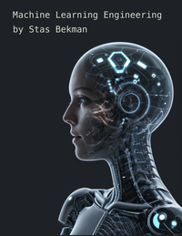

# Machine Learning Engineering 开放书籍 {#machine-learning-engineering-open-book}

<!-- not-in-ebook-start -->
<a href="#ebook-versions-of-the-book"></a>
<!-- not-in-ebook-end -->

这是一套开放的方法论、工具与分步操作说明合集，旨在帮助你顺利完成大语言模型和多模态模型的训练、微调以及它们的推理。

这是一份适合 LLM/VLM 训练工程师和运维人员的技术资料。也就是说，这里的内容包含大量脚本和可复制粘贴的命令，能让你快速地解决自己的需求。

这个仓库是我在训练大语言模型（LLM）（以及 VLM）过程中经验的持续汇集（brain dump）；其中的很多诀窍是我在 2022 年训练开源的 [BLOOM-176B](https://huggingface.co/bigscience/bloom) 模型、2023 年训练多模态的 [IDEFICS-80B](https://huggingface.co/HuggingFaceM4/idefics-80b-instruct) 模型、以及 2024 年在 [Contextual.AI](https://contextual.ai/) 训练 RAG 模型时积累下来的。

我整理这些信息主要是为了自己，好让我能迅速找到过去已经研究过并且确实有效的解决方案，但和往常一样，我很乐意把这些笔记分享给更广泛的 ML 社区。


## 目录 {#table-of-contents}


**第 1 部分：洞察**

1. **[AI 战场工程](./insights/ai-battlefield.md)** - 为了取得成功，你需要了解的知识。

1. **[如何选择云服务商](./insights/how-to-choose-cloud-provider.md)** - 这些问题将让你有能力获得一次成功的算力云服务体验。

1. **[升级 GPU 何时才值得？](./insights/when-to-upgrade-gpus/README.md)** - 一个判断 GPU 代际升级是否物有所值的实用框架，并结合真实的 H200 → B200 基准测试完整演算了一遍。

**第 2 部分：硬件**

1. **[计算](compute/README.md)** - 加速卡、CPU、CPU 内存。

1. **[存储](storage/README.md)** - 本地、分布式和共享文件系统。

1. **[网络](network/README.md)** - 节点内和节点间网络。


**第 3 部分：编排**

1. **[编排系统](orchestration/README.md)** - 管理容器与资源
1. **[SLURM](orchestration/slurm/README.md)** - Simple Linux Utility for Resource Management（简单 Linux 资源管理工具）


**第 4 部分：训练**

1. **[训练](training/README.md)** - 与模型训练相关的指南


**第 5 部分：推理**

1. **[推理](inference/README.md)** - 关于模型推理的洞察


**第 6 部分：开发**

1. **[调试与故障排查](debug/README.md)** - 如何调试简单和困难的问题

1. **[更多调试内容](https://github.com/stas00/the-art-of-debugging)**

1. **[测试](testing/README.md)** - 众多让编写测试变得愉快的技巧与工具


**第 7 部分：杂项**

1. **[资源](resources/README.md)** - LLM/VLM 编年史


## 更新 {#updates}

我会在我的 twitter 频道 [https://twitter.com/StasBekman](https://twitter.com/StasBekman) 上公布任何重大更新。

## 本书的电子书版本 {#ebook-versions-of-the-book}

你可以下载本书的多种电子书格式：
* [PDF](https://huggingface.co/stas/ml-engineering-book/resolve/main/Stas%20Bekman%20-%20Machine%20Learning%20Engineering.pdf?download=true)
* [EPUB](https://huggingface.co/stas/ml-engineering-book/resolve/main/Stas%20Bekman%20-%20Machine%20Learning%20Engineering.epub?download=true)


我会尽量每隔几周左右重新构建一次这些电子书，但如果你想获得最新的电子书版本，构建说明在[这里](build/README.md)。

感谢 HuggingFace 允许我把本书的电子书格式托管在 [HF hub](https://huggingface.co/stas/ml-engineering-book) 上。


## 面向 AI 智能体的技能 {#skills-for-ai-agents}

我维护了两个 [SKILL.md](https://github.com/CodingPracticeGroup/ml-engineering/blob/master/skills/README.md) 文件，你可以用它们来教导你的 AI 智能体：

- [Machine Learning Engineering](https://github.com/CodingPracticeGroup/ml-engineering/blob/master/skills/ml-engineering/SKILL.md) — 训练并运维大规模机器学习模型。
- [评估一个 GPU 集群](https://github.com/CodingPracticeGroup/ml-engineering/blob/master/skills/evaluate-cluster/SKILL.md) — 试用节点 / 验收流程：计算、网络和存储，然后输出一份 markdown 报告。

另请参阅配套技能：[The Art of Debugging](https://github.com/stas00/the-art-of-debugging/blob/master/SKILL.md) 和 [Stas' Python Cookbook](https://github.com/stas00/python-cookbook/blob/master/SKILL.md)。


## 课程 {#courses}

- **[训练 LLM 的经验教训](courses/lesson-learned/README.md)** - 提供了一种阅读我的开放书籍的截然不同的方式：逐条浏览言简意赅的经验洞察，并让你在需要时能够快速深入地探究。

## 讲座/演讲 {#lecturestalks}

- [构建有韧性的 ML 工程技能](https://www.youtube.com/watch?v=IBJUt9JPKHk)，于 2026-01-10 为 [GPU Mode 社区](https://github.com/gpu-mode)所做。当时只来得及讨论加速卡、网络和存储的真实性能，以及它们各自如何可能对整个系统的性能至关重要。感谢 [Mark Saroufim](https://github.com/msaroufim) 的组织，以及在演讲期间提供的出色支持。

## 讨论 {#discussions}

如果你想讨论与 ML 工程相关的话题，本仓库开放了[社区讨论](https://github.com/stas00/ml-engineering/discussions)——所以请不要吝于分享你的经验，或就你热衷的话题发起新的讨论。


## 关键对比表 {#key-comparison-tables}

高端加速卡：

- [加速卡理论 TFLOPS](compute/accelerator/README.md#tflops-comparison-table)
- [加速卡显存容量与速度](compute/accelerator/README.md#accelerator-memory-size-and-speed)

网络：

- [节点间理论速度](network/README.md#inter-node-networking)
- [节点内理论速度](network/README.md#intra-node-networking)

## 快捷入口 {#shortcuts}

你很可能会经常需要快速找到的内容。

工具：

- [torch-dist-bench.py](network/benchmarks/torch-dist-bench.py) - 比 nccl-tests 容易得多的网络吞吐量基准测试方法（旧名为 `all_reduce_bench.py`）。
- [torch-distributed-gpu-test.py](debug/torch-distributed-gpu-test.py) - 一个用于快速测试节点间连通性的工具
- [mamf-finder.py](compute/accelerator/benchmarks/mamf-finder.py) - 测一测你的加速卡实际能跑出多少 TFLOPS。

指南：

- [调试 PyTorch 应用程序](debug/pytorch.md) - 让挂起或出错的 PyTorch 应用程序恢复正常的快速可复制粘贴方案
- [面向用户的 Slurm](orchestration/slurm/users.md) - 一份 Slurm 速查表和技巧
- [制作微型模型/数据集/分词器](debug/pytorch.md#faster-debug-and-development-with-tiny-models-tokenizers-and-datasets)
- [LLM/VLM 编年史合集](resources/README.md#publicly-available-training-llmvlm-logbooks)


## 致谢 {#gratitude}

如果不是承蒙信任、让我承担那些具体的 LLM/VLM 训练任务——我最初的诀窍正是从这些任务中学到的——就不会有今天的一切。由于租用庞大的 ML 算力集群的费用高得令人却步，这是一种只有少数人才能享有的际遇。因此希望 ML 社区的其他人能够从这些笔记中间接学到同样的东西。

特别感谢 [Thom Wolf](https://github.com/thomwolf)，在我对大规模训练一无所知的时候，是他提议由我负责 BLOOM-176B 的训练。正是这个项目把我推入了高强度学习的进程。当然，还要感谢 HuggingFace 给了我机会，让我能全职投入 BLOOM-176B 以及后来的 IDEFICS-80B 训练。

最近，我在 [Contextual.AI](https://contextual.ai/) 一边训练模型、一边构建可扩展的训练/推理系统，继续拓展自己的知识与经验，我很感谢 Aman 和 Douwe 给了我这个机会。

我还要感谢众多[贡献者](contributors.md)，是他们让这份文本始终保持出色、没有错误。

## 参与贡献 {#contributing}

如果你发现了 bug、错别字，或者想提出改进建议，请不要客气，直接开一个 [Issue](https://github.com/stas00/ml-engineering/issues) 或贡献一个 PR。

## 相关的开放书籍 {#related-open-books}

- [The Art of Debugging 开放书籍](https://github.com/stas00/the-art-of-debugging) — 调试 Unix、Python 和 PyTorch 程序的方法论与实用范例。
- [Stas' Python Cookbook](https://github.com/stas00/python-cookbook) — 日常 Python 与标准库实用范例。

## 许可证 {#license}

本网站的内容以 [Attribution-ShareAlike 4.0 International](https://github.com/CodingPracticeGroup/ml-engineering/blob/master/LICENSE-CC-BY-SA)（署名-相同方式共享 4.0 国际）许可协议分发。


## 引用 {#citation}

```bibtex
@misc{bekman2024mlengineering,
  author = {Bekman, Stas},
  title = {Machine Learning Engineering Open Book},
  year = {2023-2026},
  publisher = {Stasosphere Online Inc.},
  journal = {GitHub repository},
  url = {https://github.com/stas00/ml-engineering}
}
```

## 我的仓库地图 {#my-repositories-map}

✔ **书籍：**
 [Machine Learning Engineering](https://github.com/stas00/ml-engineering) |
 [The Art of Debugging](https://github.com/stas00/the-art-of-debugging) |
 [Stas' Python Cookbook](https://github.com/stas00/python-cookbook)

✔ **应用程序：**
 [ipyexperiments](https://github.com/stas00/ipyexperiments)

✔ **工具与速查表：**
 [bash](https://github.com/stas00/bash-tools) |
 [conda](https://github.com/stas00/conda-tools) |
 [git](https://github.com/stas00/git-tools) |
 [jupyter-notebook](https://github.com/stas00/jupyter-notebook-tools) |
 [make](https://github.com/stas00/make-tools) |
 [python](https://github.com/stas00/python-tools) |
 [tensorboard](https://github.com/stas00/tensorboard-tools) |
 [unix](https://github.com/stas00/unix-tools)

✔ **其他机器学习内容：**
 [ML ways](https://github.com/stas00/ml-ways) |
 [Porting](https://github.com/stas00/porting)
