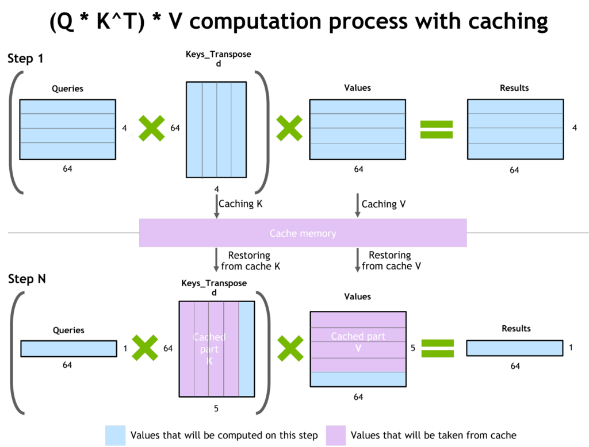
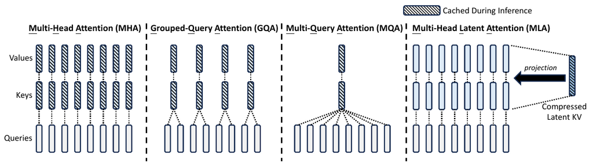
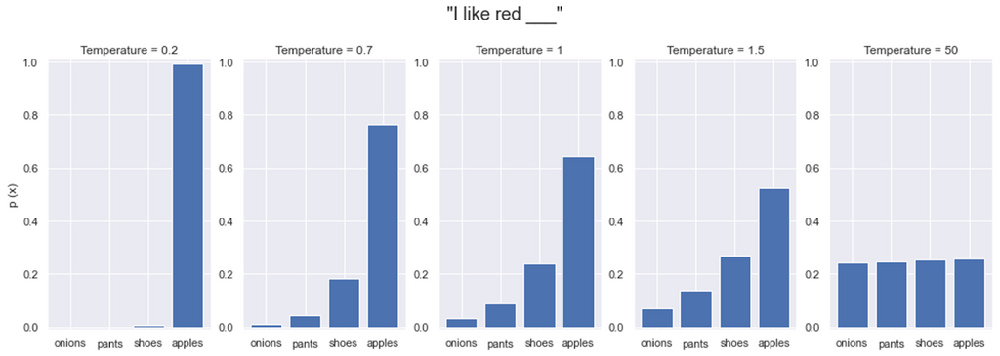
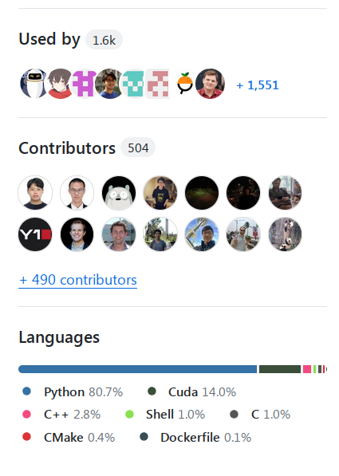

# 推理 {#inference}

XXX：本章仍在撰写中——有些部分已经完成，有些才刚刚起步，还有很多尚未开始，但已经完成的有用部分足够多，值得一读。

## 术语表 {#glossary}

- CLA: Cross-Layer Attention（跨层注意力）
- FHE: Fully Homomorphic Encryption（全同态加密）
- GQA: Grouped-Query Attention（分组查询注意力）
- ITL: Inter-Token Latency（词元间延迟）
- KV: Key Value（键值）
- LPU: Language Processing Unit™
- MHA: Multi-Head Attention（多头注意力）
- MLA: Multi-Latent Attention（多潜在注意力）
- MPC: Secure Multi-Party Computation（安全多方计算）
- MQA: Multi-Query Attention（多查询注意力）
- PPML: Privacy-Preserving Machine Learning（隐私保护机器学习）
- QPS: Queries Per Second（每秒查询数）
- TPOT: Time Per Output Token（每个输出词元的时间）
- TTFT: Time to First Token（首个词元时间）


更多类似术语表的条目，请见[概念](#concepts)。

## 概念 {#concepts}


### 预填充与解码 {#prefill-and-decode}

做推理时有 2 个阶段：

#### 预填充 {#prefill}

在预填充（prefill）阶段，模型像训练那样并行地处理提示词中的词元，并构建生成阶段使用的 KV 缓存。预填充通常是计算受限的。它的延迟直接计入 TTFT，并且一般随输入长度增加；很长的提示词或不足的算力都可能使预填充成为请求延迟的主要部分。

#### 解码 {#decode}

在常规的自回归解码中，模型基于提示词和此前已生成的词元，一次只生成一个输出词元。这种顺序依赖使得同一条序列内部的输出词元步骤无法并行化，因此解码阶段通常是内存带宽受限的。

哪个阶段影响最大，取决于工作负载和所关注的指标。TTFT 对提示词长度、预填充效率、调度和排队敏感；TPOT/ITL 主要刻画的是解码；端到端延迟则取决于输入长度、输出长度、批处理、负载和硬件。

参见 [NVIDIA 的推理优化综述](https://developer.nvidia.com/blog/mastering-llm-techniques-inference-optimization/)和 [LLM 基准测试指标定义](https://developer.nvidia.com/blog/llm-benchmarking-fundamental-concepts/)。


### 模型显存占用的构成 {#anatomy-of-models-memory-usage}

推理的显存占用与[训练](../training/performance/README.md#anatomy-of-models-memory-usage)很不相同。这里的组成部分有：

1. 模型权重
2. KV 缓存——至关重要，有了它就不必为每个新生成的词元重新计算过往的词元
3. 激活内存——这是处理过程中的临时内存，取决于批次大小和序列长度

#### 模型权重 {#model-weights}

每种 [dtype](../training/dtype.md) 下每个参数占用的字节数：

- 4 bytes * 参数量，fp32
- 2 bytes * 参数量，fp16/bf16
- 1 byte  * 参数量，fp8/int8
- 0.75 bytes * 参数量，fp6 或 6-bit 量化
- 0.625 bytes * 参数量，5-bit 量化
- 0.5 bytes * 参数量，fp4/int4
- 0.375 bytes * 参数量，3-bit 量化
- 0.25 bytes * 参数量，2-bit 量化
- 0.125 bytes * 参数量，1-bit 量化

这些是紧凑排布的载荷（payload）大小。实际的权重存储可能更高，因为量化格式可能还要存储缩放因子、零点、码本、填充/对齐，并且可能以更宽的格式存储部分张量。

[OCP 微缩放（MX）格式](https://github.com/openxla/xla/discussions/18085)每 32 个值使用一个 8 位的 E8M0 缩放因子。把共享的缩放因子也算进去，它们打包后的载荷大小为：

- 1.03125 bytes * 参数量，MXFP8/MXINT8
- 0.78125 bytes * 参数量，MXFP6
- 0.53125 bytes * 参数量，MXFP4

示例：Meta-Llama-3.1-8B 以 bf16 存储需要 `2 (bf16 bytes) * 8B (num of params) = 16GB`（大约）


#### KV 缓存 {#kv-caching}

在每生成一个新词元之前都要重新计算所有先前的 KV（Key Value）值，代价会极其高昂，因此它们被缓存在加速器的显存中。新算出的 KV 值会被追加到已有缓存的末尾。



（[来源](https://developer.nvidia.com/blog/accelerated-inference-for-large-transformer-models-using-nvidia-fastertransformer-and-nvidia-triton-inference-server/)）

KV 缓存的大小与输入序列长度和批次大小成正比。过去的查询（query）值不会用在注意力机制中，因此不需要缓存。

1 个词元的 KV 缓存需要 `dtype_bytes * 2 * num_hidden_layers * hidden_size * num_key_value_heads / num_attention_heads` bytes

说明：
- `dtype_bytes` 是每种 dtype 的字节数：fp32 为 4 bytes，bf16/fp16 为 2 bytes，等等。
- `2` 代表 keys + values，一共有 2 项。
- `num_key_value_heads / num_attention_heads` 是一个因子，取决于使用的是多查询注意力（MQA）、分组查询注意力（GQA）还是多头注意力（MHA）。对 MHA 它是 1；对 MQA 它是 `1/num_attention_heads`；对 GQA 它取决于每个分组使用多少个查询，即 `num_key_value_heads / num_attention_heads`，这也是涵盖 MHA 和 MQA 的通用表达式。

你可以从模型目录下的 `config.json` 或功能等价的其它文件（如果文件名不同）中获得这些维度，例如 [meta-llama/Meta-Llama-3.1-8B](https://huggingface.co/meta-llama/Meta-Llama-3.1-8B/blob/main/config.json)。

示例：

Meta-Llama-3.1-8B 的 1 个词元在 bf16 下需要：`2 (bf16 bytes) * 2 (keys+values) * 32 (num_hidden_layers) * 4096 (hidden_size) * 8 (num_key_value_heads) / 32 (num_attention_heads)  / 10**6 = 0.131MB`。该模型使用 GQA，因此只占用朴素 MHA 的 1/4。

1 个批次、1024 个词元需要 `0.131*1024 = ~134MB`。

128 个批次、每条各 1024 个词元需要 `0.131*1024*128 / 10**3 = ~17.2GB`。

如果 Meta-Llama-3.1-8B 改用 MHA，其 KV 缓存每个词元会多占 4 倍的显存；如果改用 MQA，则显存会少用 8 倍。从下文更远处的 MHA/GQA/MQA/MLA 对比图很容易看出原因。

在这个例子中，模型的 `num_key_value_heads=8`、`num_attention_heads=32`，因此与 MHA 相比，MQA 和 GQA 分别只使用 1/32 和 1/4 的显存。

[DeepSeek v3](https://arxiv.org/abs/2412.19437) 提出了多潜在注意力（Multi-Latent Attention，MLA），把 Key 和 Value 压缩进一个潜在向量（latent vector），进一步减小 KV 缓存的体积。具体细节见论文的第 2.1.1 节。

下图展示了 MHA/GQA/MQA/MLA 之间的差异：



[来源](https://arxiv.org/abs/2405.04434)

提出 [SwiftKV](https://arxiv.org/abs/2410.03960) 是为了应对一种常见情形：预填充与解码的用例比例达到 10:1。它在提示词处理阶段减少推理计算量，而不仅仅是压缩内存。通过把模型重连（model rewiring）与保知自蒸馏（knowledge-preserving self-distillation）结合起来，SwiftKV 在精度损失极小的情况下大幅降低了推理的计算开销，为面向企业的 LLM 负载带来了吞吐量、延迟和成本效率方面高达 2 倍的显著改善。

KV 缓存虽然省去了重复计算，但对推理性能有很大的负面影响。这里引用 [Dynamic Memory Compression: Retrofitting LLMs for Accelerated Inference](https://arxiv.org/abs/2403.09636) 中的一段话：

> 2.3. 内存受限与计算受限的操作
>
> 在 GPU 加速器上执行的每一个操作，例如通用矩阵乘法（GEMM），要么内存受限，要么计算受限。前者的整体运行时间主要取决于高带宽内存（HBM）访问，后者则主要取决于实际计算。在 Transformer LLM 的自回归生成中，每次前向传播的序列长度都是 n = 1，这往往内存受限而非计算受限。一次前向传播的绝大部分时间，要么花在线性层的处理上（MHSA、Feed-Forward 前馈网络和输出词表投影），要么花在按公式（4）计算注意力分数和输出上。对于线性层，FLOPS 与内存访问的比值会随着批次大小增大而改善，从 HBM 取回的一组层权重可以执行更多 FLOPS。当批次足够大时，线性层最终会变成计算受限。另一方面，在自回归推理中计算 MHSA 层内部的公式（4）时，FLOPS 与输入大小的比值保持不变，无论批次多大，MHSA 层都是内存受限的。由此可知，对这些层而言，延迟随 KV 缓存的大小线性增长。

* 公式（4）就是常见的自注意力机制公式 `Softmax(Q,K)V`

更小的 KV 缓存会带来更快的生成和更高的 GPU 利用率。因此人们使用各种技术来达成这一目标，例如摘要压缩（gisting）、上下文蒸馏、键值驱逐策略（词元丢弃）、内存压缩、多查询注意力、分组查询注意力、跨层注意力、基于锚点的自注意力、量化等等。


### 在线推理与离线推理 {#online-vs-offline-inference}

当用户实时发送查询时，这就是在线推理，也称部署（Deployment）推理或交互式（Interactive）推理。例如：聊天机器人、搜索引擎、通用 REST API。这种情况下必须始终运行着一个推理服务器，并且可能有各种各样的客户端来查询它。

当你有一个包含成百上千条提示词的文件需要跑推理时，这就是离线推理，也称批处理（batch）推理。例如：基准评测和合成数据生成。这种情况下通常不需要推理服务器，推理直接在发送查询的同一个程序里运行（客户端和服务器在同一个应用中）。

这 2 种主要用例通常针对不同的性能指标做优化——在线推理用例要求极低的 TTFT 和低延迟，而离线推理要求高吞吐量。对任何类型的推理来说，预填充和解码合在一起的词元处理吞吐量都是关键指标，因为它决定了推理服务的总成本。就在线推理而言，合并吞吐量越高，同样的硬件能服务的用户就越多。对离线推理而言，显然推理完成得越快，计算成本就越低。


### 批处理 {#batching}

解码阶段一次只处理一个词元，对加速器的利用极其低效。把多个查询批量放在一起能提高加速器的利用率，并支持同时处理多个请求。

最大可能的批次大小，取决于加载模型权重、并用中间状态填充 KV 缓存之后还剩多少内存。

#### 静态批处理 {#static-batching}

这就是朴素直接的分批方式——把前 N 个查询打包成一批。这里的问题是：如果其中许多查询已经生成完毕，它们也不得不等待生成最长的那个查询完成后才能返回给调用方——这会极大地增加延迟。

#### 连续批处理（Continuous Batching）或在途批处理（In-flight batching） {#continuous-batching-or-in-flight-batching}

连续批处理或在途批处理是这样一种过程：生成引擎一旦有结果完成就立即将其移除，并用新的查询顶替，而不必等整批任务全部完成。这样一来，批次中位置 0 上的序列可能正在生成它的第 10 个词元，位置 1 上的序列可能刚开始生成它的第一个词元，而位置 3 上正在产出它的最后一个词元。

这改善了响应时间，因为已经完成的序列可以立即返回，新的提示词也不必等待下一批腾出位置。当然，如果全部算力都完全繁忙、批次中没有新的空位，那么一些请求就得等待，计算才会开始处理它们。


### 分页注意力（Paged Attention） {#paged-attention}

分页注意力在推理服务器中非常流行，因为它能让加速器显存的利用非常高效——其做法是像操作系统用分页（paging）方式管理内存那样来对待加速器内存，从而实现了动态内存分配，并防止内存碎片。


### 解码方法 {#decoding-methods}

主要的解码方法有：[贪心解码](#greedy-decoding)、[束搜索](#beam-search)和[采样](#sampling)。


#### 贪心解码 {#greedy-decoding}

贪心解码就是模型总是选择概率最高的词元。这是最快的解码方法，但它并不总能生成最好的结果，因为它可能选上一条不够理想的词元路径，从而错过一段非常出色的后续词元序列。

这种方法的主要问题之一是形成循环，即同一句话被一遍又一遍地重复。

#### 束搜索 {#beam-search}

束搜索克服了贪心解码的局限：它同时生成多个输出。不是只跟随概率最高的那一条——束宽（beam size）为 3 时，它在每个新词元处跟随概率最高的前 3 条——然后在 `3*3` 共 9 条子路径中，丢弃除总概率最高的 3 条以外的所有路径，这 3 条要使整条链上所有词元的总概率最高。最后在结束时，选择所有词元概率之积最高的那条路径。

这种方法比贪心解码慢，因为它必须多生成 n 倍的词元，而且需要多 n 倍的内存。

#### 采样 {#sampling}

基于采样的解码引入了随机性。

不过，当然，随机选词不会带来好结果，所以我们仍然想要贪心解码那样的确定性，只是通过加入受控的随机性让它更有趣、更有生气。

最常见的采样方法有：

- **Top-K 采样**方法按词元的 logit 概率选出前 k 个词元，然后从中随机挑一个。
- **Top-p 采样**（也称**核采样**，nucleus sampling）与 Top-K 采样类似，但每一步的 K 是变化的，其计算方法是把词元概率从高到低累加，直到达到阈值 `p` 为止。因此，如果模型对某些预测明显更有把握，就只会考虑那些词元。

#### 温度 {#temperature}

温度是一种独立的 logits 变换，可以与 [Top-K 或 Top-p](#sampling) 采样结合使用、与两者都结合，或者都不结合。它的取值不同，会产生如下影响：

- `t==0.0`：就字面而言，softmax 的温度除以零是没有定义的。一些 API 把 0 作为贪心解码的简写，另一些则会拒绝这个值，所以如果 API 提供显式的贪心模式，就使用它。
- `0.0<t<1.0`：概率被推得彼此更远，所以越接近 0.0，随机性越少——适用于介于精准与均衡之间的用例。
- `t==1.0`：对采样没有影响——这里保留了原始训练时的分布——适用于兼顾相关性与多样性的均衡用例。
- `t>1.0`：概率被推得更接近，产生更多的随机性——适用于创意类用例。

下面这组图能让这一点一目了然：



（[来源](https://www.hopsworks.ai/dictionary/llm-temperature)）

要真正理解其影响，需要知道温度因子通常是在 Softmax 运算之前、或作为其一部分，应用于对数概率之上。

```
scaled_logits = logits / temperature
probs = softmax(scaled_logits)
```
softmax 运算把 logit 之间的差值转化为概率之比——当我们除以 t<1.0 时，这些差值被放大，导致概率之比更悬殊、分布更尖锐。当我们除以 t>1.0 时，这些差值被缩小，导致概率之比更接近、分布更均匀。当 t 从上方趋近 0 时，最高的 logit 会主导整个分布，不过实践中会避免字面上的除以零。

对任何正温度而言，缩放都不会改变 logit 的排序，所以纯贪心的 argmax 会选出同一个词元。但它确实会改变采样概率。使用 Top-K 时，符合条件的仍是同样的 K 个候选，只是它们的相对采样概率会改变。使用 Top-p 时，温度既可能改变哪些词元进入核（nucleus），也可能改变它们的相对概率。束搜索的表现取决于具体实现及其序列打分方式，所以不应假定它保持不变。参见 Transformers 的 [`TemperatureLogitsWarper` 文档](https://huggingface.co/docs/transformers/main/en/internal/generation_utils#transformers.TemperatureLogitsWarper)。

没有可以照搬的通用温度值，你必须针对每个用例做实验，找出最适合自己需求的取值——不过只要你去网上搜索，肯定能找到人们为不同用例提供的不错的基线值。

关于解码方法的更多内容，参见这篇 [HuggingFace 博客](https://huggingface.co/blog/how-to-generate)。

### 引导式文本生成 {#guided-text-generation}

也称结构化文本生成。

如果模型能以特定格式（而非不受限制的格式）返回其生成的输出，你就不希望它幻觉出不合法的格式。例如，如果你希望模型返回一个 JSON 字典，它就应当恰好做到这一点。

实现这一点的办法是使用引导式文本生成。这种技术不是直接选择概率最高的生成词元，而是在符合“下一个词元允许子集”的词元中，选择概率最高的那一个。举个例子说明：如果你希望模型生成一个字符串形式的 JSON 列表，比如 `["apples", "oranges"]`，那么我们期望：

```
["string", "string", ..., "string"]
123...
```

第一个生成的词元必须是 `[`。如果模型给出的例子中 `"` 而非 `[` 的概率最高，而 `[` 的概率更低——我们就想选那个概率更低的，让它成为 `[`。

接下来生成的词元必须是 `"`。如果不是，就继续搜索概率更低的词元，直到找到 `"` 并选择它。

第三个词元必须是一个合法的字符串（即不能是 `[` 或 `"`）。

以此类推。

基本上，对每一个后续词元，我们都需要知道一个允许的词元子集，并在其中选择概率最高的那个。

这是一种非常巧妙的技术。我们不必事后再去修复生成的输出——那并不总能匹配期望的格式——而是让模型从一开始就生成正确的输出。

这种技术有若干代价：
- 它会拖慢生成速度——需要遵守的模式（schema）越复杂，生成词元就越慢。从实测的生成速度来看，我发现有些结构化文本生成库比其他库快得多。
- 它可能加剧模型幻觉。

这一技术有多种实现。截至 2026-08，vLLM 支持其中四种作为[结构化输出后端](https://docs.vllm.ai/en/latest/features/structured_outputs/)，除非你手动覆盖，否则它会自动选用其中一个：
- https://github.com/mlc-ai/xgrammar
- https://github.com/guidance-ai/llguidance
- https://github.com/dottxt-ai/outlines
- https://github.com/noamgat/lm-format-enforcer

你最好选择那些已经被集成进 vLLM 等推理框架的实现。

#### 借助引导生成加速推理 {#faster-inference-with-guided-generation}

还可以利用 schema 来加速推理。例如，考虑下面这个简单的 "profile" schema：

```
{
  "type": "object",
  "properties": {
    "name": { "type": "string"},
    "age": { "type": "integer"}
  },
  "required": ["name", "age"]
}
```

由于该 schema 规定了具体的键 `name` 和 `age`，一旦模型预测出了 `{"n` 或 `{"a`，它就不需要再执行自回归生成来得到 ``{"name": ` 和 `{"age": `——因为这两者都必然各自导向唯一确定的结果——所以这里可以执行预填充而不是解码，省下几个慢速的解码步骤，因为它 100% 确定接下来的几个词元分别会是 `ame": ` 或 `ge":`。显然，当 schema 含有大量预先确定的键、而生成值又很短时，这种方式收益最大。


### 投机解码 {#speculative-decoding}

也称投机推理或辅助生成。

由于一次生成一个词元非常慢，有时可以用一个更小、更快的草稿模型（draft model）来“取巧”，加快速度。例如，你平时的推理使用 Llama-70B，这会相当慢，但我们可以拿 Llama-7b 当草稿模型，然后一次性对所有词元验证预测是否正确。

示例：取提示词 `I'm turnin', turnin', turnin', turnin', turnin' around and all that I can see is just`，然后：

1. 用 Llama-7b 以自回归方式预测 `another lemon tree`，共 3 步，但比 Llama-70b 快得多。
2. 现在用 Llama-70b 运行一个由 3 条提示组成的批量：

```
[...I can see is just]
[...I can see is just another]
[...I can see is just another lemon]
```
为了演示，我用 `...` 缩略了完整提示词——实际使用时它必须是完整的。并且我这里假设每个词元恰好是一个完整的单词。

现在 Llama-70B 只用一步就生成了：

```
[...I can see is just] another
[...I can see is just another] lemon
[...I can see is just another lemon] tree
```

接下来可能出现多种结果：
- 如果全部匹配——我们用了 3 个短步骤加 1 个长步骤就生成了最终结果，而不是用 3 个长步骤。
- 如果只有 `another lemon` 匹配——只要节省了时间，结果可能仍然更好。
- 如果几乎没什么匹配，我们就浪费了一点时间。

显然，如果草稿的不只是 3 个词元而是更多，节省很可能更大。

另外，不要忽略这个事实：与大模型正常做这段生成相比，这样做消耗的计算量相同甚至略多，但这种方法的延迟可以好得多——只要草稿模型小得多且仍能给出不错的预测，使用你的应用的用户平均应当能获得更好的响应时间。

出现部分不匹配时，我们可以回到草稿模型，把第一个不匹配词元之前所有匹配上的词元，连同大模型预测出的那个正确的下一个词元一起喂给它，让它为不匹配的尾部重新做一个快速的预测。

草稿模型理想情况下应当在相同的数据（或至少是分布相似的数据）上训练，而且它的分词器必须与大模型完全一致。

投机解码在[有输入依据的任务](#input-grounded-tasks)上回报最高，例如翻译、摘要、文档问答、多轮对话，因为在这些任务中可能输出的范围要小得多，草稿模型也更可能与大模型一致。

出于同样的原因，它与[贪心解码](#greedy-decoding)配合时效果最好，因为生成时可能出现的变化最少。如果不使用贪心解码，你应当把[温度](#temperature)的取值设到接近 0。

关于这一主题有一篇很好的深入解读：[Assisted Generation: a new direction toward low-latency text generation](https://huggingface.co/blog/assisted-generation)。

对于[有输入依据的任务](#input-grounded-tasks)，还有一种简单得多的方案：使用 [ngram prompt lookup decoding](https://github.com/apoorvumang/prompt-lookup-decoding)。这种方法不需要草稿模型，而是在提示词中搜索匹配的字符串来生成候选词元。据说在某些情况下能让解码加速 2 倍以上。


### 隐私保护推理 {#privacy-preserving-inference}

提供推理服务的大多数公司都会遇到用户隐私方面的需求。用户提交查询时，应当不用担心有人在偷看。一种方案是本地部署（on-premise）：客户端自己运行服务器，这样就不存在隐私问题，但这很可能会暴露提供商的知识产权——模型权重，甚至可能还有代码/算法。因此，需要一种完全加密的生成方式——也就是在客户端加密后的数据上执行计算。

满足这类需求的方案被称为隐私保护机器学习（Privacy-Preserving Machine Learning，PPML）。

其中一种方案叫全同态加密（Fully [Homomorphic Encryption](https://en.wikipedia.org/wiki/Homomorphic_encryption)，FHE）。

可以看看这样一个实现：[concrete-ml](https://github.com/zama-ai/concrete-ml)，它重写模型，使客户端能够自己运行模型的一部分，然后把加密后的中间激活发送给服务器去执行注意力计算，再送回客户端。这样提供商就保留了一部分知识产权——我想正是这部分知识产权使客户端无法拿走全部的知识产权，因为仅凭部分权重不足以还原完整模型。[这篇文章](https://huggingface.co/blog/encrypted-llm)对此有更详细的介绍。

还有各种其他思路，例如这篇论文：[LLMs Can Understand Encrypted Prompt: Towards Privacy-Computing Friendly Transformers](https://arxiv.org/abs/2305.18396v3)，它提出了一个基于安全多方计算（Secure Multi-Party Computation，MPC）和 FHE 的定制方案，并且有很好的参考文献列表。

现有方案的问题是巨大的计算开销——这极大地影响成本和延迟。未来 ASIC 方案应当能够解决这些问题。


### 模型并行 {#model-parallelism}

当模型无法装进单台加速器，或者即使勉强装得下、但把模型拆分到多台加速器上反而更高效时，训练中同样的[模型并行技术](../training/model-parallelism/README.md)同样适用于推理。

#### 张量并行 {#tensor-parallelism}

大多数时候，你最可能只会用到[张量并行](../training/model-parallelism/README.md#tensor-parallelism)，即把模型权重分片到 2 到 8 台加速器上。理想情况下，你应当尽量把模型装进单台加速器，因为那样生成时的开销最少。但出人意料的是，使用张量并行你反而可能得到更高的解码吞吐量——这是因为张量并行能让你容纳大得多的批次，而且尽管增加了加速器之间的通信，`forward` 调用也可能更快。当然，在某些情况下，这种加速是以使用更多加速器为代价换来的。所以最好多做实验：在相同的加速器数量下，某些用例中更高的张量并行度会带来更好的总吞吐量。

脚注：在我的实验中，与 TP>1 相比，TP=1 会产生最高的 TTFT 和最低的解码吞吐量。所以，如果有人要求你让 TTFT 更快、而模型又装得下，就使用更小的 TP 或 TP=1。如果有人要求你让解码吞吐量更快，就用更高的 TP 度投入更多加速器。

#### 流水线并行 {#pipeline-parallelism}

进而，虽然张量并行有助于降低延迟，但使用[流水线并行](../training/model-parallelism/README.md#pipeline-parallelism)可能有助于提高吞吐量。对于本来就必须使用很多加速器才能装下模型权重的超大模型尤其如此。比如说，如果你使用 Llama 405B 且 TP=8，那么每台加速器都必须与另外 7 台加速器做 all-reduce；而 PP=8 时，每台加速器只需要与另外 2 台加速器通信（从上一个阶段 `recv` 输入，再把当前的输出 `send` 给下一个阶段），对网络层的压力小得多，如果硬件支持，这能带来显著的加速。

这里需要澄清：只有使用完整 PP 而不是朴素 PP 时，PP 才可能优于 TP。在[朴素 PP](../training/model-parallelism/README.md#naive-model-parallelism-vertical)中，任何给定时刻只有一个 PP 阶段在工作，所以它的表现会比 TP 更差。要想从 PP 获益，推理框架需要并行地喂给所有 PP 阶段数据，以实现[完整 PP](../training/model-parallelism/README.md#pipeline-parallelism)。

关于 PP 推理另一个重要的一点是：与训练不同，这里没有 `backward` 阶段，因此不需要解决不活动气泡（bubble）问题。只会在最初几个微批次（micro-batch）里填充 PP 阶段时存在一点点很小的开销。

和训练一样，你可能会发现 TP 与 PP 的某种组合会带来最佳结果（例如对 Llama 405B 使用 TP=4 + PP=4）。所以务必多做实验、测量不同的配置，选出满足你需求的那一个。
### 提供依据（Grounding） {#grounding}

这是为预训练模型提供其训练期间不可用的额外信息的过程。例如，[有输入依据的任务](#input-grounded-tasks)会在提示词中给模型提供大量额外信息。非零样本（zero-shot）提示词则以示例作为依据来约束模型，从而改变模型的默认行为。提示词工程的全部要义，就是为模型提供依据，让它在推理时以某种特定的方式行事。

检索增强生成（Retrieval Augmented Generation，RAG）是为模型提供依据的主要技术之一，因为它会为推理过程提供与提示词相关的额外数据。其意图是：模型应当赋予这些信息比其训练时所学到的海量压缩信息更高的权重。

向另一个知识领域做微调是另一种提供依据的做法：我们更新模型，使其依据来自一个新数据集，而这个数据集可能与基础模型原先训练数据的领域相当不同。

可以把提供依据理解为提供上下文。正如任何人都能体会到的：当一个人理解了问题的上下文时，回答起来会更容易。模型生成也是如此。上下文越好，生成的输出就越贴切。

在多模态用例中，随文本提示词一并提供的图像或视频就可以充当这种依据，也就是上下文。


### 任务 {#tasks}


#### 有输入依据的任务 {#input-grounded-tasks}

有输入依据的任务是指生成的回复主要来自提示词的任务，也就是说，知识的主要来源就包含在提示词之中。这类任务包括：

- 翻译
- 摘要
- 文档问答
- 多轮对话
- 代码编辑
- 语音识别（音频转写）


## 关键推理性能指标 {#key-inference-performance-metrics}

有两种看待性能指标的视角：一类是常见的系统指标——延迟和吞吐量，另一类是用户体验指标——首个词元时间（Time To First Token，TTFT）和每个输出词元的时间（Time Per Output Token，TPOT）。我们把两类都看一看。

### 系统性能指标 {#system-performance-metrics}

#### 延迟 {#latency}

**延迟是指从发出请求起、到收到完整回复为止所经过的时间**。

它包括以下各环节的时间：
1. 接收请求
2. 对提示词做预处理（预填充阶段）
3. 生成回复的新词元（解码阶段）
4. 把回复发回给客户端。

接收请求和发送回复这两部分的时间大体相同，只会因提示词和生成回复的长短不同而有少量变化。这些长度变化对总时间的影响应当可以忽略不计。

预填充阶段并行地处理提示词词元，但更长的提示词需要更多的计算和 KV 缓存显存，因此通常会让 TTFT 变长、吞吐量降低。具体影响取决于模型、批处理、硬件和服务器负载。

解码阶段是受生成回复长度影响最大的阶段，因为每个新词元都要作为单独的一步生成。在这里，回复越长，解码阶段就越长。

如果服务器没有足够的容量同时处理所有当前请求，不得不把一些请求排入队列，那么队列中的等待时间就会把延迟延长相应的时长。

脚注：如果把路面上的车流拿来类比，延迟就相当于一个人从 A 点开车到 B 点（例如从家到办公室）所需的时间，其中包含红绿灯、拥堵和法定限速造成的速度限制。

#### 吞吐量 {#throughput}

吞吐量衡量的是一台推理服务器并行处理许多请求、并高效地对请求做批处理的能力。

吞吐量的定义本可以是能同时服务多少个请求，但由于有些请求得到服务的速度远快于另一些——在一次长请求的服务期间，可能已经服务了好几个短请求——因此统计整个系统生成词元的总速率才更合理。

因此，一个更常见的定义是：**推理吞吐量指的是整个系统每秒生成词元的总数**。

脚注：如果把路面上的车流拿来类比，吞吐量就是在任意给定时刻，一条路上能通过多少辆车。道路的车道越多、限速越高，这条路的吞吐量就越大。但显然有些车短、有些车长，所以需要某种归一化。例如，渡轮按车辆占用的总长度（米或英尺）来计算能装下多少辆车，因此长车比短车付更多的钱。


### 用户体验指标 {#user-experience-metrics}

评判一台推理服务器的特性有很多——比如功耗、效率和成本——但可以说，由于这些系统打交道的对象是人，最重要的特性都落在能否拥有顺畅的用户体验这个范畴内。如果用户体验又慢又卡顿，用户就会转投竞争对手。因此，关键需求是：

#### 首个词元时间 {#time-to-first-token}

**首个词元时间（TTFT）定义为：从用户按下提交按钮（或 Enter 键）起，到他们收到回复中的第一个单词或单词的一部分的那一刻为止，所经过的时间**。

人们希望 TTFT 非常低。如今用户已经习惯于期望任何应用理想上都能快于 1 秒就开始响应。因此，用户在开始收到词元之前需要等待的时间越短越好。这对被期望具有交互性的聊天机器人来说甚至更加重要。TTFT 的长短受许多要素影响，其中最关键的是[预填充阶段](#prefill)（对提示词做预处理）的计算，以及请求是在收到用户请求后立即得到处理，还是不得不在队列中等待。

值得注意的是，无负载服务器的 TTFT 与重负载下的服务器可能非常不同。如果平时服务器 1 秒就能发出第一个词元，而当服务器已经忙于处理它能同时处理的全部请求、并且存在队列时，那么除了最初几个请求之外，有效 TTFT 很容易就会长得多、得多。所以通常应当测量平均 TTFT，并把跑基准测试时发送的并发请求数量与之一起报告。

这是一个不太容易处理的指标，因为时间会随提示词的大小而变化，所以理想情况下你会希望把它按提示词中的词元数做归一化。

#### 每个输出词元的时间 {#time-per-output-token}

每个输出词元的时间（TPOT）是一项面向单个用户的指标。它衡量的是：对给定用户而言，生成一个新词元需要多长时间。

人们希望 TPOT 相对较低，但不必低得过头。这个时间理想上应当接近发送请求的那个人的阅读速度。举例来说，如果你服务的是小学一年级的学生，TPOT 可以相对高一些；而一个人受教育程度越高，要获得顺畅的阅读体验，TPOT 就应当越低。

据维基百科，阅读有[3 种类型](https://en.wikipedia.org/wiki/Speed_reading#Types_of_reading)，阅读速度以每分钟单词数（WPM）来衡量。

平均每词对应多少个词元会随语言而变，也会受分词器的一定影响，而受影响最大的则是所生成文本的类型。这里我们假设一个英语分词器约为每词 1.5 个词元。这样，我们就可以把每分钟单词数（WPM）换算成每分钟词元数（TPM）。

接下来只需除以 60 就得到每秒词元数（TPS），再取倒数就得到每个输出词元的时间（TPOT）

于是 `TPOT = 60 / (WPM*1.5)`，单位为秒

| 读者类型 | WPM |  TPM |   TPS |  TPOT |
| :---     | --: | ---: | ----: | ----: |
| 默读型   | 250 |  375 |  6.25 |  0.16 |
| 听读型   | 450 |  675 | 11.25 | 0.089 |
| 视读型   | 700 | 1050 | 18.75 | 0.057 |

记得把 1.5 这个系数改成分词器实际的词到词元平均比率，你可以在自己的文本上测量出来：

```python
import re, tiktoken
enc  = tiktoken.get_encoding("cl100k_base")
text = open("sample.txt").read()
print("tokens per word: ", len(enc.encode(text)) / len(re.findall(r"\S+", text)))
```

用一段普通的英语散文实测，OpenAI 的 `cl100k` 和 `o200k` 分词器得到的结果约为每词 1.2 个词元，在 GPT-2 那个更早的 5 万词表分词器上结果相同——对散文而言，选用哪种分词器几乎不改变这个比值。真正改变它的是模型输出的文本类型：对 Python 代码做同样的测量，结果约为每词 3.3 个词元。所以，如果你提供的是代码补全而非散文，1.5 这个系数会把你的 TPOT 目标定得过松 2 倍以上——对一位 250 WPM 的读者，你会按每个词元 0.16 秒来预算，而代码场景实际需要的是接近 0.07。

可以看到，TPOT 是一个很难跟踪、也难以在脑中直观把握的量，所以**一旦知道了自己的目标 TPOT，最好把它换算成每秒词元数（TPS），改为跟踪 TPS**。

因此，在这个例子中，如果你的系统能在每个请求上持续稳定地生成 20 个词元/秒，你的客户就会满意，因为这样的系统即便跟上每分钟 700 词的超快速读者也不在话下。

当然，总会有用户宁愿等到生成完全结束后再开始阅读回复。这种情况下，越快越好。

根据生成内容的类型，下面这些情况很可能是适用的：
1. 图像——一次性给出全部
2. 文本——不慢于用户的阅读速度；或者，如果用户不希望开始阅读前就有内容在滚动，则一次性给出全部
3. 音频——不慢于用户的收听速度
4. 视频——不慢于用户的观看速度

如果一个离线系统并不直接面向一个个的人，而只是批量地处理一批批请求，这些指标就无关紧要，关键的指标是延迟和吞吐量。


### 简化后的性能指标 {#simplified-performance-metrics}

你已经能看出，[前面讨论过的这些指标](#key-inference-performance-metrics)之间有大量重叠。实际上，我们可以把它们全部归约为这 2 个指标：预填充吞吐量和解码吞吐量——可能还包括系统每秒能处理多少个并行请求。

#### 预填充吞吐量 {#prefill-throughput}

这衡量的是系统预处理提示词的速度——以每秒词元数计。

假设接收和发送请求的开销可以忽略，在没有队列、到来的请求会被立即处理的情况下，[TTFT](#time-to-first-token) 实际上就是提示词中的词元数除以预填充的每秒词元数，再加上生成第一个词元的时间（由于它非常快，可以忽略）。

如果存在队列，仅有预填充吞吐量就不够了，因为这时还得加上请求在队列中耗费的时间，TTFT 可能会长得多。

#### 解码吞吐量 {#decode-throughput}

这衡量的是系统生成回复词元的速度——以每秒词元数计。

这一项同时对应吞吐量和每个输出词元的时间这两项指标。

这样一来，回复延迟就是：提示词中的词元数除以预填充吞吐量，加上生成的词元数除以解码吞吐量。


### 更多指标说明 {#more-metric-notes}

#### 加速器利用率 {#accelerator-utilization}

加速器利用率——无论是百分比还是功耗测量——都是判断你的部署是否高效利用了加速器的好指标。例如，如果你使用 NVIDIA GPU，运行 `watch -n 0.5 nvidia-smi`，看到“gpu util”只有 10%，而你又在用大量请求猛烈轰炸推理服务器，这通常意味着：要么推理服务器非常低效（例如花大量时间来回拷贝数据），要么可能是客户端接收数据的方式低效（即存在过多的 IO 阻塞）。

脚注：我最初用 openai 客户端写了一个简单的基准测试，在低并发下它一切正常，但并发一高，推理服务器的 gpu util 反而降到 6-7%。等我把客户端换成 `aiohttp` API，利用率升到了 75%。所以要当心：造成糟糕性能报告的元凶可能是你的基准测试，而不是服务器。

这在某种意义上相当于用 [TFLOPS 来衡量训练效率](../training/performance/README.md#tflops-as-a-performance-metric)。

理想情况下，你希望加速器利用率尽可能高。要注意的是，至少对 NVIDIA GPU 而言，`gpu util` [并不是你想象中的那个含义](../compute/accelerator/nvidia/debug.md#how-to-get-the-real-gpu-utilization-metrics)，但如果它报告了很低的百分比，这就足以说明肯定存在低效问题。

#### 百分位数 {#percentiles}

如果你在读基准测试报告时遇到 p50、p75、p90、p95 和 p99，这些百分位数是有序分布中的取值。p95 是一个阈值，95% 的观测值落在它或它之下，其余 5% 在它之上。理想的尾部方向取决于具体指标。对延迟来说，越低越好，所以 p95 描述的是高尾延迟。对吞吐量来说，越高越好，所以常常有用的是下侧分位 p5 作为下尾保障：约 95% 的观测值不低于 p5。参见 [Grafana k6 的百分位文档](https://grafana.com/docs/k6/latest/javascript-api/k6-metrics/trend/)。

例如，来看一份由 [k6](https://github.com/grafana/k6) 在一台推理服务器上生成的系统负载报告的部分输出：

```
http_req_duration..: avg=13.36s   min=12.54s  med=13.31s   max=14.12s   p(90)=13.79s   p(95)=13.83s
http_req_receiving.: avg=27.98µs  min=15.16µs med=21.6µs   max=98.13µs  p(90)=44.98µs  p(95)=59.2µs
http_req_sending...: avg=133.8µs  min=20.47µs med=75.39µs  max=598.04µs p(90)=327.73µs p(95)=449.65µs
```

在第一行中，50% 的响应在至多 13.31 秒内完成，90% 在至多 13.79 秒内完成，95% 在至多 13.83 秒内完成。最慢的 5% 超过了 13.83 秒，直至观测到的最大值 14.12 秒。

同样的解读适用于其余各行。对任何指标，一组排序正确的样本都必须满足 `min <= p50 <= p90 <= p95 <= max`；数值更高是更好还是更坏，取决于所测量的是什么。

百分位数能在不让单个极端观测值左右整份报告的情况下概括分布的尾部。但这并不意味着被略去的尾部不重要：p95 延迟仍然意味着 5% 的请求更慢，而在生产规模下，这可能对应着大量的用户。

更深入的说明请参阅[百分位数](https://en.wikipedia.org/wiki/Percentile)。


## 加快模型加载时间 {#speeding-up-model-loading-time}

在生产环境中提供服务时，让模型慢慢加载也许问题不大，因为加载只发生一次，之后服务器会连续运行数日，这份开销会摊到很多天里。但在做研究、开发和测试时，推理服务器能够极快地开始服务至关重要。

有时开销只是先加载到 CPU、再把张量搬到加速器上；有时还需要额外把张量分片，以便在多台加速器上执行 [TP](../training/model-parallelism/README.md#tensor-parallelism) 和 [PP](../training/model-parallelism/README.md#pipeline-parallelism)。

为此人们采用了各种做法——大多涉及某种形式的预分片和缓存，随后直接加载到 GPU。

例如：

- vLLM 支持 `--load-format` 参数，可以选择像 `npcache`（numpy 格式缓存）或 `tensorizer` 这样的选项，后者使用 CoreWeave 的 [Tensorizer](https://github.com/coreweave/tensorizer)。 （[用法示例](https://docs.vllm.ai/en/stable/examples/features/tensorize_vllm_model/)，当然，如果你使用 TP>1，你会希望[把权重预先分片一次](https://docs.vllm.ai/en/stable/examples/features/sharded_state/)。
 - TensorRT-LLM 要求用户针对每个具体用例构建一个模型引擎，并在运行时加载预先做好的分片（除非你使用简化版 API，它会在每次服务器启动时即时构建模型引擎）。


## 基准测试 {#benchmarks}

你可以按[关键推理性能指标](#key-inference-performance-metrics)中讲解的方法自己写一个基准测试，也可以使用现成的。

目前我主要使用 [TTFT](#time-to-first-token) 和[解码吞吐量](#decode-throughput)基准测试。TTFT 测量的是从发送请求起、到收到第一个非空生成块为止，客户端观察到的时间。词元间解码速率则覆盖收到第一个生成词元与收到最后一个生成词元之间的时间段。下面是相关的代码片段，使用的是 [`openai` 客户端的 completions API](https://github.com/openai/openai-python)：

```python
# ... 创建 client、prompt 和 model ...
request_started_time = time.perf_counter()
decode_text = ""
first_token_time = None
last_token_time = None
completion = client.completions.create(model=model, prompt=prompt, stream=True)
for chunk in completion:
    if chunk.choices:
        text = chunk.choices[0].text
        if text:
            now = time.perf_counter()
            if first_token_time is None:
                first_token_time = now
            last_token_time = now
            decode_text += text

if first_token_time is None:
    raise RuntimeError("The response contained no output tokens")

ttft = first_token_time - request_started_time
output_tokens = len(tokenizer.encode(decode_text, add_special_tokens=False))
inter_token_count = max(output_tokens - 1, 0)
inter_token_time = last_token_time - first_token_time
decode_throughput = (
    inter_token_count / inter_token_time
    if inter_token_count > 0 and inter_token_time > 0
    else None
)
```

`output_tokens - 1` 中的减 1 与所测量的区间相匹配，该区间始于第一个词元到达之后。这种客户端侧的估算假设流式返回的块与词元的到达足够一一对应；如果一个 API 会把多个词元打包进一个块，那么要得到精确的词元间延迟，就需要词元级或服务器侧的时间戳。

TTFT 并不是纯粹的预填充时间。它包含请求传输、排队、调度、提示词处理、第一个词元的生成以及回复传输。因此，用提示词的词元数除以 TTFT 得到的并不是预填充吞吐量；该指标需要能把提示词处理单独隔离出来的服务器侧测量。参见 [NVIDIA 的 LLM 推理指标定义](https://developer.nvidia.com/blog/llm-benchmarking-fundamental-concepts/)和 [MLPerf Inference 对 TTFT 与 TPOT 的定义](https://mlcommons.org/2024/03/mlperf-inference-v4/)。

当然，和任何认真的基准测试一样，你要多运行几次才能得到真实的数字，因为单次运行之间的方差可能相当大。

注：我发现使用 openAI 客户端时它的扩展性不好，并发请求一多，openAI 客户端就成了瓶颈，测不出服务器真正的性能——我还弄不清这究竟是我的代码的问题、openAI 客户端的问题，还是它与 vLLM 服务器交互方式的问题——我正在此处跟进：https://github.com/vllm-project/vllm/issues/7935 - 我发现[这个版本](https://github.com/vllm-project/vllm/blob/f842a7aff143a4a1ddc59e1fb57109cb377f5475/benchmarks/backend_request_func.py#L223-L301)的客户端用 `aiohttp` 重写，扩展性非常好——所以我改用它了。

下面是一些做负载测试的不错起点：

- https://github.com/vllm-project/vllm/blob/main/benchmarks/benchmark_throughput.py - 这是目前为止我最喜欢的工具
- https://github.com/grafana/k6 - 适合做负载测试，可模拟多个并发客户端——使用 JavaScript 客户端。


我现在还缺一个工具，用来测量服务器所能承受的最高并发度。


## 推理框架 {#inference-frameworks}

推理框架有几十种之多，而且每周都有新的出现，所以要把它们全部列出来会非常困难。因此，这里你看到的只是一份起步清单，收录了少数也许恰好适合你需求的推理框架；如果这里列出的不能满足你的需求，请务必再去看看其他框架。

本节尽力保持中立，不推荐任何特定框架，因为即便我能把每个都试一遍，我也不可能猜得出哪个框架对哪个用户/公司最合适。


### vLLM {#vllm}

[vLLM](https://github.com/vllm-project/vllm)

### DeepSpeed-FastGen {#deepspeed-fastgen}

[DeepSpeed-FastGen](https://github.com/deepspeedai/DeepSpeed/tree/master/blogs/deepspeed-fastgen) 来自 [DeepSpeed 团队](https://github.com/deepspeedai/DeepSpeed)。

### TensorRT-LLM {#tensorrt-llm}

[TensorRT-LLM](https://github.com/NVIDIA/TensorRT-LLM)（还整合了曾经的 `FasterTransformer`）

只支持 NVIDIA GPU。

### SGLang {#sglang}

[SGLang](https://github.com/sgl-project/sglang)

### llama.cpp {#llamacpp}

[llama.cpp](https://github.com/ggml-org/llama.cpp) - 本地/单机服务（CPU、CUDA 含数据中心 GPU、Metal 等）；并不是可与 vLLM/SGLang 对标的多租户生产级服务框架。

### LightLLM {#lightllm}

[LightLLM](https://github.com/ModelTC/lightllm)

### LMDeploy {#lmdeploy}

[LMDeploy](https://github.com/InternLM/lmdeploy)

### MLC-LLM {#mlc-llm}

[MLC-LLM](https://github.com/mlc-ai/mlc-llm)

如果你喜欢的推理框架没有出现在这里，请提一个 PR 把它加上。


### 面向特定加速器的框架 {#accelerator-specific-frameworks}

大多数推理框架当然都支持 NVIDIA CUDA。许多也支持 AMD ROCm 和 Intel Gaudi——而且越来越多地是通过供应商为主流框架提供的插件（例如 vLLM 的硬件插件架构），而不是作为独立的技术栈。

面向特定加速器的主要软件栈有：

- **Intel Gaudi (HPU)**：[vllm-gaudi](https://github.com/vllm-project/vllm-gaudi) 插件（较旧的 [HabanaAI/vllm-fork](https://github.com/HabanaAI/vllm-fork) 正在退役），以及面向 HF `transformers`/`diffusers` 生态的 [Optimum for Intel Gaudi](https://github.com/huggingface/optimum-habana)。
- **AWS Trainium/Inferentia**：[AWS Neuron SDK](https://github.com/aws-neuron/aws-neuron-sdk)，它通过标准 vLLM API 提供推理服务，并配有 [Optimum Neuron](https://github.com/huggingface/optimum-neuron)。
- **Google TPU**：[tpu-inference](https://github.com/vllm-project/tpu-inference)——统一 JAX 与 PyTorch 的 vLLM TPU 插件，是现已归档的 [JetStream](https://github.com/AI-Hypercomputer/JetStream) 的继任者；[MaxText](https://github.com/AI-Hypercomputer/maxtext) 则是 JAX 原生的替代方案。
- **Modular MAX**：[MAX](https://github.com/modular/modular)——一个可移植的服务栈，同样能运行在 CPU 和 NVIDIA/AMD GPU 上。
- **Apple Silicon**：[MLX](https://github.com/ml-explore/mlx) / [mlx-lm](https://github.com/ml-explore/mlx-lm)，再加上 llama.cpp 的 Metal 后端。
- **Tenstorrent**：[tt-metal](https://github.com/tenstorrent/tt-metal) 及其 vLLM 集成。

由于对加速器的支持越来越以主流框架插件的形式交付，在去找某个供应商专用软件栈之前，一定要先确认你选用的框架是否已经支持你的加速器。

最后，还有一些供应商只把推理作为其自家硬件上的托管服务提供，而不是可安装的框架——例如 [Cerebras Inference](https://www.cerebras.ai/inference)、Groq 和 [SambaNova](https://sambanova.ai/)。


### 如何选择推理框架 {#how-to-choose-an-inference-framework}

要选择最合适的推理框架，你至少需要回答下面这些问题：

1. 该框架是否具备你需要的功能？这里要小心：有些框架声称支持功能 A，可你真正用起来时，却发现它集成得不好，或者运行得非常慢。
2. 该框架是否有宽松的、符合你当前和未来需求的许可证？在实践中我们见到，许可证与商用相抵触的框架很可能被社区抛弃。例如，HF 的 TGI 曾试图对商用收费，结果适得其反——在社区压力下他们的许可证被回退了，但 TGI 自此一蹶不振，开发也停止了。
3. 该框架是否有活跃的贡献者社区？到该框架的 GitHub 仓库，看看它有多少贡献者——如果非常少，我会感到担忧，因为有活力的框架通常会吸引人做出贡献，这意味着即使核心贡献者没时间做某个功能，也可能有别的贡献者替你做。
4. 该框架是否有很高的采用度？GitHub star 数往往是个不错的指示，但有时它会靠巧妙的营销手段被炒高。所以要寻找其他信号——例如框架在 GitHub 上仓库主页里的 `Used by` 计数——这些是真实数字。大量的 PR 和 Issue 是另一个信号。然后再上网搜索，看看有多少文章写到了该框架。
5. 框架维护者是否积极响应 Issue 和 PR？有些框架会无视许多 Issue，甚至 PR。查看一下有多少 PR 和 Issue 一直无人处理。长期挂着大量未处理的 open Issue 是一个很难解读的信号——一方面这说明项目很受欢迎，另一方面也说明开发团队和贡献者应付不了其用户的需求。
6. 尽管大多数 ML 推理框架是用 Python 写的，其间夹杂少量用于融合内核的 C++ 或 Triton，但也有少数不是用 Python 写的（例如 NVIDIA 的 TensorRT-LLM 有 99% 是 C++，llama.cpp 是 C++/CUDA）。如果某个东西没能按你需要的方式工作、你提了 Issue 却无人处理，你能不能亲自动手修改框架，让它做你需要的事？
7. 你可能遇到的另一个问题是：有些框架不想要你提交的 PR——而你在其中实现了缺失的功能或做了改进——于是你最终不得不维护一个 fork，如果你想继续与上游同步，这会极其困难，也会给你的开发者带来很多痛苦。
8. 针对你期望的工作负载跑一些负载[基准测试](#benchmarks)，了解性能是否足够好。
9. 将来你会不会想选择[性价比最高的加速器](../compute/accelerator/README.md#high-end-accelerators-for-ml-workloads)，还是说你愿意接受被锁定在特定供应商？例如，一家来自 NVIDIA 的框架不太可能支持 NVIDIA 之外的任何加速器。AMD 和 Intel 也是如此。

例如，下面是 [vLLM](https://github.com/vllm-project/vllm) 截至 2024-08-24 的统计数据的快照——而截至 2026-08，它是最受欢迎的推理框架之一。



你可以看到，它被许多 GitHub 仓库使用，拥有大量贡献者，而且主要用 Python 写成。所以，对你可能考虑的任何推理框架，找到这类信息都应该非常容易。这只是一个例子，并不是在为 vLLM 背书。


## 推理芯片 {#inference-chips}

除通用加速器之外，一些厂商一直在研制专门只做推理（inference-only）的 ASIC。

### Groq {#groq}

- [Groq](https://groq.com/)


## 资源 {#resources}

- [A Survey on Efficient Inference for Large Language Models (2024)](https://arxiv.org/abs/2404.14294)
