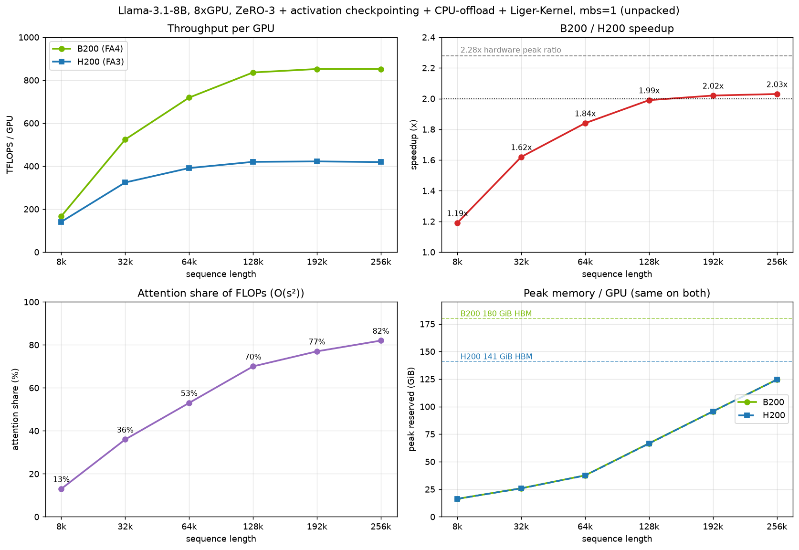

# 升级 GPU 什么时候才值得？ {#when-is-it-worth-upgrading-gpus}

这是一份实用指南，帮助判断升级 GPU 代际是否值回其价。文中用一个真实的 DeepSpeed 训练基准测试（meta-llama/Llama-3.1-8B，H200 上的 FlashAttention-3 对比 B200 上的 FlashAttention-4）作为具体的完整示例。这套框架建立在 Hopper H200 → Blackwell B200 的数字之上，但可以推广到任何“我该不该从 X 号 GPU 升级到 Y 号 GPU”的决策。

## 关键规格差异：H200 对比 B200 {#key-spec-differences-h200-vs-b200}

| 规格                                  | H200 SXM         | B200 SXM                | 倍数（B200/H200） |
| --------------------------------- | ---------------- | ----------------------- | ----------------: |
| 架构                          | Hopper           | Blackwell               |                 — |
| 计算能力                | sm90             | sm100                   |                 — |
| 注意力内核（HF 自动选择） | FlashAttention-3 | FlashAttention-4（beta 版） |                 — |
| bf16 峰值 TFLOPS（理论值）    | 989              | 2250                    |         **2.28×** |
| fp8 峰值 TFLOPS（理论值）     | 1979             | 4500                    |             2.27× |
| HBM 容量（可用）HBM3e       | ~141GiB          | ~180GiB                 |             1.28× |
| HBM 带宽                     | 4.8TBps          | 8.0TBps                 |             1.67× |
| TDP                               | 700W             | 1000W                   |             1.43× |

理论峰值 TFLOPS 是[一个现实中没人能达到的天花板](../../training/performance/README.md#tflops-as-a-performance-metric)——真正能做到多少，请看[后文的 MAMF 数字](#mamf-the-realistic-ceiling-not-the-marketing-number)。完整的规格表（所有数据类型、所有厂商、内存、功耗、频率）：[ml-engineering 加速卡规格表](../../compute/accelerator/README.md#tflops-comparison-table)。

## MAMF：现实中的上限，而不是营销数字 {#mamf-the-realistic-ceiling-not-the-marketing-number}

**MAMF（Maximum Achievable Matmul FLOPS，最大可达矩阵乘法 FLOPS）**是在真实硬件/软件上实测出来的 `matmul` 最佳吞吐（形状完美对齐、尺寸取到最大、不使用稀疏性）——与之相对的是物理上无法达到的理论峰值。可以用它来判断你自己的训练 TFLOPS 还有没有优化空间，还是已经接近天花板了（用 [`mamf-finder.py`](../../compute/accelerator/benchmarks/mamf-finder.py) 在你自己的 GPU 上测量 MAMF）。数据来源及跨多家厂商的完整对比：[MAMF 对比表](../../compute/accelerator/README.md#maximum-achievable-and-sustainable-matmul-flops-comparison-table)。

**BF16：**

| 加速卡   | MAMF（TFLOPS） | 理论值 | 效率 |
| ------------- | ------------: | ----------: | ---------: |
| H100/H200 SXM |         794.5 |         989 |      80.3% |
| B200 SXM      |        1745.0 |        2250 |      77.6% |

**FP8：**

| 加速卡 | MAMF（TFLOPS） | 理论值 | 效率 |
| ----------- | ------------: | ----------: | ---------: |
| H200 SXM    |        1453.4 |        1979 |      73.4% |
| B200 SXM    |        3432.5 |        4500 |      76.3% |

要点：*实际可达*的 bf16 倍率（1745/794.5 = **2.20×**）与理论上的 2.28× 非常接近，因为两颗芯片的效率相近（80.3% vs 77.6%）。而在 fp8 上，实际可达倍率甚至*高于*理论值（3432.5/1453.4 = **2.36×**），因为 B200 的 fp8 路径相对（76.3%）比 H200 的（73.4%）更成熟。无论如何，**2.2–2.4× 就是这次升级在纯矩阵乘法上现实可达的上限**——把注意力的提升幅度、稠密 GEMM 的成熟度和通信开销都考虑进来之后，真实的训练吞吐量会落在这个数字以下（[后文的完整示例](#worked-example-meta-llamallama-31-8b-training-step-fa3-vs-fa4)正好说明了会低多少，以及原因）。

## 决策框架第一部分——你需要新的数据类型吗？ {#decision-framework-part-1--do-you-need-a-new-dtype}

从这里开始，因为仅凭这一个问题就可能把决策定下来，完全不需要做基准测试。真正该先问的第一个问题不是*“它快了多少”*，而是*“新 GPU 能做到当前 GPU **做不到**的事吗？”*——而对于一次硬件跨代升级，最明显的这类能力差距就是**[新的低精度数据类型（dtype）](../../training/dtype.md)**。

Blackwell 新增了 Hopper **在硬件上完全无法执行**的 **FP4/NVFP4/FP6**——这与 FP4 推理或微缩放（microscaling）训练方案有关[^unlocks]。如果你要采用的方案需要这些格式之一，旧 GPU 的得分是零，而不是“慢 2 倍”——没有任何可测的东西，你要么需要这项能力，要么不需要。（注意：这也恰恰是*最*容易受软件成熟度风险影响的功能——芯片能做到，不代表框架/内核/数值方案已经能做到；参见[后文软件支持部分](#software-support-the-cost-of-switching-too-early)。）

**在*为了*某项功能升级*之前*，先确认你实际使用的软件支持它。** 一项你的软件栈用不上的硬件能力，就是白花出去的钱——规格表列出的是芯片*能*做什么，而不是你的框架/内核/库今天允许你做什么。例如：

- **NVLink-C2C**（基于 Grace 的系统上的 CPU↔GPU 一致性互联）纸面上很漂亮，但刚推出时几乎没有训练/推理软件利用它——所以在软件跟上之前，为它花钱买不来多少现实收益。
    - 类似地，完全可用的 flash attention 4 也过了好几个月才出现。在那之前只能继续用 flash attention 2，而它在 Blackwell 上非常慢，因为它无法利用新架构的优势。

对任何以功能为动机的升级，都要把“我的软件栈支持这个功能吗？”当作一道硬性关卡（并且要随着时间推移反复检查，因为支持会逐步完善）。

新 GPU 带来的其他一切——更多显存、更大带宽、更快的互联、更多裸 FLOPS——都只是*你已有东西在数量上的增加*，而不是全新能力，因此它们本身并不能决定决策；这要靠测量。这就是[第二部分](#decision-framework-part-2--is-it-worth-it-on-performance)的内容。

[^unlocks]: 各数据类型的峰值 TFLOPS（理论值），H200 → B200：bf16 989→2250，fp8 1979→4500，另外还有 Hopper 完全无法执行的格式——fp6 →4500，mxfp4 和 nvfp4 →9000。FP4 的吞吐量约为 fp8 的两倍，量化张量占用的显存/带宽则减半。让 4 位精度真正*可用*的，是 Blackwell 的**第二代 Transformer Engine 及其微缩放（microscaling）**：FP4 只有约 16 个可表示的值，所以整个张量共用一个缩放因子无法覆盖它的动态范围（小值会被归零，大值会饱和）。微缩放（MX / NVFP4）改为对每个小块（例如每 16–32 个值）使用单独的缩放因子，由张量核心在硬件中直接施加，不损失吞吐量——于是你在获得 FP4 约 2 倍速度和一半显存占用的同时，精度仍能保持在接近 fp8/bf16 的水平，而朴素的按张量 FP4 做不到这一点。（Hopper 的第一代 TE 已通过按张量缩放因子对 fp8 做了类似处理；Blackwell 的第二代把它扩展到了按块缩放的 fp4/fp6。）

## 决策框架第二部分——就性能而言值得吗？ {#decision-framework-part-2--is-it-worth-it-on-performance}

如果你不需要[第一部分](#decision-framework-part-1--do-you-need-a-new-dtype)所涉及的新功能，那么升级就是一个“花钱能买到多少速度和容量”的量化问题——而这必须由你亲自**测量**。在相信任何厂商的幻灯片或单个基准测试数字之前，请先走完下面这些步骤：

1. **让两块 GPU 的软件栈完全一致。** 新旧硬件上使用相同的 torch/CUDA/库版本——新 GPU 往往*也是*在更新的软件栈上验证过的，仅软件栈差异本身就可能带来两位数的百分比差距（参见后文[“在完全相同的软件栈上比较”](#caveats)）。要做对等的比较。
2. **找出你的负载中注意力与稠密部分的占比，以及它随你的真实配置如何变化。** 新一代 GPU 对注意力（FlashAttention 内核）的提升通常远快于稠密 GEMM 的成熟速度（cuBLAS/cuDNN 在新架构上需要时间才能追上）。如果你的负载以注意力为主（长上下文），你获得的收益会比短上下文/稠密计算受限的负载大得多——而且这个占比不是固定的，它会随序列长度增长。要测量，不要假设。[^linear-attn]
3. **针对*你的*负载，权衡新 GPU 在硬件数量上的优势——显存、带宽、互联。** 这些只是“量”的提升，不是新能力，所以它们的价值取决于具体负载，必须测量：
    - **更多显存**（例如 180 vs 141GiB）是最处于临界状态的一项。它能让那些在旧 GPU 上会 OOM（显存溢出）的配置跑起来，还能让你丢掉那些牺牲吞吐量的“拐杖”（CPU 卸载、更高的 ZeRO 阶段、激活检查点）——所以重新调优之后，*实际*加速比甚至可能超过裸 FLOPS 之比。但“装不下”很少是一堵硬墙：几乎总是可以靠更多并行（更多 GPU + [ZeRO/TP/CP/SP/PP/EP](../../training/model-parallelism/README.md)）在旧 GPU 上把模型塞进去，所以这通常是*成本/效率*的权衡，只有当为了装下所需的额外 GPU/并行带来的开销或拖慢，超过用新硬件的代价时，天平才会倒向“直接升级”。（在极端情况下——当你负担得起的任何并行方式都装不下时——显存就真的成了一种硬性能力差距，就像新数据类型一样。）
    - **更高的 HBM 带宽**（8.0 vs 4.8TBps，约 1.67 倍）决定了带宽受限工作（norm、逐元素运算、优化器、KV 缓存流量）的上限以及解码受限的推理延迟；收益取决于你的负载实际上有多受带宽限制。
    - **更快的互联**（更新的 NVLink/NVSwitch/NVLink-C2C）抬高了 ZeRO/TP/CP/SP/PP/EP 通信、各种主机内存卸载策略以及多节点扩展的上限；收益取决于你有多受通信限制。
4. **计算 $/词元（或 $/step），而不只是 TFLOPS/step。** 2 倍的加速配上 2 倍的价格，在成本上就是打平的，真正决定胜负的是 (a) 墙钟时间（wall-clock time，即实际经过的时间）和 (b) 显存余量。
5. **留意那些会让实验室数字虚高或虚低的现实因素**——打包与未打包的序列、beta 质量的内核、软件栈不一致。具体例子见[后文注意事项](#caveats)。

[^linear-attn]: 随着更新的模型转向**线性/混合注意力**（Gated DeltaNet、Mamba 风格的 SSM（状态空间模型）、滑动窗口注意力，以及把少数全注意力层穿插在许多线性注意力层之间的 MoE 混合架构），驱动这种长上下文优势的 O(s²) 全注意力占比正在不断缩小。线性注意力是 O(s) 的，所以它的行为更像稠密路径而不像全注意力——让新 GPU 在长上下文上大放异彩的那个二次项，在这些模型中所占的比例*比*在经典全注意力 transformer 中小得多。如果你的目标模型是混合/线性注意力架构，不要用 Llama-3 模型家族这类全注意力模型的加速比去外推；要针对那个具体架构跑基准测试（它的内核也更“年轻”——参见[后文软件支持部分](#software-support-the-cost-of-switching-too-early)）。

本文余下内容会以 H200→B200 的例子，端到端地把这些步骤完整走一遍。

## 完整示例：meta-llama/Llama-3.1-8B 训练步，FA3 对比 FA4 {#worked-example-meta-llamallama-31-8b-training-step-fa3-vs-fa4}

设置：meta-llama/Llama-3.1-8B，真实权重，bf16，8 块 GPU，DeepSpeed，mbs=1，前向+反向+优化器 step。注意力使用 HF 原生的 `attn_implementation`，按 GPU 自动选择：**H200 → FA3，B200 → FA4**。

### 结果：加速比随序列长度增长 {#results-speedup-grows-with-sequence-length}

两块 GPU 使用相同配置（ZeRO-3 + 激活检查点 + CPU 卸载 + Liger-Kernel），测量稳态 TFLOPS/GPU：

| 序列长度 | 全注意力<br>占整步比例 | H200<br>TFLOPS | H200<br>MFU | B200<br>TFLOPS | B200<br>MFU |   加速比 |
| -----: | -------------------------: | -------------: | ----------: | -------------: | ----------: | --------: |
|     8K |                       ~13% |            141 |         14% |            167 |          7% | **1.19×** |
|    32K |                       ~36% |            324 |         33% |            524 |         23% | **1.62×** |
|    64K |                       ~53% |            391 |         40% |            719 |         32% | **1.84×** |
|   128K |                       ~70% |            420 |         42% |            836 |         37% | **1.99×** |
|   192K |                       ~77% |            422 |         43% |            852 |         38% | **2.02×** |
|   256K |                       ~82% |            419 |         42% |            852 |         38% | **2.03×** |



**为什么加速比会随序列长度增长（注意力与稠密占比的实际作用）：** 因果注意力每步的代价是 `6·s²·d·h·L`（O(s²)）；稠密路径的代价是 `6·N·tok`（O(s)）。更长的序列会把注意力在整个训练步中的占比推高，而注意力恰恰是 FA4/Blackwell 优势集中的地方——只提升约 1.7 倍的稠密路径（在这个尺寸下受带宽限制，加上还很“年轻”的 sm_100 cuBLAS）则缩小到只剩舍入误差的水平。恒等式 `speedup ≈ 2.28 × MFU_ratio` 全程成立——与 2.28 倍之间剩下的差距来自 FA4-beta 的开销，它即使在纯注意力上也没有达到完整的硬件倍率。

**FLOPs 计数约定：** 这些 TFLOPS/MFU 数字是*模型* FLOPs（[MFU](../../training/performance/README.md#mfu-vs-hfu)），注意力按**因果**方式计数（`6·s²·…`，即 FlashAttention 实际计算的下三角部分——非因果的 `12·s²` 会把注意力多算一倍，在长上下文下虚增 MFU）。激活检查点的重计算*不计入*——计入的话就成了 HFU（会高约 1.3 倍）。两种约定在 B200/H200 的加速比比值中都会相互抵消，所以只有绝对的 MFU/TFLOPS 取决于这一选择，报告的主要加速比不受影响。

**8k 的注意事项：** 这个重型配置（ZeRO-3 + 激活检查点 + CPU 卸载）是为了跑到 256k 才这样设置的，所以在 8k 时它只有纯粹的开销，没有足够的计算量来掩盖 → B200 的 MFU 只有一位数，加速比只有 1.19×。一个针对 8k 合理配置的运行（ZeRO-2，不开激活检查点/卸载）在远高于此的 MFU 下可以达到约 1.69×——见[后文“稠密路径的差距从何而来”](#where-the-dense-path-deficit-comes-from-why-not-the-full-228)。**教训：不要把长上下文配置放在短上下文下跑基准测试，然后声称结果有代表性。**

### 更大的 GPU 能解锁旧 GPU 跑不了的配置吗？ {#does-the-bigger-gpu-unlock-configs-the-old-one-cant-run}

配置：ZeRO-3、Liger-Kernel、开启激活检查点、开启 AdamW 优化器状态的 CPU 卸载，mbs=1。在激活检查点 + 融合 CE 的条件下，[激活显存](../../training/performance/README.md#anatomy-of-models-memory-usage)很小且呈线性：**峰值 ≈ 12.6GiB + 0.00043GiB/词元**（12.6GiB 的下限来自 ZeRO-3 的参数/梯度分片；AdamW 状态存放在 CPU 上）。

峰值显存（`max_memory_reserved`，取最差的 rank，即所有训练进程中显存占用最高的那个）在**同一序列长度下，H200 与 B200 完全相同**——它由模型 + ZeRO-3 分片 + 激活决定，而不是 GPU 架构——所以能装进其中一块 GPU 的序列长度也能装进另一块，直到各 GPU 自身的上限为止：

|   序列长度 | H200 峰值（GiB） | B200 峰值（GiB） | H200 TFLOPS | B200 TFLOPS |
| -------: | --------------: | --------------: | ----------: | ----------: |
|       8K |            16.3 |            16.3 |         141 |         167 |
|      32K |            25.8 |            25.9 |         324 |         524 |
|      64K |            37.5 |            37.6 |         391 |         719 |
|     128K |            66.5 |            66.7 |         420 |         836 |
|     192K |            95.7 |            95.7 |         422 |         852 |
| **256K** |       **124.5** |       **124.6** |     **419** |     **852** |

在 H200 约 130GiB 的可用显存预算下，最长可到**峰值约 125GiB 的 256k 词元**，在两台机器上都得到了验证（峰值显存吻合在约 0.2GiB 以内）。B200 更大的 HBM（180 vs 141GiB）可以推过约 350k 词元——这种序列长度 H200 **花多少钱都装不下**——而这恰恰是 B200 加速比最大的区间。这就是[第二部分](#decision-framework-part-2--is-it-worth-it-on-performance)中“更多显存”优势的极端形态：超过 256k 之后，比较不再是“B200 更快”，而是“H200 干不了这个活”。

### 注意事项 {#caveats}

1. 未打包序列与打包序列

    上面的每次运行都只输入**一条完整连续的序列** → 这是真正完整的全 O(s²) 注意力，正是这一点使注意力在 256K 时占到约 82% 的 FLOPs（即加速比表格中的[“全注意力占整步比例”列](#results-speedup-grows-with-sequence-length)），也带来了 ≥2 倍的加速。真实训练常常会用文档掩码（document mask）把短样本**打包（pack）**进序列，使注意力代价变成 `Σ lenᵢ²` 而不是 `(Σ lenᵢ)²`。例如，把每个约 8k 词元的样本打包进一条 256k 的序列 → 注意力只在每个样本*内部*计算，所以它的 FLOPs 下降约 32 倍（总注意力计算量从 `256k²` 降到 `Σ lenᵢ² = 256k·8k`，倍数为 `256k ÷ 8k = 32`；下降倍数 = 打包后的序列长度 ÷ *平均样本长度*，由每个样本有**多短**决定，而不由你打包了**多少条**决定）。这把注意力占比打回到了真正的 8k 序列时的约 13%（即[上文的 8K 行](#results-speedup-grows-with-sequence-length)），于是加速比又退回到我们在那里直接测过的稠密计算受限状态——**约 1.7×**（参见[后文“稠密路径的差距从何而来”](#where-the-dense-path-deficit-comes-from-why-not-the-full-228)），而不是真正长上下文的约 2×。≥2 倍的结果只适用于*单篇*文档确实很长的情况——在假定这个吸引眼球的数字适用于你的场景之前，先确认你的负载实际处于哪种状态。

2. 在完全相同的软件栈上比较

    我在写这份指南时起初没有留意这一点，拿运行 torch **2.10.0/cu129** 的 H200 与运行 torch **2.13.0/cu130** 的 B200 做了比较，得到了非常不同的结果，B200 占了极大的便宜。我怀疑是 CUDA 版本的问题，于是只在 H200 上重新跑了整个扫描，覆盖 torch 2.10.0–2.13.0，并同时用 cu129 和 cu130——结果发现 CUDA 几乎无关紧要。真正的推手是 **PyTorch 本身**：2.12.0 及更高版本明显快于 2.11.0 及更早版本，与 CUDA 版本无关。在 8k、相同 GPU/模型/配置下，分别独立扫描 torch 和 CUDA：

   | H200 @ 8k，TFLOPS/GPU | torch 2.10.0 | 2.11.0 | 2.12.0 | 2.13.0    |
   | --------------------- | ------------ | ------ | ------ | --------- |
   | **cu129**             | 113.8        | –      | –      | 140.4     |
   | **cu130**             | 117.8        | 120.5  | 140.1  | **140.2** |

   在 H200 上把 torch 从 2.10.0 一路升到 2.13.0，固定 cu130 时是 **+19%**（117.8 → 140.2TFLOPS），而且几乎所有增益集中在一处——仅 torch 2.11.0 → 2.12.0 这一跳就有 **+16%**（120.5 → 140.1）。相比之下，CUDA 最多贡献约 3.5%（在 torch 2.10.0 下 113.8 → 117.8），到 torch 2.13.0 时几乎为零（140.4 vs 140.2）。所以，最初引发这项调查的 2.10.0/cu129 → 2.13.0/cu130 比较（113.8 → 140.4，**+23.4%**）几乎完全是一个 **PyTorch 版本造成的假象，不是硬件差异，甚至也不是 CUDA**。本文的所有结果都在两台机器上使用完全相同的软件栈（torch 2.13.0/cu130，deepspeed 0.19.2）。**如果你跳过这一步检查，就会系统性地高估那台恰好在更新的 PyTorch 版本上做基准测试的 GPU。**

### 价格约为 H200 两倍的 B200 值得吗？ {#is-b200-worth-2-the-h200-cost}

为简单起见，我们假设成本差距是 2 倍——新一代 GPU 家族刚开始上市时通常就是如此。Blackwell 自 2026 年年中起已经出货了一段时间，所以实际的成本差距已经低于 2 倍。

在你实际的计算中，请使用你拿到的报价，而不是网上查到的信息。

那我们就按 2 倍价格差的假设来算这笔账：

- **长的未打包上下文（128k–256k）：** 约 2.0 倍的吞吐量对应约 2 倍的成本 → $/词元打平，之后还有两项带来净收益：(1) **墙钟时间减半**；(2) **更多显存**解锁了 H200 完全装不下的上下文长度（≥256k）——而那恰恰是 B200 加速比最高的地方，两者相互叠加。
- **短上下文/打包短样本（稠密计算受限）：** 约 1.7 倍对应 2 倍成本 → 就 $/词元而言今天是**亏**的。在这个批次大小下，稠密路径受带宽限制而非计算能力限制（参见[后文“稠密路径的差距从何而来”](#where-the-dense-path-deficit-comes-from-why-not-the-full-228)），所以不要指望仅靠 cuBLAS 在 sm_100 上成熟起来就能补上到 2.28 倍的差距——它收敛的是 **约 1.67× 的 HBM 带宽上限**。要在这里更接近 2.28 倍，需要更大的批次/更大的 GEMM，让稠密路径重新变成计算受限。

**$/词元之外——时间维度。** 只看单位成本的性能可能是错误的指标，因为它把便宜但慢的方案和贵但快的方案当成等价的——只要它们每个词元的成本相同——却忽略了*拿到结果的墙钟时间*。

- 对训练来说，一次运行多花一倍时间，可能意味着输掉率先上市的竞争，这不是任何 $/词元 的节省能够弥补的。
    - 对推理来说，慢 2 倍的性能会直接损害用户体验——更高的 TTFT（首词元时间，time to first token）和 TPOT（每输出词元时间，time per output token）——无论每个词元的账算起来多有吸引力，都可能让你失去用户。
    - 原则上，你可以往问题上投入约 2 倍数量的较便宜 GPU，把速度“买”回来，但这通常意味着*更多*的跨 GPU（而且往往是跨节点）通信，这会增加开销，蚕食——甚至超过——你本来想追回的那部分加速，对通信受限的负载尤其如此。所以要把原始的速度优势当作一个独立的维度来权衡，而不只是 $/词元 比值中的一项。

**本例的结论：** 值得——如果确实是长上下文的训练，就升级；对短上下文/打包类负载则先等一等，因为那里的稠密路径受带宽限制而非计算能力限制（参见[后文“稠密路径的差距从何而来”](#where-the-dense-path-deficit-comes-from-why-not-the-full-228)），在这个批次大小下达不到完整的 2.28 倍硬件比率。

### 稠密路径的差距从何而来（为什么不是完整的 2.28×？） {#where-the-dense-path-deficit-comes-from-why-not-the-full-228}

对 8k 训练步的深入分析（ZeRO-2、不开激活检查点、按短上下文合理配置），解释稠密路径*为什么*会把加速比压在硬件倍率之下。下面三个分桶共用**同一个时钟**——即实测的墙钟步时，按各分桶在计算流内核时间中的占比来划分（注意力 = FlashAttention 内核；NCCL 梯度通信与反向传播重叠，被隐藏在墙钟时间里）——因此各分桶与合计天然就能对得上。可用 [`bench_decompose.py`](bench_decompose.py) 复现。

**8k 训练步分解**（注意力约占 FLOPs 的 13%、步时的 12%；稠密路径是其余部分）：

| 分桶            | H200<br>TFLOPS | H200<br>MFU | B200<br>TFLOPS | B200<br>MFU |     倍率 |
| --------------- | -------------: | ----------: | -------------: | ----------: | --------: |
| 注意力（FA）  |            447 |         45% |            834 |         37% |     1.87× |
| 其余部分 |            463 |         47% |            771 |         34% |     1.67× |
| **合计**       |            461 |         47% |            778 |         35% | **1.69×** |

有两点值得注意：

- **注意力（FA4 对比 FA3）达到 1.87 倍**，这是在*整步之内*实测的，与孤立的微基准测试一致（[`bench_flash_attn.py`](bench_flash_attn.py)，FA4 对比 FA3，8B 注意力形状，因果模式：前向+反向 **1.88× @ 8k → 1.95× @ 32k**）。注意力已经接近 2.28 倍的上限，*不是*瓶颈。
- **真正的上限是稠密的“其余部分”分桶，只有 1.67 倍**——几乎正好等于 **HBM 带宽比**（8 vs 4.8TBps = 1.67×）。在 mbs=1 × 8k 下，每块 GPU 上的 GEMM 很小，稠密路径受带宽/开销限制（norm/RoPE/SwiGLU/CE 的逐元素运算 + NCCL 通信 + 瘦长的 GEMM），所以 Blackwell 的 2.28 倍*计算*优势基本闲置，这个分桶转而跟着内存带宽走。这使混合后的总倍率被拖低到 **1.69×**。

**Liger-Kernel**（融合的 RMSNorm/RoPE/SwiGLU/CE）在 8k 下是**显存上的收益，不是速度上的收益**：它把峰值显存降低约 20%（**99 → 80GiB**，两块 GPU 上相同），而步时变化在噪声范围内（两台机器上都 ≤1.5%），整体倍率也基本不变（约 1.66×）。在这里，融合那些带宽受限的逐元素运算并不能提高吞吐量，因为稠密路径的限制因素是 GEMM 尺寸和通信，而不是这些运算——这与该分桶跟随 HBM 带宽的现象一致。sm_100 的 cuBLAS 比 Hopper 的 cuBLAS 更“年轻”，且取这些数字时 FA4 还处于 beta 阶段（后来已作为 `flash-attn-4` 包正式发售），所以稠密路径的这个差距应该会随时间缩小——请定期重跑这个基准测试，不要把今天的数字当成永久结论。

### 这些实验所用的环境 {#environment-used-for-these-experiments}

|                                      | B200                         | H200               |
| ------------------------------------ | ---------------------------- | ------------------ |
| GPU                                  | NVIDIA B200                  | NVIDIA H200        |
| 注意力                            | flash-attn-4 4.0.0b22（beta 版） | flash-attn-3 3.0.0 |
| PyTorch / CUDA                       | 2.13.0 / cu130               | 2.13.0 / cu130     |
| deepspeed                            | 0.19.2                       | 0.19.2             |
| python / transformers / Liger-Kernel | 3.12.12 / 5.14.1 / 0.8.0     | （相同）             |

## 软件支持：过早切换的代价 {#software-support-the-cost-of-switching-too-early}

新芯片几乎总是先于能充分利用它的软件栈推出。“GPU 买到了”和“GPU 能以标称性能*用于*你的负载”之间可能相隔数月——而且这种差距可能因模型架构而异，不只是因 GPU 而异。它会表现为两种具体的形式，在这份基准测试里都能直接看到：

1. **优化内核本身可能仍是 beta 版。** 这里 B200 的注意力路径用的是 `flash-attn-4 4.0.0b22`——一个 beta 发布版，不是正式版（GA）。beta 内核在 1.0 之前可能有正确性缺陷、缺失的功能和破坏兼容性的 API 变更；要锁定确切的版本，每次升级版本都重新测试，并去查项目的 issue 跟踪页，而不是想当然地认为“PyPI 上有包”就等于可用于生产。
2. **即使主角内核没问题，栈的其余部分也可能落后。** 这里孤立的注意力（FA4 对比 FA3）已经能达到约 1.9 倍，接近 2.28 倍的硬件倍率（见前文[“稠密路径的差距从何而来”](#where-the-dense-path-deficit-comes-from-why-not-the-full-228)）——但*稠密*路径只到约 1.7×（它跟着 HBM 带宽比走，在这个尺寸下受带宽/开销限制；而且 Blackwell 在新 `sm_100` 架构上的 cuBLAS 比 Hopper 的更“年轻”，后者已经用多年时间成熟起来了）。最终效果就是：你可能已经在用目前最好的注意力内核，看到的却仍只是理论加速比的一小部分，因为软件栈中不那么光鲜的一环——没人愿意写进幻灯片的那部分——还没有跟上。

**在把预算投入到新架构之前，请先过一遍这份实用检查清单：**

<!---->

- 在内核库的 issue 跟踪页中，搜索你所用 GPU 的确切计算能力（例如 `sm_100`）以及你的模型所用注意力/MoE 机制的名称——README 里写着“支持”，并不意味着已达到正式版质量，甚至不代表有预编译的 wheel 包可用。
- 确认你的训练框架（DeepSpeed、Megatron-LM、TorchTitan 等）有一个*已发布的*、针对新计算能力验证过的版本——“应该能用，反正都是 CUDA”和“经过测试”是两码事。
- 如果你的模型使用非标准算子（线性注意力、MoE 路由、稀疏注意力、融合的自定义 CUDA 扩展），要核实确实有人在新架构上把它构建出来*并跑过基准测试*。不要因为 GPU 更快，就想当然认为它会自动继承 GPU 的加速。
- 定期重新测量，不要相信一次性的结论。beta 内核和稚嫩的 GEMM 库都进步飞快；[cuBLAS 成熟度差距](#where-the-dense-path-deficit-comes-from-why-not-the-full-228)正是这种不断变化的目标，几个发布周期内就可能把“还不值得”翻转成“值得”——如果出现倒退，也会朝反方向翻转。

## 先租用新的目标硬件 {#rent-the-new-target-hardware}

虽然你也许可以依靠别人替你做的分析工作（比如这份指南），但典型情况是各人的负载不同，最好还是用你自己的确切负载跑基准测试。

因此，我建议先租下至少一个你所考虑的目标 GPU 的节点，在上面跑基准测试。

如果你的负载涉及多节点，可以先试着把负载缩减到单个节点，在那里做性能比较。例如缩减模型的层数，让它小得多——机器学习模型架构通常就是一摞完全相同的重复层，所以[把 48 层的模型裁到 1-2 层](../../debug/pytorch.md#reducing-the-number-of-layers-for-large-models)只消耗很少的 GPU 显存，应当能轻松放进单个节点，同时每一层的计算/内存行为仍具有代表性。

如果负载涉及多节点，你最终肯定还是要对完整的“最小副本”配置跑一次基准测试，但可以把这一步推迟到确认单节点比较的结果支持升级 GPU 之后再去做。如果结果不支持，你就省下了租用额外节点所需的时间和钱。

## 把这套框架应用到你自己的升级决策上 {#applying-this-framework-to-your-own-upgrade-decision}

换成你自己的模型、GPU 和价格，然后走完这个由两部分组成的决策框架——先[第一部分](#decision-framework-part-1--do-you-need-a-new-dtype)，再[第二部分](#decision-framework-part-2--is-it-worth-it-on-performance)——先做功能检查，如果功能还不足以决定，再走性能步骤：

1. 在两块 GPU 上锁定完全相同的软件栈（见前文[“在完全相同的软件栈上比较”](#caveats)）——否则你测的不是硬件，而是软件栈。
2. 沿着会改变注意力/稠密（或其他“被加速/未被加速”）比例的维度做扫描——对 LLM 训练来说是序列长度；对其他负载则可能是批次大小、分辨率，或者完全不同的东西。
3. 在旧 GPU 上把受显存限制的配置一路推上去，直到 OOM，并查看新 GPU 还能额外装下什么。
4. 拿到新旧 GPU 各自实际的 $/GPU 小时价格，并在扫描的每一个取值点（而不仅是扫描的最高端）计算 $/词元或 $/step。
5. 排查会让比较失效的隐患：beta 内核、打包与未打包的数据、热降频、同一节点上不同 GPU 之间的“体质”差异（silicon lottery，见[并非所有加速卡都一样](../../compute/accelerator/README.md#not-all-accelerators-are-created-equal)）。

如果你用 [FSDP](../../training/model-parallelism/README.md) 来做扩展——它的性能与 DeepSpeed ZeRO 应当大致相当——你可能需要对配置稍作调整以匹配你的确切环境，但当然，理想情况下应当直接对你实际使用的软件跑基准测试。
## 同代升级 {#same-generation-upgrades}

上文比较的都是两个*代际*之间的差异（Hopper → Blackwell）。而同一代际内的刷新——比如 B200 → **B300**（"Blackwell Ultra"）——则是另一种通常要小得多的决策。同样的两部分决策框架依然适用——[第 1 部分（你需要新的 dtype 吗？）](#decision-framework-part-1--do-you-need-a-new-dtype)和[第 2 部分（从性能上看值得吗？）](#decision-framework-part-2--is-it-worth-it-on-performance)——只是答案会沿着可预期的方向变化。

| 规格                                     |    B200 SXM |      B300 SXM |     倍率 |
| ---------------------------------------- | ----------: | ------------: | -------: |
| bf16 / fp8 TFLOPS（理论值）              | 2250 / 4500 |   2250 / 4500 |     1.0× |
| mxfp4 / nvfp4 TFLOPS（理论值）           | 9000 / 9000 | 13500 / 13500 |     1.5× |
| bf16 MAMF（可达值）                      |        1745 |          1769 |   ~1.01× |
| HBM（可用）                              |     ~180GiB |       ~288GiB | **1.6×** |
| HBM 带宽                                 |     8.0TBps |       8.0TBps |     1.0× |
| TDP                                      |       1000W |         1300W |     1.3× |

这对"是否该升级"的决策框架意味着什么：

- **[第 1 部分](#decision-framework-part-1--do-you-need-a-new-dtype)（你需要新的 dtype 吗？）很少触发。** B300 没有引入任何 B200 缺少的 dtype。唯一*可能*起到第 1 部分那种能力差距作用的东西是**显存**：288 对 180GiB（1.6×）是很大的跨度，因此一个即便用并行切分也塞不进 B200 节点的模型/配置，也许可以直接塞进 B300 节点。
- **[第 2 部分](#decision-framework-part-2--is-it-worth-it-on-performance)（从性能上看值得吗？）：唯一实打实的算力提升在 fp4（1.5×）**——bf16/fp8 没有任何变化，所以 B300 的收益主要来自低精度推理/训练，以及多出来的显存。
- **软件成熟度风险很低。** 同一架构家族（`sm_100`）、同一套 FA4/内核栈——完全不存在跨代升级情形里那种"过早切换"的代价。

## 复现本基准测试 {#reproduce-this-benchmark}

本指南中的每一个数字都来自这个文件夹里的脚本。没有任何数字是手工录入的——下面准确说明哪个脚本产出哪张表/哪幅图，你可以据此重新生成它们（也可以在你自己的 GPU/模型上重跑）。所有脚本都会**自动检测 GPU**（Hopper→FA3，Blackwell→FA4），并在输出头部打印解析出的后端和完整环境变量，因此两台机器上跑的*是同一组命令*。

### 文件一览 {#files-at-a-glance}

| 文件                    | 用途                                                                                                                                                                                                                                                | 产出                                                                              |
| ----------------------- | -------------------------------------------------------------------------------------------------------------------------------------------------------------------------------------------------------------------------------------------------- | --------------------------------------------------------------------------------- |
| `install.sh`            | 一次性安装：锁定版本相互匹配的 torch/CUDA/依赖，安装 FA3（Hopper）或 FA4（Blackwell），并把模型预置到本地磁盘                                                                                                                                       | 两台机器上完全相同软件栈的环境（即"在相同软件栈上比较"这条注意事项）              |
| `benchmark.py`          | 训练循环（fwd+bwd+step），使用真实权重，逐步打印 JSON（`tflops`、`peak_mem_gib`）；配置块在脚本开头，可用环境变量覆盖（`SEQ_LEN`、`STEPS`、`WARMUP_STEPS`、`ZERO_STAGE`、`OFFLOAD_OPTIMIZER`、`GRAD_CHECKPOINT`、`USE_LIGER`、`MEM_DEBUG`）       | 加速比表和显存表中的一行                                                          |
| `run_sweep.sh`          | 驱动 `benchmark.py` 依次跑一组序列长度，日志写入 `results_<gpu>_<ts>.log`                                                                                                                                                                           | **加速比—序列长度**表和**最大序列长度/显存**表                                    |
| `bench_flash_attn.py`   | 独立的 FA3/FA4 注意力内核微基准测试（跨各序列长度的 fwd + fwd/bwd TFLOPS）                                                                                                                                                                          | "稠密路径的差距从何而来"一节中的**独立注意力**数字                                |
| `bench_decompose.py`    | 剖析一个训练步，在同一时钟下把实测墙钟时间（wall time）拆成注意力（FlashAttention 内核）与其他所有部分两类桶（bucket）（可用环境变量覆盖：`SEQ_LEN`、`ZERO_STAGE`、`GRAD_CHECKPOINT`、`OFFLOAD_OPTIMIZER`、`USE_LIGER`）                            | "稠密路径的差距从何而来"一节中的**步分解**表                                      |
| `plot_results.py`       | 用扫描（sweep）数字绘制 matplotlib 图（数据硬编码在脚本开头）                                                                                                                                                                                       | `results_plot.png`                                                                |

### 步骤 1——在每台 GPU 上搭建完全相同的软件栈（每个节点一次） {#step-1--set-up-an-identical-stack-on-each-gpu-once-per-node}

在 H200 和 B200 两台机器上运行同一个安装脚本。它会锁定完全相同的 torch/CUDA/依赖版本，使唯一预期中的差异只剩下注意力后端，然后在 Hopper 上自动安装 FA3、在 Blackwell 上自动安装 FA4，并把模型预置到本地磁盘：

```bash
./install.sh  # H200 -> FA3，B200 -> FA4（自动检测）；可用 --force fa3|fa4 覆盖
```

`HF_HOME` 默认指向 `~/.cache/huggingface`；模型（`meta-llama/Llama-3.1-8B`）必须已经存在于那里（比如先运行 `hf download meta-llama/Llama-3.1-8B`）。安装脚本的最后一步会校验整个软件栈，并发起一次很小的 FA 调用，以捕捉 ABI 不匹配的问题。

### 步骤 2——在一台 GPU 上运行序列长度扫描（加速比 + 显存表） {#step-2--run-the-sequence-length-sweep-on-each-gpu-speedup--memory-tables}

```bash
SEQLENS="8192 32768 65536 131072 196608 262144" GPUS=8 ./run_sweep.sh # -> results_<gpu>_<ts>.log
```

两台机器上都要运行。每个训练步会打印一行类似 `{"step": 5, "warmup": false, "exec_time_ms": ..., "tflops": ..., "peak_mem_gib": ...}` 的 JSON；取稳态（非预热）的 `tflops` 用于吞吐量/加速比表，取 `peak_mem_gib` 用于显存表。B200/H200 的加速比就是两台机器在每个序列长度上 `tflops` 的比值。（如果省略环境变量，默认值为：单一序列长度 196608、8 块 GPU、10 个训练步 + 2 个预热步。）定义这次运行的全部配置——ZeRO-3、激活检查点、把 AdamW 卸载到 CPU、Liger-Kernel、mbs=1——都在 `benchmark.py` 的配置块里，并且会在每次运行的头部打印出来。

### 步骤 3——独立的注意力微基准测试（稠密路径深入分析） {#step-3--isolated-attention-micro-benchmark-dense-path-deep-dive}

```bash
python bench_flash_attn.py   # 打印 FA3 或 FA4 在每个序列长度上的 fwd / fwd+bwd TFLOPS
```

两台机器上都要运行；每个序列长度上 `fwd_bwd_tflops` 的 FA4/FA3 比值就是"独立注意力"的结果，它表明注意力本身就能扩展到约 1.9×——也就是说，限制端到端加速比上限的不是 FA，而是稠密路径。

### 步骤 4——步分解（注意力 vs 其他所有部分的桶） {#step-4--step-decomposition-attention-vs-everything-else-buckets}

```bash
for L in 0 1; do USE_LIGER=$L deepspeed --num_gpus=8 bench_decompose.py; done  # L=0 为基线，L=1 为 Liger
```

两台机器上都要运行。它先测量训练步的墙钟时间（剖析器关闭），然后剖析一个窗口，按各部分占计算流内核时间的比例，把这段实测时间拆成一个注意力桶（FlashAttention 内核）和一个其他所有部分的桶（NCCL 通信与反向传播重叠，被视为已被掩盖而排除在外）。由于两个桶都是从*同一个*实测步中切分出来的，按构造它们与总时间必然严格吻合——这就是**步分解**表。每个桶的 B200/H200 比值就是该桶的加速比（注意力约 1.87×，稠密路径约 1.67×）。

### 步骤 5——显存占用调查（可选） {#step-5--the-memory-usage-investigation-optional}

```bash
MEM_DEBUG=1 SEQ_LEN=32768 deepspeed --num_gpus=8 benchmark.py
```

`MEM_DEBUG=1` 会在 fwd/bwd/step 前后加入分阶段的 allocated/reserved 显存探针，并在 rank 0 上转储一份 `torch.cuda.memory._record_memory_history` 快照——这对[诊断显存占用](../../training/performance/README.md#memory-profiler-tools)很有用。

### 步骤 6——重新生成结果图 {#step-6--regenerate-the-plot}

```bash
python plot_results.py       # -> results_plot.png
```

注意：`plot_results.py` 把扫描得到的数字**硬编码在脚本开头**（它不会解析 `.log` 文件）。如果你重跑扫描后得到了不同的数字，请相应更新 `plot_results.py` 中的数组和上文各表格，使二者一致，然后重新生成。

## 延伸阅读 {#further-reading}

- [加速卡](../../compute/accelerator/README.md)——完整规格表（所有厂商、所有 dtype）、MAMF 方法论、显存/功耗/频率参考资料、芯片体质（silicon lottery）与散热方面的说明。
