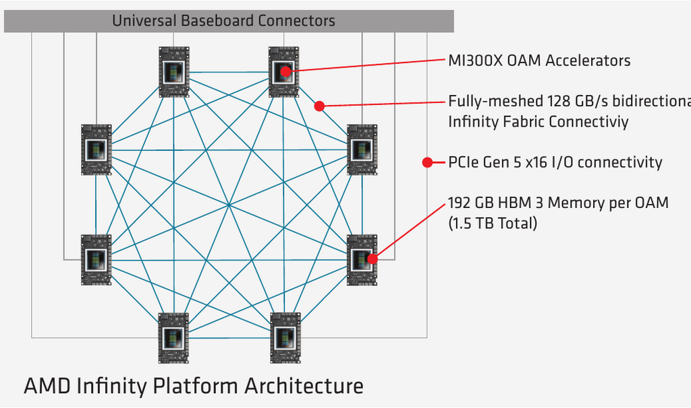
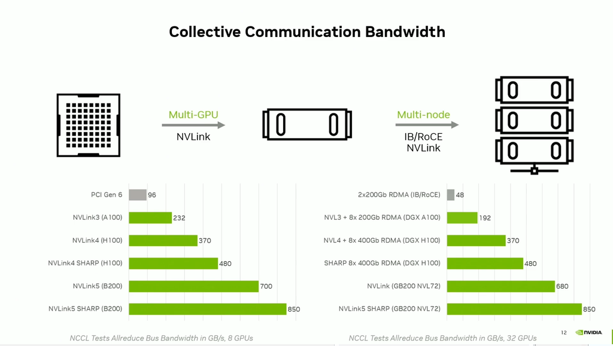
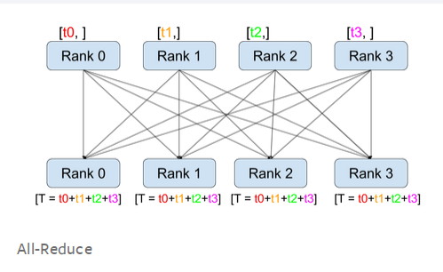
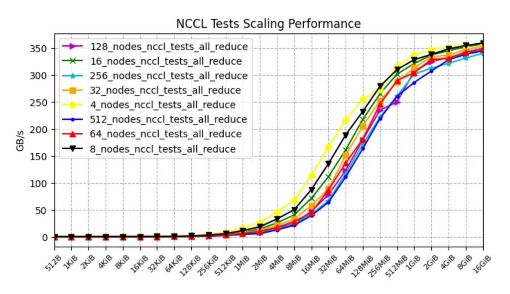
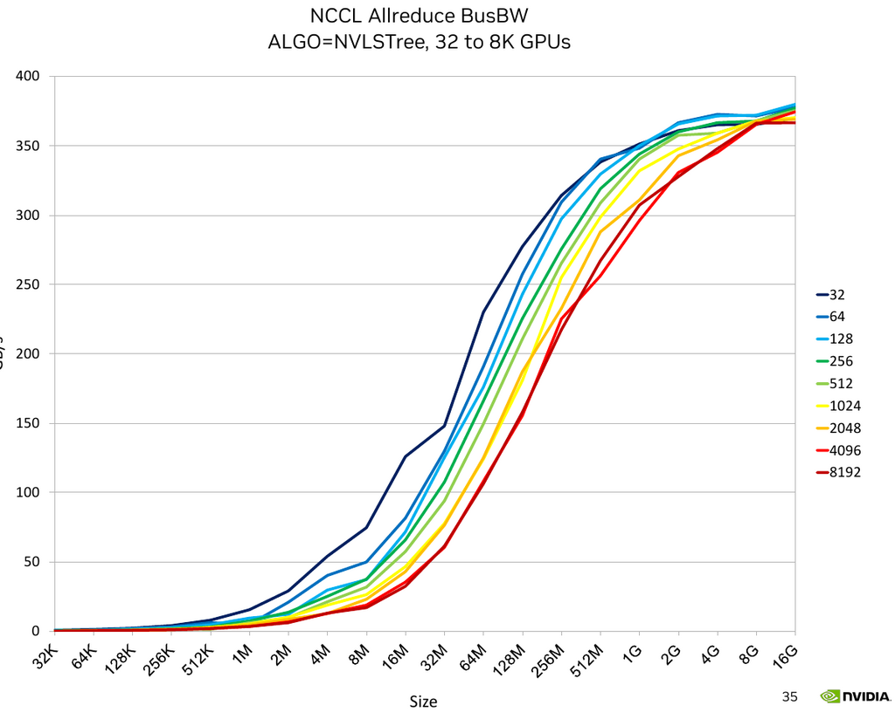
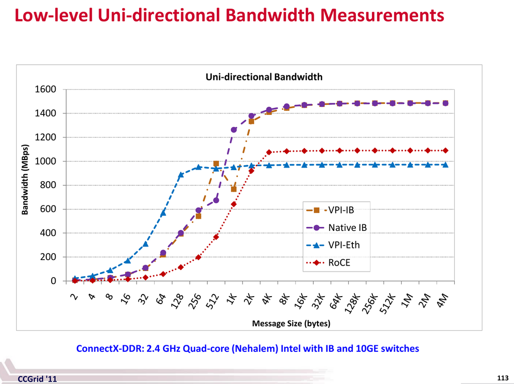
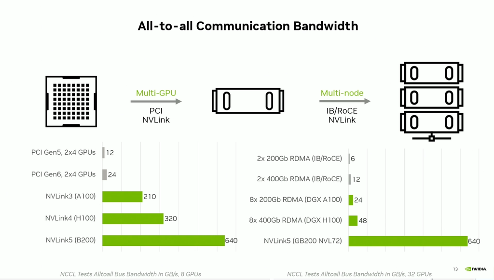
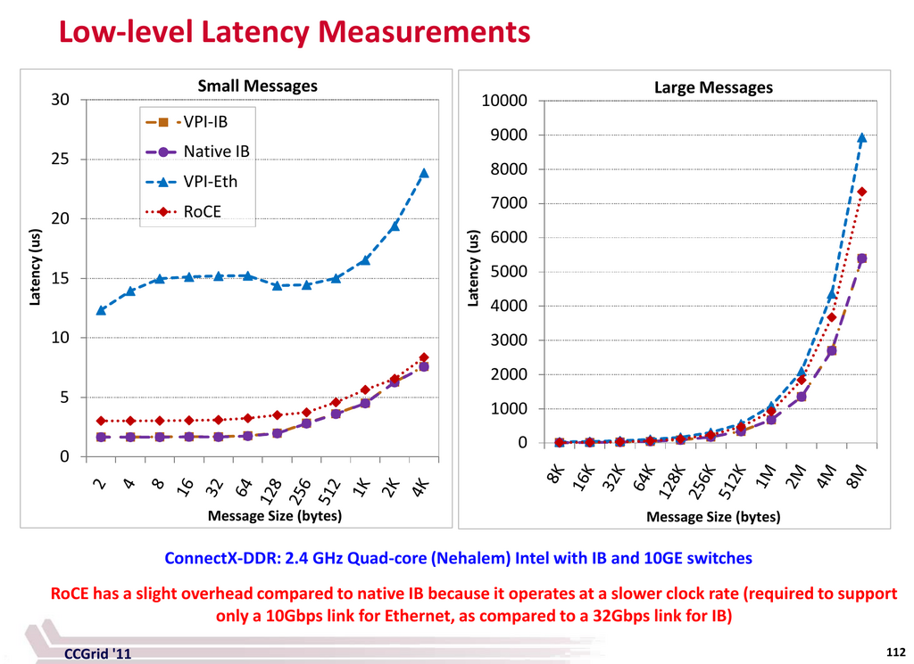

# 节点间与节点内网络硬件 {#inter-node-and-intra-node-networking-hardware}

**子章节**：

- [通信模式](comms.md)
- [网络调试](debug/README.md)
- [网络基准测试](benchmarks/README.md)

## 简介 {#introduction}

光购买/租用昂贵的加速卡，并不足以快速训练和推理模型。你需要确保 [存储 IO](../storage/README.md)、[CPU](../compute/cpu/README.md) 和网络足够快，能“喂饱加速器的熔炉”。如果做不到这一点，昂贵的加速卡就会得不到充分利用，导致白白损失金钱、训练时间变长、推理吞吐量下降。虽然瓶颈可能是上面提到的任何一个组件，但在训练期间（假设你的数据加载器 DataLoader 是快的），网络往往才是瓶颈。

如果你的模型装得进单张加速卡，那基本没什么可担心的。但如今大多数模型需要多张加速卡才能装下，LLM/VLM 模型在训练时需要多个计算节点，有些甚至推理时也需要。

大多数计算节点包含 8 张加速卡，有些是 4 张，还有一些是 16 张甚至更多，最近还出现了一些每个节点只有一张超级加速卡的节点。

当模型跨越数张加速卡、但没有离开单个节点时，你只需要关心快速的[节点内网络](#intra-node-networking)。而一旦模型需要多个节点——对于训练来说情况常常如此，因为可以用多个副本来并行化、加快训练——快速的[节点间网络](#inter-node-networking)就成了关键。

本文介绍这两类网络硬件，报告它们的理论带宽与有效带宽，并解释它们彼此之间如何相互作用。

## 术语表与概念 {#glossary-and-concepts}

这里列出的许多概念和缩写，你大可在用到之前先忽略它们，需要时再回到这里。

- ALU：算术逻辑单元（Arithmetic Logic Units）
- C2C：芯片到芯片（chip-to-chip），如 NVLink-C2C
- CPO：光电共封装（co-packaged optics）——光引擎位于交换机封装内部，而不是可插拔光模块（transceiver）
- DMA：直接内存访问（Direct Memory Access）
- EDR、HDR、NDR、XDR、GDR、LDR：InfiniBand 各代每通道数据速率——见 [InfiniBand](#infiniband)
- EFA：弹性结构适配器（Elastic Fabric Adapter）
- GA：正式可用（Generally Available）——产品确实能买到或租到，而不只是宣布了、送样或只有规格
- GDR：InfiniBand 的一代每通道数据速率——路线图目标为每通道 400Gbps，如[节点间表格](#inter-node-networking)中 `InfiniBand GDR example` 那一行——见 [InfiniBand](#infiniband)。请注意，NCCL 用同样的三个字母指 GPUDirect RDMA，即网卡与加速器显存之间的直接通路，例如 `NCCL_NET_GDR_LEVEL`——这与本条无关；这种重名继承自创造这两个术语的两个生态：链路代际出自 IBTA，数据通路出自 NVIDIA
- HCA：主机通道适配器（Host Channel Adapter）
- HPC：高性能计算（High-performance Computing）
- IB：即 InfiniBand
- IBTA：InfiniBand 贸易协会（InfiniBand Trade Association）
- ICI：芯片间互连（Inter-Chip Interconnect）——Google 在 TPU 芯片之间的 scale-up 互联结构
- MFU：模型浮点运算利用率（Model Flops Utilization）（例如 `mfu=0.5`，是在 A100 上半精度下跑出 156TFLOPS 得出的，因为半精度峰值规格是 312TFLOPS，因此 `156/312=0.5`）
- NCCL：NVIDIA Collective Communications Library（NVIDIA 集合通信库）
- NIC：网络接口卡（Network Interface Card）
- NVL72：包含 72 张加速卡的 NVLink 域；NVL8 与 NVL36 依此类推
- NVLS：NVLink 上的 [SHARP](#glossary-and-concepts)——在 NVSwitch 内部执行归约的 NCCL 算法
- NVLSTree：把每个节点内的 `NVLS` 与跨节点的树组合起来的 NCCL 算法；仅适用于多节点
- OPA：Omni-Path Architecture
- OPX：Omni-Path Express
- OSFP：八通道小型可插拔光模块（Octal Small Form Factor Pluggable transceiver）
- P2P：点对点（peer-to-peer）——恰好只在两张加速卡之间传输，与全对全（all-to-all）相对
- QSFP-DD：四通道小型可插拔双倍密度光模块（Quad Small Form Factor Pluggable Double Density transceiver）
- RC：可靠连接（Reliable Connection）——基于 verbs 的工具中的默认连接类型，面向连接，可靠且按序交付
- RDMA：远程直接内存访问（Remote Direct Memory Access）
- RMA：远程内存访问（Remote Memory Access）——libfabric 对单侧（one-sided）读/写操作的叫法，与 RDMA write 属于同一类操作
- RoCE：融合以太网上的 RDMA（RDMA over Converged Ethernet）
- SHARP：可扩展分层聚合归约协议（Scalable Hierarchical Aggregation Reduction Protocol）
- SRD：可扩展可靠数据报（Scalable Reliable Datagram）——AWS EFA 的传输协议，交付可靠但不像 [RC](#glossary-and-concepts) 那样保持消息顺序
- SuperNIC：NVIDIA 对其近年推出的高速网卡的称呼
- TCPX、TCPXO：Google Cloud 为 A3 机型提供的 GPUDirect 传输方案
- UEC：超以太网联盟（Ultra Ethernet Consortium）——制定超以太网（Ultra Ethernet）标准的组织，AI 网卡以其标准为目标
- VPC：虚拟私有云（Virtual Private Cloud）——通用用途的云上网络，与加速器互联结构相对
- xGMI：插槽间全局内存接口（Socket to Socket Global Memory Interface）
- XGS：Spectrum-X 的跨数据中心变体

与速度相关的条目：

- 自适应路由（Adaptive Routing）：改进静态路由（Static routing），允许网络上出现乱序数据包。数据包在每个交换机处做负载均衡，以更好地分摊网络负载。
- algbw：算法带宽（algorithm bandwidth）——负载大小除以耗时
- 双向（Bi-directional）、双工（Duplex）：在两点之间沿两个方向 A <-> B 传输，通常是单向（unidirectional）速率的 2 倍
- 对分宽度（Bisection Width）：把网络切成两部分（不一定等分）所需切断的最少链路数。这些链路的带宽称为对分带宽（Bisection Bandwidth）——它常被用作衡量真实网络带宽的指标。有时它也被称为网络的最坏情况容量。这里有一个[很好的回答](https://networkengineering.stackexchange.com/a/29662/93656)解释了这一概念及相关概念，但你多半不必真正理解它，只要知道它说的是什么就行，因为你的集群拓扑很可能早已由服务商设计好了。
- busbw：总线带宽（bus bandwidth）——把 `algbw` 按每种集合操作各自的修正系数进行缩放，使其反映硬件瓶颈而不是 rank 数量
- GBps、GB/s：每秒吉字节（Gigabytes per second），指通道中每秒传输的数据量（1GBps = 8Gbps）
- Gbps、Gb/s：每秒吉比特（Gigabits per second），指通道中每秒传输的数据量（1Gbps = 1/8GBps）
- GT/s：每秒十亿次传输（GigaTransfers per second）——每秒发生的传输数据的操作次数。
- 单向（Unidirectional）：在两点之间沿单一方向 A -> B 传输

脚注：在下文各节中，请特别注意 1GBps = 8Gbps。


### 单向与双向（双工） {#unidirectional-vs-bidirectional-duplex}

大多数基准测试/带宽测量工具报告的都是单向带宽。所以在查看单向与双向（双工）速度时要当心。通常后者快约 2 倍。

如果你在自己的环境上测得的带宽约为标称速度的 40%，请仔细核对标称速度是否写着双工；如果是，把它折半，那么你测得的带宽现在应该约为 80%，这才是符合预期的。

案例研究：有一段时间我想不明白，为什么我在一台标称节点内速度 600GBps 的 A100 节点上运行 nccl-tests 的 all_reduce 基准测试，却只得到 235GBps（40%），直到 Horace He 好心提醒我应该看单向速度，也就是 300GBps，这样我得到的就是理论规格的 80%，这就对上了。

这个约 80% 的预期在新硬件上同样成立。在一个 8x H200（NVLink 4，经 NVSwitch 连接）的节点上，成对拷贝（pairwise copy）测得单向 396.40GBps，对应 450GBps 的规格即 88%；双工测得 783.73GBps，对应 900GBps 即 87%——所以在该互联上同时运行两个方向几乎不产生额外代价，测量用的是 [nvbandwidth](benchmarks/README.md#nvbandwidth)：

```bash
./nvbandwidth -i 10 -t device_to_device_memcpy_write_ce                # 每对 396.40 GB/s
./nvbandwidth -i 10 -t device_to_device_bidirectional_memcpy_write_ce  # 每对合计 783.73 GB/s
```

脚注：双向测试用例会打印 `Write1`、`Write2` 和一个合并的 `total` 矩阵——请读取 `total`，而不是把某一个方向翻倍。

成对拷贝是这一对比的合适手段，因为它只搬运数据、不涉及其他。在同一硬件上，一次*集合操作*可能报告出高于单向规格的带宽，那是完全不同的另一种效应——见 [SHARP](#sharp)。


## 集群网络 {#cluster-networks}

集群的每个节点都接入 3 张网络，彼此之间的速度差异极大。

1. [前端网络](#frontend-networking)
2. [后端网络](#backend-networking)
3. [带外网络](#out-of-band-networking)

### 前端网络 {#frontend-networking}

前端网络通常用于互联网连接（例如下载 python 包、向云存储卸载数据）、分布式网络存储（例如检查点和数据集）以及编排调度（例如 SLURM 和 Kubernetes）。截至 2026-08，典型节点很可能只有一条 100-400Gbps 的连接。

脚注：并非所有集群都能用上外部互联网连接，例如许多 HPC 环境只通过专门的 cpu 节点提供外部访问。

### 后端网络 {#backend-networking}

后端网络用于实现 GPU 到 GPU 的连通，使训练和推理能够扩展到多张加速卡（例如 all-reduce、all-gather 及其他集合通信）。这是 AI 集群最重要的部分。它通常要么采用 [InfiniBand](#infiniband)，要么采用 [RoCEv2 以太网](#rdma-networking)。其内部又分为[节点内网络](#intra-node-networking)与[节点间网络](#inter-node-networking)——同一节点上的 GPU 彼此通信通常比与其他节点上的 GPU 通信更快。截至 2026-08，这里典型的顶级[单向](#unidirectional-vs-bidirectional-duplex)速度是：节点内每卡约 900GBps（NVLink 5，如 B200/B300 上所用），节点间每卡 100GBps、即每节点 800GBps（8x ConnectX-8，如 DGX B300 XDR 上所用）——按每卡计相差约一个数量级，而由于两侧始终在一起翻倍，这一比例已经维持了好几代。以上是链路之间的差距；你用集合操作实际测到的差距要小得多，原因见[节点间速度取决于节点内速度](#inter-node-speed-depends-on-intra-node-speed)。每张加速卡至少会有一条后端连接，有时每张卡还可能有多个连接，尤其是当使用的是低带宽网卡时。

脚注：并非所有服务商都跟得上业界的标准网络速度——有些服务商的节点间网络速度可能慢到十分之一。所以务必先确认自己得到的是什么。

### 带外网络 {#out-of-band-networking}

带外（Out-Of-Band，OOB）网络用于引导后端网络的启动、监控节点健康状况、远程重新镜像（re-imaging）节点等。它通常使用一条低速的 1Gbps 以太网连接。


## RDMA 网络 {#rdma-networking}

远程直接内存访问（Remote Direct Memory Access）之于跨节点，就像节点内的 DMA（Direct Memory Access，直接内存访问）。它允许节点之间交换数据，而无需像 TCP/IP 那样经由本地处理器、操作系统内核和缓存，从而省去了相应的开销。3 种主要实现是：

1. InfiniBand
2. RDMA over Converged Ethernet（RoCE）（基于 IB 或 UDP 的 RDMA）
3. iWARP（基于 TCP 的 RDMA）

这里有一篇[很好的概述文章](https://www.fs.com/blog/a-quick-look-at-the-differences-rdma-vs-tcpip-2945.html)。


## 节点内网络 {#intra-node-networking}

这也被称为 scale-up 网络。

市面上有多种提供节点内网络的平台/方案：

1. 通用：[PCIe](#pcie)
2. NVIDIA：[NVLink](#nvlink) 和 [NVSwitch](#nvswitch)
3. AMD：[Infinity Fabric](#infinity-fabric--xgmi)
4. Intel：[Gaudi2](#gaudi2)、[Gaudi3](#gaudi3)
5. AWS：NeuronLink（Trainium）
6. Google：ICI（TPU）
7. Huawei：[UB Link](#ub-link-unifiedbus)（Ascend）

### 全对全带宽 {#all-to-all-bandwidth}

以下是现有方案的节点内单向理论全对全峰值带宽横向对比，按带宽排序：

**已正式可用：**

| 互联方案 | 加速卡 | GBps | 备注 |
| :--------------- | :----------- | -----: | :---- |
| NVIDIA NVLink 5  | B200, B*     |  900.0 | 1     |
| AWS NeuronLink 3 | Trainium2    |  640.0 | 2     |
| Intel            | Gaudi3       |  600.0 |       |
| Google ICI       | TPU7x        |  600.0 | 4     |
| AMD XGMI         | MI355X       |  535.5 |       |
| AMD XGMI         | MI350X       |  535.5 |       |
| NVIDIA NVLink 4  | H100, H*     |  450.0 | 1     |
| AMD XGMI         | MI325X       |  448.0 |       |
| AMD XGMI         | MI300X       |  448.0 |       |
| AMD XGMI         | MI250X       |  350.0 |       |
| NVIDIA NVLink 3  | A100         |  300.0 | 1     |
| Intel            | Gaudi2       |  300.0 |       |
| PCIe 5           |              |   63.0 |       |
| PCIe 4           |              |   31.0 |       |

**已发布、可用性未确认：**

| 互联方案 | 加速卡 | GBps | 备注 |
| :--------------- | :----------- | -----: | :---- |
| Huawei UB Link   | Ascend 950DT |  840.0 | 5     |
| NVIDIA NVLink 6  | Rubin        | 1500.0 | 1     |
| PCIe 6           |              |  121.0 | 3     |

备注：

1. NVSwitch 的速率与同代 NVLink 相同。见 [NVSwitch](#nvswitch)。
2. AWS 公布 Trainium2 的 `NeuronLink-v3 ... 1.28 TB/sec bandwidth per chip`，没有声明方向性，因此按下面关于方向性的说明在此折半。AWS 没有公布每链路速率或链路数量，所以 Trainium2 无法放进下面的[点对点表格](#peer-to-peer-bandwidth)。
3. PCIe 6 列在“已发布、可用性未确认”之下，是因为截至 2026-07-31 还没有出货中的加速卡以 Gen6 接入——当前的部件都是 Gen5 x16（NVIDIA H200 SXM 标注 `PCIe Gen5`，AMD MI350X/MI355X 标注 `PCIe 5.0 x16`），所以 63GBps 仍是当今加速卡之间 PCIe 流量的上限。Gen6 已经在网卡一侧出货——NVIDIA 宣传 ConnectX-8 带来 “PCIe Gen6 connectivity in a single device”（单一设备提供 PCIe Gen6 连接），这正是单张网卡能喂饱 800Gbps 的原因。
4. Google 公布 TPU7x 的 “Bidirectional inter-chip interconnect (ICI) bandwidth per chip (GBps)”（每芯片双向芯片间互连（ICI）带宽（GBps））为 1200，按上面的说明在此折半。点对点指的是每个轴的数值，“bi-directional bandwidth of 200 GBps per axis”（每个轴 200 GBps 的双向带宽）——而三维环面（3D torus）拓扑中的 6 个邻居每个 200，恰好就是总计 1200，两个数字互相印证。`GA` 为 `?`，因为 Google 完整记录了 TPU7x 的文档，却没有说明上市阶段。见 [TPU7x](https://docs.cloud.google.com/tpu/docs/tpu7x)。
5. Huawei 为 Atlas 950 SuperPoD 公布了每机柜总互联带宽最高 64 x 1.68TBps 双向——即每颗加速卡 1.68TBps 双向，在此折半。只有中文页面载有这一数字；英文页面没有给出每 NPU 的数字。点对点未知，所以[点对点表格](#peer-to-peer-bandwidth)中没有对应的行。`GA` 为 `?`，因为在 Huawei 所有可访问的资料中都找不到 Ascend 950DT 的上市信息——其自己的英文站点只是一个普通的下载页，仅是一个导航外壳，其中根本没有出现 `950DT`。仅在中国发行并不是原因：一旦可用性得到确认，这一行就应归入已可获得的硬件，并注明仅限中国。见 [UB Link](#ub-link-unifiedbus)。

总体说明：

* 当规格说明写的是单向还是双向（双工）速度时，请高度留意——如果你在网上读到一份规格没有明确声明方向性，就要去找出答案。为了弄懂下面一些表格中的数据，我不得不查阅大量文档，因为有些厂商在发布的规格中省略了这一关键信息。我甚至还编辑过几个 wiki 页面来补上缺失的信息。请记住，对厂商来说数字越大越好，所以他们几乎总会使用双工数字，而双工数字通常是单向数字的 2 倍。


### 点对点带宽 {#peer-to-peer-bandwidth}

有些厂商的全对全与点对点（GPU 到 GPU）带宽相同，有些则不然。例如，AMD MI300X/MI325X 的 GPU 到 GPU（点对点）带宽是 64GBps，但在 8 张加速卡的板卡上总带宽是 448GBps，因为 `64*7=448`。同理，MI350X/MI355X 的点对点是 76.5GBps、全对全是 535.5GBps，因为 `76.5*7=535.5`。

以下是现有方案的节点内单向理论点对点峰值带宽横向对比，按带宽排序：

**已正式可用：**

| 互联方案 | 加速卡 | GBps   |
| :-------------- | :---------- | -----: |
| NVIDIA NVLink 5 | B200, B*    |  900.0 |
| Intel           | Gaudi3      |  600.0 |
| NVIDIA NVLink 4 | H100, H*    |  450.0 |
| NVIDIA NVLink 3 | A100        |  300.0 |
| Intel           | Gaudi2      |  300.0 |
| Google ICI      | TPU7x       |  100.0 |
| AMD XGMI        | MI355X      |   76.5 |
| AMD XGMI        | MI350X      |   76.5 |
| AMD XGMI        | MI325X      |   64.0 |
| AMD XGMI        | MI300X      |   64.0 |
| PCIe 5          |             |   63.0 |
| AMD XGMI        | MI250X      |   50.0 |
| PCIe 4          |             |   31.0 |

**已发布、可用性未确认：**

| 互联方案 | 加速卡 | GBps   |
| :-------------- | :---------- | -----: |
| NVIDIA NVLink 6 | Rubin       | 1500.0 |
| PCIe 6          |             |  121.0 |

说明：PCIe 在两张表中数字相同，原因却与 NVLink 相反。NVLink 两处数字一致，是因为 NVSwitch 能让单独一对卡点亮所有链路——两种情况下你得到的都是整个互联结构。PCIe 数字一致，是因为一张加速卡只有一条 x16 主机链路，所以无论它与一个对端还是七个对端通信，这条链路都是上限。而且与 NVLink 或 Infinity Fabric 不同——它们的每一对设备走的是相同的互联路径——PCIe 的数字取决于两个设备所处的位置：在同一交换机下、跨越根复合体（root complex）、跨越 CPU 插槽，都是不同的路径（`nvidia-smi topo -m` 会告诉你是哪一种）。所以请把这些 PCIe 行当作摆放位置理想的一对设备的最好情况，而不是节点内任意两个设备都成立的数字。

说明：这些 PCIe 行假定的是 x16 接入，这正是当前加速卡使用的方式——NVIDIA H200 SXM 标注 `PCIe Gen5`，双工 128GBps，AMD MI350X/MI355X 标注 `PCIe 5.0 x16`，A100 是 Gen4 x16。如果某个部件以 x8 接入，请把数字折半。另请注意，截至 2026-07-31 没有出货中的加速卡以 Gen6 接入——所以 63GBps 是当今加速卡之间 PCIe 流量的实际上限，PCIe 6 这一行是为将来会这么做的平台列出的。Gen6 *确实*已经在节点内的其他地方出货了：NVIDIA 宣传 ConnectX-8 带来 “PCIe Gen6 connectivity in a single device”（单一设备提供 PCIe Gen6 连接），这正是单张网卡能喂饱 800Gbps（100GBps）的原因，因为 Gen5 x16 的上限只有 63GBps。

当点对点带宽远低于全对全带宽时，意味着如果同一个应用程序没有用上节点上的全部加速卡，你最终得到的带宽会低得多；一旦这些加速卡需要彼此通信，你的应用程序就会受到性能影响。

为了验证这一点，在一个 8x GPU 的 AMD MI300X 节点上以 4GiB 负载运行了 [torch-dist-bench.py](benchmarks/torch-dist-bench.py)，测得的 `busbw` 为：

- 2 GPU：  47.671GBps
- 8 GPU：  312.912GBps

也就是说，2 GPU 比 8 GPU 慢了 6.5 倍。

所以，如果你必须部署 TP=2、TP=4，或在 2 或 4 张 GPU 上运行 ZeRO-DP/FSDP，无论训练还是推理，网络都会成为瓶颈。如果你用 TP=1 或 TP=8，或在 8 张 GPU 上运行 ZeRO-DP/FSDP，或使用每 GPU 一个副本的 DP，就没有问题。（如果你不确定 TP/ZeRO-DP/DP 是什么意思，请见 [model-parallelism](../training/model-parallelism/README.md)。）

下文各节会给出对每种技术的详细分析。

### PCIe {#pcie}

[PCIe](https://en.wikipedia.org/wiki/PCI_Express) 是一种高速串行计算机扩展总线标准，即使在最便宜的台式电脑上也能找到它。

**已正式可用：**

| 互联方案 | 每通道/<br>每方向<br>(GBps) | 通道数 | 单向<br>(GBps) | 双工<br>(GBps) |
| :----------- | ---------------------------: | ----: | -----------------: | ---------------: |
| PCIe 4       |                         ~2.0 |    16 |                 31 |               62 |
| PCIe 5       |                         ~4.0 |    16 |                 63 |              126 |
| PCIe 6       |                         ~7.5 |    16 |                121 |              242 |

**已发布、可用性未确认：**

| 互联方案 | 每通道/<br>每方向<br>(GBps) | 通道数 | 单向<br>(GBps) | 双工<br>(GBps) |
| :----------- | ---------------------------: | ----: | -----------------: | ---------------: |
| PCIe 7       |                        ~15.0 |    16 |                242 |              484 |
| PCIe 8       |                        ~30.0 |    16 |                484 |              968 |

如果把各种节点内网络技术的最新一代拿来比较（见下文各节），PCIe 通常落后一个数量级。

上面的表是规格。一条 PCIe 链路实际能交付多少是另一个问题，而且似乎没人公布过——所以这里给出一项测量。在一个 8x H200 的节点上，每张加速卡都有自己的 PCIe 5 x16 链路，[nvbandwidth](#nvlink-c2c) 报告主机到设备 55.43GBps、设备到主机 55.06GBps，分别是上表 63GBps 那一行的 88% 和 87%。八条链路的结果彼此相差在 0.10GBps 以内，`nvbandwidth` 报告的变异系数为 0.00。

要复现这一结果，先确认代数与宽度，因为 63GBps 这个数字只适用于 x16 的 PCIe 5：

```bash
nvidia-smi --query-gpu=index,pcie.link.gen.current,pcie.link.width.current --format=csv
```

然后，使用 [nvbandwidth](benchmarks/README.md#nvbandwidth)：

```bash
./nvbandwidth -i 10 -t host_to_device_memcpy_ce
./nvbandwidth -i 10 -t device_to_host_memcpy_ce
```

注意：`host_to_device_memcpy_ce` 测量的是该平台上当时的主机到设备路径，所以要对照机器实际使用的互联来解读它。在一台以 PCIe 连接 SXM 加速卡的 x86 主机上，这条路径就是 PCIe，上面的 88% 指的就是这种情形。而在 Grace-Blackwell 系统上，同一个测试用例测量的其实是 [NVLink-C2C](#nvlink-c2c)，会报出几百 GBps——同样的命令，不同的互联，相差一个数量级。

脚注：规格正式发布不等于芯片已出货。截至 2026-07-30，[PCI-SIG](https://pcisig.com/specifications) 把 `PCI Express Base Specification Revision 7.0` 列为已发布，而 PCIe 8.0 只是仅对会员开放的草案，目标是 2028 年。而且即便规格完成，也要好几年才能落到产品上——PCIe 6.0 硬件直到 2025 年 8 月才推出，距离其规格完成约三年。所以请把最后几行读作标准的走向，而不是你现在能买到的东西。


### NVLink {#nvlink}

脚注：`nvidia-smi nvlink -s` 报告的是每条链路的原始信号速率，把它们加总会超出标称的总带宽。B200 列出 18 条链路、每条 53.125GBps，合计 956.25GBps，而标称是 900GBps；H100 列出 18 条、每条 26.5625GBps，合计 478.125GBps，而标称是 450GBps。两者比值都是 0.9412，这就是编码开销，所以把总和乘以约 0.94 即可回到规格数字。

- [NVLink](https://en.wikipedia.org/wiki/NVLink) 是 NVIDIA 开发的一种基于线缆的串行多车道近距通信链路。这篇[《什么是 NVLink》](https://blogs.nvidia.com/blog/what-is-nvidia-nvlink/)博客文章提供了更多背景介绍。

我发现 NVLink 的 wiki 页面相当难懂，所以我会试着让这件事更清楚一些。而且我很确定，截至 2026-08，那个 wiki 页面上的一些数字是不对的，看起来 NVIDIA 并不维护那个页面。

节点内 GPU 到 GPU 通信硬件的有效载荷速率：

**已正式可用：**

| 互联方案 | 每通道/<br>每方向<br>(GBps) | 车道数 | 链路数 | 单向<br>(GBps) | 双工<br>(GBps) | GPU               |
| :----------- | ---------------------------: | ----: | ----: | -----------------: | ---------------: | :---------------- |
| NVLink 1     |                         2.50 |     8 |     4 |                 80 |              160 | P100              |
| NVLink 2     |                        3.125 |     8 |     6 |                150 |              300 | V100              |
| NVLink 3     |                         6.25 |     4 |    12 |                300 |              600 | A100              |
| NVLink 4     |                        12.50 |     2 |    18 |                450 |              900 | H100, H200, GH200 |
| NVLink 5     |                        25.00 |     2 |    18 |                900 |             1800 | B200, B\*, GB\*   |

**已发布、可用性未确认：**

| 互联方案 | 每通道/<br>每方向<br>(GBps) | 车道数 | 链路数 | 单向<br>(GBps) | 双工<br>(GBps) | GPU               |
| :----------- | ---------------------------: | ----: | ----: | -----------------: | ---------------: | :---------------- |
| NVLink 6     |                            ? |     2 |    36 |               1500 |             3000 | Rubin             |

说明：NVLink 6 的每通道速率为 `?`，因为 NVIDIA 只公布了每 GPU 的总数字（双工 `3 TB/s`，单向 `1500` GBps）。表中数字针对标准版 Rubin GPU；Rubin CPX 和 Rubin Ultra 是独立的部件，各有自己的 NVLink。

[这里](https://www.naddod.com/blog/unveiling-the-evolution-of-nvlink)有一篇关于 NVLink（1 到 4）演进的很好的综述。

最大的 PCIe 16x 插槽有 16 条车道。更小的插槽车道更少，1x == 1 条车道。

NVIDIA Rubin 节点配备 PCIe 6 和 NVLink 6。在那里 NVLink 比 PCIe 快约 15 倍。

NVIDIA Blackwell 节点配备 PCIe 6 和 NVLink 5。在那里 NVLink 比 PCIe 快约 7 倍。

NVIDIA Hopper 节点通常配备 PCIe 5 和 NVLink 4。在那里 NVLink 比 PCIe 快约 7 倍。

下面来看几个节点的例子，把理论与现实对照起来。

如果你使用多块 GPU，卡之间的互连方式会对总训练时间产生巨大影响。如果这些 GPU 位于同一个物理节点上，你可以运行：

```bash
nvidia-smi topo -m
```

它会告诉你 GPU 之间是如何互连的。

在一台双 GPU、且两卡以 NVLink 相连的机器上，你很可能会看到类似这样的输出：

```
        GPU0    GPU1    CPU Affinity    NUMA Affinity
GPU0     X      NV2     0-23            N/A
GPU1    NV2      X      0-23            N/A
```
而在另一台没有 NVLink 的机器上，你可能会看到：
```
        GPU0    GPU1    CPU Affinity    NUMA Affinity
GPU0     X      PHB     0-11            N/A
GPU1    PHB      X      0-11            N/A
```

报告中还包含这份图例：

```
  X    = Self
  SYS  = Connection traversing PCIe as well as the SMP interconnect between NUMA nodes (e.g., QPI/UPI)
  NODE = Connection traversing PCIe as well as the interconnect between PCIe Host Bridges within a NUMA node
  PHB  = Connection traversing PCIe as well as a PCIe Host Bridge (typically the CPU)
  PXB  = Connection traversing multiple PCIe bridges (without traversing the PCIe Host Bridge)
  PIX  = Connection traversing at most a single PCIe bridge
  NV#  = Connection traversing a bonded set of # NVLinks
```

所以，第一份报告里的 `NV2` 告诉我们这些 GPU 以 2 条 NVLink 互连，第二份报告里的 `PHB` 则表明我们是典型的消费级 PCIe+桥（Bridge）配置。

请检查你的环境属于哪种连接类型。其中一些会让卡间通信更快（例如 NVLink），另一些则更慢（例如 PHB）。

取决于所采用的扩展方案，连接速度的影响可能很大也可能很小。如果 GPU 很少需要同步，例如 DDP，那么慢连接的影响就没那么显著。如果 GPU 需要频繁互相发送消息，例如 ZeRO-DP，那么更快的连接对于更快完成训练就极其重要。

现在来看看 A100 和 H100 节点的拓扑：


- A100 拓扑：

```bash
$ nvidia-smi topo -m
      GPU0  GPU1  GPU2  GPU3  GPU4  GPU5  GPU6  GPU7  CPU Affinity  NUMA Affinity
GPU0   X    NV12  NV12  NV12  NV12  NV12  NV12  NV12   0-23         0
GPU1  NV12   X    NV12  NV12  NV12  NV12  NV12  NV12   0-23         0
GPU2  NV12  NV12   X    NV12  NV12  NV12  NV12  NV12   0-23         0
GPU3  NV12  NV12  NV12   X    NV12  NV12  NV12  NV12   0-23         0
GPU4  NV12  NV12  NV12  NV12   X    NV12  NV12  NV12  24-47         1
GPU5  NV12  NV12  NV12  NV12  NV12   X    NV12  NV12  24-47         1
GPU6  NV12  NV12  NV12  NV12  NV12  NV12   X    NV12  24-47         1
GPU7  NV12  NV12  NV12  NV12  NV12  NV12  NV12   X    24-47         1
```
可以看到这里有 12 条 NVLink 和 2 个 NUMA 组（2 颗 CPU，每颗 24 核）

- H100 拓扑：
```bash
$ nvidia-smi topo -m
      GPU0  GPU1  GPU2  GPU3  GPU4  GPU5  GPU6  GPU7  CPU Affinity  NUMA Affinity
GPU0   X    NV18  NV18  NV18  NV18  NV18  NV18  NV18   0-51         0
GPU1  NV18   X    NV18  NV18  NV18  NV18  NV18  NV18   0-51         0
GPU2  NV18  NV18   X    NV18  NV18  NV18  NV18  NV18   0-51         0
GPU3  NV18  NV18  NV18   X    NV18  NV18  NV18  NV18   0-51         0
GPU4  NV18  NV18  NV18  NV18   X    NV18  NV18  NV18  52-103        1
GPU5  NV18  NV18  NV18  NV18  NV18   X    NV18  NV18  52-103        1
GPU6  NV18  NV18  NV18  NV18  NV18  NV18   X    NV18  52-103        1
GPU7  NV18  NV18  NV18  NV18  NV18  NV18  NV18   X    52-103        1
```
可以看到这里有 18 条 NVLink 和 2 个 NUMA 组（2 颗 CPU，每颗 52 核）

当然，其他 A100 和 H100 节点的报告可能会有差异，例如 CPU 核心数很可能就不一样。
### NVLink-C2C {#nvlink-c2c}

这是在 GH200 和 GB200+ 模块中 Grace CPU 与 GPU 之间、以及 Vera CPU 与 Rubin GPU 之间的一种高带宽连接。

截至 2026-08 还没有公开的速度规格，但我在[这里](https://newsletter.semianalysis.com/p/gb200-hardware-architecture-and-component#%C2%A7the-4-rack-scale-form-factors-of-blackwell)看到有人为 GB200 提到过 450GBps 的单向速度。与之对比，NVLink-5 的单向带宽是 900GBps——也就是它只有后者速度的一半。

请求：我正在寻找官方规格，如果你找到了，请告诉我。

**已正式可用：**

| 架构            |   单向<br>(GBps) | NVLink<br>(GBps) | NVLink<br>代次 |
| :-------------- | -----------------: | ---------------: | ------------: |
| Grace/Hopper    |                450 |              900 |             4 |
| Grace/Blackwell |                450 |              900 |             5 |

**已发布、可用性未确认：**

| 架构            |   单向<br>(GBps) | NVLink<br>(GBps) | NVLink<br>代次 |
| :-------------- | -----------------: | ---------------: | ------------: |
| Vera/Rubin      |                900 |             1800 |             6 |

接下来需要理解的是，这些速度是独立的 C2C 技术的速度；当它被集成进系统、受其他组件制约时，实际速度可能要低得多。

在 DGX Station（由半个 GB300 模块组成）上，我用 [nvbandwidth 基准测试](benchmarks/README.md#nvbandwidth)测得，相对于理论带宽，单向效率约 80%、双工效率约 38%：

```bash
$ ./nvbandwidth
[...]
Running host_to_device_memcpy_ce.
memcpy CE CPU(row) -> GPU(column) bandwidth (GB/s)
           0
 0    359.05

SUM host_to_device_memcpy_ce 359.05

Running device_to_host_memcpy_ce.
memcpy CE CPU(row) <- GPU(column) bandwidth (GB/s)
           0
 0    377.15

SUM device_to_host_memcpy_ce 377.15

Running host_to_device_bidirectional_memcpy_ce.
memcpy CE CPU(row) <-> GPU(column) bandwidth (GB/s)
           0
 0    175.38

SUM host_to_device_bidirectional_memcpy_ce 175.38

Running device_to_host_bidirectional_memcpy_ce.
memcpy CE CPU(row) <-> GPU(column) bandwidth (GB/s)
           0
 0    171.76
 [...]
```

下面是计算过程（由于两个方向的报告并不相同，我对两次方向带宽报告取了平均值）
```
(359+377)/2 / 450 = 0.82
(175+171)/2*2 / 900 = 0.38
```
本质上，端到端路径达不到双工 C2C 规格，在两个方向同时通信时只能提供单向速度的一半。线路本身是双工的，但 Grace 上的 LPDDR5X 内存带宽使它无法在两个方向都全速运行，因为双向测试会让两个方向共享同一条内存带宽。对当前大多数 ML 应用来说这大概不是问题，因为它们通常只在 H2D / D2H 这一个方向上发送数据；但如果确实需要真正的双工，请注意这个问题。


### NVSwitch {#nvswitch}

脚注：在机架级 NVLink 系统上，这会让 `nvidia-smi topo -m` 的输出格外有参考价值——它会报告与其他机箱中加速器的 `NV#` 连接，因为那些加速器处于同一个 scale-up 域内。而在常规节点上，同一个工具对节点间连接什么都不会告诉你，因为它只认识 NVIDIA 自家的互联结构。

[NVSwitch](https://www.nvidia.com/en-us/data-center/nvlink/) 能以 [NVLink](#nvlink) 的速度连接超过 8 张 GPU。据宣传，该交换机的未来几代可以连接多达 256 张 GPU。

以 NVLink 速度连接超过 8 张 GPU 的好处在于，它能让 GPU 之间的全对全通信达到远超任何节点内硬件所能提供的速度。而且随着计算速度不断提升，网络很可能成为瓶颈，导致贵得离谱的 GPU 得不到充分利用。

例如，在张量并行（Tensor Parallelism，Megatron）的领域里，人们不会使用超过 8 的 TP 并行度，因为 TP 只有在 NVLink 速度下才是高效的。如果整个集群都以 NVLink 速度运行、不涉及慢速的节点间连接，ZeRO-DP（DeepSpeed/FSDP）也会运行得快得多。

NVSwitch 用于节点内连接。

NVSwitch 第 1 代随 V100 推出，第 2 代随 A100，第 3 代随 H100，第 4 代随 B200——其速度对应同一技术的 NVLink 版本。

[NVIDIA DGX H100](https://web.archive.org/web/20231208180425/https://developer.nvidia.com/blog/upgrading-multi-gpu-interconnectivity-with-the-third-generation-nvidia-nvswitch/) 通过 4 颗第三代 NVSwitch 芯片连接 8 张 H100 GPU。每张 H100 拥有 900GBps 的 NVLink 4 双向带宽，NVIDIA 至今仍在其实时页面的 [NVLink 规格](https://www.nvidia.com/en-us/data-center/nvlink/)表格中把它列在 `Fourth Generation` 之下。NVIDIA 另外给出的数字还有 3.6TBps 的系统对分带宽和 450GBps 的归约带宽。这些数字描述的范围不同：900GBps 是单张 GPU 可用的接口带宽，而 3.6TBps 是对八卡互联结构做均衡划分后的聚合流量；NVSwitch 芯片的数量并不会把单张 GPU 的带宽成倍放大。

NVIDIA DGX A100 有 6 台交换机，每台 12 条 NVLink，总计 72 条。

一个 [DGX H100 SuperPOD](https://docs.nvidia.com/dgx-superpod/reference-architecture-scalable-infrastructure-h100/latest/index.html) 可扩展单元包含 32 台 DGX H100 系统（256 张 GPU），但每台 DGX 仍然是一个独立的节点内 NVSwitch 域。这些系统通过另一个独立的 Quantum-2 NDR400 InfiniBand 计算网络向外扩展，因此跨节点带宽必须依据 ConnectX-7/InfiniBand 拓扑来描述，而不是把内部 NVLink 折半或加总。见 [InfiniBand](#infiniband)。

此外，NVSwitch 第 3 代及更高版本带有 [NVIDIA 可扩展分层聚合归约协议（SHARP）](#sharp)，它既能提升节点内也能提升节点间的 `all-reduce` 速度。现在的 NCCL 版本提供了 `NCCL_ALGO=NVLS`，可把节点内 `all-reduce` 带宽提升最多 30%，把节点间 `all-reduce` 提升约 25%。

最近推出了 [GB200 NVL72](https://www.nvidia.com/en-us/data-center/gb200-nvl72/)，它使用 NVSwitch 把 72 张 Blackwell GPU 放进单个节点，全部以 NVLink 5 的 900GBps 单向速度互连。于是我们不再只有 8 卡节点，而是拥有了 72 卡节点（尽管它们在物理上并不都位于同一块板上）。

### Infinity Fabric / xGMI {#infinity-fabric--xgmi}

AMD MI* 加速器的节点内通信由 AMD Infinity Fabric 完成，它也被称为 xGMI（Socket to Socket Global Memory Interface，跨插槽全局内存接口）。

这是 AMD 对 [NVLink](#nvlink) 的回应。

下面是全对全带宽。

**已正式可用：**

| 互联方案     | 每链路/<br>每方向<br>P2P (GBps) | 链路数 | 单向<br>全对全<br>(GBps) | 双工<br>全对全<br>(GBps) |
| :----------- | -------------------------------: | ----: | -------------------------------: | -----------------------------: |
| MI355X       |                             76.5 |     7 |                            535.5 |                           1071 |
| MI350X       |                             76.5 |     7 |                            535.5 |                           1071 |
| MI325X       |                               64 |     7 |                              448 |                            896 |
| MI300X       |                               64 |     7 |                              448 |                            896 |
| MI250X       |                               50 |     7 |                              350 |                            700 |

**已发布、可用性未确认：**

| 互联方案     | 每链路/<br>每方向<br>P2P (GBps) | 链路数 | 单向<br>全对全<br>(GBps) | 双工<br>全对全<br>(GBps) |
| :----------- | -------------------------------: | ----: | -------------------------------: | -----------------------------: |
| MI455X       |                               ?? |    ?? |                             1800 |                           3600 |

点对点带宽只是单条链路/方向（第 2 列）的带宽。这意味着，除非你在单个进程组里用满整个 8 卡节点，否则通信性能会慢 7 倍。细节见[点对点带宽](#peer-to-peer-bandwidth)。

其他节点内方案的全对全与点对点节点内带宽通常是相同的，所以 Infinity Fabric 看起来要慢得多——除非工作负载不使用节点内通信，或者整个节点都被单个工作负载占满。



平台规格：

- [MI250X](https://www.amd.com/en/products/accelerators/instinct/mi200/mi250x.html)
- [MI300x](https://www.amd.com/en/products/accelerators/instinct/mi300/platform.html)
- [MI325X](https://www.amd.com/en/products/accelerators/instinct/mi300/mi325x.html)
- [MI350X](https://www.amd.com/en/products/accelerators/instinct/mi350/mi350x.html)
- [MI355X](https://www.amd.com/en/products/accelerators/instinct/mi350/mi355x.html)

脚注：MI455X 那一行是 `??`，因为 AMD 什么都没公布。对 MI3*，AMD 同时给出 `Infinity Fabric Links` 和 `Peak Infinity Fabric Link Bandwidth`，这才让我们能填出每链路和全对全两列，并展示出 7 倍的点对点性能劣势。对 MI455X，它只公布了 `Scale-up Bandwidth per GPU: 3.6 TB/s`——没有链路数量，也没有每链路速率——所以全对全两列按后文的约定载入这个数字折半后的值，而点对点两列完全无法填写。MI4* 是否仍像 MI3* 那样按对端来划分带宽，还是转向了一种单对设备就能用满全部带宽的互联结构，恰恰要靠这两个 `??` 来回答。AMD 也从未对它使用“all-to-all”或“any-to-any”这些说法，所以请把 1800 当作该加速器的总 scale-up 带宽，而不是一个得到确认的全对全数字。

脚注：AMD 公布的每条链路单一的 `Peak Infinity Fabric Link Bandwidth`，并没有说明它是单向还是双向——MI350X/MI355X 为 153GBps，MI300X/MI325X 为 128GBps。厂商都引用较大的那个数字，因此这里把它们按双工理解，并在上面的每方向列中折半。AMD 还为每张 GPU 列出了第 8 条 scale-out 链路（峰值 128GBps），它不属于节点内全对全数字的一部分。


### Gaudi2 {#gaudi2}

根据 [Gaudi2 规格](https://habana.ai/wp-content/uploads/2023/10/HLS-Gaudi2_Datasheet_10_23.pdf)，这些节点用同样的 100GbE RoCE v2 RDMA 硬件同时承担节点间与节点内连接（每张卡 24x 100Gbps）。

- 节点内：8x 7x3 NIC——卡到卡 300Gbps
- 节点间：8x 1x3 NIC——总计 2.4Tbps（300GBps）

### Gaudi3 {#gaudi3}

根据 [Gaudi3 规格](https://www.intel.com/content/www/us/en/content-details/817486/intel-gaudi-3-ai-accelerator-white-paper.html)，这些节点提供与 Gaudi2 相同的配置，只是网卡使用 200GbE RoCE v2 RDMA 快了 2 倍，用于节点间与节点内连接（每张卡 24x 200Gbps）。

- 节点内：8x 7x3 NIC——卡到卡 600Gbps
- 节点间：8x 1x3 NIC——总计 4.8Tbps（600GBps）

### NeuronLink v3 {#neuronlink-v3}

NeuronLink v3（[规格](https://awsdocs-neuron.readthedocs-hosted.com/en/latest/about-neuron/arch/neuron-hardware/trn2-arch.html)）是 AWS Trainium2 上对应 NVLink 的节点内技术，但它是一种点对点架构，和 AMD MI* 一样，因此除非其他 Trainium2 芯片也加入同一个进程组，否则无法利用它们的 NeuronLink v3。这项技术基于 PCIe-5.0（所以单向每通道 32Gbps）。

除 EFA v3 之外，NeuronLink v3 也可用于节点间。

每个节点的 Trainium2 芯片数量与节点内网络速度：

- Trainium2：16 颗芯片以 128GBps 的点对点单向速度（32 条 PCIe 通道）互连，每颗 Trainium2 连接到其他 3 颗芯片
- Trainium2 Ultra：64 颗芯片——16 颗一组的分组方式与非 Ultra 相同，此外这 4 个组之间以 64GBps 相互互连。

和 TPU 一样，它被用在三维环面（3D Torus）结构中。这里不同的轴以不同的速度连接，因此每颗芯片的全对全总带宽为 640GBps 单向（`128GBps * 4 intra-node neighbors + 64GBps * 2 inter-node neighbors`）

当它们的规格给出 1024GBps/芯片的实例内带宽时，那是双向数字，所以单向只有 512GBps/芯片——它来自 `128GBps * 4 intra-node neighbors`（而且只有 4 颗邻居芯片都参与时才成立）。


## 节点间网络 {#inter-node-networking}

这也被称为 scale-out 网络。

由于在这个领域，节点间硬件过去比节点内硬件慢大约一个数量级，所以这里用的是 Gbps 而不是 GBps。（1GBps = 8Gbps）（链路本身仍然相差大约一个数量级，但集合通信的实际差距要小得多，因为节点间集合通信的大部分工作也走的是[节点内](#intra-node-networking)链路——见[节点间速度取决于节点内速度](#inter-node-speed-depends-on-intra-node-speed)）

说到节点间网络硬件，既有 NVIDIA 和其他几家厂商久经考验的 [InfiniBand](#infiniband)，也有各种基于 NVLink 的 NVIDIA 产品；还有许多新来者，它们主要来自计算云服务商——这些服务商靠出租别人的硬件赚不到多少利润，于是自己造（AWS EFA、GCP GPUDirect-TCPX）；此外 HPE 和 Cornelis Networks 最近也推出了更新的产品。

截至 2026-07-28，下面是针对当前平台配置与互联世代的节点间单向理论峰值带宽横向对比。这里的接口（interface）指的是面向网络的 NIC 或适配器端口，不是 SerDes 通道，也不是交换机端口。总带宽为 `interfaces * rate / 8`。`Shipped` 列说明你现在是否真的能拿到该硬件（V），还是它仍是路线图目标或正式发布前目标（X）。

按单向总带宽降序排列，其次按每接口速率降序，再按平台/示例节点升序：

**已正式可用：**

| 平台/<br>示例<br>节点              | 每节点<br>NIC<br>数量 | 每接口<br>速率<br>(Gbps) | 单向<br>总带宽<br>(GBps) | 备注    |
| :--------------------------- | ------------------: | ---------------------------: | --------------------------: | :------ |
| NVIDIA DGX B300 XDR          |                   8 |                          800 |                         800 | 1,19    |
| AWS EFA v4 (P6-B300)         |                  16 |                          400 |                         800 | 2,20,31 |
| Intel Gaudi3                 |                  24 |                          200 |                         600 | 3,21    |
| NVIDIA DGX H100 NDR          |                   8 |                          400 |                         400 | 4,22    |
| Omni-Path CN5000 示例        |                   8 |                          400 |                         400 | 17,18   |
| AWS EFA v4 (P6-B200)         |                   8 |                          400 |                         400 | 2,30,31 |
| AWS EFA v3 (P5en/Trn2)       |                  16 |                          200 |                         400 | 2,23,31 |
| AWS EFA v2 (P5/P5e)          |                  32 |                          100 |                         400 | 2,23,31 |
| Intel Gaudi2                 |                  24 |                          100 |                         300 | 5,21    |
| InfiniBand XDR 示例          |                   2 |                          800 |                         200 | 9,11    |
| GCP A3 Mega TCPXO            |                   8 |                          200 |                         200 | 6,24,29 |
| GCP A3 High TCPX             |                   4 |                          200 |                         100 | 6,25,29 |
| HPE Slingshot 示例           |                   4 |                          200 |                         100 | 7,26    |
| Omni-Path CN100 示例         |                   8 |                          100 |                         100 | 8,27    |
| InfiniBand NDR 示例          |                   1 |                          400 |                          50 | 10,12   |
| AWS EFA v1 (P4d)             |                   4 |                          100 |                          50 | 2,28,31 |

**已发布、可用性未确认：**

| 平台/<br>示例<br>节点              | 每节点<br>NIC<br>数量 | 每接口<br>速率<br>(Gbps) | 单向<br>总带宽<br>(GBps) | 备注    |
| :--------------------------- | ------------------: | ---------------------------: | --------------------------: | :------ |
| Omni-Path CN6000 示例        |                   8 |                          800 |                         800 | 13,14   |
| InfiniBand GDR 示例          |                   2 |                         1600 |                         400 | 15,16   |

备注：

1. [NVIDIA DGX B300 规格](https://www.nvidia.com/en-us/data-center/dgx-b300/)
2. [AWS EC2 加速计算实例网络规格](https://docs.aws.amazon.com/ec2/latest/instancetypes/ac.html)
3. [Intel Gaudi3 白皮书](https://www.intel.com/content/www/us/en/content-details/817486/intel-gaudi-3-ai-accelerator-white-paper.html)
4. [NVIDIA DGX H100/H200 用户指南](https://docs.nvidia.com/dgx/dgxh100-user-guide/introduction-to-dgxh100.html)
5. [Intel Gaudi2 数据手册](https://habana.ai/wp-content/uploads/2023/10/HLS-Gaudi2_Datasheet_10_23.pdf)
6. [Google Cloud GPUDirect-TCPX/TCPXO](https://docs.cloud.google.com/kubernetes-engine/docs/how-to/gpu-bandwidth-gpudirect-tcpx)
7. [HPE Slingshot 11 QuickSpecs](https://www.hpe.com/us/en/collaterals/collateral.a50002546enw.html)
8. [Cornelis CN-100HFA 规格](https://www.cornelis.com/product/cornelis-omni-path-accelerated-host-fabric-adapter-cn-100hfa)
9. [InfiniBand 协会（InfiniBand Trade Association）XDR 规格发布](https://infinibandta.org/ibta-unveils-xdr-infiniband-specification-to-enable-the-next-generation-of-ai-and-scientific-computing/)
10. [NVIDIA NDR 布线指南](https://docs.nvidia.com/dgx-superpod/design-guide-cabling-data-centers/latest/ndr-overview.html)
11. 2 个端口，每个端口 4 条 XDR 通道（4x200Gbps = 每端口 800Gbps）；这种布局的节点只是示意，并非有记载的产品。
12. 1 个端口，含 4 条 NDR 通道（4x100Gbps = 400Gbps）。
13. Cornelis 的 [CN6000 产品页](https://www.cornelis.com/products/cn6000?product_range=supernics)和 [AMD MI400 参考架构](https://www.cornelis.com/stories/cornelis-announces-new-reference-architecture-for-ai-inference-training-and-hpc-built-for-amd-6th-gen-epycsupsup-and-amd-instinctsupsup-mi400-series)
14. 800Gbps 产品于 2026 年送样；GA 目标为 2026 年第四季度；八适配器节点仍只是示意。
15. [InfiniBand 协会路线图](https://infinibandta.org/infiniband-roadmap/)
16. GDR 位于 InfiniBand 协会的路线图上；尚无任何 GDR 产品出货。2 端口节点是示意。
17. [Cornelis CN5000 发布](https://www.cornelis.com/stories/cornelis-launches-cn5000-industry-leading-ai-and-hpc-scale-out-network)
18. 400Gbps 产品系列于 2025 年 6 月开始出货，2025 年第三季度起广泛可得；八适配器节点仍只是示意。原路线图目标为 2025 年第二季度。
19. 八张单端口 ConnectX-8 适配器。
20. 十六个面向网络的 EFA 接口。
21. 集成的 RoCEv2 接口。
22. 八张单端口 ConnectX-7 适配器。
23. 常见的 3.2Tbps 配置。
24. 八个加速器网络接口。
25. 四个加速器网络接口。
26. 示意的四接口节点。
27. 示意的八适配器节点。
28. 四个面向网络的 EFA 接口。
29. Google 为这些机型公布了更高的标称数字——A3 Mega 最高网络带宽 1800Gbps，A3 High 为 1000Gbps。这些总数包含了 VPC/前端 NIC；上面的数字只统计加速器网络，因此分别是 `8x200=1600Gbps` 和 `4x200=800Gbps`。两种情况下约 200Gbps 的差额都是通用网络接口，它不承载集合通信。
30. 八个面向网络的 EFA 接口，每个 400Gbps，这是通过 `/sys/class/infiniband/rdmap*/ports/1/rate` 从设备读出的结果，对应 AWS 公布的每个 P6-B200 实例 3.2Tbps。
31. `v1`-`v4` 这些 EFA 世代标签是 AWS 自己的叫法，取自[受支持的实例类型](https://docs.aws.amazon.com/AWSEC2/latest/UserGuide/efa.html#efa-instance-types)表格，这些表格把实例归在 `Nitro v3 (EFA v1)` 到 `Nitro v6 (EFA v4)` 标题之下。世代的划分跟随 Nitro 版本，而不是加速器——见 [EFA](#efa)。

这些是常见/流行的节点配置——某些定制节点的配置可能不同，通常是更少的 NIC，很少有更多的 NIC。而且，是的，AWS EFA v2 在每个节点上放了 32 张 NIC——那一定有很多线缆。

脚注：注意，节点间与[节点内带宽](#intra-node-networking)之间曾经那一个数量级的差距正在开始消失——我最近把这里的速率从 Gbps 重新标定为 GBps。

下文各节会有对每种技术的详细分析。

### 网络适配器 {#network-adapters}

本章的表格大多统计的是节点级带宽，但你买的是适配器。NVIDIA 把它最近的适配器称为 SuperNIC，AMD 的 AI NIC 产品线是 Pensando。下面是单个适配器的吞吐量，它与单端口速率不是一回事——这些适配器中大多数承载着不止一个端口，而厂商很少说明有几个。按吞吐量降序排列：

**已正式可用：**

| 适配器               | 厂商   | 协议                     | 每适配器<br>吞吐量<br>(Gbps) | 备注  |
| :------------------- | :----- | :----------------------- | ----------------------------------: | :---- |
| ConnectX-8 SuperNIC  | NVIDIA | InfiniBand XDR、以太网   |                                 800 | 1,4   |
| ConnectX-7 HCA       | NVIDIA | InfiniBand NDR、以太网   |                                 400 | 1,4   |

**已发布、可用性未确认：**

| 适配器               | 厂商     | 协议                              | 每适配器<br>吞吐量<br>(Gbps) | 备注  |
| :------------------- | :------- | :-------------------------------- | ----------------------------------: | :---- |
| ConnectX-9 SuperNIC  | NVIDIA   | 以太网                            |                                1600 | 1,7   |
| CN6000 SuperNIC      | Cornelis | Omni-Path、RoCEv2、Ultra Ethernet |                                 800 | 8,9   |
| Pensando Vulcano     | AMD      | Ultra Ethernet                    |                                 800 | 2,5,6 |
| Pensando Pollara 400 | AMD      | 以太网                            |                                 400 | 2,3,7 |

备注：

1. [NVIDIA InfiniBand 适配器](https://www.nvidia.com/en-us/networking/infiniband-adapters/)——NVIDIA 为 ConnectX-9 标注 “up to 1.6 terabits per second (Tb/s) throughput”（最高 1.6 Tb/s 吞吐量），为 ConnectX-8 标注 “up to 800 gigabits per second (Gb/s) of data throughput”（最高 800 Gb/s 数据吞吐量），为 ConnectX-7 标注 “400Gb/s throughput”（400Gb/s 吞吐量）。那里没有公布端口数量和 PCIe 世代，所以无法从这个来源推算每端口速率。
2. [AMD Pensando 网络](https://www.amd.com/en/products/network-interface-cards/pensando.html)——为 Vulcano 标注 “up to 800 Gbps of Ethernet connectivity”（最高 800 Gbps 以太网连接），为 Pollara 400 标注 “up to 400 Gbps Ethernet speeds”（最高 400 Gbps 以太网速率）。
3. Pollara 400 有一个合作伙伴平台目录，这暗示它已经出货，但 AMD 没有在那个页面上说明可用性。
4. InfiniBand 世代的配对并没有写在 NVIDIA 的适配器页面上——它取自[上文节点表](#inter-node-networking)中的平台行：DGX B300 XDR 使用 8 张 800Gbps 的 ConnectX-8，DGX H100 NDR 使用 8 张 400Gbps 的 ConnectX-7。
5. 截至 2026-07-30 处于预发布状态。AMD 的 Vulcano 数字来自 “AMD Engineering silicon modeling and AMD synthetic benchmark simulation”（AMD 工程的硅建模与 AMD 合成基准仿真），并且 “may vary when actual product(s) are released in market”（实际产品上市时可能会有所不同）。
6. AMD 为 Vulcano 宣传 “up to 2.4 Tbps of scale-out bandwidth per GPU”（每 GPU 最高 2.4 Tbps 的 scale-out 带宽）。那是给一块 GPU 挂接 3 张 800Gbps NIC——这是平台配置，不是单张更快的 NIC。与本章其他地方节点聚合列的陷阱相同。
7. 这两行之所以放在“已发布、可用性未确认”之下，是因为厂商页面提到了产品却没有说明可用性，而不是因为厂商声称它未发布。NVIDIA 在其适配器产品组合中列出了 ConnectX-9，但没有给出出货日期；AMD 给 Pollara 400 列出了合作伙伴平台目录，这暗示它已出货，但哪儿都没有明说。这里既没有声称它们可获得，也没有声称它们不可获得。
8. [Cornelis CN6000 SuperNIC 适配器](https://www.cornelis.com/product/cornelis-cn6000-omni-path-adapters)——带宽 `800G`；性能 `1.6Tbps bidirectional (800Gbps Tx and 800Gbps Rx)`；双 QSFP-DD 端口（`x4` @ 每通道 112 Gbps）；PCIe 6.0 x16。吞吐量列为单向，与 CN5000 / ConnectX 采用同一约定。
9. 正式发布前（pre-GA）；见[节点间](#inter-node-networking)表的备注 13-14（2026 年送样，GA 目标 2026 年第四季度）。


### InfiniBand {#infiniband}

[InfiniBand](https://en.wikipedia.org/wiki/InfiniBand)（IB）已经存在几十年了，因此外面能找到很多种不同的配置。所以，如果有人说他们有 InfiniBand，这个信息是不够的。你需要知道的是信号速率和 IB 链路的数量。

InfiniBand 是一套完整的网络协议，实现了 RDMA（绕开 TCP/IP）。

网卡本身在上文 [网络适配器](#network-adapters) 一节——NDR 对应 ConnectX-7，XDR 对应 ConnectX-8。

下面把 HDR 和 EDR 归入 `GA`，因为至今仍有许多集群在运行它们，但 NVIDIA 已经不再为这两代列出任何交换机平台——它的 InfiniBand 页面只提到 Quantum-2 和 Quantum-X800。所以请把 HDR/EDR 当作你可能继承到的硬件，而不是你会新选购的硬件。还值得了解的是，InfiniBand 的制造商已经整合到只剩极少数几家，在与 RoCE 权衡时这是一个供应商锁定的考虑因素——见本节下方关于制造商的说明。截至 2026-07-28，XDR 是最新的已标准化 InfiniBand 世代。InfiniBand 的世代名称描述的是每通道速率；一个全宽端口由 4 条通道组成。它们并不规定一个节点有多少张适配器或多少个端口。

按 4x 端口速率降序排列：

**已正式可用：**

| 世代       | 每通道<br>速率<br>(Gbps) | 每端口<br>通道数 | 4x 端口<br>速率<br>(Gbps) | 参考 |
| :--------- | ----------------------: | -------------: | ------------------------: | :--- |
| XDR        |                     200 |              4 |                       800 | 1    |
| NDR        |                     100 |              4 |                       400 | 2    |
| HDR        |                      50 |              4 |                       200 | 3    |
| EDR        |                      25 |              4 |                       100 | 3    |

**已发布、可用性未确认：**

| 世代       | 每通道<br>速率<br>(Gbps) | 每端口<br>通道数 | 4x 端口<br>速率<br>(Gbps) | 参考 |
| :--------- | ----------------------: | -------------: | ------------------------: | :--- |
| LDR        |                     800 |              4 |                      3200 | 3    |
| GDR        |                     400 |              4 |                      1600 | 3    |

来源：

1. [InfiniBand 协会 XDR 规格发布](https://infinibandta.org/ibta-unveils-xdr-infiniband-specification-to-enable-the-next-generation-of-ai-and-scientific-computing/)
2. [NVIDIA NDR 布线指南](https://docs.nvidia.com/dgx-superpod/design-guide-cabling-data-centers/latest/ndr-overview.html)
3. [InfiniBand 协会路线图](https://infinibandta.org/infiniband-roadmap/)

面向产品的表格中只展示 4x 端口，因为 4 条通道是这里对比的现代高端产品所采用的全宽端口配置。1x 的值就是“每通道速率”那一列。早先 8x 和 12x 的算术在后面单独保留，以免把通道总数与端口或节点的总数当作同一范围的数字来互相比较。

GDR 和 LDR 是路线图目标，而不是已标准化的世代；本表并不暗示上市日期。

2021 年 6 月的 IBTA 路线图曾把 GDR 定在 2025 年、LDR 定在几年之后。保留这份历史时间表只是为了提供背景；那是路线图目标，不是标准化或产品可用性的确认。

下面的表格恢复了早先的理论宽度算术。它按 **链路数** 升序排列。这些数值只是通道速率的乘法，并不表示存在相应的产品或节点配置。

| 链路数 | EDR | HDR |  NDR |  XDR |  GDR |  LDR | 参考 |
| ----: | --: | --: | ---: | ---: | ---: | ---: | :--- |
|     1 |  25 |  50 |  100 |  200 |  400 |  800 | 1    |
|     4 | 100 | 200 |  400 |  800 | 1600 | 3200 | 1    |
|     8 | 200 | 400 |  800 | 1600 | 3200 | 6400 | 1, 2 |
|    12 | 300 | 600 | 1200 | 2400 | 4800 | 9600 | 1, 2 |

来源：

1. [InfiniBand 协会路线图](https://infinibandta.org/infiniband-roadmap/)
2. [InfiniBand 协会历史上的 8X 和 12X 路线图](https://infinibandta.org/infiniband-trade-association-ibta-announces-updated-infiniband-roadmap-projecting-data-speeds-of-104gb-s-per-4x-port-in-2011/)

早先 LDR 的 8x 值是 4800Gbps；修正后的通道速率算术是 `8 * 800 = 6400Gbps`。

延迟，单位微秒，各列按世代从旧到新排列：

| EDR | HDR | NDR | XDR | GDR | LDR |
| --: | --: | --: | --: | --: | --: |
| 0.5 | 0.6 | ??  | ??  | ??  | ??  |

`??` = NDR 及之后的世代没有公布延迟数据

InfiniBand 提供 [RDMA](https://en.wikipedia.org/wiki/Remote_direct_memory_access)。

下面是一些配有最快 IB 的 NVIDIA 设备的例子：

- NVIDIA DGX H100 的一种配置带有 8 个 NVIDIA ConnectX-7（CX7）以太网/InfiniBand 端口，每个 400Gbps，用于连接其他 DGX 服务器，合计 3.2Tbps（0.4TBps）单向。
- 对 DGX H100 SuperPOD，所有 32 台 DGX 服务器上的 ConnectX-7 以及相关的 InfiniBand 交换机可提供 12.8TBps 的单向带宽（两个方向都计算则为 25.6TBps），供整个 pod 内部使用或向多个 SuperPOD 扩展——这相当于每个节点 0.4TBps（3.2Tbps）单向，与上面的每节点数字一致。
- NVIDIA DGX GB200 NVL72 计算托盘提供 4 个单端口 ConnectX-7 接口，每个最高 400Gbps，对应每张 GPU 一条 400Gbps 连接（[网络文档](https://docs.nvidia.com/dgx/dgxgb200-user-guide/networking.html)）。Quantum-2 承载每端口 400Gbps 的 NDR；一根 800G OSFP 线缆可以拆分为两个 400Gbps 端口，所以它不是单个 800Gbps 的 NDR 端点。
- NVIDIA DGX B300 系统提供 8 个 ConnectX-8 接口，每个最高 800Gbps。在有记载的 SuperPOD 设计中，计算网络使用 Quantum-X800 XDR，而存储网络使用 Quantum-2 NDR。

[InfiniBand](https://en.wikipedia.org/wiki/InfiniBand) 过去曾有多家制造商，但目前只剩 NVIDIA（收购了 Mellanox）——这使它成为一种单一供应商的互联，在与以太网权衡时是一个锁定的考虑因素。Intel 常被算作第二家供应商，因为它收购了 QLogic 的 InfiniBand 业务，但那支血统变成了 [Omni-Path](#omni-path)——一个独立的网络结构，而不是 InfiniBand——后来 Intel 又把它卖给了 Cornelis Networks。另见 [InfiniBand Trade Association](https://infinibandta.org/)。

实用链接：

- [InfiniBand 工具](https://networking-docs.nvidia.com/mlnxofedswum/24.10-5.1.6.1lts/infiniband-fabric-utilities)（链接带版本号，可能已过时）——在调试 IB 环境时这些很有用。

### 交换机平台 {#switch-platforms}

这里是 [适配器](#network-adapters) 插接的交换机。两种网络结构都放在这里，以便直接比较——先列 InfiniBand 的一对，再列以太网的。

#### NVIDIA Quantum-2 InfiniBand {#nvidia-quantum-2-infiniband}

[NVIDIA Quantum-2 InfiniBand 平台](https://www.nvidia.com/en-us/networking/quantum2/)是 NDR 的交换机一侧，与 [网络适配器](#network-adapters) 中的 ConnectX-7 适配器配对。它支持每端口 400Gbps，提供 RDMA，带有基于 [SHARP](#sharp) 的网络内计算，并支持 PCIe-5。

这些交换机提供 64 个 400Gbps 端口，或 128 个 200Gbps 端口。


#### NVIDIA Quantum-X800 InfiniBand {#nvidia-quantum-x800-infiniband}

[NVIDIA Quantum-X800 InfiniBand 平台](https://www.nvidia.com/en-us/networking/products/infiniband/quantum-x800/)是 XDR 的交换机一侧，与 ConnectX-8 配对，支持每端口 800Gbps，并带有基于 [SHARP](#sharp) v4 的网络内计算。

截至 2026-07-28，Quantum-X800 被 Blackwell Ultra 系统使用，例如 DGX B300 和 GB300 NVL72；它并非 Rubin 专属。

#### Spectrum-X 以太网 {#spectrum-x-ethernet}

[Spectrum-X](https://www.nvidia.com/en-us/networking/spectrumx/) 是 NVIDIA 针对自家 InfiniBand 产品线给出的以太网答案，面向想要 RoCE 而不是 IB 的团队。NVIDIA 将其描述为 "the tight coupling of the NVIDIA Spectrum-X Ethernet switch and the NVIDIA Spectrum-X Ethernet SuperNIC"（NVIDIA Spectrum-X 以太网交换机与 NVIDIA Spectrum-X 以太网 SuperNIC 的紧密结合），并宣称性能 "1.6x over off-the-shelf (OTS) Ethernet"（达到现成（OTS）以太网的 1.6 倍）。

交换机吞吐量是网络结构（fabric）的容量——它不是单个节点的注入带宽，两者绝不应相加，也不应互相比较。下表按总吞吐量降序排列，总吞吐量相同的按高度升序排列：

**已正式可用：**

| 交换机 | 世代 | 端口                                    | 总<br>吞吐量<br>(Tbps)        | 高度 |
| :-------- | :--------- | :-------------------------------------- | ----------------------------: | :----- |
| SN5600    | Spectrum-4 | 64x OSFP 800GbE                         |                          51.2 | 2U     |
| SN5600D   | Spectrum-4 | 64x OSFP 800GbE                         |                          51.2 | 2U     |
| SN5610    | Spectrum-4 | 64x OSFP 800GbE                         |                          51.2 | 2U     |
| SN5400    | Spectrum-4 | 64x QSFP-DD 400GbE                      |                          25.6 | 2U     |

**已发布、可用性未确认：**

| 交换机 | 世代 | 端口                                    | 总<br>吞吐量<br>(Tbps)        | 高度 |
| :-------- | :--------- | :-------------------------------------- | ----------------------------: | :----- |
| SN6800-LD | Spectrum-6 | 512x MMC-12 共封装光学                  |                         409.6 | 5U     |
| SN6200-LD | Spectrum-6 | 32x OSFP 2x800GbE + 256x 200G 背板      |                         102.4 | 1U     |
| SN6600-LD | Spectrum-6 | 64x OSFP 2x800Gbps（128 端口）          |                         102.4 | 2U     |
| SN6810-LD | Spectrum-6 | 128x MMC-12 共封装光学                  |                         102.4 | 2U     |
| SN6600    | Spectrum-6 | 64x OSFP 2x800Gbps（128 端口）          |                         102.4 | 3U     |

来源：[NVIDIA 以太网交换](https://www.nvidia.com/en-us/networking/ethernet-switching/)，截至 2026-07-30。NVIDIA 在那里没有逐型号说明可用性，因此对于 Spectrum-6 SN6000 系统——更新的共封装光学生代——`GA` 是 `?`；而对于 Spectrum-4 SN5000 系列则是 `Y`，它自 Spectrum-X 推出起就已出货。

还有两点值得了解：

- Spectrum-XGS 是跨数据中心变体，官方称其 "built for scaling across multiple disparate data centers - located in different buildings or separated by hundreds of kilometers"（为跨多个彼此独立的数据中心扩展而构建——这些数据中心位于不同楼宇，或相隔数百公里），并宣称 "1.9x higher NCCL performance in cross-data center environments"（在跨数据中心环境中 NCCL 性能高 1.9 倍）。
- 多平面（multiplane）扩展把 "each GPU's SuperNIC across two or more independent network planes"（把每张 GPU 的 SuperNIC 拆分到两个或更多独立的网络平面上），从而 "up to 128K GPUs in two tiers - 64x more than single-plane networks"（以两层网络连接到多达 128K 张 GPU——是单平面网络的 64 倍）。也就是说，单张 GPU 的节点间带宽可能分散在好几个网络结构上，而不是集中在一个上。

#### 共封装硅光子 {#co-packaged-silicon-photonics}

这是两种网络结构共同的方向：把光引擎放进交换机的封装内部，而不是使用可插拔光模块。NVIDIA 的提法是 "New Co-Packaged Silicon Photonic Networking Switches to Scale to Millions of GPUs, Multi-Site AI Factories"（新型共封装硅光子网络交换机，把 AI 工厂扩展到数百万张 GPU、多个站点），在以太网一侧，它宣称相比可插拔光模块有 "5x better network power efficiency"（网络能效高 5 倍）和 "5x longer sustained AI application runtime"（AI 应用可持续运行时长增加 5 倍）。它已经出现在出货的型号上——上面的 Spectrum-6 `SN6800-LD` 和 `SN6810-LD` 用的就是 `MMC-12` 共封装光学，而不是 OSFP cage。

注意，NVIDIA 在其 [InfiniBand 页面](https://www.nvidia.com/en-us/networking/products/infiniband/) 上没有给 InfiniBand 版本的这一代冠上 Quantum 产品名——只有泛泛的光子学说法——所以现在还没有世代可以放进表格。功耗是这件事重要的原因：到了 800Gbps 及以上，光模块会占据交换机功耗预算的相当大一块，这是数据中心层面的约束，而不是跑基准测试层面的问题。

### 延伸到机架之外 {#reaching-beyond-the-rack}

并非所有东西都是网卡或机架顶交换机。有三类值得了解的设备，你都不该用[节点与适配器表](#inter-node-networking)去估算它们：

- MetroX——InfiniBand 的长途（long-haul）方案，覆盖距离 "up to 40 kilometers"（最远 40 公里）。这就是 InfiniBand 阵营对应 [Spectrum-XGS](#spectrum-x-ethernet) 的答案，用来把一个训练作业拆分到不同楼宇或站点。
- InfiniBand 路由器——用于连接彼此分开的 InfiniBand 子网，超大规模的网络结构正是这样切分区域的。
- InfiniBand 到以太网的网关——用于从 InfiniBand 计算网络结构访问挂在以太网上的存储与服务。

如果一个作业必须跨越多个站点，那么正是这一层决定了它到底可不可行，而它增加的延迟，与节点内各节讨论过的任何量级相比都要大得多。

### EFA {#efa}

[Elastic Fabric Adapter (EFA)](https://aws.amazon.com/hpc/efa/) 是 AWS 创造的一种较新的节点间网络技术。

- EFA v1 0.4Tbps（all_reduce 测试中的有效速度为 340Gbps）（P4 AWS 实例）
- EFA v2 3.2Tbps（自 2023 年第三季度起，P5 AWS 实例——32 个 100GbE（4x28G）网卡！）
- EFA v3 3.2Tbps（自 2025 年第一季度起，P5en AWS 实例——16 个 200GbE（4x56G）网卡！以及 Trn2 AWS 实例）——理论速度与 v2 相同，但在真实世界的消息大小下，实际速度应该会好得多。
- EFA v4 3.2Tbps（P6-B200 AWS 实例——8 个 400Gbps 网卡，即每张加速卡 400Gbps）
- EFA v4 6.4Tbps（P6-B300 AWS 实例，自 2025 年第四季度起——16 个 400Gbps 网卡，即每张加速卡 800Gbps）。相对 B200 的 2 倍来自在单网卡速率不变的情况下把网卡数量翻倍，AWS 把这归因于 PCIe Gen6——所以不要以为“EFA v4”就意味着 6.4Tbps。

上面的代际标签是 AWS 自己的：它的[受支持的实例类型](https://docs.aws.amazon.com/AWSEC2/latest/UserGuide/efa.html#efa-instance-types)页面把每个支持 EFA 的实例都归在 `Nitro v3 (EFA v1)` 到 `Nitro v6 (EFA v4)` 的标题之下。每实例的带宽数字则来自单独的[网络规格](https://docs.aws.amazon.com/ec2/latest/instancetypes/ac.html)页面，所以这两个页面要配套使用。

脚注：EFA 的代际跟随的是 Nitro 的代际，而不是加速器的——它对每张加速卡的带宽没有任何说明。`p6e-gb200.36xlarge` 归在 `Nitro v5 (EFA v3)` 之下，而 `p6-b200.48xlarge` 和 `p6-b300.48xlarge` 归在 `Nitro v6 (EFA v4)` 之下，但 GB200 实例按每卡算反而是两者中更快的：AWS 给它 4 张 B200 列出 3200Gbps，即每张 800Gbps（100GBps）；而 P6-B200 上同样的 3200Gbps 摊到 8 张上，每张只有 400Gbps（50GBps）。所以更高的 `v` 既不意味着上面有更新的硅片，也不意味着每张加速卡有更多带宽。

要统计节点上的 EFA 设备数量：

```bash
fi_info -p efa -t FI_EP_RDM | grep -c provider
```

把结果除以二。`libfabric` 会为每个 EFA 设备报告两个 provider——一个的 fabric 是 `efa-direct`，对应网卡的原始能力（最大发送 8KiB、无排序、无匹配），另一个的 fabric 是 `efa`，提供 MPI 或 NIXL 会使用的更完整的接口。所以 `16` 意味着 8 个网卡。

不要改用统计 `/sys/class/infiniband/*` 的办法，因为它还会列出非 EFA 适配器——一台 P6-B200 节点会显示 10 个条目：8 个 EFA 设备（`rdmap*`，每个报告 `rate=400 Gb/sec`）外加 2 个不相关的 100Gbps 适配器。不过那里确实是读取每网卡速率的地方：`cat /sys/class/infiniband/rdmap*/ports/1/rate`。`nvidia-smi topo -m` 在这里是错的工具——它是节点内的工具，对节点间网络结构一无所知。

### Gaudi2（节点间） {#gaudi2-inter-node}

根据 [Gaudi2 规格](https://habana.ai/wp-content/uploads/2023/10/HLS-Gaudi2_Datasheet_10_23.pdf)，这些节点提供 `3*8=24` 个 100GbE RoCE v2 RDMA 网卡，与其他 Gaudi2 节点之间共有 2.4Tbps 的节点间连接能力。

### Gaudi3（节点间） {#gaudi3-inter-node}

根据 [Gaudi3 规格](https://www.intel.com/content/www/us/en/content-details/817486/intel-gaudi-3-ai-accelerator-white-paper.html)，这些节点提供 `3*8=24` 个 200GbE RoCE v2 RDMA 网卡，与其他 Gaudi3 节点之间共有 4.8Tbps 的节点间连接能力。

### HPE Slingshot 互联 {#hpe-slingshot-interconnect}

[HPE Slingshot interconnect](https://www.hpe.com/ca/en/compute/hpc/slingshot-interconnect.html) 似乎为一些 HPC 所采用。截至 2026-08，它每条链路提供 200Gbps。有些 HPC 用其中 4 条链路搭建 800Gbps 的互联，当然，用更多链路就能带来更高的整体带宽。

### GPUDirect-TCPX {#gpudirect-tcpx}

GPUDirect-TCPX 是 Google 为 A3 实例开发的 RDMA-over-TCP 软件方案。GPUDirect-TCPXO 是 TCPX 的硬件加速扩展，仅在 A3 Mega 上可用。文档很少，但这里有一些关于 [TCPX](https://docs.cloud.google.com/compute/docs/gpus/gpudirect) 和 [TCPXO](https://docs.cloud.google.com/cluster-toolkit/docs/machine-learning/a3-mega-enable-gpudirect-tcpxo) 的信息。

这项技术没有流行起来，正被逐步淘汰，从 GCP 的 Blackwell 实例开始被 RoCE 取代。

### Omni-Path {#omni-path}

[Omni-Path Architecture](https://en.wikipedia.org/wiki/Omni-Path)（OPA）。这项技术最初属于 Intel，后来被卖给了 Cornelis Networks。它也被称为 Omni-Path Express（OPX）。

案例研究：2022 年我在法国的 JeanZay HPC 用过这项技术。当时它只有 135Gbps，虽然厂商一年之后试图修复，速度仍然没变。希望这个问题后来已经解决，如今的速度已经快得多。因为它实在太慢，我们训练 BLOOM-176B 时不得不使用 [Megatron-DeepSpeed](https://github.com/bigscience-workshop/Megatron-DeepSpeed)，而不是好用得多的 DeepSpeed ZeRO）。

[Cornelis Omni-Path Accelerated Host Fabric Adapter CN-100HFA](https://www.cornelis.com/product/cornelis-omni-path-accelerated-host-fabric-adapter-cn-100hfa) 100Gbps 网卡已经问世多年——而直到 2025 年，它都是唯一出货过的 Omni-Path 世代，因为 Intel 在 2019 年 7 月取消了原本计划的 200Gbps `OPA 200` 系列。在每网卡 100Gbps 的速率下，你基本不会在 ML 工作负载里看到 Omni-Path 的身影，除非有人在每个节点上装了很多网卡。

[CN5000](https://www.cornelis.com/product/cornelis-cn5000-omni-path-adapters) 400Gbps 网卡于 2025 年 6 月开始出货，2025 年第三季度起广泛可得——见[节点间网络](#inter-node-networking)表下的注释 18。有一套 MI300X 配置用了 8 个这种网卡，提供合计 3200Gbps 的节点间单向总带宽。

脚注：Cornelis 的营销页面有时写 "400Gbps bidirectional"（400Gbps 双向），但[产品家族文档](http://docs.cornelis.com/en/cn5000-product-family-descriptions/fabric-hardware-components/cn5000-supernic.html)写的是 "400 Gbps (4 x 100 Gbps) bandwidth **in each direction**"（**每个方向** 400 Gbps（4 x 100 Gbps）带宽）——所以本章把 400Gbps 当作单向，与本章对待 ConnectX-7 NDR / EFA 400G 的方式一致。

[CN6000](https://www.cornelis.com/product/cornelis-cn6000-omni-path-adapters) 是下一代——运行在 PCIe 6.0 上的 800Gbps SuperNIC，可同时运行 Omni-Path、RoCEv2 和 Ultra Ethernet（它的两个 QSFP-DD 端口各自可独立配置），因此一张卡可以在一个端口上说 Omni-Path，在另一个端口上说 RoCE/UEC。Cornelis 的目标是 2026 年第四季度 GA；在此之前，它位于[节点](#inter-node-networking)与[适配器](#network-adapters)表的“已发布”那一半里。

脚注：Cornelis 在营销文案里也写 "800 Gbps of bidirectional bandwidth"（800 Gbps 双向带宽）；而该适配器页面自己的 Performance 一行是 `1.6Tbps bidirectional (800Gbps Tx and 800Gbps Rx)`，所以本章把 800Gbps 当作单向——与上面 CN5000 脚注的处理相同。

Omni-Path 提供 [RDMA](https://en.wikipedia.org/wiki/Remote_direct_memory_access)。

### Ultra Accelerator Link (UALink) {#ultra-accelerator-link-ualink}

[UALink 倡议](https://ualinkconsortium.org/) 是一次尝试，想创建一个开放标准来与 [NVLink](#nvlink) 竞争。据说它将基于 AMD 的 [Infinity Fabric](#infinity-fabric--xgmi)。该联盟在 2025 年 4 月发布了 `UALink 200G 1.0` 规范，又在 2026 年 4 月发布了四份，涵盖网络内计算、芯粒（chiplet）、可管理性和 200G 性能。截至 2026-08，我不知道有任何值得一提的实际硬件——联盟列出了规范和成员，但没有产品。

### UB Link (UnifiedBus) {#ub-link-unifiedbus}

Huawei 的 scale-up 互联，对 [Ascend](../compute/accelerator/README.md#huawei-ascend) 加速器起的作用，等同于 [NVLink](#nvlink) 之于 NVIDIA、[Infinity Fabric](#infinity-fabric--xgmi) 之于 AMD。即使买不到它，它也值得知道其存在，因为它是第三种真正成型的 scale-up 网络结构，也是 [UALink](#ultra-accelerator-link-ualink) 工作暗中竞速的对象。

Huawei 的英文页面只在机架级别引用它的数字，但中文页面公布了每加速器的数字。对 Atlas 950 SuperPoD，它们列出的每机柜总互连带宽最高为 64 x 1.68TBps 双向。也就是说每台 NPU 有 **1.68TBps 双工，即 840GBps 单向**，这把 UB Link 放在了 NVLink 5（900GBps）和 NVLink 4（450GBps）之间。

三个公开的数字互相印证，这正是为什么尽管出处难找，这个数字仍然可信：SuperPoD 最多容纳 1024 台 Ascend 950DT 加速器，分布在 16 个计算柜中，即每柜 64 台，与带宽那一行的说法完全一致；而 1024 x 1.68TBps 是 1.72PBps，与同一页面宣称的“总带宽高达 1.72PBps”完全吻合。

在架构上，它是一个交换式网络结构，而不是点对点的：产品页列出的机架由 16 个计算柜加 4 个 LingQu 互联柜组成，全部是 44OU——所以**有四个机柜纯粹用于互联**。LingQu 是 Huawei 对 UnifiedBus 网络结构的称呼，正是这四个机柜使 1024 台加速器的 scale-up 域成为可能。Huawei 还声称具备链路级韧性——LingQu 链路闪断快速自恢复，配合传输层重传——以及跨机柜的 2+2 光路保护。

出处提醒：请以 Huawei 的中文页面为准，而不是英文页面。两者都是 JavaScript 应用，但中文产品页面把完整的规格表内联在页面里，英文对应页面几乎什么都不内联——英文的 Atlas 950 页面根本没有给出每 NPU 的 UB Link 数字。上面引用的一切均来自 [Ascend 中文网站](https://www.hiascend.com/hardware/cluster?tag=950)，此处译出。任何二手的 UB Link 数字，在你无法把它追溯到 Huawei 之前都应抱持怀疑。

## 其他重要的网络技术 {#other-essential-network-technologies}

### SHARP {#sharp}

NVIDIA [Scalable Hierarchical Aggregation and Reduction Protocol（SHARP）](https://networking-docs.nvidia.com/sharpum/300)——可以在网络本身（网络内计算）上完成数据归约与聚合。如果你经常做支持 SHARP 的 MPI、NCCL 及其他网络集合通信，这会非常有用，因为它们的延迟应该会得到大幅改善。

要理解这项技术的重要性——对 `all-reduce` 操作而言，它不再需要 2N 次发送，只需要 N+1 次——所以对较大的 N，这几乎能让有效 all-reduce 吞吐量翻倍。（N 是参与通信的 rank/GPU 数量。）细节参见 [all-reduce operation compatibility](https://web.archive.org/web/20231208180425/https://developer.nvidia.com/blog/upgrading-multi-gpu-interconnectivity-with-the-third-generation-nvidia-nvswitch/)（你得往下滚动才能看到那一节）。

较新的 NCCL 版本如果这项技术可用，就会通过 `NCCL_ALGO=NVLS` 自动使用它。就目前而言，实际效果是节点内 `all-reduce` 带宽提升 30%，节点间 `all-reduce` 提升约 25%。这两个数字说的都是 NVLink SHARP——同一幻灯片更下面的内容把 30% 定位于节点内的 NVLink 4，把 25% 定位于跨 NVL72 域，所以即便那里说的是“节点间”，也仍然是在一个 scale-up 网络结构之内。InfiniBand 交换机中的 SHARP 是另一条路径，用来加速跨越 scale-out 网络的集合通信——两者只是同名，机制并不同。

SHARP 硬件是 NVSwitch 或 InfiniBand 交换机的一部分，也在 NVLink 4 及更高版本之中，它包含算术逻辑单元（ALU），直接执行计算，而不是动用 GPU。据说它能以 FP64、FP32、FP16 和 BF16 dtype 做运算。

案例研究：我偶然发现了 SHARP——一次在 H100 上用 [torch-collective-bench](benchmarks/torch-dist-bench.py) 做的节点内 NVLink 4.0 基准测试，在 4GiB 载荷下报告了 480GBps，而理论规格只有 450GBps！我们后来弄清楚，是因为 NCCL 启用了新的 `NVLS` 算法，动用了 NVLink SHARP。我仍然不明白它怎么能测出比物理介质允许的速度还快的数字。我很确定，那里的 `busbw` 计算算法需要从 2N 调整为 N+1，才能得到真实速度。关于这一点，[这里](https://github.com/NVIDIA/nccl-tests/issues/153#issuecomment-1628415956)有一场详细的讨论。结论是：`busbw` 是否给你真实的带宽数字，取决于 NCCL 选用的 `algo`——只有在使用 `Ring` 算法时，`busbw` 才是正确的。

要用好这个出色的特性：

- 集合通信必须用到足够多的 GPU，NCCL 才会真正选择 `NVLS`——见下文的实测；在 H200 上切换发生在 4 张以上，在 B200 上是 5 张以上，所以请在自己的机器上实测，而不是照搬这两个数字中的任何一个。
- 确保环境变量 `NCCL_NVLS_ENABLE` 未设置，或设置为 `1`。

下面是在一台 8x H200 节点上用 `nccl-tests` 在 8GiB 载荷下的测量，每个 GPU 数量各跑两遍——一次保持默认，一次用 `NCCL_NVLS_ENABLE=0` 强制走 ring——这样最后一列就单独分离出了 SHARP 的实际贡献：

| GPU 数 | NCCL 选择的算法 | busbw     | busbw（NVLS 关闭） | SHARP 带来的增益 |
| ---: | :-------------- | --------: | --------------: | --------------: |
|    4 | Ring            | 363.3GBps |       363.3GBps |           1.00x |
|    5 | NVLS            | 414.2GBps |       364.4GBps |           1.14x |
|    6 | NVLS            | 435.6GBps |       365.1GBps |           1.19x |
|    7 | NVLS            | 460.0GBps |       365.7GBps |           1.26x |
|    8 | NVLS            | 473.1GBps |       365.6GBps |           1.29x |

所以这并不是一个在 8 张 GPU 处陡然出现的断崖，而是一条从 4 张以上就开始爬升的坡。在 4 张 GPU 时，NCCL 根本不会选择 `NVLS`，两种跑法的 ring 数字一模一样——恰好 1.00x。从 5 张起它选择 `NVLS`，而且每多加一张加速器，增益就再大一些。诚然，跑一个 5 张或 7 张 GPU 的集合通信是件古怪的事，但这确实意味着只占用部分节点的设备也能拿到一部分收益，而不是一点都没有。

同样的扫描放在一台 8x B200 `p6-b200.48xlarge` 节点上（`nccl=2.27.7`，8GiB，测量于 2026-08-09），表明这条坡并不能跨代沿用——5 张 GPU 时 NCCL 仍停留在 `Ring`，从 6 张起才切换到 `NVLS`，这一点已用 `NCCL_DEBUG=INFO NCCL_DEBUG_SUBSYS=INIT,TUNING` 证实：

| GPU 数 | NCCL 选择的算法 | busbw     | busbw（NVLS 关闭） | SHARP 带来的增益 |
| ---: | :-------------- | --------: | --------------: | --------------: |
|    4 | Ring            | 673.2GBps |       673.8GBps |           1.00x |
|    5 | Ring            | 677.8GBps |       677.8GBps |           1.00x |
|    6 | NVLS            | 778.2GBps |       677.8GBps |           1.15x |
|    7 | NVLS            | 811.2GBps |       680.5GBps |           1.19x |
|    8 | NVLS            | 838.0GBps |       682.2GBps |           1.23x |

在整节点规模上，增益仍然是实实在在的——这里是 1.23x，对比 H200 的 1.29x——但这台 B200 节点上一个 5 张 GPU 的作业却完全拿不到收益。这台机器上做选择的是 AWS 的 `NCCL_TUNER_PLUGIN=ofi`，其日志行写着 `base Tuner is chosen for platform: p6-b200.48xlarge`，所以不要把 H200 的阈值照搬到另一种实例类型上。

NVIDIA 自己的文档把线画在 4 张 GPU，尽管要多走一步才能明白原因：NVLink SHARP 是用组播（multicast）实现的——交换机先做归约，再把结果扇出给每一个参与者——正因如此，NCCL 为 `NVLS` 打的初始化日志才会字面上写着 `Created Multicast group`。所以，一条关于组播的陈述就是一条关于 SHARP 的陈述，而 [GB200 NVL Partition User Guide](https://docs.nvidia.com/multi-node-nvlink-systems/partition-guide-v1-0.pdf) 说 "partitions that have less than or equal to four GPUs will not benefit from multicast and can accomplish all traffic through unicast"（不超过四张 GPU 的分区不会从组播中获益，所有流量都可以通过单播完成）——这与上面 H200 的边界一致，并且比 B200 的边界低一张 GPU。

脚注：组播组本身是无论如何都会创建的——`NCCL_DEBUG=INFO NCCL_DEBUG_SUBSYS=NVLS` 在 4 张 GPU 时同样会报告 `NVLS Created Multicast group`，与 8 张时一样，还带着同样的 16 个 nvls 通道。越过阈值之后真正改变的是，NCCL 开始*使用* `NVLS` 算法。所以“组播组是否建立了”和“SHARP 是否真的在为你出力”是两个不同的问题。

脚注：不要把 GPU 数量和 `multicastGroupsLimit` 混为一谈，同一份指南说后者 "must be 0 or a multiple of 4"（必须是 0 或 4 的整数倍）。它指的是系统提供的 1024 个组播*编队*中为某个分区预留的个数——这是 fabric 管理器的资源分配，与你的集合通信实际动用多少张 GPU 无关。

对于 NVL36、NVL72 等比 NVL8 更大的系统，粒度很可能是 4 张 GPU 而不是 8 张，因为一个计算托盘装着 2 个 GB200 模块，而每个模块是 1 个 Grace CPU + 2 个 Blackwell GPU。[NVIDIA GB200 NVL Partition User Guide](https://docs.nvidia.com/multi-node-nvlink-systems/partition-guide-v1-0.pdf) 也指向同一方向：它的分区大小示例都是按 4 递增的（72、68 和 64 张 GPU），并且同样写着 "partitions that have less than or equal to four GPUs will not benefit from multicast and can accomplish all traffic through unicast"（不超过四张 GPU 的分区不会从组播中获益，所有流量都可以通过单播完成）。组播是 NVLink SHARP 工作的前提条件；关于为什么需要组播的更多说明，见[这里](https://github.com/NVIDIA/nccl/issues/807#issuecomment-1480585042)。

**这一点仍需在真实的 NVL 硬件上验证。**上面的两次 HGX 扫描彼此就已经不一致（H200 在 5 张处切换，B200 在 6 张处），而且指南的说法涉及的是网络结构层面的分区，不是 NCCL 在分区内部选择哪种算法——所以 NVL 的情形可能落在这一边，也可能落在那一边，或者两边都不是。在有人于 NVL36 或 NVL72 系统上把这条扫描跑一遍之前，请把 4 张 GPU 的粒度读作从文档推出的可能情形，而不是已经确立的结论。

让这件事变得模糊的原因之一，是 GB200 场景在数 GPU 时既含糊又容易混淆，因为 1x GB200 == 2x B200 + 1x CPU，所以 NVIDIA 的文档谈的是 4x GB200，也就是 8x B200——而把那个“4x”读成分区的最小尺寸，就很容易得出 8 张 GPU 的粒度，可单个托盘本身只装得下 4 张。

下面这张幻灯片的左侧，展示了 `all-reduce` 带宽从 NVLink 4 非 SHARP（370GBps）到 NVLink 4 SHARP（480GBps）那漂亮的 30% 提升。我用大约 8GiB 的载荷复现出了相符的结果。对 NVL72 上的 `all-reduce`（右侧），它显示的是 25% 的提升（`850/680`）。



[来源](https://www.nvidia.com/en-us/on-demand/session/gtc25-s72583/)

要在你自己的节点上亲眼看到它，请把同一个基准测试跑两遍——`NCCL_NVLS_ENABLE=0` 会强制走 ring 路径：

```bash
# SHARP（默认）
torchrun --nproc_per_node=8 --rdzv_endpoint localhost:6000 --rdzv_backend c10d torch-dist-bench.py
# ring
NCCL_NVLS_ENABLE=0 torchrun --nproc_per_node=8 --rdzv_endpoint localhost:6000 --rdzv_backend c10d torch-dist-bench.py
```

在 8x H200、`nccl=2.27.7` 上，16GiB 载荷下这给出 482.26GBps 对 367.61GBps——1.31x 的提升，与上面幻灯片里的 480/370 相符。加上 `NCCL_DEBUG=INFO NCCL_DEBUG_SUBSYS=INIT,GRAPH,TUNING` 可以确认走了哪条路径、切换发生在何处：它会在载荷到 1MiB 为止报告 `Algo RING proto LL`，从 2MiB 起报告 `Algo NVLS proto SIMPLE`；而在禁用 NVLS 时，自始至终都是 `Algo RING proto SIMPLE`。`NCCL_DEBUG_FILE=/tmp/nccl.%h.%p.log` 可以把这些输出与基准测试自身的输出分开。

GPU 数量只是两个条件之一。另一个是集合通信本身——`NVLS` 只实现 `all-reduce`，别的都没有。以下测量在同一节点、16GiB 载荷下进行，全部动用 8 张 GPU：

| 集合通信                         | 算法 | busbw     | 占 450GBps 的比例 |
| :------------------------------- | :--- | --------: | -----------: |
| all-reduce, `NCCL_NVLS_ENABLE=1` | NVLS | 480.0GBps |         107% |
| all-reduce, `NCCL_NVLS_ENABLE=0` | Ring | 367.2GBps |          82% |
| all-gather                       | Ring | 361.4GBps |          80% |
| reduce-scatter                   | Ring | 362.9GBps |          81% |

第二行是同一个集合通信在同样的宽度上关闭 SHARP 的结果，而正是这一行让另外两行可以被正确解读：`all-gather` 和 `reduce-scatter` 不是慢的集合通信，它们只是走了 ring 路径——也就是 `all-reduce` 同样会退回去的那条。三者都落在单向规格的 80-82%——正是你在[单向与双向（双工）](#unidirectional-vs-bidirectional-duplex)里会预期的那种正常 NVLink 效率。也就是说，`~80%` 才是常态，107% 是例外，只有宽到能让 NCCL 选择 `NVLS` 的 `all-reduce` 才能达到。

如果你想复现这些数字，请使用 [nccl-tests](benchmarks/README.md#nccl-tests)：

```bash
NCCL_NVLS_ENABLE=1 ./build/all_reduce_perf     -b 16G -e 16G -g 8 -z 1  # 480.0 - NVLS
NCCL_NVLS_ENABLE=0 ./build/all_reduce_perf     -b 16G -e 16G -g 8 -z 1  # 367.2 - Ring，SHARP 关闭
./build/all_gather_perf                        -b 16G -e 16G -g 8 -z 1  # 361.4 - Ring，用错了集合通信
./build/reduce_scatter_perf                    -b 16G -e 16G -g 8 -z 1  # 362.9 - Ring，用错了集合通信
```

脚注：`busbw` 对不同集合通信使用不同的修正系数——`all-reduce` 是 `2*(n-1)/n`，`all-gather` 和 `reduce-scatter` 是 `(n-1)/n`——而 `nccl-tests` 会为每一个套用正确的那个，所以最后一列作为线路能力的一个分数，在各行之间确实是可比的。

## 理解为什么节点间网络速度极其重要 {#understanding-why-inter-node-network-speed-is-of-a-huge-importance}

这可能是最重要的一类横跨多段的小节，你真的需要把它理解透。它想要说明的是节点间速度有多重要；而为了建立起这一论证，它会在途中顺带讲解许多与训练相关的重要概念。

### 基础 {#the-basics}

首先，让我们大致感受一下那些 Gbps/GBps 在实际中意味着什么。

如果你的模型有 80B 个参数，哪怕只需要在网络上以 float32（fp32）格式把每个参数或每个梯度传输一次，每个参数需要 4 字节，你就得发送 320GB（`80*4`）的数据，也就是 2560Gb（`320*8`）。如果你的网络带宽是 200Gbps，传输就需要 12.8 秒（`2560/200`）。而如果网络是 1600Gbps，那就只需要 1.6 秒。

### 单 GPU 训练 {#1-gpu-training}

我们从一个更小的模型开始，比如 2B 参数。要在混合半精度（mixed half precision）下训练它，每个参数至少需要 [18 字节](../training/performance/README.md#anatomy-of-models-memory-usage)，其中参数本身以 2 字节存储。也就是说，仅模型权重、优化器状态和梯度就需要 36GB（`18*2`）显存。此外你还需要额外的显存来存放激活。保存下来的隐状态（hidden states）、激活检查点和 logits 会随批次大小和序列长度线性增长。标准稠密注意力的计算量随序列长度呈二次方增长；而临时的注意力显存只有在内核物化出完整的注意力矩阵时，才随序列长度呈二次方增长。以 80GB 的 A100 为例，我们完全可以在单张 GPU 上训练这个模型。

我们暂时假设数据加载器（DataLoader）足够快，其耗时与计算时间相比可以忽略不计。于是我们就得到了一个接近完美的 MFU（Model FLOPs Utilization，模型 FLOPs 利用率）：

```
[DL][  compute  ][DL][  compute  ][DL][  compute  ]
---------------------------------------------------> time
|<--iteration-->||<--iteration-->||<--iteration-->|
```

这意味着 GPU 只需要做大量的矩阵乘法（matmul），而它会做得飞快。在这种情况下，你会得到最高的投资回报率（ROI，Return on Investment）。
### 单节点训练 {#single-node-training}

前面那种情况好得令人惊叹，因为 MFU 近乎完美，但你会意识到，在单张 GPU 上训练会花相当长的时间；既然我们身处 AI 竞赛之中，你大概希望越快完成训练越好。于是你会问——我能不能改用 8 张 GPU 来训练这个模型？答案会是——当然可以。但有一个附带条件——在每次迭代结束时，你需要在 8 个进程之间同步梯度（每个进程对应一张 GPU），这样每个参与训练的进程都能受益于其他 7 个进程在上一次迭代中学到的东西。

脚注：你当然可以用少于 8 张 GPU，只是如今大多数基于 NVIDIA GPU 的计算节点都配有 8 张 GPU，为什么不把投资回报拿到最高呢。在 NVLink 4 及更高版本上还有一个性能方面的理由：在 4 张或更少加速卡上做一次 `all-reduce` 会完全失去 [SHARP](#sharp)，而 5 到 7 张加速卡只能得到它的一部分收益。

脚注：理想情况下，用 1 张 GPU 训练 8 倍时长，应当与用 8 张 GPU 训练 1 倍时长的花费相同。这正是人们所期待的——花同样的钱，但快 8 倍完成。但由于数据同步的要求，事实并非如此。

如果实验模型仍像上一节那样包含 2B 参数，并且梯度用 fp32，那么训练程序需要在每次迭代中发送 8GB（`2B * 4B`）的数据。而且，由于同步梯度需要一个 [`all_reduce` 集合通信](https://docs.pytorch.org/tutorials/intermediate/dist_tuto.html#collective-communication)——它需要传输两次数据——第一次由每张 GPU 发送梯度数据，计算出梯度之和，再把这个值发回每一张参与的 GPU，这样每个训练进程都能受益于它的每个对等进程在上一次迭代中取得的进展。

下面是 all-reduce 集合通信的图示：



（[来源](https://docs.pytorch.org/tutorials/intermediate/dist_tuto.html#collective-communication)）

所以我们要在每次迭代中发送 8GB 两次，也就是要发送 16GB 的数据。

脚注：更准确地说，all-reduce 的 2 倍通信量实际上是 `2*(n-1)/n`，其中 n 是参与的 GPU 数量。所以如果 n=2，系数就只有 1，因为 `2*(2-1)/2=1`；n=8 时是 1.75，因为 `2*(8-1)/8=1.75`。到 n=64 时它已经非常接近 2 了。

脚注：还有一个重要问题是网络延迟——由于要从所有参与的 GPU 收集数据，延迟会被放大若干倍。不过，鉴于这里要移动的是非常大的负载，延迟带来的开销很小，为简单起见可以忽略。

发送 16GB 数据需要多长时间？

- A100 @ 300GBps：`16/300` = 0.053 秒
- H100 @ 450GBps：`16/450` = 0.035 秒

这快得不可思议！

而我们的时间线将会像这样：

```
[DL][  compute ][comms][DL][  compute ][comms][DL][  compute ][comms]|
-----------------------------------------------------------------------> time
|<---- iteration ---->||<---- iteration ---->||<---- iteration ----->|
```

对了，这一整套同步协议在 PyTorch 的行话里叫 DDP（[DistributedDataParallel](https://docs.pytorch.org/docs/stable/generated/torch.nn.parallel.DistributedDataParallel.html)）。

#### 通信与计算的重叠 {#comms-and-compute-overlap}

即使通信已经这么快，网络仍然会构成瓶颈，导致 GPU 短暂空闲。为了解决这个问题，先进的算法会实现通信与计算的重叠。到目前为止，我们把这个问题当作一次完整的传输来处理，但实际上每个模型都由许多层组成，每一层都可以在下一层计算梯度的同时，传输自己已经算好的梯度。所以，如果你从模型的层面来看，`backward` 路径中发生的事情是：


```
[   compute   ][   compute   ][   compute   ]
               [comms]        [comms]        [comms]
---------------------------------------------> time
<- layer -1 ->|<- layer -2 ->|<- layer -3 ->|
```

因此，一旦最后一层（-1）算出它的梯度，它就会对这些梯度做 all-reduce，与此同时倒数第二层在执行自己的 `backward`，如此继续，直到第一层算完梯度并最终把自己的梯度发送出去。

现在你理解重叠是如何运作的了。我们的时间图就变得和我们之前单 GPU 时的那张图非常相似了：

```
[DL][  compute  ][DL][  compute  ][DL][  compute  ]
[  comms ]       [  comms]        [  comms]
---------------------------------------------------> time
|<--iteration-->||<--iteration-->||<--iteration-->|
```

我们希望通信比 DL+计算更快，因为如果通信不是更快，就会出现下面这些 GPU 空闲间隙：

```
[DL][  compute  ][idle][DL][  compute  ][idle][DL][  compute  ][idle]
[         comms       ][         comms       ][         comms       ]
----------------------------------------------------------------------> time
|<---  iteration  --->||<---  iteration  --->||<---  iteration  --->|
```

当通信耗时超过计算时，没有与计算重叠的那部分通信被称为“暴露通信”（exposed communication）。这时计算被阻塞，只能等待它继续运行所需的数据到达。


#### 计算 TFLOPS {#calculating-tflops}

计算 TFLOPS 可以回答“进行一次计算需要多长时间”这个问题。

这里在命名上有点混乱，因为 TFLOPS 末尾的 `s` 有时表示 `sec`（秒），有时只表示 `ops`（运算次数）。

例如，当你阅读 [A100 规格](https://www.nvidia.com/en-us/data-center/a100/#specifications)时，那里的 TFLOPS 指的是每秒万亿次浮点运算（TeraFloatingPointOperations per second）。

所以让我们严格定义这些缩写：

- TFLOPS - TeraFLoatingpointOPerations per Second（每秒万亿次浮点运算，另一种写法是 TFLOP/s 或 TFLOPs/s）
- TFLOP - TeraFLoatingpointOPerations（万亿次浮点运算，也可写作 TFLOPs——小写的 `s`，但这本身已经够令人困惑了）

更多澄清也可以参见 [wiki 页面](https://en.wikipedia.org/wiki/FLOPS)。

对于 GPT 这类解码器式 transformer 模型，我们可以使用这份 [BLOOM-176 文档](https://github.com/bigscience-workshop/bigscience/tree/master/math#calculate-tflops)中描述的数学方法：

下面是每秒处理的 TFLOP 数量：
```
tflops = model_size_in_B * 4 * 2 * seqlen * global_batch_size / (time_in_sec_per_iteration * total_gpus * 1e3)
```

这个公式假定使用了[激活重计算](../training/performance/README.md#gradient-checkpointing)，它能在引入少量开销的同时节省显存。如果不用它，就把 `4` 替换为 `3`，因为模型每次 `forward` 只需做 1 倍计算，每次 `backward` 做 2 倍计算（因为梯度要计算两遍——一遍针对输入，一遍针对权重）。使用激活重计算时，`forward` 要做两遍，于是多出一条计算路径，使系数变成 `4` 而不是 `3`

脚注：激活重计算（activation recomputation）和梯度检查点（gradient checkpointing）指的是同一种技术。

那么我们把时间项去掉，就得到总 TFLOP 数

```
tflop = model_size_in_B * 4 * 2 * seqlen * global_batch_size / (total_gpus * 1e3)
```

假设我们有：

- `seqlen=2048`（序列长度）
- `global_batch_size=16`

而我们已经定义了：

- `total_gpus=8`
- `model_size_in_B=2`

这就得到：

```
tflops = 2 * 4 * 2 * 2048 * 16 / (8 * 1e3) = 65.536 TFLOP
```

因此，如果我们做混合半精度训练，并且大部分运算都在半精度下完成，那么可以粗略地说，我们能在 [A100 上跑出 312TFLOPS](https://www.nvidia.com/en-us/data-center/a100/#specifications)；而通常一个优化良好的框架在调校良好的硬件上至少能做到 50% MFU——也就是以大约一半的峰值性能进行计算。

脚注：在 H100 上这个数字约为 3 倍——[989TFLOPS on H100](https://www.nvidia.com/en-us/data-center/h100)（滚动到页面末尾）——而且那里给出的稀疏性数字是夸大了 2 倍的误导性数字，所以你心里要把它除以 2。

沿着这个思路继续，就意味着这套配置的混合半精度训练大约有 156TFLOPS——因此，如果我们忽略数据加载器（DataLoader）的开销（我们希望它几乎不占时间），在 A100 GPU 上处理一次迭代（2 次 `forward` 和 2 次 `backward` 计算）将耗时 0.42 秒。

前面我们说过，典型的 A100 节点内部有 300GBps 的节点内 NVLink 连接，因此我们也说过，发送 16GB 梯度需要 `16/300` = 0.053 秒。

而我们测得的计算耗时是 0.42 秒，所以这里网络不是瓶颈，因为 `0.42 > 0.053`，计算会比通信慢。

你现在可以做几个思想实验——例如，如果你把批次大小或序列长度减半，计算时间也会减半。

脚注：这只是一个非常粗略的建议，因为 GPU 相乘的矩阵越大，它跑得就越快。但对我们正在做的这个简化思想实验来说已经足够了。实际上，把维度减半并不会让计算时间减半。

好，希望到这里已经相当清楚：只要你还留在单个节点的范围内，就不必担心 GPU 空闲。

但如果你想让训练再快一些，投入比如 4 个 8 GPU 的节点呢。（当然，如果你有一个大得多的模型，你别无选择，只能使用多个节点。）突然之间，通信可能变成一个更大的瓶颈。


### 多节点训练 {#multiple-node-training}

这里我们继续沿用 2B 参数模型的想法，现在使用分布在 4 个节点上的 32 张 GPU，让训练进一步提速。

虽然每组 8 张 GPU 之间仍由超快的 NVLink 技术连接，但节点间的连接通常要慢一个数量级。

假设你有一条 200Gbps 的连接。让我们重复上一节的计算，看看归约 16GB 的梯度需要多长时间。

16GB 是 128Gb，因此在 200Gbps 下这将耗时 0.64 秒。

如果仍按计算耗时 0.42 秒来算，这里我们得到的结果就是通信比计算耗时更长，因为 `0.64 > 0.42`。

让我们把这两种情况放在一起：

| 节点数 | 通信 | 计算 | 通信是否是瓶颈 |
|-------|-------|---------|-----------------------|
|     1 | 0.053 |    0.42 | 否                    |
|     4 |  0.64 |    0.42 | 是                   |

在这个 200Gbps 的节点间配置下，通信比在节点内 NVLink 连接上执行同样的操作慢 12 倍。

脚注：上面的算术假设整个负载都以单张加速卡的 NIC 速率穿过节点间线路，这比真实集群的实际表现要悲观得多。例如，在 4 个 8x B200 节点上（`p6-b200.48xlarge`、NCCL 2.30.7、EFA），一次跨 32 个 rank 的 4GiB `all-reduce` 会选择 `Ring`，测量于 2026-10-03。强制设置 `NCCL_ALGO=allreduce:ring` 复现了默认选择，两者相差不到 0.1%——`busbw` 为 375.22 对 375.42GBps——而 `NCCL_ALGO=allreduce:nvlstree` 虽然可用，却慢了 18%，只有 308.15GBps。然而那条 ring 并不是以单张 NIC 的速率在运行：NCCL 会同时运行多条 ring，每条经由不同加速卡的 NIC 离开节点，因此 8 张 NIC 都在承载流量，归约的完成时间比上面的算术预测快约 4 倍——参见[节点间速度取决于节点内速度](#inter-node-speed-depends-on-intra-node-speed)。算法是按平台和负载大小逐个选择的，在那个集群上是由 AWS 的 `NCCL_TUNER_PLUGIN=ofi` 插件选择的，而不是 NCCL 自己的调优器，所以请用 `NCCL_DEBUG=INFO NCCL_DEBUG_SUBSYS=INIT,TUNING` 检查你自己的选择。

在这种情况下，尽管我们仍然拥有快得多的 NVLink 连接，实际上却享受不到它的好处，因为整个集群是以最慢链路的速度通信的。而最慢的那条链路正是节点间连接。

所以在这种特定情况下，如果你能拿到 400Gbps 的节点间连接，速度就会翻倍，通信将在 0.32 秒内完成，从而快于计算所需的 0.42 秒。

脚注：在应用层面你永远无法完全拿到标称速度，所以如果标称是 400Gbps，最好的情况也只能指望 320Gbps（约 80%）。请务必把这一点也考虑进去。此外，实际的网络吞吐量还取决于每次集合通信的负载——负载越小，实际吞吐量就越低。

还要记住，这一切处理的都只是按今天的标准来看相当小的 2B 参数模型。

现在对 20B 和 200B 参数的模型做同样的计算，你就会看到，要想高效地扩展，你需要快得多、得多的节点间互联。

### 大模型训练 {#large-model-training}

当然，训练大模型时我们不会使用 DDP，因为我们根本没法把整个模型装进单张 GPU，所以会使用各种其他技术。细节在专门讨论[模型并行](../training/model-parallelism/README.md)的章节里讨论，但有一点需要立刻理解清楚：所有可扩展性技术都会带来大得多的通信开销，因为它们需要通信的远不止梯度，因此与迄今为止我们一直在探讨的 DDP 协议开销相比，网络上的流量很容易增长到 3 倍甚至更多。

要想像本章这样做近似计算都可能很困难，因为实际的计算时间取决于所选框架的效率、调优的好坏、数据加载器喂入批次的速度以及许多其他因素，因此并不存在一个可以拿来代入计算的通用 MFU；你要在完成配置并运行大模型训练的头几步之后，才能发现自己的 MFU，然后你会去阅读[性能章节](../training/performance/README.md)，让 MFU 变得更高。

正如我在这些小节中展示的，一旦你理解了某种具体的可扩展性技术及其网络代价，就应该能够做纸面估算，从而事先知道该向你的采购经理要求什么样的节点间网络速度。当然，你还需要理解具体的模型架构，算出做一次迭代需要多少 TFLOP。


## 重要的细微之处 {#important-nuances}

### 真实网络吞吐量 {#real-network-throughput}

标称规格中的网络吞吐量和实际吞吐量永远不会相同。最好的情况下，你可以指望达到标称值的 80-90%。

此外，网络吞吐量还取决于每次通信发送的负载大小。负载越大，吞吐量就越高。

让我们用 [nccl-tests](benchmarks/README.md#nccl-tests) 在单个 A100 节点上演示这一点：

```bash
$ ./build/all_reduce_perf -b 32k -e 16G -f 2 -g 8 -n 50
[...]
           size    time   algbw   busbw
            (B)    (us)  (GB/s)  (GB/s)
         32_768   43.83    0.75    1.31
         65_536   46.80    1.40    2.45
        131_072   51.76    2.53    4.43
        262_144   61.38    4.27    7.47
        524_288   80.40    6.52   11.41
       1048_576   101.9   10.29   18.00
       2097_152   101.4   20.68   36.18
      4_194_304   101.5   41.33   72.33
      8_388_608   133.5   62.82  109.93
     16_777_216   276.6   60.66  106.16
     33_554_432   424.0   79.14  138.49
     67_108_864   684.6   98.02  171.54
    134_217_728  1327.6  101.10  176.92
    268_435_456  2420.6  110.90  194.07
    536_870_912  4218.4  127.27  222.72
  1_073_741_824  8203.9  130.88  229.04
  2_147_483_648   16240  132.23  231.41
  4_294_967_296   32136  133.65  233.88
  8_589_934_592   64074  134.06  234.61
 17_179_869_184  127997  134.22  234.89
```

脚注：我对输出做了加工，删掉了不需要的列，并让大小更易读

这个基准测试对从 32KiB 到 16GiB 的各种负载大小运行 `all_reduce` 集合通信。我们关心的值是 `busbw`——正如[这里](https://github.com/NVIDIA/nccl-tests/blob/master/doc/PERFORMANCE.md#bus-bandwidth)所解释的，这一列给出真实的网络吞吐量。

你可以看到，对于小于 8MiB 的负载，吞吐量非常低——到负载约 512MiB 时才开始饱和。这主要是延迟造成的。归约一个 4GB 的负载比归约 1000 个 4MB 的负载快得多。

下面是在一个 8x H200 节点（`torch=2.14.1+cu130`、`nccl=2.30.7`）上进行的同样扫描，使用的是本仓库的 [torch-dist-bench.py](benchmarks/torch-dist-bench.py)。`busbw` 和 `algbw` 是上面同样的两列，表格还报告了每次调用的延迟：

```bash
$ python -u -m torch.distributed.run --nproc_per_node=8 torch-dist-bench.py

The average bandwidth and the per-call latency of all_reduce over 8 ranks (at least 5 warmups / 20 trials, up to 10 queued calls per trial):

| payload |   busbw    |   algbw    |              latency              | calls |
|         |            |            |   median  |    p99    |    mean   |       |
| ------: | ---------: | ---------: | --------: | --------: | --------: | ----: |
|      8B |            |            |    15.3us |    15.8us |    15.3us |   927 |
|     16B |            |            |    15.3us |    15.8us |    15.3us |   981 |
|     32B |            |            |    15.8us |    16.5us |    15.8us |   972 |
|     64B |            |            |    17.4us |    18.4us |    17.4us |   963 |
|    128B |            |            |    17.8us |    18.4us |    17.8us |   972 |
|    256B |            |            |    17.9us |    18.5us |    17.9us |   963 |
|    512B |            |            |    18.0us |    18.7us |    18.1us |   972 |
|    1KiB |            |            |    18.3us |    19.2us |    18.3us |   981 |
|    2KiB |            |            |    18.6us |    19.4us |    18.6us |   954 |
|    4KiB |            |            |    18.8us |    19.5us |    18.8us |   972 |
|    8KiB |            |            |    19.0us |    19.8us |    19.0us |   963 |
|   16KiB |            |            |    19.4us |    20.1us |    19.4us |   990 |
|   32KiB |   3.22GBps |   1.84GBps |    20.7us |    21.4us |    20.7us |   981 |
|   64KiB |   6.35GBps |   3.63GBps |    20.9us |    21.5us |    20.9us |   612 |
|  128KiB |  12.60GBps |   7.20GBps |    21.0us |    21.4us |    21.0us |   324 |
|  256KiB |  24.71GBps |  14.12GBps |    21.4us |    21.8us |    21.4us |   180 |
|  512KiB |  48.63GBps |  27.79GBps |    22.8us |    24.1us |    22.7us |   171 |
|    1MiB |  76.78GBps |  43.88GBps |    27.7us |    28.5us |    27.6us |   180 |
|    2MiB |  97.64GBps |  55.80GBps |    41.8us |    42.8us |    41.6us |   180 |
|    4MiB | 145.65GBps |  83.23GBps |    54.6us |    55.7us |    54.4us |   171 |
|    8MiB | 198.06GBps | 113.18GBps |    78.4us |    80.0us |    78.3us |   180 |
|   16MiB | 256.83GBps | 146.76GBps |   119.3us |   123.4us |   119.1us |   180 |
|   32MiB | 302.04GBps | 172.60GBps |   200.3us |   205.7us |   200.5us |   180 |
|   64MiB | 369.60GBps | 211.20GBps |   323.7us |   330.7us |   323.9us |   180 |
|  128MiB | 415.67GBps | 237.53GBps |   576.1us |   586.5us |   575.7us |   140 |
|  256MiB | 442.53GBps | 252.88GBps |  1075.5us |  1091.5us |  1076.7us |    60 |
|  512MiB | 457.46GBps | 261.41GBps |  2078.8us |  2098.3us |  2079.0us |    20 |
|    1GiB | 467.17GBps | 266.95GBps |  4040.6us |  4055.3us |  4041.2us |    20 |
|    2GiB | 471.88GBps | 269.65GBps |  8000.6us |  8046.7us |  8006.1us |    20 |
|    4GiB | 474.03GBps | 270.88GBps | 15904.3us | 15980.2us | 15905.9us |    20 |
|    8GiB | 478.22GBps | 273.27GBps | 31654.0us | 31716.5us | 31639.4us |    20 |
|   16GiB | 482.19GBps | 275.54GBps | 62526.9us | 62614.5us | 62533.6us |    20 |
```

曲线的形状是一样的——在几 MiB 之前都很低，到 512MiB 时已基本达到平台——但饱和端的数字很能说明问题。把 16GiB 那一行与各节点的单向标称规格对比：

| 节点                              | busbw @16GiB | 单向标称规格 | 占标称规格 % |
| :------------------------------- | -----------: | ------------: | --------: |
| A100，[NVLink 3](#nvlink)        |   234.89GBps |           300 |       78% |
| H200，[NVLink 4](#nvlink)，ring  |   367.61GBps |           450 |       82% |
| H200，[NVLink 4](#nvlink)，SHARP |   482.19GBps |           450 |      107% |

出自[单向与双向（双工）](#unidirectional-vs-bidirectional-duplex)的那条“约 80%”经验法则依然有效——当 NCCL 采用 ring 时，H200 节点落在 82%，而中间那一行正是用 `NCCL_NVLS_ENABLE=0` 测出的这种情形。把最高的那一行推过线路标称值的是 [SHARP](#sharp)：在大负载下，NCCL 在 NVSwitch 内部完成归约，因此跨越链路的字节数比 ring 需要的更少，`busbw` 基于 ring 的公式也就不再能描述线路的真实情况。A100 节点没有这样的路径，这就是它的数字不需要任何开关也服从这条规则的原因。

这里有一个演示这一点的基准测试：[all_reduce_latency_comp.py](benchmarks/all_reduce_latency_comp.py)。让我们在一个 8x H200 节点上运行它：

```bash
$ python -u -m torch.distributed.run --nproc_per_node=8 all_reduce_latency_comp.py

----------- 1x 4.0GB ----------------
 busbw: 3722.778 Gbps

----------- 1000x 0.004GB ----------------
 busbw: 1146.127 Gbps
```

不难看出，在这种特定情况下，发送同样的负载但分成 1000 个小块，速度大约慢 3 倍。

脚注：这个基准测试在开始计时之前会先做 3 次预热迭代，而且必须这样做。NCCL 会在某个给定大小的首次集合通信时建立它的通道和缓冲区，在 NVLink 4 及更高版本上还会注册 NVLS 组播组——而 `1x` 那次测量排在最先运行，若不预热，这一切都会被计入它的开销。没有预热的话，在这台节点上同样的 4GB 负载测出的是 561Gbps 而不是 3722Gbps，这不仅低了 6 倍，而且大到足以颠倒对比结果，让 1000 个小块看起来比一个大块还快。

所以，当你要计算 `all_reduce` 一个给定大小的负载需要多长时间时，需要使用对应的 `busbw` 条目（当然，前提是你已经在你自己的特定硬件/环境上跑过这个基准测试）。

确定负载可能颇有难度，因为它取决于框架的实现。有些实现会单独归约每个权重的梯度，这显然会导致负载非常小，网络就会非常慢。另一些实现会先把多个梯度合并成桶（bucket）再去归约，从而增大负载，把延迟的影响降到最低。

不过让我们回到基准测试结果表。这个测试是在一个 A100 节点上做的，它运行的 NVLink 标称为单向 300GBps，所以我们在 16GiB 负载下大约得到理论速度的 78%，再往上基准测试就崩溃了。从表格的最后几行可以看出，已经挤不出多少了。

我们还可以运行 [p2pBandwidthLatencyTest](benchmarks/README.md#p2pbandwidthlatencytest)，它执行一次底层的 p2p 基准测试。

现在让我们在 A100 上运行它：
```bash
./p2pBandwidthLatencyTest
[...]
Unidirectional P2P=Enabled Bandwidth (P2P Writes) Matrix (GB/s)
   D\D     0      1      2      3      4      5      6      7
     0 1581.48 274.55 275.92 272.02 275.35 275.28 273.62 273.20
     1 274.70 1581.48 275.33 272.83 275.38 273.70 273.45 273.70
     2 274.81 276.90 1594.39 272.66 275.39 275.79 273.97 273.94
     3 273.25 274.87 272.12 1545.50 274.38 274.37 274.22 274.38
     4 274.24 275.15 273.44 271.57 1584.69 275.76 275.04 273.49
     5 274.37 275.77 273.53 270.84 274.59 1583.08 276.04 273.74
     6 275.61 274.86 275.47 273.19 272.58 275.69 1586.29 274.76
     7 275.26 275.46 275.49 273.61 275.50 273.28 272.24 1591.14
[...]
```

如你所见，在报告的 Unidirectional（单向）部分，我们确实从标称的 300GBps 中得到了 274GBps（约 91%）。

请注意，当我在 H100（NVLink 4.0）上重跑这个同样的测试时，得到的效率要差得多：

```
Unidirectional P2P=Enabled Bandwidth (P2P Writes) Matrix (GB/s)
   D\D     0      1      2      3      4      5      6      7
     0 2494.51 364.13 375.99 378.03 376.77 376.71 374.85 375.66
     1 375.18 2533.95 376.08 374.98 376.21 375.96 375.76 375.12
     2 363.43 393.28 2532.67 376.35 377.14 376.47 375.76 375.48
     3 369.90 375.92 393.63 2525.38 376.58 375.88 376.13 377.01
     4 376.20 376.28 375.20 393.52 2526.02 375.82 375.05 376.10
     5 376.26 376.60 375.54 375.52 376.81 2521.18 376.37 376.60
     6 374.31 376.19 376.80 376.32 376.83 376.44 2529.85 376.39
     7 376.17 376.49 376.53 374.95 376.30 376.82 375.71 2519.78
```

所以 376GBps 除以 450GBps 只有 83%（不太理想）。

底线——在这个特定配置下：

1. 如果你的负载很大，你大约能用上标称 300GBps 的 80%
2. 如果每次通信的负载偏小，实际数字可能远远低于此。


在 GB200（NVLink 5.0）上（单个带 4 张 GPU 的 nvl4 节点）：
```
Unidirectional P2P=Enabled Bandwidth (P2P Writes) Matrix (GB/s)
   D\D     0      1      2      3
     0 5714.94 746.74 746.56 748.08
     1 743.89 5820.72 747.18 746.83
     2 746.16 750.28 5814.63 746.71
     3 744.82 749.00 747.16 5816.66
```
900GBps 中得到 746GBps（82.8%）——与 NVLink 4 的效率非常相似。

说明：[NVIDIA/nvbandwidth](https://github.com/NVIDIA/nvbandwidth) 本应是取代 `p2pBandwidthLatencyTest` 的更详细、更正确的基准测试，但我发现后者给出的结果与之非常接近。

下图展示了 all-reduce 的实际带宽如何随消息大小和参与的节点数量（4 到 512 个节点）变化：


（[来源](https://arxiv.org/abs/2411.13055)）

下面是一张类似的图，但使用了 NVLSTree 算法，它有助于在 H100 上达到更好的性能（4 到 1024 个节点）：


[来源](https://www.nvidia.com/en-us/on-demand/session/gtc24-s62129/)

这里还有另一张类似的图，它比较了消息大小和若干种网络：


（[来源](https://ieeexplore.ieee.org/document/5238655)）

最后那张图来自 2011 年，而前面那几张来自 2024 年——对比这些图，你可以体会到网络已经变得快了多少、传输的消息已经变大了多少。

下面是 2025 年的性能图，展示在现代技术条件下，在 all-reduce 和 all-to-all 集合通信的场景中实际可达到的带宽：




[来源](https://www.nvidia.com/en-us/on-demand/session/gtc25-s72583/)


在 NVIDIA GPU 上测量带宽的另一个工具是 [NVIDIA/nvbandwidth](https://github.com/NVIDIA/nvbandwidth)。
#### 对称内存 {#symmetric-memory}

通常，NCCL 会把每份负载都经由它内部的暂存缓冲区（staging buffers）中转一次，因为它并不知道对端把数据放在哪里。而如果每个 rank 的缓冲区都位于一个已注册的 NCCL 对称内存（symmetric memory）窗口的同一偏移处，每张 GPU 就知道对端的缓冲区在哪里，于是 NCCL（2.27+）就能切换到它的对称内核（symmetric kernels）：每张 GPU 经由 NVLink 直接从其他 GPU 的缓冲区加载它需要的数据，并把结果直接存回这些缓冲区。这要求每个 rank 都能通过直接的 NVLink 链路到达。在 PyTorch 中，你从用后端的 `mem_allocator` 创建的 `torch.cuda.MemPool` 中分配缓冲区，并用 `ProcessGroupNCCL.register_mem_pool(pool, symm=True)` 注册这个内存池——见 PyTorch 文档中的 [NCCL Symmetric Kernels](https://docs.pytorch.org/docs/stable/symmetric_memory.html#nccl-symmetric-kernels)。这需要 `torch>=2.9`，这是第一个 `register_mem_pool` 接受 `symm` 参数的发行版——`torch==2.7` 和 `2.8` 也能注册内存池，但只能作为本地的、非对称的缓冲区。torch 2.9.1（NCCL 2.27.7）、2.10.0 和 2.11.0（两者都是 NCCL 2.28.9）在该路径上会挂起在 `broadcast` 里。torch 2.12.0 配合 NCCL 2.29.7 是能完成该操作的最旧的 cu130 发行版，而该基准测试在低于 torch 2.12 和 NCCL 2.29 的版本上会拒绝接受 `--sym-mem`。

要测量它的效果，就给 [torch-dist-bench.py](benchmarks/torch-dist-bench.py) 加上 `--sym-mem`；如果你是直接调用 NCCL，就给 [nccl-tests](benchmarks/README.md#nccl-tests) 加上 `-R 2`。只有当你要为其做基准测试的工作负载本身也对对称内存缓冲区做 all-reduce 时才使用它——由工作负载自己按上面的方式注册，或通过一个会这样做的框架注册——否则该工作负载拿到的仍是常规带宽，对称内存的这些数字并不能反映它实际能得到的性能。

要确认确实使用了对称内核，加上 `NCCL_DEBUG=INFO NCCL_DEBUG_SUBSYS=TUNING`：每一个用上了对称内核的调用都会被记录为 `AllReduce [Symmetric]: ... -> Kernel ...`。

下面是在一个 8x B200 节点和一个 8x H200 节点上，开启与不开启该特性时的 `all-reduce` `busbw`（两者均为 `torch=2.14.0+cu130`、`nccl=2.30.7`，各取 2 次扫描的平均值）。

**8x B200**：

| 负载 | 常规    | 对称内存 | 提速 |
| ------: | ---------: | ---------------: | -------: |
|   32KiB |   2.09GBps |         5.31GBps |     154% |
|   64KiB |   3.88GBps |         8.64GBps |     122% |
|  128KiB |   7.86GBps |        16.52GBps |     110% |
|  256KiB |  15.20GBps |        33.53GBps |     121% |
|  512KiB |  28.33GBps |        61.56GBps |     117% |
|    1MiB |  56.98GBps |       104.34GBps |      83% |
|    2MiB | 101.81GBps |       184.07GBps |      81% |
|    4MiB | 128.25GBps |       301.25GBps |     135% |
|    8MiB | 195.46GBps |       426.89GBps |     118% |
|   16MiB | 290.77GBps |       568.35GBps |      95% |
|   32MiB | 361.21GBps |       679.39GBps |      88% |
|   64MiB | 418.92GBps |       738.62GBps |      76% |
|  128MiB | 589.35GBps |       776.80GBps |      32% |
|  256MiB | 655.48GBps |       794.80GBps |      21% |
|  512MiB | 700.30GBps |       806.40GBps |      15% |
|    1GiB | 722.44GBps |       809.47GBps |      12% |
|    2GiB | 737.76GBps |       807.06GBps |       9% |
|    4GiB | 747.53GBps |       816.49GBps |       9% |
|    8GiB | 832.30GBps |       819.30GBps |      -2% |
|   16GiB | 838.96GBps |       820.04GBps |      -2% |

**8x H200**：

| 负载 | 常规    | 对称内存 | 提速 |
| ------: | ---------: | ---------------: | -------: |
|   32KiB |   3.15GBps |         7.34GBps |     133% |
|   64KiB |   6.16GBps |        14.36GBps |     133% |
|  128KiB |  12.46GBps |        27.91GBps |     124% |
|  256KiB |  24.68GBps |        48.50GBps |      97% |
|  512KiB |  48.15GBps |        87.84GBps |      82% |
|    1MiB |  74.57GBps |       145.04GBps |      95% |
|    2MiB |  96.26GBps |       210.12GBps |     118% |
|    4MiB | 145.14GBps |       297.81GBps |     105% |
|    8MiB | 196.56GBps |       370.67GBps |      89% |
|   16MiB | 255.90GBps |       408.19GBps |      60% |
|   32MiB | 301.25GBps |       448.22GBps |      49% |
|   64MiB | 368.86GBps |       460.66GBps |      25% |
|  128MiB | 414.54GBps |       469.36GBps |      13% |
|  256MiB | 441.87GBps |       475.13GBps |       8% |
|  512MiB | 456.23GBps |       477.34GBps |       5% |
|    1GiB | 465.91GBps |       479.98GBps |       3% |
|    2GiB | 471.06GBps |       480.64GBps |       2% |
|    4GiB | 474.13GBps |       483.06GBps |       2% |
|    8GiB | 478.24GBps |       483.94GBps |       1% |
|   16GiB | 482.25GBps |       484.08GBps |     0.4% |

这些收益因 GPU 而异。在 B200 上，直到 4GiB 的每一个负载大小，对称内存都更快——在 64MiB 及以下快 76%-154%，在 1GiB 到 4GiB 之间仍快 9%-12%。在 8GiB 及以上，常规路径反而领先 2%，恰好就在它从 748GBps 跃升到 832GBps 的地方，最可能的原因是 NCCL 在那里为它切换了另一种算法。在 H200 上，小负载下的收益幅度差不多——4MiB 及以下达 82%-133%——但它衰减得更早，到 64MiB 时只剩 25%，到 1GiB 时只剩 3%，而此时常规路径已经能达到约 470GBps，并且始终没有变成劣势。所以要在你自己的硬件上、用你的工作负载实际使用的负载大小去测量，而不是假设收益能从另一种 GPU 照搬过来。

这些收益有一个前提：all-reduce 在 GPU 正忙的时候就被排入队列——这正是该基准测试默认的测量方式，也是一个主机端跑在 GPU 前面的训练循环发起 all-reduce 的方式。而如果你的程序会等待每一个 all-reduce 完成，PyTorch 每次调用 20-30µs 的主机开销就会叠加在更快的内核之上，吃掉小负载收益的大部分：按该基准测试的 `--with-host-overhead` 计时方式，对称内存让 B200 上一次 32KiB 的 all-reduce 只快 37%，而不是 154%；在 H200 上只快 16%，而不是 133%。

### 节点间速度取决于节点内速度 {#inter-node-speed-depends-on-intra-node-speed}

从规格表上看，节点间网络似乎毫无希望。在一台 P6-B200 节点（AWS）上，每张加速卡有 900GBps 的 [NVLink 5](#nvlink)，但它的 [EFA v4](#efa) 节点间链路只有 50GBps，两类链路相差确实约 18 倍。于是人们很自然会得出结论：`all-reduce` 一跨过节点边界就会慢约 18 倍。事实并非如此，而这大概是节点间网络最容易让人困惑的一点，所以值得仔细梳理一遍。

脚注：对于这类节点，IB NDR400 的规格同样是每张加速卡 50GBps。

下表汇总了用 [torch-dist-bench.py](benchmarks/torch-dist-bench.py) 在 1x 和 4x P6-B200 节点上测得的 `all_reduce` 的 `busbw`——每节点 8x B200，节点内是 NVLink 5，对外是 8 条 50GBps 的 EFA v4——环境为 `torch=2.14.0+cu130, cuda=13.0, nccl=2.30.7`，每一列都是 2 次扫描的平均值。`slowdown`（减速比）列是离开节点的代价，最后一列是 4 节点运行在该负载大小下使用的算法，取自 `NCCL_DEBUG=INFO NCCL_DEBUG_SUBSYS=TUNING`：

| 负载 | 1 节点     | 4 节点     | slowdown | 4 节点算法 |
| ------: | ---------: | ---------: | -------: | :--------------- |
|   32KiB |   2.17GBps |   0.64GBps |     3.4x | Tree LL          |
|   64KiB |   3.95GBps |   1.26GBps |     3.1x | Tree LL          |
|  128KiB |   8.07GBps |   2.33GBps |     3.5x | Tree LL          |
|  256KiB |  15.57GBps |   3.97GBps |     3.9x | Tree LL          |
|  512KiB |  29.07GBps |   6.97GBps |     4.2x | Tree LL128       |
|    1MiB |  58.54GBps |  12.56GBps |     4.7x | Tree LL128       |
|    2MiB | 104.27GBps |  20.82GBps |     5.0x | Tree LL128       |
|    4MiB | 127.85GBps |  31.56GBps |     4.1x | Tree LL128       |
|    8MiB | 195.60GBps |  49.73GBps |     3.9x | Tree LL128       |
|   16MiB | 294.36GBps |  72.03GBps |     4.1x | Tree LL128       |
|   32MiB | 362.00GBps | 142.50GBps |     2.5x | Ring LL128       |
|   64MiB | 419.98GBps | 198.07GBps |     2.1x | Ring LL128       |
|  128MiB | 591.14GBps | 260.25GBps |     2.3x | NVLSTree Simple  |
|  256MiB | 658.63GBps | 282.60GBps |     2.3x | NVLSTree Simple  |
|  512MiB | 703.38GBps | 310.96GBps |     2.3x | Ring Simple      |
|    1GiB | 721.37GBps | 366.15GBps |     2.0x | Ring Simple      |
|    2GiB | 739.47GBps | 371.24GBps |     2.0x | Ring Simple      |
|    4GiB | 749.12GBps | 374.66GBps |     2.0x | Ring Simple      |
|    8GiB | 832.48GBps | 376.05GBps |     2.2x | Ring Simple      |
|   16GiB | 838.97GBps | 376.60GBps |     2.2x | Ring Simple      |

同样的节点在 `torch=2.9.1+cu130, nccl=2.27.7` 下，从 1GiB 起的数字与表中一致（差距在 0.5% 以内），并且在每个负载大小上选择同样的算法；然而 4 节点那一列的中间部分随 NCCL 版本有升有降：在 2.27.7 上，16MiB 处高 53%、64MiB 处高 16%，而 32MiB 处低 10%。每个版本在自己多次扫描之间的复现精度都在 2% 以内，所以这是库本身造成的，不是噪声——NCCL 升级后要重新测量，而不是沿用中等大小的数字。

在大负载下，离开节点的代价约为 2 倍，而不是 18 倍。

原因在于，一次节点间的 NCCL 集合通信并不会停止使用 NVLink——几乎全部的数据搬运都依靠它完成，而且它会同时让节点内的每张 NIC 都保持忙碌。举例来说，一条 ring 会经由 NVLink 访问一个节点的全部 8 张加速卡，然后才跳到下一个节点，因此 8 跳里只有 1 跳跨越慢速链路；而且 NCCL 会同时运行多条 ring，每条都经由不同加速卡的 NIC 离开节点。分层算法则通过另一条路径达到同样效果：它在每个节点内先做归约，只把归约后的分片通过网络发出去，然后在每个节点内部再把结果广播回来。

我们来算一笔账：一次跨 32 个 rank（4 个节点 × 8 张加速卡）的 4GiB `all-reduce`。用 `P` 表示负载，`g` 表示每节点的加速卡数，`k` 表示节点数，`n = g*k` 表示 rank 总数——这里 `P` = 4GiB、`g` = 8、`k` = 4、`n` = 32。表中报告的是 [`busbw`](#glossary-and-concepts)，它是负载除以耗时得到的速率，再乘以 `all-reduce` 的修正因子 `2*(n-1)/n`，所以把这个缩放反推回去就能还原出耗时——`P / (busbw / (2*(n-1)/n))`，对 4 节点而言就是 `4GiB / (374.66GBps / 1.9375)` = 22.21ms，而在单个节点上是 `4GiB / (749.12GBps / 1.75)` = 10.03ms，其中 `n` = 8 使修正因子为 `2*(8-1)/8` = 1.75。对这个 4 节点的数字，可能有三种建模方式：

脚注：你自己做这些计算时要注意单位基数——基准测试按 `1GiB = 2**30 Bytes` 打印，但 `1GBps = 10**9 Bytes per second`，所以 4GiB 是 4.29e9 字节，而不是 4e9。把 GiB 除以 GBps 时若把它们当成同一基数，本节里的每一个时间都会被低估约 7%。

1. 朴素的节点间模型——整个负载都必须穿过某一张加速卡的 NIC：`P / 50GBps` = `4GiB / 50GBps` = 85.9ms。这比实测值多了 3.9 倍，而这种算术正是应当避免的。

2. 跨全部 `n` 个 rank 的平铺 ring——每条链路承载 `2*(n-1)/n * P` = `2*(32-1)/32 * 4GiB` = 7.75GiB，而一条铺在 `k` 个节点上的 ring 会 `k` = 4 次跨越节点边界，因此每个节点要推出去的恰好是一条边界链路的量。这要花多少时间取决于有多少张 NIC 来承载它。若只经过某一张加速卡的 NIC，则为 `7.75GiB / 50GBps` = 166.4ms，比实测值多 7.5 倍——但 NCCL 会打开多条 channel，于是不同的 ring 在不同的加速卡处跨越边界，节点的 NIC 全部都在传输，正如下面模型 3 中的情形。若走节点的 `g * 50GBps` = 400GBps，则为 `7.75GiB / 400GBps` = 20.8ms，相当于实测的 22.21ms 的 94%。

3. 分层模型——在每个节点内归约，在节点之间交换分片，再在节点内广播回去。每个阶段搬运的量，等于该阶段自身那个集合通信的修正因子乘以该阶段所操作的负载：

    - 节点内 reduce-scatter：每张加速卡经 NVLink 搬运 `(g-1)/g * P` = `(8-1)/8 * 4GiB` = 3.5GiB
    - 对得到的 `P/g` = 0.5GiB 分片，在 `k` 个节点之间做节点间 all-reduce：每张加速卡经 EFA 搬运 `2*(k-1)/k * P/g` = `2*(4-1)/4 * 0.5GiB` = 0.75GiB
    - 节点内 all-gather：每张加速卡经 NVLink 搬运 `(g-1)/g * P` = `(8-1)/8 * 4GiB` = 3.5GiB

        就每张加速卡而言，经 NVLink 的是 `2*(g-1)/g * P` = 7GiB，而经 EFA 的只有 `2*(k-1)/k * P/g` = 0.75GiB，所以只有 `0.75/(7+0.75)` = 9.7% 的流量离开节点。而且由于每张加速卡都在驱动自己的 NIC，`g` 张 NIC 同时都在传输，节点因此拥有 `g * 50GBps` = 400GBps 的节点间带宽，而不是单条链路的 50GBps。

        按线路速率，这个分片本应 `0.75GiB / 50GBps` = 16.1ms 就能传完，而实测是 22.21ms——也就是说这次交换实际只能以约 73% 的线路速率运行，NIC 效率以及任何没有重叠掉的节点内时间都折算进了这个数字。两者不能简单相加：`16.1 + 10.03` = 26.1ms 会超过实测时间，所以节点内的各个阶段必须与交换大幅重叠，而不是排在它后面。因此这个模型为实测值框出了一个区间——完全重叠时 16.1ms，完全串行时 26.1ms，而实测的 22.21ms 介于两者之间。

模型 2 和模型 3 都与测量结果吻合：模型 2 对应 NIC 跑到线路速率的 94%，模型 3 对应 73%，所以单凭算术判断不出实际运行的是哪一个——只能确定朴素的模型 1 错得离谱。究竟是这两者中的哪一个，取决于 NCCL 选择的算法，而这是可以直接读出来的：`NCCL_DEBUG=INFO NCCL_DEBUG_SUBSYS=INIT,TUNING` 会报告它；强制设置 `NCCL_ALGO=allreduce:<algo>` 再与默认情况对比可以进一步确认。在这些节点上，4GiB 时选中的是 `Ring`：强制设置 `NCCL_ALGO=allreduce:ring` 复现了默认选择，误差在 0.1% 以内——375.22 对 375.42GBps——而 `NCCL_ALGO=allreduce:nvlstree`（一种分层算法）慢了 18%，只有 308.15GBps。所以实际运行的是模型 2，每张 NIC 都稳定保持在其线路速率的 94%。算法是按负载大小逐个选择的，表格的算法一列就展示了这一点：16MiB 及以下用 `Tree`，32-64MiB 用 `Ring`，128-256MiB 用 `NVLSTree`，从 512MiB 向上又回到 `Ring`。在这个集群上，做选择的是 AWS 的 `NCCL_TUNER_PLUGIN=ofi`，而不是 NCCL 自己的调优器，它自己那行日志——`base Tuner is chosen for platform: p6-b200.48xlarge`——表明它是按实例类型来查表的。不同的实例对应不同的调优表，所以要想知道你自己的运行会选什么，唯一的办法就是把它读出来。

无论哪种情况，都有两个效应拯救了节点间场景：用上了节点全部 NIC 的带宽，而不是单条链路的带宽；并且只有一小部分流量真正跨越慢速链路——对这条 ring 来说是 8 跳中的 1 跳，对分层模型来说是 9.7% 的字节。这就是为什么无论运行哪种算法，朴素的单 NIC 算术都会错 3.9 倍。这也是为什么即使对那些你认为瓶颈在节点间的工作负载，快速的节点内网络结构也很重要——把 NVLink 拖慢，节点间的数字也会跟着变差。

这带来两个警示：

- 这是一种大负载效应。`slowdown` 列在小负载下更大——32MiB 以下是 3-5 倍，而 1GiB 向上只有 2 倍——因为在那些尺寸下起主导作用的是延迟而不是带宽，而每多一次节点跳转会再增加一点。而且绝对数值小得可怜：在 32KiB 时，4 个节点只能移动 0.64GBps，不到它们在 16GiB 时的 0.2%。这构成了最有力的论据：应当把梯度分桶（bucketing）攒成大块归约，而不是对每个张量单独做归约。

- 不要把 4 节点的 `busbw` 读成 NIC 的速率。16GiB 时的 376.60GBps 是单张 NIC 能力的 7.5 倍——把修正因子反推回去，那次归约需要 88.4ms；在此期间，ring 经节点的 8 张 NIC 把 `2*(n-1)/n * 16GiB` = 31GiB 推出节点，每张 3.875GiB，即 47.07GBps，相当于每张 NIC 50GBps 的 94%。`busbw` 是由负载和耗时经过按集合通信种类给出的修正因子推导出来的，所以一旦 NCCL 把一次集合通信铺到多张 NIC 上，它就不再对应任何单条链路——这与 [SHARP](#sharp) 中的注意事项相同。

#### 那么你应该期待什么？ {#so-what-should-you-expect}

如果 `busbw` 不是线路速率，那你能拿什么数字去和 NIC 的规格对照？把两种缩放一次性反推回去。耗时是 `P * (2*(n-1)/n) / busbw`，而在此期间每张加速卡的 NIC 搬运的字节数取决于算法。对于一条每个 channel 离开节点一次、铺在全部 `g` 张加速卡上的 ring，每张 NIC 搬运 `2*(n-1)/n * P/g`，所以把字节数除以时间，负载就被完全消掉了——连单位一起——剩下的就是一个与负载无关的换算式：`per-accelerator rate = busbw / g`。在分层模型下，每张 NIC 搬运的则是 `2*(k-1)/k * P/g`，得到的是 `busbw * (k-1)/(n-1)`。对表中运行 `Ring` 的 4GiB 4 节点那一行，这就是 `374.66GBps / 8` = 46.83GBps（每张加速卡），占该节点类型上每张加速卡所拥有的 50GBps 节点间带宽的 94%——甚至比单节点那一列自己对 NVLink 5 的 `749.12GBps / 900GBps` = 83% 还要高。换算到每张加速卡之后，节点间的结果看起来就不再反常了。

脚注：这里是每张加速卡，不是每张 NIC，因为二者只有在节点为每张加速卡配备一个网络接口时才一致——P6-B200 就是如此，它为 8 张加速卡配了 8 个 EFA 设备。而 P6-B300 在 8 张加速卡上配了 16 个设备，所以在它上面，同样的换算结果必须同两个接口所能提供的带宽去比较。

脚注：这是本节中唯一一处 `GiB` 与 `GBps` 的基数陷阱不会咬人的地方，值得弄清楚原因。`P` 同时出现在字节数和耗时里，所以无论它当初用什么单位给出都会被消掉，结果以 `busbw` 自己的十进制 `GBps` 呈现——这正是网卡规格所用的基数，因为 400Gbps 按十进制就是 50GBps。绕长路去做这个计算时确实需要换算，而且结果一致：上面那条关于 16GiB 的警示是把 3.875GiB 换算成 4.16e9 字节再除以 88.4ms 得到 47.07GBps，而 `376.60GBps / 8` = 47.07GBps。

`1/g` = 1/8 也正好是一条 ring 的跳数中跨越节点边界的那部分占比，正如 `(k-1)/(n-1)` = `3/31` 正是分层模型中离开节点的字节占比 9.7%。这是整节内容最简洁的表述：`busbw` 对线路速率的高估倍数，恰好等于跨越线路的流量占比的倒数。

关于算出来的这个数字，有两点要记住。第一，它可以和规格数字相比较，而 `busbw` 与任何东西都不可比。第二，它是一个下限，而不是对线路的实际测量，因为它把整个耗时都记在 NIC 头上，包括 ring 的填充（fill）和排空（drain），以及它们等待 NVLink 的任何时间——真实的线路速率要比算出来的数字略高。

而且它只有在大负载下才会达到平台期。把同样的 4 节点测量结果换算后，按负载升序排列——只列出 `Ring` 那些行，因为 `Tree` 和 `NVLSTree` 各行都需要各自的推导：

| 负载 | 算法 | 4 节点<br>`busbw`<br>GBps | 每加速卡<br>GBps | 占标称规格 % |
| ------: | :-------- | ------------------------: | -----------------: | --------: |
|   32MiB | Ring      |                    142.50 |              17.81 |     35.6% |
|   64MiB | Ring      |                    198.07 |              24.76 |     49.5% |
|  512MiB | Ring      |                    310.96 |              38.87 |     77.7% |
|    1GiB | Ring      |                    366.15 |              45.77 |     91.5% |
|    2GiB | Ring      |                    371.24 |              46.41 |     92.8% |
|    4GiB | Ring      |                    374.66 |              46.83 |     93.7% |
|    8GiB | Ring      |                    376.05 |              47.01 |     94.0% |
|   16GiB | Ring      |                    376.60 |              47.07 |     94.1% |

`占标称规格 %` 的基准是该节点类型上每张加速卡 50GBps 的节点间带宽。在约 1GiB 以下，它会断崖式下跌，而在 32MiB 时，一套完全健康的网络结构也只会报告 35.6%——在对任何小负载的数字下结论之前，这一点值得牢记。

现在说最重要的注意事项：这些百分比描述的是当前这套系统，它们未必能照搬到另一套系统上。换算公式本身只涉及拓扑和算法——每节点 `g` 张加速卡、`k` 个节点、`n` 个 rank，其中没有出现任何链路速率——所以那一部分可以搬到任何地方。但它算出的*数值*不行，因为那取决于节点内和节点间两套网络结构彼此如何平衡，而这种平衡是节点类型的属性。B300 说明了即便不更换加速卡代际，这个平衡也能偏移多远：它保留了与 B200 相同的每加速卡 900GBps 的 [NVLink 5](#nvlink)，而它的节点间一侧快了一倍——每加速卡 800Gbps，对比 B200 的 400Gbps。无论使用哪种算法，节点间耗时都会按比例缩短，而 NVLink 上的耗时一动不动，因此耗时中有更大的一部分是节点内的工作，而那个把所有时间都记在 NIC 头上的数字就得换一种方式来解读——而且调优器在那里很可能本来就会选另一种算法。它实际会是多少是未知的——这套基准测试还没有在 B300 集群上跑过——所以请用那套系统自己的测量结果来推导这个数字，而不是把 94% 照搬过去。

脚注：这个换算依赖于算法——模型 2 的 ring 用 `busbw / g`，模型 3 的分层交换用 `busbw * (k-1)/(n-1)`，参见[节点间速度取决于节点内速度](#inter-node-speed-depends-on-intra-node-speed)——而 NCCL 是按负载大小选择算法的，所以要把 `NCCL_DEBUG=INFO NCCL_DEBUG_SUBSYS=INIT,TUNING` 的输出连同数字一起记录下来。用错公式不是小错误：按分层模型的公式，上面 16GiB 那一行会变成 73%，而不是 94%。

至于最初如何从云服务商那里拿到这些数字，参见[索要真实的性能数字](../insights/how-to-choose-cloud-provider.md#ask-for-the-actual-performance-numbers)。

#### 单独测量节点间的网络结构 {#measuring-the-inter-node-fabric-on-its-own}

集合通信告诉不了你这些。一次跨节点的 `all-reduce` 总会依靠节点内的网络结构，而这正是本节的主旨。要测量线路本身，请使用点到点的 RDMA 基准测试。来自 [perftest](https://github.com/linux-rdma/perftest) 的 [`ib_write_bw`](https://manpages.debian.org/testing/perftest/ib_write_bw.1.en.html) 在两台主机之间运行，只使用一个网卡（`-d`）和一个队列对（`-q`，默认为 1），因此不涉及第二张本地加速卡，也不涉及集合通信——这种隔离是工具的构造使然，而不是靠你配置出来的。加上 `--use_cuda=<gpu>` 可走从加速卡显存（而不是主机内存）出发的 GPUDirect RDMA 路径；加上 `-a` 可以扫描一系列负载大小，以便与 [`busbw` 表](#inter-node-speed-depends-on-intra-node-speed)对比。

尽管名字如此，它并不只适用于 InfiniBand——它是基于 `uverbs`（用户态 RDMA API）编写的，所以在 RDMA 栈枚举出的任何网卡上都能运行。在 InfiniBand 上，必须先有一个正在运行的子网管理器（Subnet Manager）。在 EFA 上要传 `-c SRD`，因为默认的 [RC](#glossary-and-concepts) 连接类型在那里并不存在——省略它，这次运行会在建立连接阶段就死掉，报 `Unable to create QP` / `Couldn't create IB resources`，因为没有 RC 传输可以退回。两侧需要完全相同的选项和完全相同的 `perftest` 版本，而得到的是合成的操作流，不是应用流量。

那些自带用户态协议栈而不是 verbs 的网络结构——[Slingshot](#hpe-slingshot-interconnect)、经由 OPX 的 [Omni-Path](#omni-path)、[GPUDirect-TCPX](#gpudirect-tcpx)——需要各自的工具。其中最接近的对应工具是 [libfabric](https://ofiwg.github.io/libfabric/) 的 fabtests 里的 `fi_rma_bw`，一个 [RMA](#glossary-and-concepts) 读写带宽测试，其测量形式与 `ib_write_bw` 相同。注意，libfabric 自己的文档警告说，它的测试“旨在测试功能而不是性能”，并明确把其中的基准测试列为例外；而即便这些基准测试也“不保证能给出某个给定的 provider 或系统所能达到的最佳延迟或带宽数字”——所以请把这些数字当作下限，而不是该网络结构的能力。

脚注：经由 [SRD](#glossary-and-concepts) 的 RDMA-write 支持是 AWS 贡献给 `perftest` 的（[PR 206](https://github.com/linux-rdma/perftest/pull/206)）。2026-08-07 已在真实实例上确认：在一台 8x H200 的 `p5en.48xlarge` 节点上，两个节点之间运行 `ib_write_bw -d rdmap110s0 -c SRD -x 0 --report_gbits -D 10`，**单网卡持续达到 193.72Gbps，即该网卡 200Gbps 线路速率的 96.9%**。

脚注：另一种诱人的做法是保留全部加速卡，改用 [`NCCL_P2P_DISABLE=1`](https://docs.nvidia.com/deeplearning/nccl/user-guide/docs/env.html) 把节点内网络结构拿掉，但那只会把节点内流量推到主机内存——文档写明的退回顺序是 P2P、然后 SHM、最后才是网络，所以还得加上 `NCCL_SHM_DISABLE=1`，NCCL 才会把同一节点上的 rank 放到 NIC 上。在 EFA 上，连这都还不够，因为 [libfabric provider 会使用实例的共享内存做节点内通信](https://docs.aws.amazon.com/AWSEC2/latest/UserGuide/efa-start.html)：NCCL 要求走网络，而 libfabric 转而从主机内存完成这次传输。[`FI_EFA_ENABLE_SHM_TRANSFER=0`](https://ofiwg.github.io/libfabric/main/man/fi_efa.7.html) 可以覆盖这一行为。

### 延迟 {#latency}

延迟告诉我们发送或接收一条消息需要多长时间。它与吞吐量有反比关系——吞吐量越快，延迟就越低。

下面是一张有些年头但很有价值的图，它展示了延迟如何随消息大小和网络类型变化：


（[来源](https://ieeexplore.ieee.org/document/5238655)）

通常，消息要经过的“跳”（hop）越多，延迟越大。位于同一节点、直接互连的两张加速卡（例如通过 NVLink）的延迟最小。如果它们的通信路径要穿过一个 PCIe 交换机，延迟就会更大。位于两个不同节点、共享一台交换机的两张加速卡会有更大的延迟，因为要穿过一个交换机。二者相距越远，消息要穿过的交换机就越多，延迟也就越大。
#### 用哪种集合通信来测量延迟 {#which-collective-to-measure-latency-with}

小规模 all-reduce 的延迟是所有集合通信中最漂亮的一种，所以它本身几乎说明不了其他流量的延迟：

- **它独占了树形算法。** NCCL 只为 all-reduce 实现了树形算法；其他集合通信都用环形算法。一位 NCCL 维护者把树形算法的延迟建模为 `2*(G-1)*l + 2*log2(N)*L`，它随节点数的对数增长；把环形算法的延迟建模为 `N*(G-1)*l + N*L`，它随节点数线性增长（[NCCL #1049](https://github.com/NVIDIA/nccl/issues/1049)；其中 `N` 为节点数，`G` 为每个节点的加速器数，`L` 为网络延迟，`l` 为 NVLink 延迟）。
- **其他集合通信没有对应的算法。** NCCL 2.23 为 all-gather 和 reduce-scatter 加入了 PAT 算法，但只适用于每个节点一块 GPU 的情形，而且一位维护者表示它“还比不上树形 all-reduce 那样低延迟”（[NCCL #1473](https://github.com/NVIDIA/nccl/issues/1473)、[NVIDIA 博客](https://developer.nvidia.com/blog/new-scaling-algorithm-and-initialization-with-nvidia-collective-communications-library-2-23/)）。
- **交换机可能代劳。** 借助 [NVLS](#sharp)（NVLink SHARP）或 InfiniBand [SHARP](#sharp)，一次小的 all-reduce 会在交换机内部完成归约，因此它测出的延迟描述的是交换机的归约，而不是普通流量实际走的路径。

没有任何一种集合通信能代表延迟——下面说明每种操作的小负载延迟能告诉你什么，以及它在哪种工作负载上处于关键路径：

| Collective                    | What its small-payload latency shows                                                                                            | Workload where it's the critical path                                                                       |
| :---------------------------- | :------------------------------------------------------------------------------------------------------------------------------ | :---------------------------------------------------------------------------------------------------------- |
| 点对点 send/recv      | 不含任何集合通信算法干扰时，NIC 和交换机额外增加了多少延迟                                          | 流水线并行、KV 缓存传输                                                                     |
| all-to-all                    | 每个加速器同时向所有其他加速器发送，会暴露超额订阅和 incast（众多发送方汇聚到同一个端口） | MoE 专家并行的 dispatch 与 combine，是推理解码阶段对延迟最敏感的节点间模式 |
| all-reduce                    | 最好的情况，走树形算法或交换机内归约                                                                            | 节点内的张量并行推理——那里它确实就是负载本身                                                              |
| all-gather 与 reduce-scatter | 环形算法的延迟，随 rank 数线性增长                                                                              | 大规模 FSDP/ZeRO 训练中梯度桶较小时                                                              |

[`torch-dist-bench.py`](benchmarks/README.md#other-collectives) 会测量上述所有操作的单次调用延迟，例如可以加上 `--collectives all`。


### 专有网络硬件与 NCCL {#proprietary-network-hardware-and-nccl}

像 AWS（EFA）这样的专有网络硬件厂商不会公开其内部细节，因此像 [nccl](https://github.com/NVIDIA/nccl) 这样的公共库无法开箱即用地支持它们。这些厂商必须自行提供网络集合通信库的定制版本，供其硬件的用户使用。

早期，专有硬件厂商的做法是告诉用户用 `LD_LIBRARY_PATH` 和/或 `LD_PRELOAD` 来动态覆盖 `libnccl.so`，从而把他们的定制版本加载进 PyTorch 或其他框架。但近来 NCCL 开发了 [NCCL Net Plugin](https://github.com/NVIDIA/nccl/tree/master/plugins/net)，现在应改用它。该特性是在 NCCL v2.12 中加入的。

现在，NCCL 初始化时会寻找 `libnccl-net.so` 库并动态加载它，然后在库中查找符号。专有硬件厂商现在就应该把自己的定制 API 放进这个库。当然，这个库仍然需要位于 `LD_LIBRARY_PATH` 中，或者写进 `/etc/ld.so.conf` 配置。

在 EFA 上，这个插件是 [aws-ofi-nccl](https://github.com/aws/aws-ofi-nccl)。NCCL 没有针对这种 NIC 的传输层，所以没有该插件就无法通过 EFA 运行。

关于动态库加载的更多信息，请参见[这一节](https://github.com/stas00/the-art-of-debugging/tree/master/compiled-programs#shared-libraries-ldsoconf-nm-unresolved-symbols-ldd-ld_library_path-ld_preload)。

### 其他集合通信库 {#other-collective-libraries}

本章测量的集合通信都经由 NCCL。有三个库会替换这条路径的一部分。

[MSCCL++](https://github.com/microsoft/mscclpp) 在 `libmscclpp_nccl.so` 中实现了 NCCL 的集合通信 API，用来顶替 `libnccl.so`。应用程序照常保留它的 NCCL 调用，而集合通信则在 GPU 上按 MSCCL++ 的调度方案执行。在 AMD 上，同一个库顶替的是 `librccl.so`，即 AMD 的集合通信库 RCCL。

[UCCL-collective](https://github.com/uccl-project/uccl)（也叫 UCCL-Tran）是一个 [NCCL Net Plugin](#proprietary-network-hardware-and-nccl)。算法仍由 NCCL 选择。插件替换的是传输层：它把数据包分散到多条路径上发送，自行运行拥塞控制，并重传丢失的数据包。把 `NCCL_NET_PLUGIN` 指向该包打印出的路径即可：

```bash
NCCL_NET_PLUGIN=$(python -c "import uccl; print(uccl.nccl_plugin_path())")
```

在 AMD 上，`uccl.rccl_plugin_path()` 会打印同一个插件的 RCCL 构建版本的路径。

[DeepEP](https://github.com/deepseek-ai/DeepEP) 是 DeepSeek 为[专家并行](../training/model-parallelism/README.md#expert-parallelism)的 dispatch（分发）与 combine（合并）提供的库。一次调用会搬移某个 rank 所持词元的隐藏状态，并且只把它们发往这些词元被路由到的专家。它用的是 DeepEP 自己的 API，与 NCCL 的 all-to-all 是分开的。

何时该用哪个库：

**短集合通信、链路空闲时。** 在 8x H200 节点上，一次 8B 的 all-reduce 耗时 15µs，从 8B 直到 512KiB 的任何负载都停留在 15-23µs 这个区间，因此更快的 NIC 不会带来任何变化（[延迟](benchmarks/README.md#latency)）。NCCL 用它的环形算法处理这种大小，在各 rank 之间依次转发。对于短的 all-reduce，MSCCL++ 使用全互连（all-pairs）调度，直接向每个其他 rank 发送，而这是 NCCL 不提供的。值得换用的场景是某一步要发起大量这种短集合通信：还是那项测量，一次 80 层的解码，光是 all-reduce 每个词元就要花 2.4ms。一旦负载占满线路，调度方案就不再重要了。

**大集合通信、网络（fabric）拥塞时。** 一旦负载占满线路，大的集合通信就受制于路径本身。NCCL 的传输层只使用一条或少数几条路由，并让 NIC 自行恢复丢失的数据包。当正是这条路径导致带宽用不满时——比如存在多条等价路由，或者 NIC 自身的拥塞控制较弱——就该换成 UCCL-collective。在 p5、p5en 和 p6 上，UCCL 的 README 说自带的 [aws-ofi-nccl](#proprietary-network-hardware-and-nccl) 插件性能已经很好，而 UCCL 自己的 EFA 路径只覆盖 `p4d.24xlarge`，所以那些实例继续沿用 aws-ofi-nccl。上游报告称，在六个配备 8x400Gbps RoCE 的 HGX H100 节点上，all-reduce 最高提升 2.5 倍；在两台 AWS `g4dn.8xlarge` 上最高提升 3.7 倍。这些数据来自该项目，并非此处实测。

**小负载 all-to-all。** MoE 的 dispatch 会把每个词元的隐藏状态发给少数几个专家，表现为许多小的写操作，而且它们必须与专家计算重叠进行。NCCL 的 all-to-all 要求每个 rank 搬移等大的数据块，并且每次调用都由 CPU 发起。当这些写操作跨节点时，就该用 DeepEP。在单个节点上，先用[集合通信基准测试](benchmarks/README.md#other-collectives)测一测 all-to-all 的耗时：在小负载下，它在 8x B200 上耗时 17.4µs，而 all-reduce 需要 24.5µs。

### 节点邻近性 {#node-proximity}

如果你从云上随机拿到 2 个节点，它们可能不在同一个子网上，所有传输都会因此额外承担延迟。

你要确保一次训练所用的所有节点都位于同一子网／同一 spine（脊交换机）之下，彼此之间都只有一跳。

如果你最终打算建成一个大集群、只是先从小规模起步，要确认你的供应商在扩容时能让所有节点彼此保持靠近。

以下是各云厂商实现节点邻近的具体方式：

- Azure：[可用性集（availability set）](https://learn.microsoft.com/en-us/azure/virtual-machines/availability-set-overview?source=recommendations)
- AWS：[集群置放群组（cluster placement groups）](https://docs.aws.amazon.com/AWSEC2/latest/UserGuide/placement-groups.html)
- GCP：[紧凑位置策略（compact placement policies）](https://docs.cloud.google.com/compute/docs/instances/use-compact-placement-policies)

取决于你购买的套餐类型或所租用机器的类型——这些方式你可能用得上，也可能用不了。

### 共享的节点间网络 {#shared-internode-network}

如果你使用的是共享的 HPC 环境，或者哪怕是自己的集群但与同事共用，那就得预期网络带宽不可靠，并会在一天中的不同时段波动。

这种情况不幸会让微调训练配置的性能变得极其困难。由于每跑一次测试 TFLOPS 都会变化，那还怎么做优化？至少基于 SLURM 的集群就是这种状况。据说使用 Kubernetes 时，可以用 cluster namespace（集群命名空间）来隔离网络。

案例：我们在 JeanZay HPC 上就遇到过这个问题。当时我们开始训练 BLOOM-176B 之前正在做预实验。那台 HPC 用户众多，速度优化几乎无从下手，因为反复运行完全相同的配置也会得到不同的吞吐量结果。幸运的是，就在我们启动 BLOOM-176B 训练之前，我们获得了对当时新启用的 A100 分区的独占使用权，成了唯一的用户，于是我们得以大幅优化吞吐量。


## 并行方式的网络集合通信 {#parallelism-network-collectives}

参见[并行方式的网络集合通信](../training/model-parallelism/README.md#parallelism-network-collectives)。
