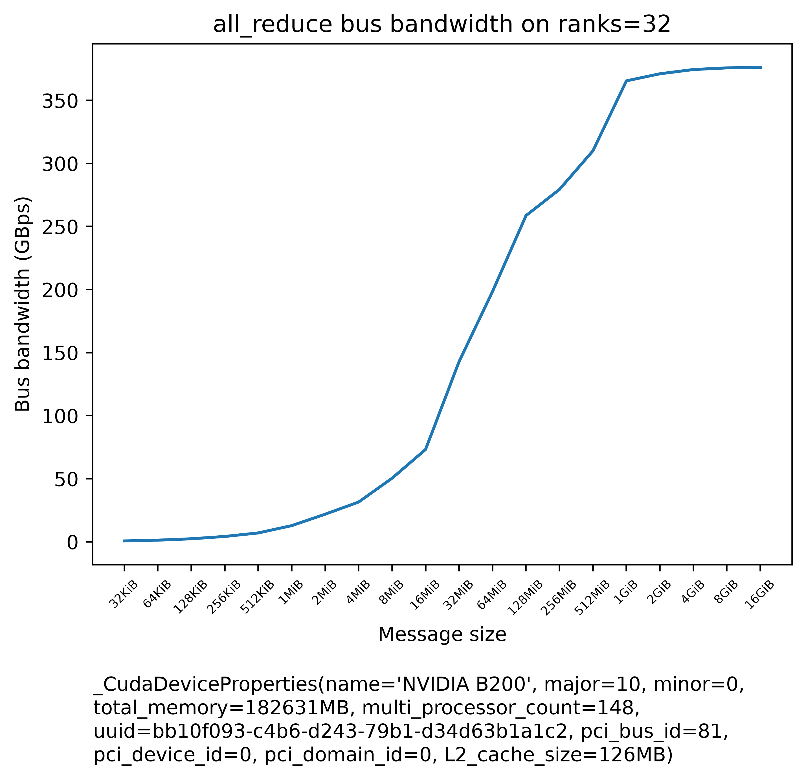
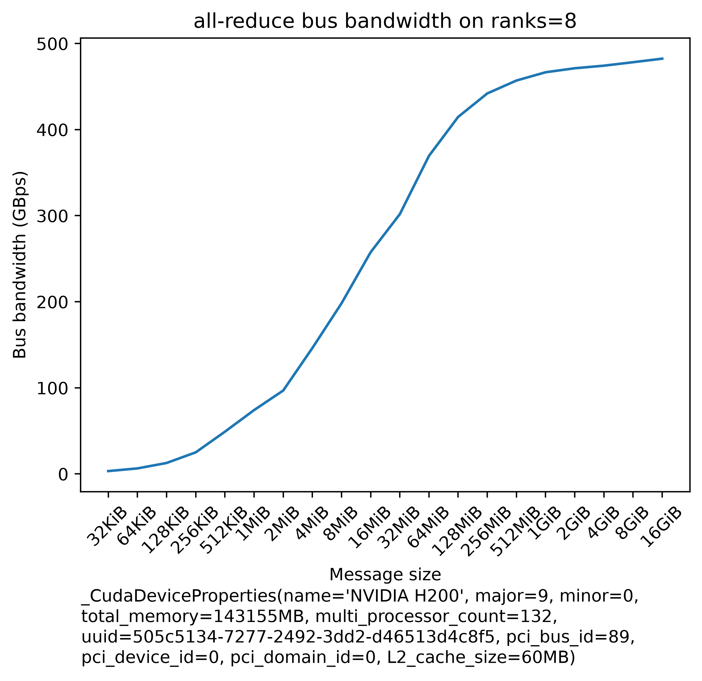
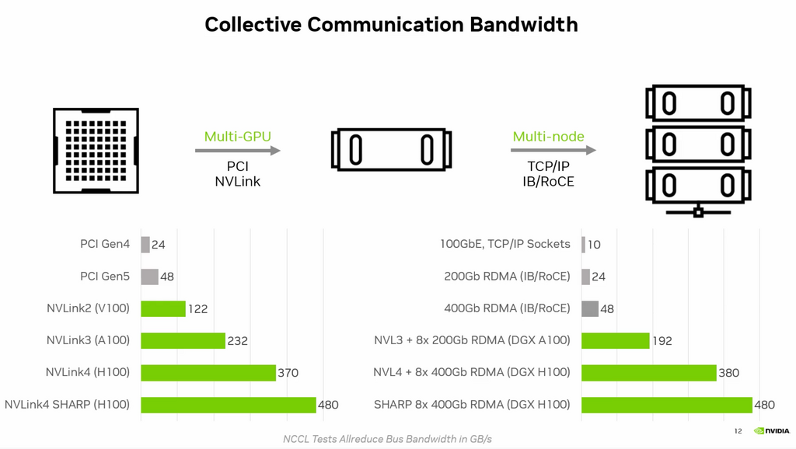
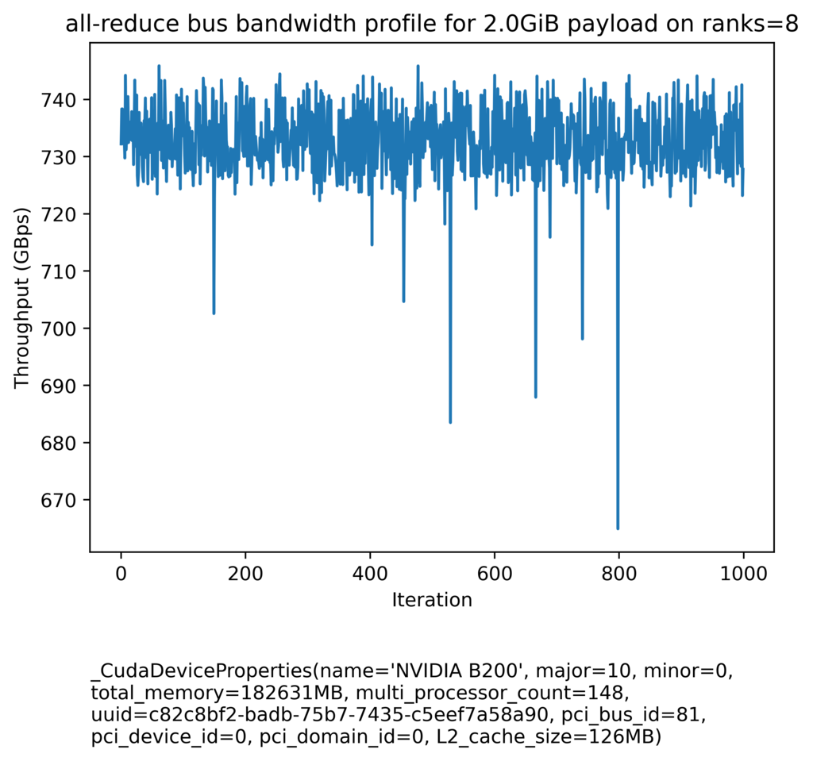
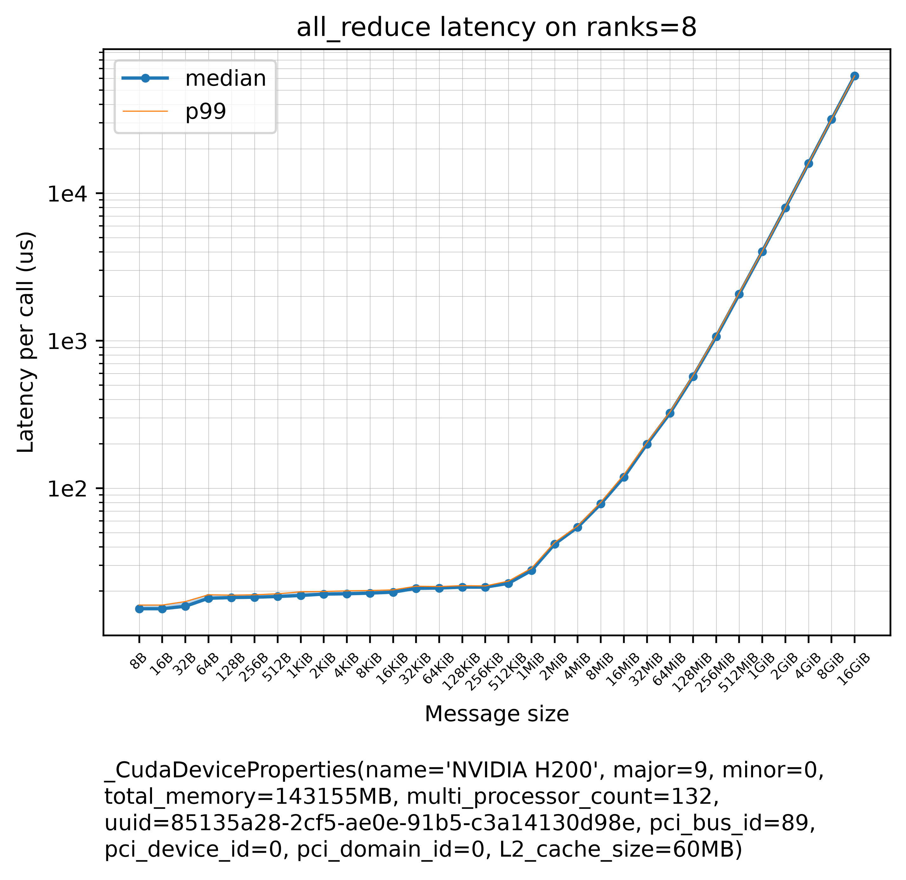
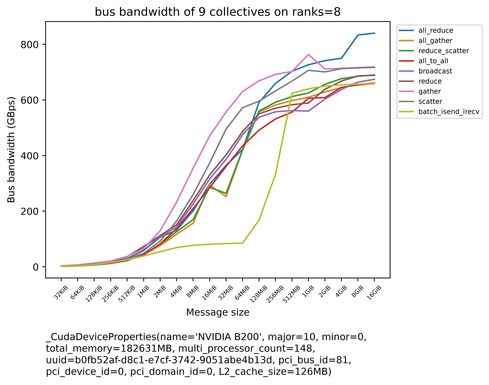
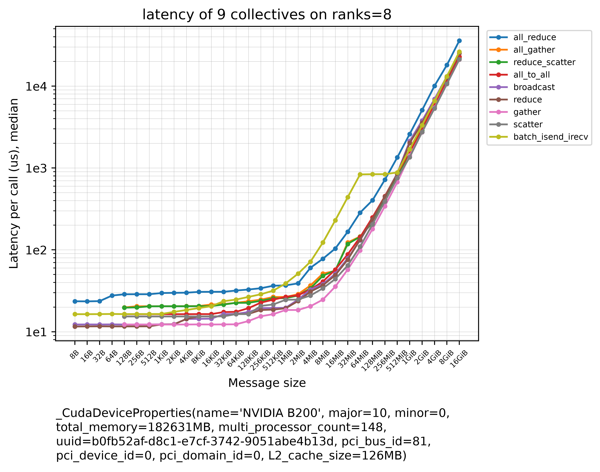

# 网络基准测试 {#networking-benchmarks}

## 工具 {#tools}

<a id="all_reduce-benchmark"></a>

### torch-dist-bench {#torch-dist-bench}

[torch-dist-bench.py](torch-dist-bench.py) —— 一个对真实网络带宽和延迟做基准测试的工具，它在一系列不同大小的负载（payload）上执行 `all_reduce` 及[其他集合通信](#other-collectives)。它有助于了解实际能得到什么成绩，与厂商标称的规格相差多少。它与 `nccl-tests` 有些类似，但只需要 PyTorch 就能运行。如果你的应用通过 `torch.distributed` 使用 NCCL 集合通信，就应该用这个基准测试；如果你写的是 CUDA NCCL 内核，则应该用 `nccl-tests`。这个基准测试按你的程序调用集合通信的方式去调用它们：经由 PyTorch，而 PyTorch 执行其中一些集合通信所用的 NCCL 调用与 `nccl-tests` 不同，例如 `scatter` 和 `batch_isend_irecv` —— 参见[其他集合通信](#other-collectives) —— 并且加上 `--with-host-overhead` 后，它还会把 PyTorch 每次调用约 20-30µs 的主机（host，即 CPU 侧）开销也计入在内，而对于小负载，这段时长几乎和集合通信本身一样长。

脚注：它的前身名为 `all_reduce_bench.py`，因为当时只测量 all-reduce 这一个集合通信。

在 4 台 8x B200 节点上（`torch=2.14.1+cu130`、`cuda=13.0`、`nccl=2.30.7`，整个扫描耗时 30 秒）它给出的结果是：
```
The average bandwidth and the per-call latency of all_reduce over 32 ranks (at least 5 warmups / 20 trials, up to 10 queued calls per trial):

| payload |   busbw    |   algbw    |              latency              | calls |
|         |            |            |   median  |    p99    |    mean   |       |
| ------: | ---------: | ---------: | --------: | --------: | --------: | ----: |
|      8B |            |            |    81.9us |    88.0us |    81.9us |   810 |
|     16B |            |            |    81.6us |    89.4us |    81.7us |   828 |
|     32B |            |            |    82.0us |    91.8us |    82.2us |   783 |
|     64B |            |            |    82.5us |    92.7us |    82.8us |   783 |
|    128B |            |            |    83.0us |    89.8us |    83.3us |   792 |
|    256B |            |            |    83.9us |    94.5us |    83.9us |   774 |
|    512B |            |            |    84.1us |    98.5us |    84.8us |   783 |
|    1KiB |            |            |    85.4us |    90.1us |    85.6us |   810 |
|    2KiB |            |            |    89.5us |    95.3us |    89.7us |   738 |
|    4KiB |            |            |    99.3us |   105.1us |    99.3us |   666 |
|    8KiB |            |            |   102.3us |   114.8us |   102.4us |   765 |
|   16KiB |            |            |   102.4us |   118.8us |   103.9us |   711 |
|   32KiB |   0.64GBps |   0.33GBps |   104.5us |   119.7us |   105.4us |   738 |
|   64KiB |   1.27GBps |   0.65GBps |   106.5us |   123.8us |   107.2us |   504 |
|  128KiB |   2.35GBps |   1.21GBps |   114.6us |   130.6us |   115.1us |   252 |
|  256KiB |   4.20GBps |   2.17GBps |   128.1us |   138.3us |   128.4us |   126 |
|  512KiB |   6.99GBps |   3.61GBps |   151.7us |   168.2us |   153.2us |   126 |
|    1MiB |  12.78GBps |   6.60GBps |   165.9us |   187.0us |   167.0us |   153 |
|    2MiB |  21.84GBps |  11.27GBps |   193.1us |   205.1us |   193.8us |   162 |
|    4MiB |  31.49GBps |  16.25GBps |   261.3us |   281.2us |   262.9us |   171 |
|    8MiB |  50.40GBps |  26.01GBps |   331.8us |   344.1us |   332.7us |   144 |
|   16MiB |  73.17GBps |  37.77GBps |   452.7us |   469.2us |   454.2us |   180 |
|   32MiB | 142.79GBps |  73.70GBps |   473.2us |   498.5us |   474.8us |   162 |
|   64MiB | 198.44GBps | 102.42GBps |   686.2us |   709.2us |   688.0us |   180 |
|  128MiB | 258.60GBps | 133.47GBps |  1027.2us |  1068.6us |  1029.2us |   140 |
|  256MiB | 279.38GBps | 144.20GBps |  1961.0us |  2112.0us |  1960.1us |    60 |
|  512MiB | 310.01GBps | 160.00GBps |  3428.2us |  3822.2us |  3452.6us |    20 |
|    1GiB | 365.47GBps | 188.63GBps |  5801.0us |  5926.7us |  5806.3us |    20 |
|    2GiB | 371.07GBps | 191.52GBps | 11307.0us | 11423.6us | 11319.9us |    20 |
|    4GiB | 374.44GBps | 193.26GBps | 22362.0us | 22451.0us | 22376.0us |    20 |
|    8GiB | 375.75GBps | 193.93GBps | 44532.8us | 44775.3us | 44549.5us |    20 |
|   16GiB | 376.17GBps | 194.15GBps | 88813.6us | 89220.5us | 88832.0us |    20 |
```

请阅读归一化后的 `busbw` 列而不是 `algbw` 列——[PERFORMANCE.md](https://github.com/NVIDIA/nccl-tests/blob/master/doc/PERFORMANCE.md#bandwidth) 解释了原因。和 `nccl-tests` 一样，本基准测试测量的是单向带宽，所以应与标称的单向峰值吞吐量作比较，而不是双向（双工）吞吐量。

并且，如果你安装了 `matplotlib` pip 包，它还会绘制一张图表：




下面是在单个 8x H200 节点上运行同一个基准测试的结果（`torch=2.14.0+cu130`、`cuda=13.0`、`nccl=2.30.7`，每种负载预热 5 次、试验 20 次迭代，整个扫描耗时 13 秒）：



注意，线性的 y 轴会把大约 100GBps 以下的一切都压缩到图表底部，所以对于小负载一端——也就是对梯度分桶（gradient bucketing）至关重要的那部分——与其看曲线，不如直接阅读[带宽的测量方法](#how-the-bandwidth-is-measured)一节中在同一节点上测得的表格的 `default` 列。那次扫描的最高值为 482.35GBps，*高于* 450GBps 的单向 [NVLink 4](../README.md#nvlink) 规格而不是低于它；原因，以及同一节点在禁用它之后的测量值，参见 [SHARP](../README.md#sharp)。

[跨节点速度取决于节点内速度](../README.md#inter-node-speed-depends-on-intra-node-speed)解释了为什么 4 节点的基准测试（32 个 rank）最高只有 376.17GBps，而同样 B200 的单个节点（8 个 rank）却能达到 839.00GBps，以及这个数字对每张网卡（NIC）意味着什么。

启动示例请看 [torch-dist-bench.py](torch-dist-bench.py) 文件顶部。你可以用 Ctrl-C 中断基准测试，它仍会报告截至那时已测得的结果。

这张表格应该能让你大致了解在调优良好的网络上，all-reduce 集合通信应达到什么样的成绩（左侧为节点内，右侧为跨节点）：


[来源](https://www.nvidia.com/en-us/on-demand/session/gtc24-s62129/)

如果你基准测试的是其他集合通信，预期的带宽可能与上面的 all-reduce 结果差别很大。[这场演讲](https://www.nvidia.com/en-us/on-demand/session/gtc24-s62129/)还给出了点对点通信带宽的预期值。

要检查 all-reduce 随时间变化的稳定性，而不是对结果取平均值，你可以用这两个参数对单一负载大小做性能剖析：`--profile_stability --payload_size_in_gib 0.5`（把最后的值改成你想要的 GiB 负载大小）。请注意，典型的 ML 负载不会不停地连续调用 all-reduce，所以这种方式是对网络做压力测试，属于一种不太典型的负载。但它仍能显示网络在持续负载下是否有问题。下面是在一台 8x B200 上以 2GiB 负载生成的一张图表示例：



<a id="how-the-calls-are-timed"></a>

#### 带宽的测量方法 {#how-the-bandwidth-is-measured}

默认情况下，每次试验（trial）先让 GPU 忙碌约 2ms，然后在后面排队提交最多 10 次连续的 `dist.all_reduce` 调用，再把耗时除以调用次数。64MiB 及以下的负载排 10 次调用，更大的次数更少，1GiB 及以上只有一次调用，因为单次调用本来就要花几毫秒。这样就隐藏了 PyTorch 每次调用 20-30µs 的主机开销——在主机始终领先于 GPU 的程序里，它本来也是被隐藏的，例如两次集合通信之间排入了足够多计算的训练循环——如果主机无法保持领先，比如连续下发小集合通信，或者程序在等待每一个结果，就请使用 `--with-host-overhead`。多次调用还会把各 rank 到达第一次调用的时间略有不同这一点平均掉。

这些带宽试验只在第一次调用之前和最后一次调用之后各记录一个 CUDA 事件。[延迟](#latency)由单独的试验测量，每次调用之后都记录一个事件，因为在两个排队的调用之间插入事件记录会让它们变慢：在 8x B200 节点上，1MiB 的 all-reduce 带事件记录耗时 35µs，不带则 30µs；`nccl-tests` 的 `-I 1` 计时与其默认计时之间也显示出同样的差别。用逐调用事件来测带宽，会让 all-reduce 在 8KiB 到 2MiB 区间损失 9-13% 的带宽，让[其他集合通信](#other-collectives)最多损失 35%。

下面是与上面图表同一台 8x H200 节点的测量结果，旁边是用相同 NCCL 版本构建的 [nccl-tests](#nccl-tests) 的运行结果——它对应的就是直接调用 NCCL API 的代码：

| 负载 | 默认    | nccl-tests | 差异 |
| ------: | ---------: | ---------: | ---------: |
|   32KiB |   3.15GBps |   3.20GBps |        +2% |
|   64KiB |   6.16GBps |   6.26GBps |        +2% |
|  128KiB |  12.46GBps |  12.40GBps |      -0.5% |
|  256KiB |  24.68GBps |  24.63GBps |      -0.2% |
|  512KiB |  48.15GBps |  48.30GBps |      +0.3% |
|    1MiB |  74.57GBps |  72.45GBps |        -3% |
|    2MiB |  96.26GBps |  91.48GBps |        -5% |
|    4MiB | 145.14GBps | 139.97GBps |        -4% |
|    8MiB | 196.56GBps | 182.03GBps |        -7% |
|   16MiB | 255.90GBps | 242.45GBps |        -5% |
|   32MiB | 301.25GBps | 298.44GBps |      -0.9% |
|   64MiB | 368.86GBps | 369.82GBps |      +0.3% |
|  128MiB | 414.54GBps | 411.21GBps |      -0.8% |
|  256MiB | 441.87GBps | 442.27GBps |      +0.1% |
|  512MiB | 456.23GBps | 455.82GBps |      -0.1% |
|    1GiB | 465.91GBps | 464.00GBps |      -0.4% |
|    2GiB | 471.06GBps | 468.31GBps |      -0.6% |
|    4GiB | 474.13GBps | 473.10GBps |      -0.2% |
|    8GiB | 478.24GBps | 475.16GBps |      -0.6% |
|   16GiB | 482.25GBps | 480.70GBps |      -0.3% |

两者相差在 2% 以内，只有 1MiB 到 16MiB 区间例外，那里 `nccl-tests` 的读数低 3-7%。用本基准测试还是用 `nccl-tests` 来测量，取决于你写的是 PyTorch 程序还是 NCCL 内核——参见 [nccl-tests](#nccl-tests)。

如果你的负载通过 PyTorch 把 all-reduce 调用捕获进 CUDA graph，那么在较小的负载下，要预期 `busbw` 低于本基准测试默认计时所报告的值。在 B200 上重放由 PyTorch 捕获的 all-reduce，会在相邻两次之间留下约 2.5µs 的间隙；在 2MiB 及以下、单次调用只需 10-35µs 的区间，这让普通 all-reduce 最多损失 9%，让对称内存（symmetric memory）的 all-reduce 损失 12-26%。

改用 `--with-host-overhead`，则每次试验改为在空闲的 GPU 上只对一次调用计时。它把那份主机开销计入每一次调用——也就是程序先等待 all-reduce 的结果、不做任何其他事情时，一次 all-reduce 的实际代价。这样得到的延迟还包含各 rank 到达该调用的时间不一致这一点，OSU 的 `osu_allreduce` 测得的延迟也是如此。

这两种模式都不测量与计算内核并发运行的集合通信——在把二者重叠（overlap）的训练循环中正是如此。内核会争夺 SM（流式多处理器）和内存带宽，所以如果集合通信不能立刻拿到它所需的全部 SM，重叠运行的集合通信就可能比这里报告的耗时更长；`nccl-tests` 也不测量这种情况。

#### 延迟 {#latency}

除带宽之外，基准测试还会报告单次调用的耗时——中位数、第 99 百分位（p99）和平均值——并把中位数和 p99 随负载大小变化的情况绘制成图。对小负载来说这才是关键数字，因为它们传输的数据几乎为零：在 8x H200 节点上，8B 的 all-reduce 仍要 15µs，512KiB 以下的每一种负载都要 15-23µs，所以更快的链路帮不上忙——要减少调用次数，或者让每次调用更便宜才行。这在推理（inference）中会迅速累积起来：一个用张量并行（tensor parallelism）部署在 8 块加速器上的模型，每生成一个词元（token），每一层要做 2 次 all-reduce；在 bf16 下隐藏维度为 8192 时，至多 32 个词元的一个批次会让每次 all-reduce 达到 16-512KiB，恰好落在那段平坦区间——于是一个 80 层的模型每生成一个词元，仅 all-reduce 就要等待 160 x 15µs = 2.4ms，无论它的链路多快。训练中也有小的 all-reduce，用来在各 rank 之间同步标志、标量或损失值；MoE 也要为其词元路由的 [all-to-all](#other-collectives) 付出同样的代价。

而 all-reduce 还是最好的情况：NCCL 只为 all-reduce 提供它的 tree 算法，NVLS 还能在交换机内部完成归约，所以其他集合通信在同样的负载下可能耗时更长——参见[用哪个集合通信来测量延迟](../README.md#which-collective-to-measure-latency-with)，并用 `--collectives` 为它们计时。



在 B200 上，延迟还能显示出跨出节点的代价。下面是一台 8x B200 节点和 4 台这样的节点上的 all-reduce 延迟，来自与开头那张表格相同的运行：

| 负载 | 8 个 rank<br>中位数 | 8 个 rank<br>p99 | 32 个 rank<br>中位数 | 32 个 rank<br>p99 | 32 / 8<br>中位数 |
| ------: | ----------------: | -------------: | -----------------: | --------------: | ---------------: |
|      8B |            23.0µs |         25.1µs |             81.9µs |          88.0µs |             3.6x |
|    1KiB |            29.5µs |         31.8µs |             85.4µs |          90.1µs |             2.9x |
|   16KiB |            30.7µs |         32.8µs |            102.4µs |         118.8µs |             3.3x |
|  128KiB |            32.8µs |         34.8µs |            114.6µs |         130.6µs |             3.5x |
|  512KiB |            35.8µs |         38.0µs |            151.7µs |         168.2µs |             4.2x |
|    1MiB |            35.9µs |         39.8µs |            165.9µs |         187.0µs |             4.6x |
|    4MiB |            60.4µs |         62.6µs |            261.3µs |         281.2µs |             4.3x |
|   16MiB |           104.4µs |        107.2µs |            452.7µs |         469.2µs |             4.3x |

在 16MiB 及以下，一次调用一旦跨出网络就要花 2.9-4.6 倍的时间，连 8B 的 all-reduce 也要 82µs 而不是 23µs。

#### 延迟的测量方法 {#how-the-latency-is-measured}

- 每次调用的耗时，是从上一个排队调用的结束到本次调用自身结束的时间，与 `nccl-tests` 的逐迭代计时（`-I 1`）相同，`nccl-tests` 在它的 `i_*` 列中报告这种计时，并在其 `-J` JSON 输出中给出中位数。每次试验的第一次调用被排除在外，并且在忙等（busy wait）之后先做一次含 1 个元素的 all-reduce，让各 rank 在 GPU 上对齐：否则最先结束忙等的 rank 会把这段差值耗在它最初的几次调用里——对多数集合通信是 1 次调用，而对 `batch_isend_irecv` 最多是 ranks-1 次调用，它的环形模式每次调用把等待向后移一个 rank。
- 一次调用要到每个 rank 都完成才算完成，因此每次调用的耗时取其中最慢那个 rank 的耗时，`nccl-tests` 的逐迭代中位数和 p99 也是如此。而它的 `time` 列是各 rank 每次调用的耗时在 rank 之间取平均：对一起完成的 all-reduce，这个值与前者接近；但对完成时间不一致的集合通信，例如 `broadcast`，它会更低。
- 小负载每种最多调用 1000 次，这样 p99 就是其中最慢的第 10 次；更大的负载次数更少，一旦 1000 次调用会传输超过 40MiB 就减少次数——[Intel MPI Benchmarks](https://github.com/intel/mpi-benchmarks) 统计重复次数的方式与此相同。`nccl-tests` 默认对 20 次调用计时；OSU 的 `osu_allreduce` 在 8KiB 及以下跑 1000 次，之上跑 100 次。
- 报告中位数和 p99 而不是平均值，因为一次慢调用会拉高平均值但不会改变中位数，而 p99 能显示慢调用究竟能慢到什么程度。平均值也会一并打印。
- 某个 rank 的 Python 线程偶尔会暂停几毫秒。如果这发生在它排队提交某次试验的调用期间，它的 GPU 会在 2ms 忙等结束之前就把排队的任务跑完，于是这次试验计时的是那次暂停而不是 all-reduce。这类试验会在所有 rank 上一起被剔除，报告也会说明剔除了多少次：在 8x H200 节点上，每次运行的 1904 次试验中有 50-60 次。如果不这样做，小负载下的 p99 读数会在 19µs 到 380µs 之间，而且每次运行都不一样。

在同一台 8x H200 节点上（`torch=2.14.0+cu130`、`nccl=2.30.7`），与 `nccl-tests` 对每种负载逐一计时 1000 次调用（`-n 1000 -w 200 -I 1`，in-place）的对比：

| 负载 | 中位数 | p99    | sym-mem<br>中位数 | sym-mem<br>p99 | 主机<br>开销<br>中位数 | 主机<br>开销<br>p99 | nccl-tests<br>`time` | nccl-tests<br>p99 |
| ------: | -----: | -----: | ----------------: | -------------: | -------------------------: | ----------------------: | -------------------: | ----------------: |
|      8B | 15.2µs | 16.1µs |             8.1µs |          9.0µs |                     36.6µs |                  3668µs |               14.9µs |            16.1µs |
|     64B | 17.9µs | 19.0µs |             8.1µs |          9.2µs |                     38.0µs |                  5166µs |               17.0µs |            19.0µs |
|    1KiB | 18.8µs | 19.8µs |             8.4µs |          9.3µs |                     39.1µs |                  5213µs |               18.2µs |            19.7µs |
|   32KiB | 20.9µs | 21.7µs |            11.6µs |         12.4µs |                     41.7µs |                  4877µs |               20.4µs |            21.6µs |
|  256KiB | 21.4µs | 21.9µs |            12.6µs |         13.8µs |                     43.5µs |                  3607µs |               21.0µs |            21.7µs |
|    1MiB | 27.7µs | 28.5µs |            16.3µs |         17.2µs |                     50.9µs |                    75µs |               27.8µs |            28.6µs |

sym-mem：带 `--sym-mem` 参数运行；主机开销：带 `--with-host-overhead` 参数运行。

默认计时与 `nccl-tests` 在 p99 上相差 1µs 以内，而[对称内存](#symmetric-memory)在 16KiB 及以下大致把延迟减半。在软件相同的 8x B200 节点上，两者同样相差 1µs 以内——8B 的 all-reduce 中位数为 23.5µs、p99 为 24.7µs，带 `--sym-mem` 时分别为 11.6µs 和 12.5µs——所以在 B200 上小 all-reduce 的代价比在 H200 节点上更高。`--with-host-overhead` 会保留主机发生过暂停的试验，因为等待每一次 all-reduce 的程序得到的就是这样：它的中位数加上了 PyTorch 每次调用约 20µs 的开销，256KiB 及以下的 p99 为 3.6-5.2ms，因为超过百分之一的调用在等某个 rank 上处于暂停状态的主机。

报告还会指出达到峰值 `busbw` 一半的最小负载——在上面那台 8x H200 节点上是 16MiB 或 32MiB，因为 16MiB 差不多正好在一半的位置。低于它的负载拿到的不到该配置所能提供带宽的一半，更适合用延迟来评价。

默认情况下，延迟从 8B 测到 16GiB，带宽从 32KiB 测到 16GiB，因为在 32KiB 以下，一次调用的耗时几乎全是延迟，它的 `busbw` 说明不了什么。`--min-payload` 调整延迟测量范围的起点，`--min-busbw-payload` 调整带宽测量范围的起点，`--max-payload` 调整二者的终点——例如用 `--max-payload 16K` 快速只做一次只测延迟的运行。
#### 其他集合通信 {#other-collectives}

该基准测试默认对 `all_reduce` 计时。要对其他集合通信计时，请加上 `--collectives` 参数，跟上一个或多个集合通信的名字，用逗号分隔，例如 `--collectives all_gather,reduce_scatter`；也可以用 `all` 表示全部九种——`all_reduce`、`all_gather`、`reduce_scatter`、`all_to_all`、`broadcast`、`reduce`、`gather`、`scatter` 和 `batch_isend_irecv`。示例：

```bash
python -u -m torch.distributed.run --nproc_per_node=8 torch-dist-bench.py --collectives all_gather,reduce_scatter
python -u -m torch.distributed.run --nproc_per_node=8 torch-dist-bench.py --collectives all
```

每一种集合通信都会得到与 `all_reduce` 相同的计时和图表，分别保存为 `busbw-mean-<collective>-<host>-<ranks>.png` 和 `latency-<collective>-<host>-<ranks>.png`。如果被基准测试的集合通信不止一种，随后还会给出一张 `busbw` 表格和一张延迟中位数表格：各行是负载大小，各列是各种集合通信——加上 `--separate-tables` 则会为每种集合通信各生成一张表，其中还包含 `algbw` 以及延迟的 p99 和平均值——随后还有一张汇总表和两张对比它们的图表，分别保存为 `busbw-mean-collectives-<host>-<ranks>.png` 和 `latency-collectives-<host>-<ranks>.png`。在一台 8x B200 节点上，全部九种集合通信从 8B 到 16GiB 跑完不到 2 分钟。

负载（payload）、`algbw` 和 `busbw` 沿用 `nccl-tests` 的定义，它的 [PERFORMANCE.md](https://github.com/NVIDIA/nccl-tests/blob/master/doc/PERFORMANCE.md) 对它们做了解释。负载是指某个 rank 的输入缓冲区和输出缓冲区中较大的那一个；`busbw` 是 `algbw` 乘上一个系数，该系数使它能在不同的集合通信之间、不同的 rank 数量 `n` 之间相互比较：

| 集合通信              | 某个 rank 的输入           | 某个 rank 的输出               | `busbw`<br>系数 |
| :-------------------- | :------------------------- | :----------------------------- | :---------------- |
| `all_reduce`          | 负载                       | 负载                           | 2(n-1)/n          |
| `all_gather`          | 负载的 1/n                 | 负载                           | (n-1)/n           |
| `reduce_scatter`      | 负载                       | 负载的 1/n                     | (n-1)/n           |
| `all_to_all`          | 负载，每个 rank 分到 1/n   | 负载，每个 rank 各提供 1/n     | (n-1)/n           |
| `broadcast`           | 负载，在 root 上           | 负载                           | 1                 |
| `reduce`              | 负载                       | 负载，在 root 上               | 1                 |
| `gather`              | 负载的 1/n                 | 负载，在 root 上               | (n-1)/n           |
| `scatter`             | 负载，在 root 上           | 负载的 1/n                     | (n-1)/n           |
| `batch_isend_irecv`   | 负载，发给 rank+1          | 负载，来自 rank-1              | 1                 |

root 就是 rank 0；`batch_isend_irecv` 让每个 rank 把数据发给下一个 rank，并从上一个 rank 接收，与 `nccl-tests` 的做法相同。发送和接收作为同一个批次一起发起：如果不打包成批次，它们就会在同一个 stream（流）上一先一后地运行，每个 rank 的发送都要等它的邻居的接收完成，而那个接收又排在那个邻居自己的发送后面。

与 `nccl-tests` 一样，1/n 的分片大小会向下取整到 16 字节的整数倍，所以每个 rank 不足 16 字节的负载会被跳过——在 8 个 rank 上就是 128B 以下的负载——而当 rank 数量不是 2 的幂时，`all_gather`、`gather`、`reduce_scatter`、`scatter` 和 `all_to_all` 传输的数据会比负载略少，表格报告的是它们实际传输的数据量。

下面是全部九种集合通信在一台 8x B200 节点上的结果（`torch=2.14.1+cu130`、`nccl=2.30.7`，整个扫描耗时 2 分钟），按基准测试的打印原样给出——先是每种集合通信在每种负载下的 `busbw` 和延迟中位数，然后是汇总：

```
The average bandwidth and the per-call latency of 9 collectives over 8 ranks (at least 5 warmups / 20 trials, up to 10 queued calls per trial):

busbw, GBps
|  pay   |  all_  |  all_  | reduce_ | all_to | broad  | reduce | gather | scatter | batch  |
|  load  | reduce | gather | scatter |  _all  |  cast  |        |        |         | _isend |
|        |        |        |         |        |        |        |        |         | _irecv |
| -----: | -----: | -----: | ------: | -----: | -----: | -----: | -----: | ------: | -----: |
|  32KiB |   2.17 |   1.64 |    1.70 |   2.45 |   2.78 |   2.97 |   3.68 |    2.67 |   2.34 |
|  64KiB |   4.18 |   3.12 |    3.22 |   4.59 |   5.28 |   5.24 |   6.84 |    4.97 |   4.22 |
| 128KiB |   8.13 |   6.12 |    6.29 |   8.33 |  10.40 |  10.40 |  13.04 |    9.92 |   7.69 |
| 256KiB |  15.91 |  11.90 |   12.31 |  13.11 |  19.00 |  20.45 |  20.78 |   14.58 |  15.11 |
| 512KiB |  29.50 |  21.65 |   22.25 |  23.85 |  36.08 |  36.36 |  37.16 |   27.18 |  25.00 |
|   1MiB |  58.93 |  43.53 |   44.73 |  42.67 |  71.98 |  72.89 |  65.03 |   48.68 |  38.80 |
|   2MiB | 106.27 |  76.21 |   80.68 |  82.44 | 108.21 | 112.18 | 129.13 |   92.42 |  54.07 |
|   4MiB | 131.71 | 116.90 |  126.13 | 137.51 | 143.11 | 151.16 | 232.74 |  164.62 |  69.05 |
|   8MiB | 201.12 | 156.61 |  169.33 | 209.13 | 225.24 | 237.76 | 354.29 |  259.37 |  77.06 |
|  16MiB | 296.16 | 294.05 |  285.91 | 284.06 | 315.35 | 329.76 | 469.87 |  372.69 |  81.14 |
|  32MiB | 364.90 | 252.67 |  264.12 | 360.63 | 385.89 | 402.28 | 556.43 |  494.93 |  83.57 |
|  64MiB | 421.74 | 418.71 |  419.83 | 434.48 | 474.91 | 486.08 | 630.14 |  572.21 |  84.83 |
| 128MiB | 591.12 | 556.63 |  560.30 | 491.21 | 537.97 | 550.18 | 668.70 |  595.42 | 167.76 |
| 256MiB | 659.60 | 582.00 |  591.78 | 531.85 | 557.36 | 570.34 | 692.03 |  632.65 | 332.74 |
| 512MiB | 703.05 | 597.64 |  612.24 | 555.99 | 561.76 | 582.73 | 702.41 |  667.78 | 624.07 |
|   1GiB | 726.53 | 609.48 |  624.93 | 606.00 | 560.04 | 589.18 | 763.36 |  706.41 | 640.10 |
|   2GiB | 741.30 | 629.10 |  656.15 | 608.20 | 602.80 | 638.31 | 711.24 |  700.79 | 649.89 |
|   4GiB | 749.77 | 644.07 |  676.61 | 645.36 | 637.73 | 667.94 | 713.73 |  712.37 | 654.43 |
|   8GiB | 833.39 | 655.67 |  685.19 | 654.13 | 664.05 | 686.42 | 716.57 |  715.36 | 657.03 |
|  16GiB | 840.18 | 661.74 |  689.72 | 658.62 | 674.19 | 688.60 | 718.37 |  717.23 | 658.47 |

latency median, us
|  pay   |   all_  |   all_  | reduce_ |  all_to |  broad  |  reduce |  gather | scatter |  batch  |
|  load  |  reduce |  gather | scatter |   _all  |   cast  |         |         |         |  _isend |
|        |         |         |         |         |         |         |         |         |  _irecv |
| -----: | ------: | ------: | ------: | ------: | ------: | ------: | ------: | ------: | ------: |
|     8B |    23.6 |         |         |         |    12.3 |    11.6 |         |         |    16.4 |
|    16B |    23.5 |         |         |         |    12.3 |    11.6 |         |         |    16.4 |
|    32B |    23.6 |         |         |         |    12.3 |    11.6 |         |         |    16.4 |
|    64B |    27.6 |         |         |         |    12.3 |    11.6 |         |         |    16.5 |
|   128B |    28.7 |    19.8 |    19.7 |    16.4 |    12.3 |    11.6 |    12.3 |    15.4 |    16.4 |
|   256B |    28.7 |    20.4 |    19.8 |    16.4 |    12.3 |    11.6 |    12.2 |    15.4 |    16.4 |
|   512B |    28.7 |    20.5 |    20.4 |    16.4 |    12.3 |    11.6 |    12.3 |    15.4 |    16.4 |
|   1KiB |    29.7 |    20.5 |    20.5 |    16.4 |    12.3 |    12.3 |    12.3 |    15.4 |    16.5 |
|   2KiB |    29.9 |    20.5 |    20.5 |    16.4 |    12.4 |    12.3 |    12.3 |    15.4 |    17.5 |
|   4KiB |    30.0 |    20.5 |    20.5 |    16.4 |    14.3 |    14.3 |    12.3 |    15.4 |    18.4 |
|   8KiB |    30.7 |    20.6 |    20.5 |    16.4 |    14.4 |    15.4 |    12.3 |    15.4 |    19.5 |
|  16KiB |    30.7 |    21.5 |    20.6 |    16.4 |    14.4 |    15.4 |    12.3 |    15.4 |    20.5 |
|  32KiB |    30.8 |    21.8 |    21.5 |    17.4 |    16.4 |    15.5 |    12.3 |    15.4 |    23.6 |
|  64KiB |    31.8 |    22.6 |    22.5 |    17.5 |    16.5 |    16.5 |    12.3 |    16.4 |    24.7 |
| 128KiB |    32.8 |    23.6 |    22.6 |    19.4 |    17.4 |    16.5 |    13.5 |    16.4 |    26.6 |
| 256KiB |    34.0 |    24.6 |    23.8 |    22.7 |    19.4 |    18.4 |    15.5 |    20.7 |    28.7 |
| 512KiB |    36.4 |    26.6 |    25.6 |    24.6 |    19.5 |    18.6 |    16.4 |    21.5 |    31.7 |
|   1MiB |    36.8 |    26.6 |    25.7 |    26.7 |    19.6 |    19.3 |    18.4 |    24.5 |    38.9 |
|   2MiB |    38.9 |    28.7 |    27.6 |    27.9 |    24.7 |    23.7 |    18.4 |    24.7 |    51.2 |
|   4MiB |    60.4 |    36.8 |    33.9 |    32.8 |    32.8 |    30.9 |    20.5 |    27.7 |    71.7 |
|   8MiB |    77.8 |    51.3 |    48.2 |    41.0 |    38.1 |    36.8 |    24.7 |    33.9 |   122.8 |
|  16MiB |   103.8 |    55.3 |    56.3 |    57.3 |    51.1 |    49.0 |    35.6 |    44.0 |   229.4 |
|  32MiB |   166.0 |   122.9 |   118.1 |    88.1 |    78.8 |    75.9 |    57.3 |    64.5 |   438.4 |
|  64MiB |   284.7 |   145.4 |   144.4 |   142.4 |   131.1 |   133.1 |    98.3 |   109.6 |   833.8 |
| 128MiB |   402.8 |   216.1 |   215.1 |   248.9 |   233.5 |   235.6 |   179.3 |   204.8 |   838.9 |
| 256MiB |   718.9 |   408.6 |   404.5 |   451.6 |   441.4 |   446.3 |   341.6 |   390.1 |   839.4 |
| 512MiB |  1345.5 |   795.5 |   775.2 |   859.1 |   860.9 |   845.6 |   671.1 |   754.7 |   880.6 |
|   1GiB |  2595.8 |  1549.3 |  1518.6 |  1555.9 |  2128.8 |  2016.3 |  1415.2 |  1353.7 |  1694.2 |
|   2GiB |  5081.1 |  2999.3 |  2879.5 |  3098.6 |  3775.5 |  3555.3 |  2725.9 |  2750.5 |  3325.9 |
|   4GiB | 10052.6 |  5853.7 |  5572.6 |  5836.8 |  6942.7 |  6619.1 |  5432.3 |  5336.1 |  6597.6 |
|   8GiB | 18091.5 | 11482.1 | 11005.9 | 11518.0 | 13140.5 | 12708.4 | 10652.7 | 10623.0 | 13150.2 |
|  16GiB | 35853.3 | 22769.6 | 21846.0 | 22860.8 | 25700.9 | 25147.9 | 21085.1 | 21192.7 | 26211.3 |
```

```
Summary of 9 collectives over 8 ranks:

fastest median latency
|     collective    | payload | fastest |
| :---------------- | ------: | ------: |
| reduce            |      8B |  11.6us |
| gather            |    256B |  12.2us |
| broadcast         |      8B |  12.3us |
| scatter           |    128B |  15.4us |
| all_to_all        |    128B |  16.4us |
| batch_isend_irecv |      8B |  16.4us |
| reduce_scatter    |    128B |  19.7us |
| all_gather        |    128B |  19.8us |
| all_reduce        |     16B |  23.5us |

busbw
|     collective    | payload |    peak    | half-peak |
|                   |         |            |  payload  |
| :---------------- | ------: | ---------: | --------: |
| all_reduce        |   16GiB | 840.18GBps |     64MiB |
| gather            |    1GiB | 763.36GBps |     16MiB |
| scatter           |   16GiB | 717.23GBps |     16MiB |
| reduce_scatter    |   16GiB | 689.72GBps |     64MiB |
| reduce            |   16GiB | 688.60GBps |     32MiB |
| broadcast         |   16GiB | 674.19GBps |     32MiB |
| all_gather        |   16GiB | 661.74GBps |     64MiB |
| all_to_all        |   16GiB | 658.62GBps |     32MiB |
| batch_isend_irecv |   16GiB | 658.47GBps |    256MiB |
```

“最快中位数”指的是在所有被测负载中最小的那个延迟中位数。半峰值负载是指达到该集合通信峰值 `busbw` 一半的最小负载，定义同[延迟](#latency)一节。





最快的 `all_to_all`——MoE 的 dispatch 与 combine 会用到它——是 16.4µs，而 `all_reduce` 最快是 23.5µs；最快的 `reduce`、`gather` 和 `broadcast` 分别是 11.6µs、12.2µs 和 12.3µs。加上 `--sym-mem` 会把 `all_reduce`、`all_gather` 和 `reduce_scatter` 的最低延迟降到 11.6µs，让其余几种集合通信的最快延迟变化不到 1µs，并使 `batch_isend_irecv` 慢 1.8µs。在峰值上，`all_gather` 达到 749.03GBps 而不是 661.74GBps；而 `reduce_scatter` 的最高值变成 8GiB 处的 489.13GBps，而不是 16GiB 处的 689.72GBps。

`gather` 的峰值在 1GiB 处，为 763.36GBps，高于它在 16GiB 处的 718.37GBps。`batch_isend_irecv` 在 16MiB 到 64MiB 区间一直保持 81-85GBps，不到同区间内其他任何集合通信的三分之一，而它的延迟中位数在 64MiB 到 256MiB 区间平坦地停在 834-839µs。它直到 512MiB 才追上其他集合通信。

与用 NCCL 2.30.7 在一台 8x B200 节点上构建的 `nccl-tests` 对比——延迟对比它的逐迭代中位数和 p99（`-I 1`），带宽对比它的默认计时——`all_reduce`、`all_gather`、`reduce_scatter`、`all_to_all`、`broadcast`、`reduce` 和 `gather` 在 1MiB 及以下相差约 1µs 以内，在 16GiB 处相差 2% 以内，它们的 p99 也是如此。存在差异的地方，是因为 PyTorch 执行该集合通信的方式不同，或 `nccl-tests` 的计时方式不同：

- `scatter` 在 128KiB 及以下多花 3-4µs，在 256KiB 到 1MiB 之间多花 6-7µs，并在 8KiB 到 256MiB 区间少得到 7-24% 的 `busbw`。`torch.distributed.scatter` 用一次次独立的 NCCL 发送把各分片发给每个 rank，而 `nccl-tests` 调用的是 NCCL 自己的 `ncclScatter`，它是在 NCCL 2.28 中加入的。对于 `gather`，本基准测试调用 `torch.distributed.gather_single`，当 PyTorch 基于 NCCL>=2.28.3 构建时它使用 `ncclGather`，与 `nccl-tests` 的结果一致。较旧的 `torch.distributed.gather` 接收一个输出张量列表，并使用独立的发送和接收，在 1KiB 处要多花 3.7µs。
- `batch_isend_irecv` 在 128KiB 及以下多花 2-4µs。它到下一个 rank 的发送和来自上一个 rank 的接收走的是 PyTorch 的点对点路径，而不是单次集合通信调用。它的 `busbw` 从 8KiB 起与 `nccl-tests` 相差在 9% 以内，从 32MiB 起相差在 1% 以内。
- `broadcast` 和 `reduce` 在 4MiB 到 2GiB 区间少得到 7-15% 的 `busbw`，这是因为连续进行的 `broadcast` 和 `reduce` 会相互重叠，而 `all_reduce` 不会；`nccl-tests` 对连续的 20 次调用计时，而本基准测试的每次试验最多对 10 次调用计时，从 1GiB 起每次试验只对 1 次调用计时。与 `nccl-tests` 的单次调用（`-n 1`）相比，它在 1GiB 的 `broadcast` 为 1.89ms，相差在 5% 以内。它 1GiB 的延迟中位数为 2.09ms，因为一次调用的延迟取的是最慢那个 rank 的值，而带宽——和 `nccl-tests` 的 `time` 列一样——是在各 rank 之间取平均，并且一次 `broadcast` 中各 rank 并不是一起完成的。

#### 其他实现 {#other-implementations}

其他测量集合通信延迟的基准测试，以及它们各自默认扫描的负载范围：

- [nccl-tests](https://github.com/NVIDIA/nccl-tests) —— NVIDIA 通过 NCCL C API 对每一种 NCCL 集合通信做的基准测试；`time` 列是每次调用的平均值，`-I 1` 会额外给出每次调用的最小值、最大值和 p99。默认只测一个 32MiB 的负载，而它的 README 在单个节点上用 `-b 8 -e 128M`、在 8 个节点上用 `-b 8 -e 8G` 做扫描——参见 [nccl-tests](#nccl-tests)。
- [rccl-tests](https://github.com/ROCm/rccl-tests) —— 同样的基准测试用于 AMD 的 RCCL，选项（flag）和输出列都相同。
- [OSU Micro-Benchmarks](https://mvapich.cse.ohio-state.edu/benchmarks/) —— MVAPICH 团队的 MPI 基准测试；`osu_allreduce` 及其同族程序报告每次调用的平均、最小和最大延迟，默认范围为 1B 到 1MiB。
- [Intel MPI Benchmarks](https://github.com/intel/mpi-benchmarks) —— `IMB-MPI1 Allreduce` 及其他集合通信报告每次调用的 `t_min`、`t_max` 和 `t_avg`，默认范围为 0B 到 4MiB。
- [PARAM](https://github.com/facebookresearch/param) —— Meta 的基准测试，其 `train/comms/pt/comms.py` 与本基准测试一样通过 `torch.distributed` 对集合通信计时，并报告 p50、p75 和 p95 延迟，默认范围为 8B 到 64B。
- [UCC perftest](https://github.com/openucx/ucc) —— `ucc_perftest` 通过 UCC 对集合通信计时——UCC 可以运行在 NCCL 之上——并报告平均、最小和最大延迟；默认只测一个含 128 个元素的负载。
- [MSCCL++](https://github.com/microsoft/mscclpp) —— 它的 `python/mscclpp_benchmark/allreduce_bench.py` 在 4KiB 到 1GiB 的范围内，对 MSCCL++ 的 all-reduce 内核与 NCCL 的内核分别计时。参见[其他集合通信库](../README.md#other-collective-libraries)。
- [DeepEP](https://github.com/deepseek-ai/DeepEP) —— DeepSeek 的 MoE 专家并行 all-to-all 库，它的测试不扫描负载大小，而是在符合现实规模的词元数量下对其 dispatch 和 combine 内核计时。参见[其他集合通信库](../README.md#other-collective-libraries)。


#### 对称内存 {#symmetric-memory}

在较低的负载下，对称内存能显著加快 NCCL 通信。详见[对称内存](../README.md#symmetric-memory)。

要在注册为 NCCL 对称内存窗口的缓冲区上运行这些集合通信，请加上 `--sym-mem`（类似于 `nccl-tests -R 2`），它让 NCCL>=2.27 对有对称内核的那些集合通信使用其对称内核。`register_mem_pool(..., symm=True)` 是 torch 2.9 引入的。torch 2.9.1（NCCL 2.27.7）、2.10.0 和 2.11.0（两者均为 NCCL 2.28.9）在该路径上会挂起在 `broadcast` 里。torch 2.12.0 搭配 NCCL 2.29.7 是能正常完成它的最早的 cu130 版本，所以本基准测试在低于 torch 2.12 和 NCCL 2.29 的版本上会拒绝接受 `--sym-mem`。请在启用和不启用该参数的两种情况下运行基准测试，看看对称内存能在你的配置上带来多少收益。只有当你要为之做基准测试的那个工作负载也会在对称内存缓冲区上运行这些集合通信时，才使用它；否则它测出的数字并不能反映那个工作负载实际能得到的性能。[其他集合通信](#other-collectives)展示了它在 B200 节点上会加速哪些集合通信、又会拖慢哪些。


### all_gather_object 与 all_reduce {#all_gather_object-vs-all_reduce}

[all_gather_object_vs_all_reduce.py](all_gather_object_vs_all_reduce.py) —— 一个简单的基准测试，表明在从进程组收集完成状态时——例如实现某种“所有进程都已完成”的标志——把做法从 `all_gather_object` 换成 `all_reduce` 能带来 23 倍的加速。这种技术通常用于在各 GPU 可能在不同迭代次数上完成时同步这些 GPU——在多条数据并行（DP）通道上做推理时就需要这样——或者用于在 `DataLoader` 中同步 `StopIteration` 事件。另见 [all_gather_object_vs_all_gather.py](./all_gather_object_vs_all_gather.py)。

### all_reduce 延迟对比 {#all_reduce-latency-comparison}

[all_reduce_latency_comp.py](all_reduce_latency_comp.py) —— 举例说明 1 次 4GB 的归约比 1000 次 4MB 的归约快得多。

### nccl-tests {#nccl-tests}

[NVIDIA/nccl-tests](https://github.com/NVIDIA/nccl-tests) 对各种集合通信——`all-reduce`、`all-gather`、`reduce-scatter` 以及其他——做基准测试，并报告与 [torch-dist-bench.py](torch-dist-bench.py) 相同的 `busbw`/`algbw` 列。

用这两个中的哪一个，取决于你写的是什么。如果是 PyTorch 程序，就用 `torch-dist-bench.py`：它像你的程序那样通过 `torch.distributed` 调用集合通信，所以它给出的数字就是你的程序能得到的数字——[其他集合通信](#other-collectives)指出了这与 `nccl-tests` 有差异的地方。如果你写的是直接调用 NCCL 的代码，例如自定义通信内核，或在 NCCL 之上构建的 C++/CUDA 层，就用 `nccl-tests`，它调用 NCCL C API 的方式与你的代码相同。

单节点的情况下 `MPI=0` 就够了；`NCCL_HOME` 指向你想测试的那个 NCCL——选 PyTorch 正在使用的那个最方便，因为那才是你的训练实际会用到的。pip 安装的 PyTorch 从 `nvidia-nccl` wheel 包获得它，而截至 `nvidia-nccl-cu13==2.30.7`，该包随附 `libnccl.so.2` 但没有 `libnccl.so`，所以要在头文件旁边给链接器准备一个 `libnccl.so`：

```bash
git clone https://github.com/NVIDIA/nccl-tests
cd nccl-tests
NCCL_PIP=$(python -c "import nvidia.nccl; print(list(nvidia.nccl.__path__)[0])")
mkdir -p nccl-home/lib
ln -s $NCCL_PIP/include nccl-home/include
ln -s $NCCL_PIP/lib/libnccl.so.2 nccl-home/lib/libnccl.so
make -j MPI=0 NCCL_HOME=$PWD/nccl-home
export LD_LIBRARY_PATH=$NCCL_PIP/lib:$LD_LIBRARY_PATH
```

这样会在 `build/` 下为每种集合通信生成一个可执行文件——`all_reduce_perf`、`all_gather_perf`、`reduce_scatter_perf`、`alltoall_perf` 以及其他。`LD_LIBRARY_PATH` 那一行使它们在运行时加载的是同一个 NCCL，而不是系统里的某个 NCCL——可以核对它们打印的 `NCCL version` 行。默认的运行方式是对连续排队的调用计时，这与 `torch-dist-bench.py` 的默认计时一致；而 `-R 2` 会把缓冲区注册为对称内存窗口，这与 `torch-dist-bench.py --sym-mem` 一致。

### nvbandwidth {#nvbandwidth}

[NVIDIA/nvbandwidth](https://github.com/NVIDIA/nvbandwidth) 测量主机与加速器之间的点对点带宽——这是最接近单条链路直接读数的东西，而不是某个集合通信的聚合值：

```bash
git clone https://github.com/NVIDIA/nvbandwidth
cd nvbandwidth
cmake . && make
```

不带任何参数运行即是完整扫描；`./nvbandwidth -l` 列出各个测试用例，`-t <testcase>` 只运行其中一个。`-i N` 把迭代次数从默认的 3 往上调。

注意：`host_to_device_memcpy_ce` 测量的是所在平台上的主机到设备路径——在配有 PCIe 直连加速器的 x86 主机上是 PCIe，在 Grace-Blackwell 系统上则是 NVLink-C2C。同一条命令，结果能相差一个数量级，所以要对照这台机器实际使用的网络结构（fabric）来解读这个数字。

### p2pBandwidthLatencyTest {#p2pbandwidthlatencytest}

来自 CUDA samples 的 [p2pBandwidthLatencyTest](https://github.com/NVIDIA/cuda-samples/tree/master/cpp/5_Domain_Specific/p2pBandwidthLatencyTest) 是一个底层的加速器到加速器的基准测试：

```bash
git clone https://github.com/NVIDIA/cuda-samples/
cd cuda-samples/cpp/5_Domain_Specific/p2pBandwidthLatencyTest
nvcc -o p2pBandwidthLatencyTest p2pBandwidthLatencyTest.cu -I ../../../Common
```

注意：这个仓库调整过目录布局——示例以前放在 `Samples/` 下，现在放在 `cpp/` 下。如果 `cd` 失败，可以用 `find . -name p2pBandwidthLatencyTest.cu` 找到它。`Common` 仍在仓库根目录，所以 `-I` 的路径没有变化。


## 关键的可复现性要求 {#crucial-reproducibility-requirements}

要让一系列实验接连成功，最重要的要求是能够一次又一次地复现实验环境，同时只改变一个或少数几个配置变量。

因此，当你要弄清某项改动会改善性能还是让性能变差时，必须先设法保持各种条件稳定。

例如，你需要找到办法防止网络使用量出现波动。我们做 [108B pre-BLOOM 实验](https://github.com/bigscience-workshop/bigscience/tree/master/train/tr8-104B-wide)的性能优化时，这几乎做不到，因为我们用的是共享的跨节点网络，完全相同的配置会因为其他用户使用网络多少的不同而给出不同的吞吐量，根本行不通。在 BLOOM-176B 期间，我们得到了一个专用的 SLURM 分区和一张隔离的网络，上面唯一的流量就是我们自己的。在这样的环境里做性能优化简直再理想不过了。


## 网络吞吐量 {#network-throughput}

务必弄清你特定的模型规模和框架对网络带宽、吞吐量和延迟有什么要求。如果网络投入太少，结果就是 GPU 空转，你白白浪费了钱和时间；如果花大价钱买了很快的网络，但你的 GPU 很慢，那同样是浪费了钱和时间。

如果你的网络很慢，你的训练很可能受制于网络（network-bound），此时训练配置上的许多改进都不会有助于提升性能。

注意：[EAI cookbook](https://github.com/EleutherAI/cookbook) 里包含一组针对每种集合通信的[通信基准测试](https://github.com/EleutherAI/cookbook/tree/main/benchmarks/communication)，你可以用它快速测量自己跨节点或节点内网络的吞吐量。

下面是一个简单的 all-reduce 基准测试，可用来快速测量你跨节点网络的吞吐量：

[torch-dist-bench.py](torch-dist-bench.py)

在已启用 [SLURM Pyxis 容器插件](https://github.com/NVIDIA/pyxis) 的云服务商（CSP）上，例如 CoreWeave、Crusoe、AWS、Oracle、Azure、GCP 等，可以用下面的命令轻松运行并复现 `torch-dist-bench.py`：
```bash
sbatch -n <num_of_nodes> ./torch-dist-bench-pyxis.sbatch
```

通常建议至少对 4 个节点做基准测试；当然，如果你已经能访问训练期间要用的全部节点，那就用全部节点来做基准测试。


如果你没有可用的 pyxis SLURM 环境，那么在 4 个节点上运行它的方式是：

```bash
GPUS_PER_NODE=8
NNODES=4
MASTER_ADDR=$(scontrol show hostnames $SLURM_JOB_NODELIST | head -n 1)
MASTER_PORT=6000
python -u -m torch.distributed.run \
    --nproc_per_node $GPUS_PER_NODE \
    --nnodes $NNODES \
    --rdzv_endpoint $MASTER_ADDR:$MASTER_PORT \
    --rdzv_backend c10d \
    --max_restarts 0 \
    --role `hostname -s`: \
    --tee 3 \
    torch-dist-bench.py
```

注意：
- 如果不是在能自动推导出它的 SLURM 环境里，请手动把 `MASTER_ADDR` 改成 rank 0 的主机名。

下面是在 SLURM 环境中用 4 个节点启动它的方式：
```bash
salloc --partition=mypartition --nodes=4 --ntasks-per-node=1 --cpus-per-task=48 --gres=gpu:8 --time=1:00:00 bash
srun --cpus-per-task=$SLURM_CPUS_PER_TASK --gres=gpu:8 --nodes=4 --tasks-per-node=1 python -u -m torch.distributed.run --nproc_per_node=8 --nnodes 4 --rdzv_endpoint $(scontrol show hostnames $SLURM_JOB_NODELIST | head -n 1):6000 --rdzv_backend c10d torch-dist-bench.py
```

注意：
- 那里你可能需要修改 `--cpus-per-task` 和 `--partition` 参数。
- `salloc` 只需执行一次，之后可以在同一份资源分配上多次重复执行 `srun`。

你可能得到介于 5Gbps 和 6700Gbps 之间的任何结果（截至 2026-10），而负载大小的影响和硬件本身一样关键——完全相同的配置上，`busbw` 会从小负载到大负载攀升几个数量级。在[跨节点速度取决于节点内速度](../README.md#inter-node-speed-depends-on-intra-node-speed)一节下的实测表格中，16GiB 负载下单台 B200 节点达到 838.97GBps、4 台节点达到 376.60GBps——约 6700Gbps 和 3000Gbps——而在 32KiB 时，同样的运行报告的是 2.17GBps 和 0.64GBps。所以一定要用相同的负载去比较相同的东西。要避免受制于网络所需的最低速度取决于你具体的训练框架，但通常你至少会希望有 400Gbps 或更高。不过我们训练 BLOOM 时用的只有 50Gbps。

像带 ZeRO Stage-3 的 [DeepSpeed](https://github.com/deepspeedai/DeepSpeed) 这样对权重和优化器状态做分片的框架，产生的通信量要比那些在数据并行之外还做张量并行和流水线并行的框架（比如 [Megatron-DeepSpeed](https://github.com/bigscience-workshop/Megatron-DeepSpeed)）大得多。后一类框架只传输激活值，因此不需要那么多带宽。但它们的配置和运行要复杂得多。

当然，高效的框架会把通信和计算重叠起来，这样一个阶段在取数据时，另一个阶段在并行地做计算。所以只要通信开销小于计算耗时，网络需求就得到了满足，网络不必多么出色。

在使用 V100、以 DeepSpeed ZeRO Stage 3 做大规模训练（64+ GPU）时，若想获得合理的 GPU 吞吐量

1. 100Gbps 不够
2. 200-400Gbps 可以
3. 800-1000Gbps 最理想

[完整细节](https://github.com/deepspeedai/DeepSpeed/issues/2928#issuecomment-1463041491)

当然，A100 GPU 节点的要求更高，H100 的要求还要更高（但目前还没有人分享过这样的基准测试信息）。


### 把少数节点的基准测试结果外推到更多节点 {#extrapolating-benchmark-results-from-several-nodes-to-many}

由于对数百个节点做基准测试往往并不容易，我们时常尝试用例如 4 个节点来对互联（interconnect）性能做基准测试。我不确定这样做对将来使用 40 个或 400 个节点时能否给出正确的指示，所以在[这里](https://github.com/NVIDIA/nccl/issues/790)问了这个问题，得到的回答是：

> 对 ring 和 tree 算法来说，按规模外推并不是什么难事（我们在 `tuning.cc` 里有一个预测函数，基于 ring 的线性延迟和带有带宽折减的 tree 对数延迟来做预测）。不过在扩展规模时，有很多因素可能让实际性能与预测相差很远，比如路由（routing）。另外要注意，在 IB 网络上你可以使用 SHARP；这样一来，随着规模扩大，你的延迟几乎保持不变，带宽也不会下降太多，而且你总是比 ring 和 tree 两种算法都更好。


## 禁用访问控制服务（ACS） {#disable-access-control-services}

用于 IO 虚拟化（也叫 VT-d 或 IOMMU）的 PCI 访问控制服务（ACS，Access Control Services）会迫使 P2P 的 PCIe 事务上行经过 PCIe 根复合体（Root Complex），这使得 GDS 无法在包含 PCIe 交换机的系统中、于网卡或 NVMe 与 GPU 之间的路径上绕过 CPU。

要获得最佳的 GDS 性能，请按照[这里](https://docs.nvidia.com/deeplearning/nccl/user-guide/docs/troubleshooting.html#pci-access-control-services-acs)的说明禁用 ACS。这里还有一些[补充说明](https://docs.nvidia.com/gpudirect-storage/best-practices-guide/index.html)

请注意，如果你使用的是虚拟机，就不能禁用 ACS，因为它是必需的特性。要在虚拟机内以最大性能运行，需要在网卡中启用地址翻译服务（ATS，Address Translation Service）。


## 面向性能的 NCCL 环境变量 {#performance-oriented-nccl-environment-variables}

虽然 NCCL 非常擅长自动为任何给定网络找出最佳性能，但有时它也需要一些帮助，这时就要用下面这些 NCCL 环境变量来调优性能。我们来看几个你可能需要了解其用处的常见变量，完整列表可以在[这里](https://docs.nvidia.com/deeplearning/nccl/user-guide/docs/env.html)找到。

请注意，一些 `NCCL_IB_*` 环境变量同样适用于 RoCEv2 网络。
### `NCCL_ALGO` {#nccl_algo}

这个变量定义 NCCL 将使用哪些算法。通常是以下几种之一：

1. Tree
2. Ring
3. CollnetDirect 和 CollnetChain（IB SHARP）
4. NVLS（NVLink SHARP）

我曾就用户能做哪些优化提出问题，在 [这个 NCCL Issue](https://github.com/NVIDIA/nccl/issues/790) 中得到的答复是：用户基本上不应该尝试做任何优化，因为 NCCL 内部有很多聪明的算法，会尝试根据具体情况在一种算法和另一种算法之间自动切换。

Sylvain Jeaugey 分享道：

> 过去曾有一个静态阈值，但它已被一套更复杂的调优系统取代。新系统会为每个算法/协议组合建立延迟和带宽模型（组合数量非常多），并根据消息大小决定哪个组合的性能最好。因此不再有环境变量和静态值，这是好事，因为每个算法的性能取决于节点数和每个节点的 GPU 数量，所以我们需要在一个算法/协议的二维空间中做选择，这并不容易。你始终可以用 `NCCL_ALGO=TREE` 和 `NCCL_ALGO=RING` 强制使用某一种算法，看看能得到什么性能，以及 NCCL 是否在正确的切换点进行了切换。我知道这很难理解，但这也是我们找到的最佳方案：无需用户手动调整切换点，就能让所有平台和所有用户都获得最佳性能。缺点就是，如果你想手动调优，那就做不到了。

如果使用 `NCCL_ALGO`，你需要列出可以考虑的算法，但除此之外你无法对它施加控制。所以实际上，它只有在你想确保不使用某个算法时才有用。

当我询问哪种算法更好时，得到的答复是：

> 大致来说，ring 在峰值带宽方面更优（2 个节点的情况除外），tree 在基础延迟方面更优（尤其是在扩展规模时）。`Bandwidth = Size / Time`，所以对于给定的大小，无论你关注的是时间还是带宽，它都是峰值带宽和基础延迟两者共同作用的结果。对于固定的大小，随着规模扩大，ring 的基础延迟会成为主导因素，此时 tree 更好。

还有一个名为 `NVLS` 的算法，它利用 NVLink SHARP 在交换机内部完成归约（reduction），因此报告的结果可以超过线缆规格——在 NVLink 4.0（450GBps）上，一次 `all-reduce` 基准测试达到了 480GBps。`NVLSTree`（NCCL 2.18+）是它在节点间的对应版本，并且[需要 IB 或 RoCE](https://github.com/NVIDIA/nccl/issues/1031#issuecomment-1773965518)。关于它何时启用、有多大价值，以及它一旦启用，`busbw` 为什么就不再反映线缆上的实际流量，参见 [SHARP](../README.md#sharp)。

如果你想知道正在使用的是哪种算法，`NCCL_DEBUG=INFO` 配合 `NCCL_DEBUG_SUBSYS=INIT,TUNING` 会按负载大小报告所选的算法：

```bash
NCCL_DEBUG=INFO NCCL_DEBUG_SUBSYS=INIT,TUNING NCCL_DEBUG_FILE=/tmp/nccl.%h.%p.log \
./build/all_reduce_perf -b 32k -e 16G -f 2 -g 8
grep -ihoE "AllReduce: [0-9]+ Bytes -> Algo [A-Z]+ proto [A-Z0-9]+" /tmp/nccl.*.log | sort -u
```

在一台 8x H200 的节点上，它会打印类似 `AllReduce: 2097152 Bytes -> Algo NVLS proto SIMPLE` 的行，并显示 NCCL 在何处发生切换——1MiB 及以下的负载使用配合 `LL` 协议的 `RING`，从 2MiB 起使用配合 `SIMPLE` 协议的 `NVLS`。`NCCL_DEBUG_FILE` 把这些内容都放到基准测试自身输出之外，否则基准测试的输出会被这些信息淹没。

显式设置 `NCCL_ALGO` 仍然值得做，但目的不同——是为了测量每个算法在你的硬件上能达到什么性能，而不是弄清 NCCL 选择了哪个算法。


### `NCCL_CROSS_NIC` {#nccl_cross_nic}

`NCCL_CROSS_NIC` 变量控制 NCCL 是否允许环（ring）/树（tree）使用不同的 NIC，这会导致不同节点上的节点间通信使用不同的 NIC。

为了在使用多个 NIC 时最大化节点间通信性能，NCCL 会尝试在节点之间通过相同的 NIC 相互通信，以便支持这样一种网络设计：每个节点的每个 NIC 连接到不同的网络交换机（网络轨道，rail），并避免数据流相互干扰的任何风险。因此，`NCCL_CROSS_NIC` 的设置取决于网络拓扑，特别是网络结构是否做了轨道优化（rail-optimized）。

对于只有一个 NIC 的系统，这没有任何影响。

接受的取值：

- 0：同一个 ring/tree 始终使用相同的 NIC，以避免跨越网络轨道。适用于每个 NIC 各接一台交换机（轨道）、且轨道之间连接较慢的网络。注意存在某些极端情况，NCCL 仍可能产生跨轨道通信，因此轨道在顶层仍需要互连。
- 1：不尝试为同一个 ring/tree 使用相同的 NIC。这适用于一个节点的所有 NIC 都连接到同一台交换机的网络，在这种情况下，尝试通过相同的 NIC 通信并不能帮助避免数据流冲突。
- 2：（默认）尝试为同一个 ring/tree 使用相同的 NIC，但如果并非如此会带来更好的性能，则仍然允许。


### `NCCL_IB_QPS_PER_CONNECTION` {#nccl_ib_qps_per_connection}

如果你处于多层（multi-layer）InfiniBand 或 RoCEv2 网络中，这一点就与你相关。

`NCCL_IB_QPS_PER_CONNECTION` 定义两个 rank 之间每条连接使用的 IB 队列对（queue pair）数量。在需要多个队列对才能获得良好路由熵（routing entropy）的多层网络结构上，这会很有用。换句话说，就是当你的作业需要跨越 spine 或 super-spine 交换机时。

默认值是 `1`，但更高的取值可能会提升吞吐量。

这取决于网络的规模。对于任何超过 64 块 GPU 的集群（即任何规模大于其 IB 交换机 radix（端口数）的集群，例如 IB NDR 交换机的 radix 是 64），你可以先从 4 左右的值开始尝试。

理想情况下，你应该先问云服务商是否已经研究出最佳取值；如果他们没有，你也可以自己研究，尽管结果可能因用例而异。

另一个需要注意的坑是，当取值高于 `1` 时，会额外消耗 GPU 显存。


### `NCCL_MIN_CTAS` 和 `NCCL_MAX_CTAS` {#nccl_min_ctas-and-nccl_max_ctas}

协作线程数组（Cooperative Thread Array，CTA）实现了 CUDA 线程块（thread block）——你可以在[这里](https://docs.nvidia.com/cuda/parallel-thread-execution/#thread-hierarchy)阅读相关内容。

过去这两个环境变量叫作 `NCCL_MIN_NCHANNELS` 和 `NCCL_MAX_NCHANNELS`。

在 CUDA 中，计算操作和通信操作共享每块 GPU 上数量有限的 SM（流式多处理器，Streaming Multiprocessor），如果用于计算的 SM 太多，通信就会被阻塞，反之亦然。由于理想情况下计算和通信应当重叠而不是互相阻塞，找到正确的平衡就很重要。

CTA 取值由 NCCL 通过算法自动推导，但可以通过环境变量 [`NCCL_MIN_CTAS`](https://docs.nvidia.com/deeplearning/nccl/user-guide/docs/env.html?highlight=nccl_max_ctas#nccl-min-ctas) 和 [`NCCL_MAX_CTAS`](https://docs.nvidia.com/deeplearning/nccl/user-guide/docs/env.html?highlight=nccl_max_ctas#nccl-max-ctas) 设置下限和上限，从而覆盖默认行为。这样一来，NCCL 的调优器（tuner）就只能在你设定的范围内选择最佳取值。你也可以在程序中通过 [`torch.distributed.init_process_group`](https://docs.pytorch.org/docs/stable/distributed.html#torch.distributed.init_process_group) 的 `pg_options` 参数，使用 [`ncclConfig_t`](https://docs.nvidia.com/deeplearning/nccl/user-guide/docs/api/types.html#ncclconfig-t) 的 `minCTAs` 和 `maxCTAs` 达到同样的效果（其他进程组创建函数同样带有 `pg_options`）。后一种方式允许你为不同的进程组设置不同的 CTA 配置，而环境变量则会全局应用于所有进程组。

下面这个示例直接为每个进程组把这两个值都设为 `32`：

```python
import torch
nccl_options = torch.distributed.ProcessGroupNCCL.Options()
nccl_options.config.min_ctas = 32
nccl_options.config.max_ctas = 32
torch.distributed.init_process_group(..., pg_options=nccl_options)
```

为了找到最佳性能，可以在一个刻意模拟目标工作负载的选定基准测试上试验不同的取值：你可以把这两个配置选项设为同一个值，然后在 1 到 64 或类似的范围内做二分查找。


## InfiniBand {#infiniband}

### InfiniBand 自适应路由 {#infiniband-adaptive-routing}

请确认你的云服务商已启用 IB 自适应路由（adaptive routing），它可以大幅提升性能。

有关细节参见这篇论文：[Adaptive Routing in InfiniBand Hardware](https://web-backend.simula.no/sites/default/files/publications/files/adaptive_routing_in_infiniband_hardware.pdf)。
