# 通信模式 {#communication-patterns}

本章的意图不是展示代码示例、讲解那些已经有大量教程的 API，而是用出色的图示来解释各类通信模式的工作原理。

## 点对点通信 {#point-to-point-communications}

点对点通信是最简单的通信类型，始终只有一个发送方和一个接收方。

例如，[流水线并行](../training/model-parallelism/README.md#pipeline-parallelism)执行的就是点对点通信：当前纵向阶段的激活被发送给下一个阶段。也就是说，当前的 GPU 执行 `send`，持有下一个阶段的 GPU 执行 `recv`。

PyTorch 提供了用于阻塞式点对点通信的 `send` 和 `recv`，以及用于非阻塞式点对点通信的 `isend` 和 `irecv`。[更多信息](https://docs.pytorch.org/tutorials/intermediate/dist_tuto.html#id1)。

## 单侧通信 {#one-sided-communications}

集合通信和 `send`/`recv` 都是双侧的：每个参与的 rank 都要发起一个与之匹配的调用。单侧（one-sided，即 RMA）通信则允许一个 rank 直接写入或读取另一个 rank 的内存，而对方无需发起 `recv`。这种形式适合不规则访问——嵌入查找、权重拷贝、把词元路由到某一个专家——在这些场景下，让所有 rank 都加入一次 all-to-all 所搬运的数据，比算法本身需要的还要多。

从 PyTorch 2.14 开始，`nccl2` 把这一能力以*窗口*（window）的形式暴露出来，它建立在 NCCL 的 `Put`/`Get` API 之上。创建窗口本身仍然是集合操作——组内的每个 rank 都必须以相同的顺序调用它——并且截至 2.14，这些 Python 入口点是实验性的（`dist._new_window`、`dist._supports_window`）。当访问模式稀疏时使用它；当每个 rank 都参与时，仍然使用双侧的集合通信。

参考：[PyTorch 2.14 release blog](https://pytorch.org/blog/pytorch-2-14-release-blog/)。

## 集合通信 {#collective-communications}

集合通信包括：多个发送方与一个接收方、一个发送方与多个接收方，或者多个发送方与多个接收方。

在 PyTorch 的世界里，通常每个进程绑定一个加速器，因此各加速器通过进程组（process group）来执行集合通信。同一个进程可以属于多个进程组。

### 广播（Broadcast） {#broadcast}

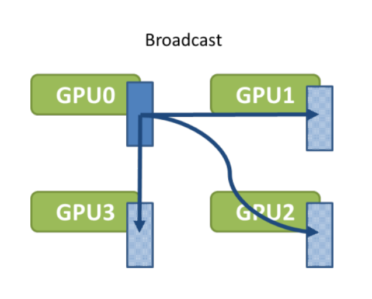
[来源](https://images.nvidia.com/events/sc15/pdfs/NCCL-Woolley.pdf)

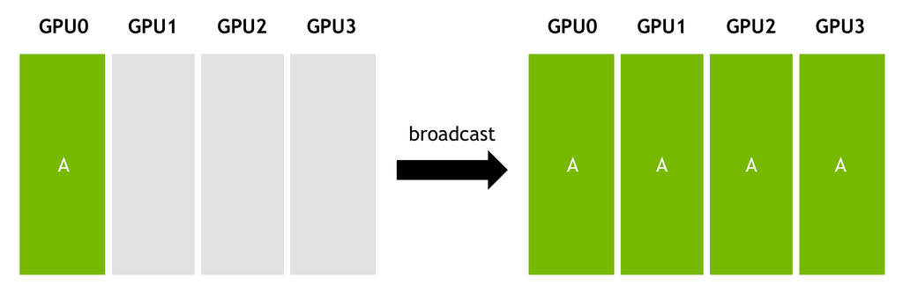
[来源](https://images.nvidia.com/events/sc15/pdfs/NCCL-Woolley.pdf)

PyTorch API 示例：

`dist.broadcast(tensor, src, group)`：把 `tensor` 从 `src` 复制到所有其他进程。[文档](https://docs.pytorch.org/docs/stable/distributed.html#torch.distributed.broadcast)。

### 收集（Gather） {#gather}

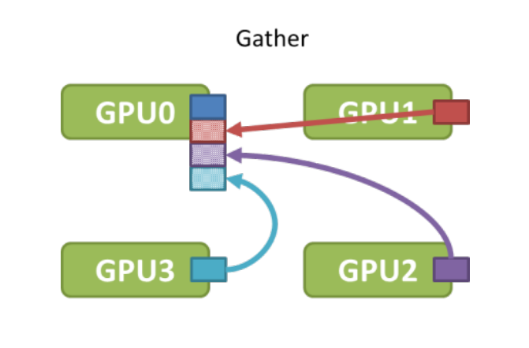
[来源](https://images.nvidia.com/events/sc15/pdfs/NCCL-Woolley.pdf)

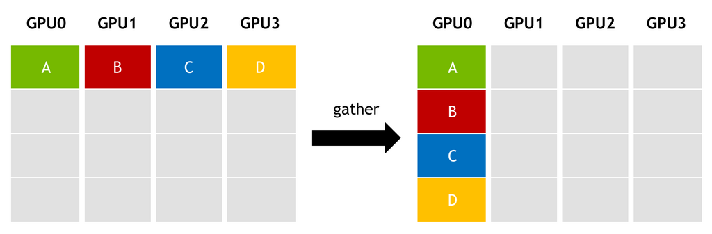
[来源](https://images.nvidia.com/events/sc15/pdfs/NCCL-Woolley.pdf)

PyTorch API 示例：

`dist.gather(tensor, gather_list, dst, group)`：把组内每个进程的一份 `tensor` 复制到 `dst` 上的 `gather_list` 中。[文档](https://docs.pytorch.org/docs/stable/distributed.html#torch.distributed.gather)

### 全收集（All-gather） {#all-gather}

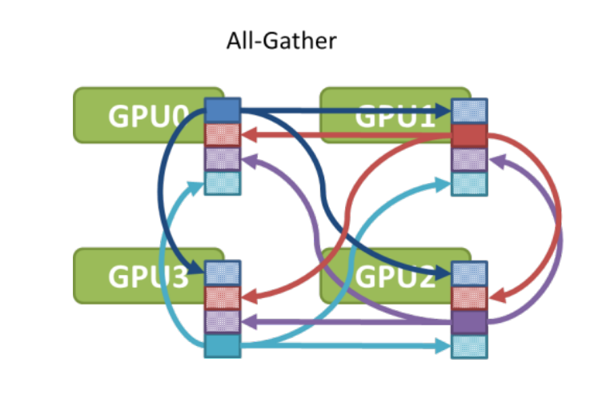
[来源](https://images.nvidia.com/events/sc15/pdfs/NCCL-Woolley.pdf)

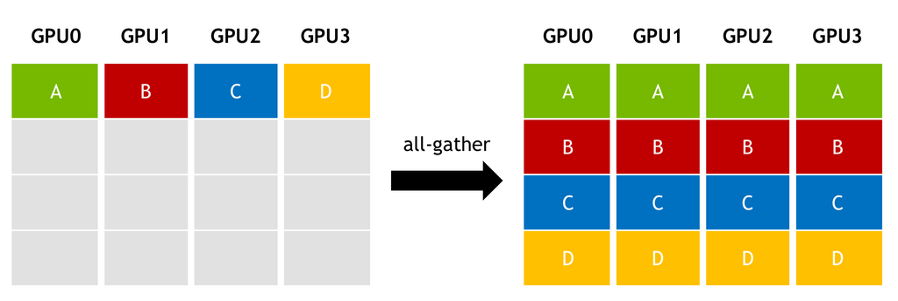
[来源](https://images.nvidia.com/events/sc15/pdfs/NCCL-Woolley.pdf)

例如，[ZeRO](../training/model-parallelism/README.md#zero-data-parallelism)（DeepSpeed 和 FSDP）就使用这个集合通信，在 `forward` 和 `backward` 调用之前把分片的模型权重收集齐。

PyTorch API 示例：

`dist.all_gather(tensor_list, tensor, group)`：把所有进程的 `tensor` 复制到所有进程上的 `tensor_list` 中。[文档](https://docs.pytorch.org/docs/stable/distributed.html#torch.distributed.all_gather)

### 归约（Reduce） {#reduce}

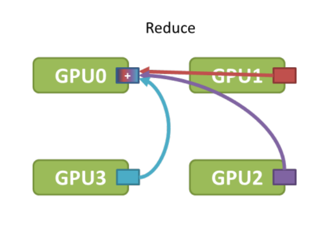
[来源](https://images.nvidia.com/events/sc15/pdfs/NCCL-Woolley.pdf)

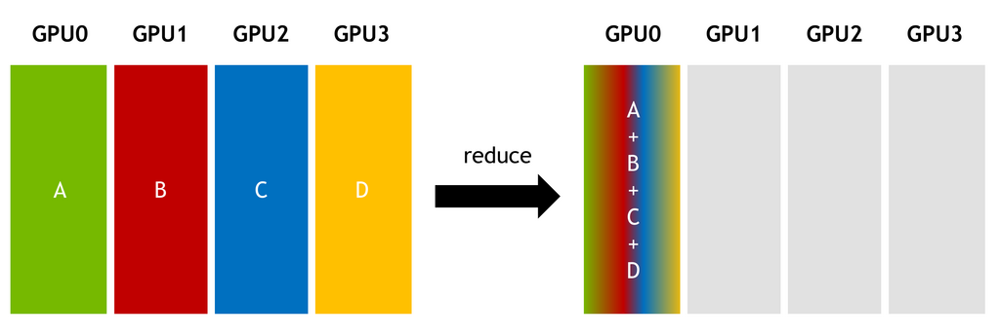
[来源](https://images.nvidia.com/events/sc15/pdfs/NCCL-Woolley.pdf)

PyTorch API 示例：

`dist.reduce(tensor, dst, op, group)`：对每个 `tensor` 应用 `op`，并将结果存储在 `dst` 中。[文档](https://docs.pytorch.org/docs/stable/distributed.html#torch.distributed.reduce)

PyTorch 支持多种归约操作，例如 `avg`、`sum`、`product`、`min`、`max`、`band`、`bor`、`bxor` 等——[完整列表](https://docs.pytorch.org/docs/stable/distributed.html#torch.distributed.ReduceOp)。

### 全归约（All-reduce） {#all-reduce}

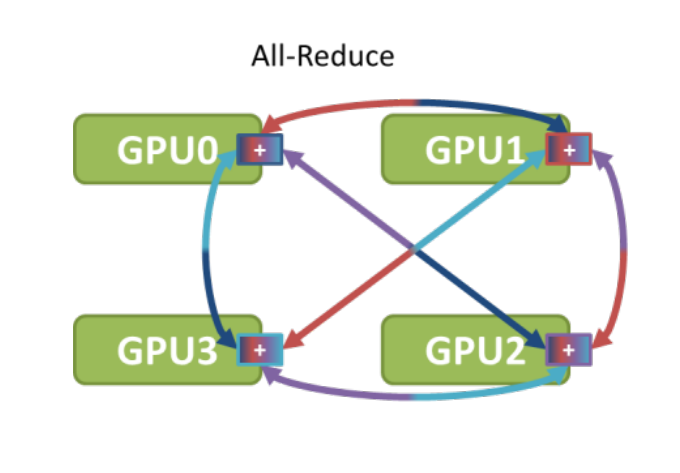

[来源](https://images.nvidia.com/events/sc15/pdfs/NCCL-Woolley.pdf)
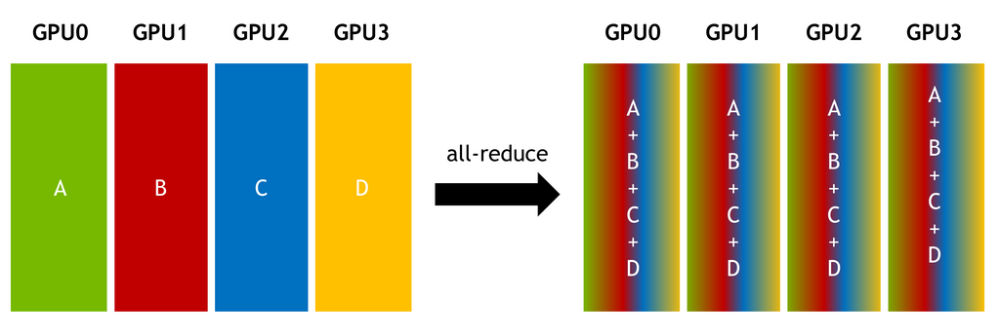
[来源](https://images.nvidia.com/events/sc15/pdfs/NCCL-Woolley.pdf)

例如，[DDP](https://docs.pytorch.org/docs/stable/generated/torch.nn.parallel.DistributedDataParallel.html) 使用该集合通信来归约所有参与 rank 之间的梯度。

PyTorch API 示例：

`dist.all_reduce(tensor, op, group)`：与 reduce 相同，但结果存储在所有进程中。[文档](https://docs.pytorch.org/docs/stable/distributed.html#torch.distributed.all_reduce)

### 分散（Scatter） {#scatter}

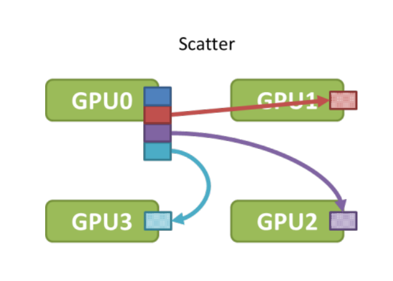
[来源](https://images.nvidia.com/events/sc15/pdfs/NCCL-Woolley.pdf)

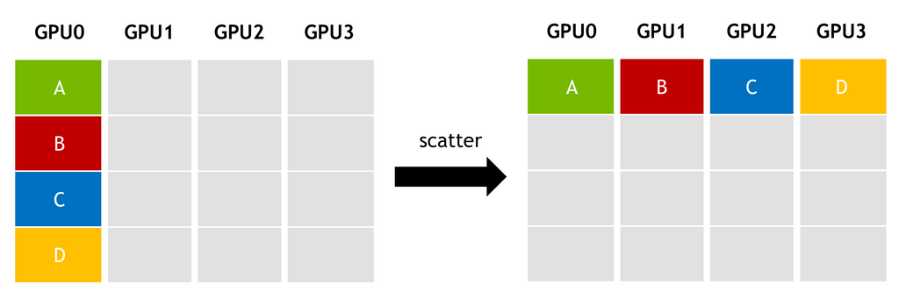
[来源](https://images.nvidia.com/events/sc15/pdfs/NCCL-Woolley.pdf)

PyTorch API 示例：

`dist.scatter(tensor, scatter_list, src, group)`：把第 `i` 个张量 `scatter_list[i]` 复制给第 `i` 个进程。[文档](https://docs.pytorch.org/docs/stable/distributed.html#torch.distributed.scatter)

### 归约分散（Reduce-Scatter） {#reduce-scatter}

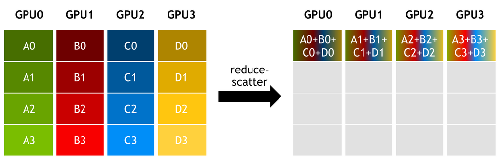
[来源](https://images.nvidia.com/events/sc15/pdfs/NCCL-Woolley.pdf)

例如，[ZeRO](../training/model-parallelism/README.md#zero-data-parallelism)（DeepSpeed 和 FSDP）使用这个集合通信，在所有参与 rank 之间高效地归约梯度。注意，它并不是 [all-reduce](#all-reduce) 的一个更廉价的替代品——每个 rank 最终只得到自己那一份归约后的分片，而不是完整结果。这正是 ZeRO 想要的，也正是它的数据搬运量只有一半的原因：环形 all-reduce 就是一次 reduce-scatter 后接一次 all-gather，去掉 all-gather 阶段，链路上的字节数就减半了。

PyTorch API 示例：

`dist.reduce_scatter(output, input_list, op, group, async_op)`：先归约，再把一组张量列表分散到组内所有进程。[文档](https://docs.pytorch.org/docs/stable/distributed.html#torch.distributed.reduce_scatter)

### 全到全（All-to-all） {#all-to-all}

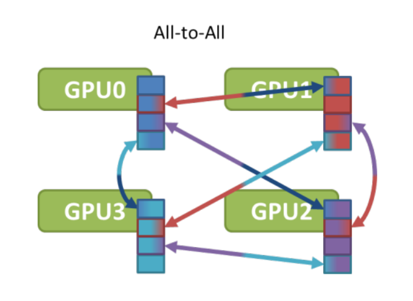
[来源](https://images.nvidia.com/events/sc15/pdfs/NCCL-Woolley.pdf)

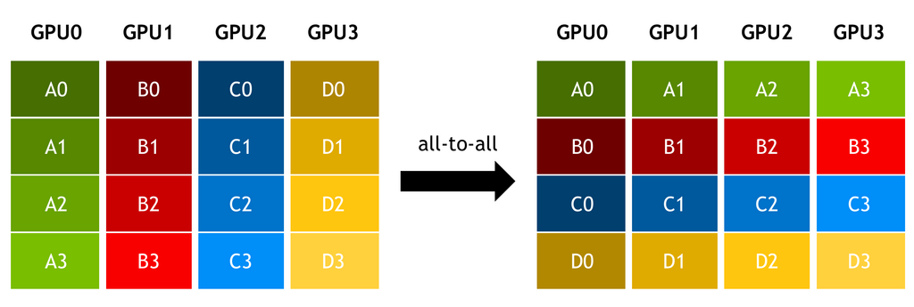
[来源](https://images.nvidia.com/events/sc15/pdfs/NCCL-Woolley.pdf)

例如，[DeepSpeed 序列并行](../training/model-parallelism/README.md#deepspeed-ulysses-sp)在注意力计算中使用这个集合通信，MoE 的[专家并行](../training/model-parallelism/README.md#expert-parallelism)也使用它。

PyTorch API 示例：

`dist.all_to_all(output_tensor_list, input_tensor_list, group)`：把输入张量列表分散到组内所有进程，并在输出列表中返回收集到的张量列表。[文档](https://docs.pytorch.org/docs/stable/distributed.html#torch.distributed.all_to_all)

## 算法 {#algorithms}

集合通信可以有多种不同的实现，`nccl` 这类通信库会根据内部启发式规则在不同算法之间切换，除非用户手动覆盖其选择。

### 环形 {#ring}

#### 单向环上的广播 {#broadcast-with-unidirectional-ring}

给定：

- N：要广播的字节数
- B：每条链路的带宽
- k：GPU 数量

朴素的广播每个步骤会发送 `N/B`。向 `k` 个 GPU 完成广播的总耗时为：`(k-1)*N/B`

下面是一个基于环形的广播的执行方式：

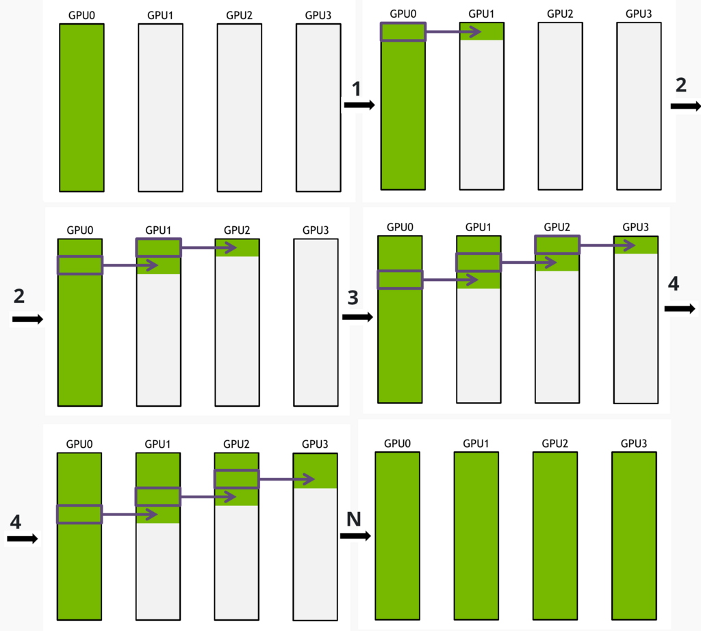
[来源](https://images.nvidia.com/events/sc15/pdfs/NCCL-Woolley.pdf)

该算法把 `N` 拆分成 `S` 条消息

每个步骤发送 `N/(S*B)`，即每步发送的量是朴素算法每步的 `S` 分之一。

把 `N` 字节广播到 `k` 个 GPU 的总耗时为：

`S*N/(S*B) + (k − 2)*N/(S*B) = N*(S + k − 2)/(S*B)`

如果拆分出的消息非常小，使得 `S>>k`，那么 `S + k − 2` 约为 `~S`，于是总耗时约为 `N/B`。

#### 单向环上的全归约（All-reduce） {#all-reduce-with-unidirectional-ring}

基于环形的 `all-reduce` 与[广播](#broadcast-with-unidirectional-ring)的做法类似。消息被拆分成许多小消息，每个 GPU 向环中的下一个 GPU 发送一个小消息，与其他 GPU 并行进行。`all-reduce` 必须执行比 `broadcast` 多一倍（2x）的步骤，因为它还要做归约——所以消息需要在线上被完整发送两遍。

此外，还可以先把整个消息切分成若干块（chunk），让整个过程更加高效。下面是第一块的归约过程：

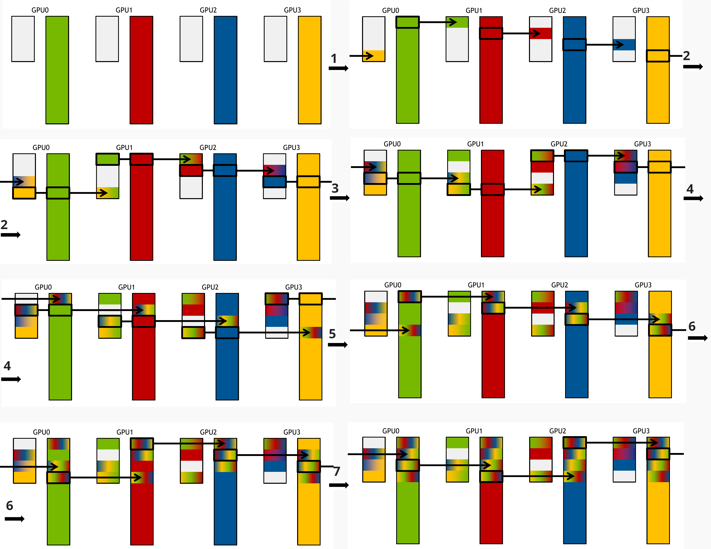
[来源](https://images.nvidia.com/events/sc15/pdfs/NCCL-Woolley.pdf)

然后处理下一块，直到所有小消息都完成归约：

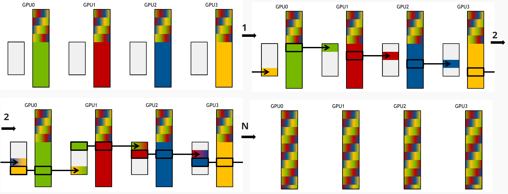
[来源](https://images.nvidia.com/events/sc15/pdfs/NCCL-Woolley.pdf)

### 树形 {#tree}

环形算法把消息从邻居传给邻居，所以步数随 GPU 数量 `k` 增长，基础延迟也随之增长。树形算法则把消息向外扇出，跳数随 `log(k)` 增长。这就是两者在规模扩大时会互换优劣的原因：环形保持更高的峰值带宽，树形保持更低的基础延迟，对于固定大小的消息，`k` 足够大时树形就成了两者中更快的那个。

单棵二叉树会浪费一半的机器：一半节点是叶子，而叶子只接收不发送，其对外带宽始终得不到利用。因此 NCCL 会构建一棵*双二叉树*（double binary tree）——在同样的这批 GPU 上建两棵树，其排布保证没有节点在两棵树中都是内部节点，并且在两棵树中都是叶子的节点至多只有一个。两棵树同时承载流量，从而恢复了全部带宽。当节点数为偶数时，第二棵树是第一棵树的镜像；为奇数时，则是错开一位。

关于 NCCL 如何在环形与树形之间做选择，以及如何查看或手动覆盖这一选择，见 [`NCCL_ALGO`](benchmarks/README.md#nccl_algo)。

## 协议 {#protocols}

算法决定谁向谁发送什么。与算法正交的是，协议决定每次这样的传输如何同步，它对性能的影响与算法同样大。NCCL 有三种协议——这就是 [`NCCL_ALGO`](benchmarks/README.md#nccl_algo) 所展示的 `Algo NVLS proto SIMPLE` 行中的 `proto` 部分。

下表各列按每跳延迟从低到高排列，而带宽利用率恰好也是从低到高：

| 属性              | LL                | LL128                          | Simple            |
| :-------------------- | :---------------- | :----------------------------- | :---------------- |
| 设计目标           | 低延迟       | 低延迟且高带宽 | 高带宽    |
| 同步方式       | 基于标志位        | 基于标志位                     | 内存栅栏     |
| 每单元有效载荷      | 4B 数据 + 4B 标志 | 120B 数据 + 8B 标志            | 大数据块 |
| 带宽利用率 | 峰值的 25-50%    | 峰值的 ~95%                   | 接近峰值         |
| 每跳延迟       | ~1µs              | ~2µs                           | ~6µs              |

来源：

1. [Demystifying NCCL: An In-depth Analysis of GPU Communication Protocols and Algorithms](https://arxiv.org/abs/2507.04786)（2025），Table I。

`Simple` 发送大块数据，并用内存栅栏保证接收方看到的是一个完整的块。这能达到接近峰值的带宽，但栅栏的开销会主导任何小消息的成本。`LL` 去掉了栅栏：它把 4 字节数据与一个 4 字节标志配对，并把这 8 个字节作为一次原子写入，因此标志一到达，接收方就可以继续。代价是暂存缓冲区必须位于主机内存中，CPU 才能轮询那个标志，这就排除了 GPUDirect RDMA，并把 `LL` 限制在峰值的 25-50%——在只在乎延迟时这还可以接受，其他场合就很浪费。

`LL128` 保留了标志技巧，但采用 128 字节粒度，每 120 字节数据配一个 8 字节标志，约 95% 的峰值带宽正是由此而来。代价是一项硬件要求：这些 128 字节的写入绝不能被互联拆分或重排，在无法保证这一点的地方——某些 PCIe 路径——NCCL 会禁用 `LL128`，而不承担数据损坏的风险。所以你在 NVLink 系统上看到的就是它，而它的强项在于节点内。走网络时，每 128 字节一次的同步会在一次大传输上变成数百万次小操作，于是 `Simple` 重新占优。

## 更多指南 {#more-guides}

下面是一些带有精美图示的补充指南：

- [UvA Deep Learning Tutorials](https://uvadlc-notebooks.readthedocs.io/en/latest/tutorial_notebooks/DL2/High-performant_DL/Multi_GPU/hpdlmultigpu.html#Communication-Primitives)

NCCL 专属：

- [Demystifying NCCL: An In-depth Analysis of GPU Communication Protocols and Algorithms](https://arxiv.org/abs/2507.04786)（2025）——这篇论文对 NCCL 做了全面分析，重点研究它的通信协议变体（Simple、LL 和 LL128）、支配节点内和节点间数据移动的机制，以及基于环形和树形的集合通信算法。
