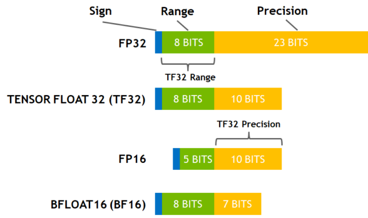
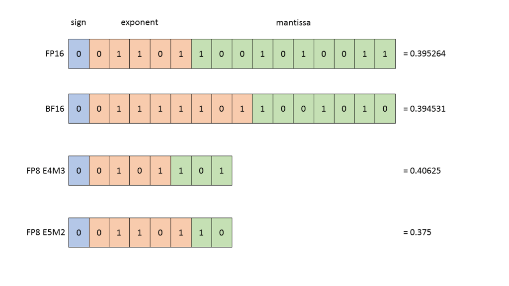
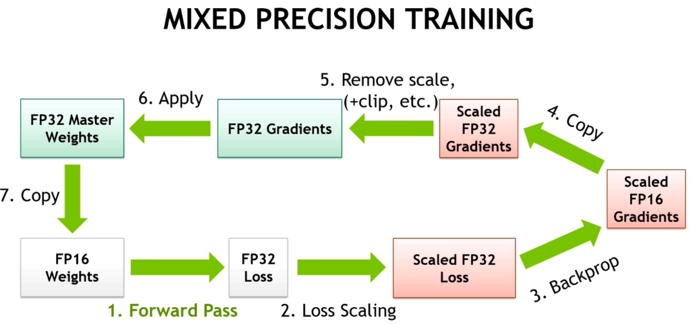

# 张量精度 / 数据类型 {#tensor-precision-data-types}

以下是截至 2026-08 在 ML 中常用的数据类型（通常被称为 `dtype`）：

浮点格式：
- fp32 - 32 位
- tf32 - 19 位（NVIDIA Ampere 及更新架构）
- fp16 - 16 位
- bf16 - 16 位
- fp8 - 8 位（E4M3 和 E5M2 格式）
- fp6 - 6 位
- fp4 - 4 位

如需直观对比，请参考这些图示：



（[来源](https://developer.nvidia.com/blog/accelerating-ai-training-with-tf32-tensor-cores/)）



（[来源](https://docs.nvidia.com/deeplearning/transformer-engine/user-guide/examples/fp8_primer.html)）


新硬件正在采用的新格式如下：
- fp4：`float4_e2m1fn`
- fp6：`float6_e2m3fn` 和 `float6_e3m2fn`
- fp8：`float8_e3m4`、`float8_e4m3`、`float8_e4m3b11fnuz`、`float8_e4m3fn`、`float8_e4m3fnuz`、`float8_e5m2`、`float8_e5m2fnuz`、`float8_e8m0fnu`

关于每一种变体的出色解释见[这里](https://github.com/jax-ml/ml_dtypes?tab=readme-ov-file#specifications-of-implemented-floating-point-formats)。

`float8_e8m0fnu` 在上述列表里是个异类——它不是一种元素格式，而是块缩放（block-scaled）格式为一组元素附加的共享缩放因子（shared scale），这就是它没有尾数的原因。把它与 4 位、6 位或 8 位的元素编码搭配使用，就得到了加速器规格中被引用的 `MXFP4`/`MXFP6`/`MXFP8` 这些名称：每 32 个值组成的一个块配一个 `E8M0` 缩放因子，其每个参数所占的字节开销在[模型权重](../inference/README.md#model-weights)中有推算。NVIDIA 的 [`NVFP4`](https://developer.nvidia.com/blog/introducing-nvfp4-for-efficient-and-accurate-low-precision-inference/) 是同一个由两部分构成的思路，只是调校不同——使用同样的 `E2M1` 元素，但块大小为 16，配一个 `E4M3` 缩放因子，再为整个张量附加单个 fp32 缩放因子，这比只能取 2 的幂的 `E8M0` 缩放因子能更贴近局部的动态范围。

对于后面跟着数字的字母：
- `e` 表示指数（exponent）的位数
- `m` 表示尾数（mantissa）的位数
- `b` 表示偏置（bias）

对于出现在数字后面的字母：
- `f` 表示只包含有限值（没有无穷大）。
- `n` 表示包含 NaN，但只出现在取值范围的最外围。
- `u` 表示无符号格式。
- `uz` 表示无符号零。

例如：`float8_e4m3b11fnuz` 表示 fp8 + 4 位指数 + 3 位尾数 + 偏置 11 + 仅包含有限值 + 包含 NaN（但仅出现在取值范围的最外围）+ 无符号零。


量化中使用的整数格式：

- int8 - 8 位
- int4 - 4 位
- int1 - 1 位

## ML 中 dtype 的演进 {#ml-dtype-progression}

最初 ML 使用的是 fp32，但它非常慢。

接着人们发明了[混合精度](https://developer.nvidia.com/blog/video-mixed-precision-techniques-tensor-cores-deep-learning/)，将 fp16 与 fp32 结合使用，使训练速度得到了极大的提升。



（[来源](https://developer.nvidia.com/blog/video-mixed-precision-techniques-tensor-cores-deep-learning/)）

但事实证明 fp16 不够稳定，用它训练 LLM 极其困难。

幸运的是 bf16 问世并取代了 fp16，沿用了同样的混合精度方案。这使得 LLM 训练稳定得多。

随后 fp8 出现，混合精度可以切换到[该格式](https://docs.nvidia.com/deeplearning/transformer-engine/user-guide/examples/fp8_primer.html)，这让训练甚至更快。参见 [FP8 Formats for Deep Learning](https://arxiv.org/abs/2209.05433)。截至 2026-08，bf16 混合精度仍是大多数训练任务的默认选择，但 fp8 训练已不再是实验性的——[DeepSeek-V3](https://arxiv.org/abs/2412.19437) 就是以 fp8 训练的。

再之后 Blackwell 加入了 fp6、fp4 以及 NVIDIA 自家的 nvfp4。到目前为止，这些主要还是推理格式，不过 nvfp4 的预训练方案已经开始出现——参见 [FP4 格式](#fp4-formats)。

为了直观感受不同格式之间的加速差异，这里给出一张 NVIDIA B200 的 TFLOPS 规格表（不含稀疏化），并附上首个在非 CPU 硬件上支持各 dtype 的加速器（CPU 做深度学习很弱）。表格按 `B200 TFLOPS` 升序排列；当几种 dtype 速度相同时，则按硬件支持出现的年份排序：

| 数据类型    | B200 TFLOPS | 首次硬件支持                                      |
| :-------- | ----------: | :--------------------------------------------------- |
| fp32      |          80 | 早于 ML 加速器的出现                                        |
| tf32      |        1125 | NVIDIA A100（Ampere，2020）                           |
| fp16      |        2250 | NVIDIA P100（Pascal，2016）                           |
| bf16      |        2250 | Google TPU v2（2017）<br>NVIDIA A100（Ampere，2020）   |
| int8      |        4500 | Google TPU v1（2015）<br>NVIDIA P4/P40（Pascal，2016） |
| fp8       |        4500 | NVIDIA H100（Hopper，2022）<br>Intel Gaudi 2（2022）   |
| fp6       |        4500 | NVIDIA B200（Blackwell，2024）                        |
| mxfp4     |        9000 | NVIDIA B200（Blackwell，2024）                        |
| nvfp4     |        9000 | NVIDIA B200（Blackwell，2024）                        |

int8 的单位是 TOPS 而不是 TFLOPS，因为那些是整数运算。

表中有些日期标记的是某个 dtype 变得可用的时间，而不是它变得很快的时间。P100 能以 fp32 速率 2 倍的速度执行 fp16 运算，但要到 2017 年 V100 的 tensor core 出现，fp16 的 `matmul` 才算真正快了起来。Pascal 上的 int8 指的是 `DP4A` 点积指令；int8 tensor core 是随 2018 年的 Turing 而来的。

这个翻倍规律一直成立到 fp8 为止——元素位宽每减半，大约换来 2 倍的吞吐量。然后就停了：fp6 以与 fp8 相同的 4500 TFLOPS 运行，所以它换来的是内存和带宽，而不是算力。fp4 相对 fp8 又翻倍，而在 GB300 上是 3 倍（15000 对比 5000）。所以不要假设这个规律会一直延续——请查阅你实际打算使用的 dtype 的规格。

与混合精度训练并行发展的，是 ML 社区开始提出的各种量化方法。其中最好的例子大概是 Tim Dettmers 的 [bitsandbytes](https://github.com/bitsandbytes-foundation/bitsandbytes)，它提供了许多 4 位和 8 位量化方案。DeepSpeed 也有一些[有趣的量化方案](https://www.deepspeed.ai/tutorials/model-compression/)。

## FP4 格式 {#fp4-formats}

一个 fp4 `e2m1` 元素只有 16 种位模式：±0、±0.5、±1、±1.5、±2、±3、±4 和 ±6。想用单一的缩放因子覆盖一个张量的取值范围，这远远不够，所以 fp4 只有配合块缩放才可用：每个小的元素块共享一个缩放因子，把这些值拉伸到该块实际的取值范围上。块缩放的 fp4 格式有两种，它们的区别仅在于这个缩放因子。下表按块大小降序排列：

| 格式   | 块<br>大小 | 块<br>缩放因子              | 每元素<br>比特数 | 定义方      | 硬件                                                     |
| :----- | ------------: | :----------------------------- | ------------------: | :---------- | :----------------------------------------------------------- |
| mxfp4  |            32 | `E8M0`                         |                4.25 | OCP MX 规范 | NVIDIA Blackwell<br>AMD MI350X/MI355X<br>Huawei Ascend 950DT |
| nvfp4  |            16 | `E4M3`<br>+ FP32<br>每张量 |                 4.5 | NVIDIA      | 仅限 NVIDIA，<br>Blackwell<br>及更新的硬件                 |

块大小以元素个数计，每元素比特数中已包含该块应分摊的缩放因子开销。`E8M0` 缩放因子是 2 的幂，而 nvfp4 在其 `E4M3` 块缩放因子之外，还为每个张量增加一个 FP32 缩放因子。OCP MX 是开放计算项目（Open Compute Project）的 Microscaling 规范。

速度并不是两者的区别所在。NVIDIA 的 Blackwell tensor core 通过同一条指令、以相同的峰值性能运行这两种格式，这就是[理论 TFLOPS 表](../compute/accelerator/README.md#tflops-comparison-table)中两列数字相同的原因。在 B200 上用 torch 2.14 [实测](../compute/accelerator/README.md#maximum-achievable-and-sustainable-matmul-flops-comparison-table)，nvfp4 在 MAMF（6746 对比 6183 TFLOPS）和 MSMF（5627 对比 5222 TFLOPS）两项上都比 mxfp4 快 8–9%，这是软件差异，而非硬件差异。

精度才是两者的分野。更小的块意味着一个异常值扭曲的是 15 个邻近元素的缩放因子，而不是 31 个；而且 `E4M3` 缩放因子可以取在两个 2 的幂之间，而 `E8M0` 只能舍入到某个 2 的幂。在 NVIDIA 的[80 亿参数、1 万亿词元预训练对比](https://developer.nvidia.com/blog/train-models-faster-with-jax-and-maxtext-using-nvfp4-on-nvidia-blackwell/)中，MXFP4 需要多消耗约 36% 的词元才能达到 NVFP4 的最终损失；推理方面的情况另见 [Introducing NVFP4](https://developer.nvidia.com/blog/introducing-nvfp4-for-efficient-and-accurate-low-precision-inference/)。这两个说法都出自 NVIDIA 一方。

因此：
- 在 NVIDIA Blackwell 及更新的硬件上，使用 nvfp4：同样的算力、更好的精度，代价只是每元素多 0.25 位。
- 在没有 nvfp4 的地方使用 mxfp4——比如实现 OCP MX 的 AMD MI355X 等非 NVIDIA 加速器——或者当同一个检查点（checkpoint）必须运行在多家厂商的硬件上时。
- 当某个模型以其中一种格式发布时——例如 OpenAI 的 gpt-oss 就以 MXFP4 提供其 MoE 权重——直接以该格式运行它，可以省去重新量化。

## TF32 {#tf32}

TF32 是一种神奇的数据类型，自 Ampere 起在 NVIDIA GPU 上可用，它允许以远高于普通 fp32 `matmul` 的速度执行 fp32 的 `matmul`，代价只是很小的精度损失。

下面是一个 A100 的 TFLOPS 示例（不含稀疏化）：

| 数据类型                  | TFLOPS |
| :---                   |    --: |
| FP32                   |   19.5 |
| Tensor Float 32（TF32） |    156 |

可以看到，TF32 比 FP32 快 8 倍！

它默认是禁用的。若要启用，请在程序开头添加：

```python
torch.backends.cuda.matmul.allow_tf32 = True
torch.backends.cudnn.allow_tf32 = True
```

关于实际精度损失的更多信息，请参见[这里](https://docs.pytorch.org/docs/stable/notes/cuda.html#tensorfloat-32-tf32-on-ampere-and-later-devices)。


## 何时使用 fp32 累加器 {#when-to-use-fp32-accumulators}

只要使用低精度 dtype，就必须小心，不要用该 dtype 来累加中间结果。

`LayerNorm` 一类的运算不得全程以半精度计算，否则可能丢失大量数据。因此，当这些运算实现得正确时，它们会以输入的 dtype 进行高效的内部计算，但使用 fp32 的累加寄存器，之后再将其输出向下转换为输入的精度。

通常只有累加这一步用 fp32 完成，因为若不然，把许多低精度数值加在一起会造成很大的损失。

以下是一些示例：

1. 归约（reduction）集合通信

* fp16：在有损失缩放（loss scaling）的前提下，用 fp16 做也可以

* bf16：只能在 fp32 中做

2. 梯度累积

* 对 fp16 和 bf16 最好用 fp32 来做，而对 bf16 来说则是必须的

3. 优化器步进 / 梯度消失

* 当把很小的梯度加到一个很大的数上时，这次加法往往不会起作用，因此通常要使用 fp32 的 master weights（主权重）和 fp32 的优化器状态。

* 在使用 [Kahan 求和](https://en.wikipedia.org/wiki/Kahan_summation_algorithm)或[随机舍入（stochastic rounding）](https://en.wikipedia.org/wiki/Rounding)（引入自 [Revisiting BFloat16 Training](https://arxiv.org/abs/2010.06192)）时，可以使用 fp16 的 master weights 和优化器状态。

后者的一个例子见：[AnyPrecision optimizer](https://github.com/pytorch/torchdistx/pull/52)，其最新版本见[这里](https://github.com/facebookresearch/multimodal/blob/6bf3779a064dc72cde48793521a5be151695fc62/torchmultimodal/modules/optimizers/anyprecision.py#L17)。


## 训练后改变精度 {#changing-precision-post-training}

有时候，在模型训练完成之后改变精度是可行的。

- 将在 bf16 下预训练的模型放到 fp16 环境下使用通常会失败——原因是上溢（fp16 能表示的最大数值是 64k），关于深入讨论和可能的变通办法，见这个 [PR](https://github.com/huggingface/transformers/pull/10956)。

- 将在 fp16 下预训练的模型放到 bf16 环境下使用通常是可行的——转换时会损失一些性能，但应该能用——最好先做一点微调再使用。
