# 理解训练损失模式 {#understanding-training-loss-patterns}

训练损失图与心跳曲线有些相似——有好的、坏的，还有那种你应该警惕的。研究过足够多的训练损失轨迹之后，人就会形成一种直觉，能够解释训练过程中出现的各种损失表现，并知道该如何应对。

我要提醒你，本节标题里的“理解”一词含义比通常更宽泛，因为在很多情况下，我们其实并不真正理解某些类型的尖峰（spike）为什么会发生。这里的“理解”指的是识别出各种模式。随后我们通常都有技术手段来克服糟糕的模式，把训练顺利带到终点线。

因此你会在这里看到一组训练损失模式的图集，其中有时附有真正的解释，但更多时候只是对可能正在发生之事的有依据的猜测。

请原谅这些图的快照彼此看起来风格差异很大，因为它们来自多年间许多不同的出处。

## 好的、坏的和出乎意料的 {#the-good-the-bad-and-the-unexpected}

我们来看一些好的、坏的和异常的模式。

### 一次非常失败的训练 {#a-very-failed-training}

在开始 BLOOM-176B 的训练之前，我们用 [104B 模型](https://github.com/bigscience-workshop/bigscience/tree/master/train/tr8-104B-wide)做了多次实验，始终没能找到办法避免它在很早的阶段就发散。

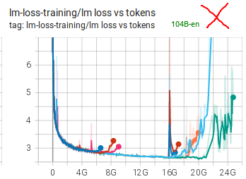

如你所见，我们做了很多次尝试，应用了许多技术（参见 [chronicles](https://github.com/bigscience-workshop/bigscience/blob/master/train/tr8-104B-wide/chronicles.md)。我们认为两个主要障碍是使用了 fp16，以及数据里混杂了大量垃圾内容。对于 BLOOM-176B，我们改用 bf16，使用了干净得多的数据，还增加了一个嵌入层归一化（embedding layer-norm），这些改变带来了决定性的差别。

### 一次几乎完美的训练 {#an-almost-perfect-training}

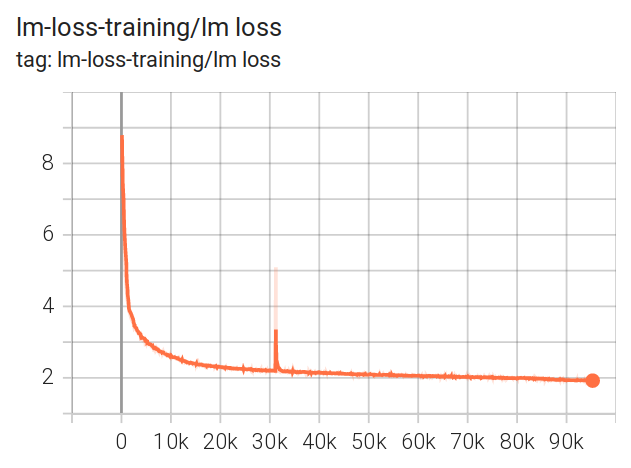

[BLOOM-176B](https://github.com/bigscience-workshop/bigscience/tree/master/train/tr11-176B-ml) 的训练损失轨迹近乎完美，只有一个尖峰，并且在 200 步内就恢复了。

你可以查看 [TB](https://huggingface.co/bigscience/tr11-176B-logs/tensorboard)（TensorBoard），放大细节并检查其他图表。

这确实是一次几乎完美的训练。为达到这一点，人们投入了大量艰苦的工作。

### grokking（顿悟）时刻 {#the-grokking-moment}

前一阵子我在做性能测试，在一个 8×A100 节点上以很小的全局批次大小（global batch size）8，从零开始训练 llama-2-7b。（使用 DeepSpeed ZeRO-3 数据并行（DP），配合 HF Transformers 的 [Llama](https://github.com/huggingface/transformers/tree/main/src/transformers/models/llama) 实现）

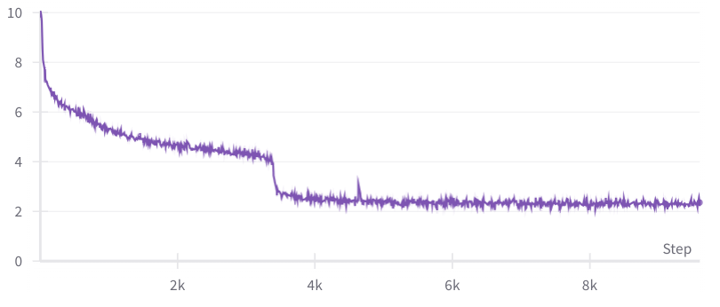

在这里可以观察到：在经历了一段非常平稳、缓慢得多的改善之后，损失仅用 480 个样本就从 4 急剧改善到 2.5。我的同事 [Gautam Mittal](https://github.com/gmittal) 把它称为 [grokking](https://en.wikipedia.org/wiki/Grok)（顿悟）时刻。仅仅几步之后，模型就突然泛化开来，对下一个词元的预测明显变好了。

通常，在使用大得多的批次大小时，你不会看到如此剧烈的改善。

如果放大来看，这大约发生在 60 个“每次迭代 8 个样本”的训练步内：

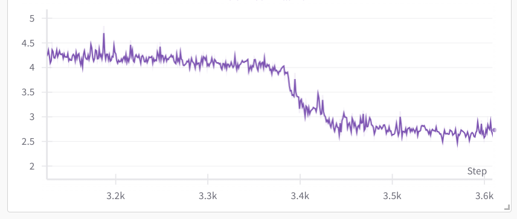

## 损失尖峰的主要类型 {#main-types-of-loss-spikes}

一般来说，损失尖峰有 3 种类型：

1. 快速恢复的尖峰
2. 缓慢恢复的尖峰
3. 未完全恢复的尖峰

尖峰通常是由一小块糟糕的数据引起的，要么是数据没有很好地打乱（shuffle），要么是数据没有清理掉从网页上抓取来的垃圾内容。

人们可能会猜测尖峰前一个批次就是触发因素，但如果你真去研究那个批次的内容，很可能会发现不了任何异常——问题往往在许多步之前就开始酝酿，然后突然之间尖峰就出现了。而且研究批次本身也不容易：当全局批次大小和序列长度都非常大时，一个批次的内容可能多到相当于一本书。

### 快速恢复的尖峰 {#fast-recovering-spikes}

损失尖峰可能频繁出现，但只要它们能迅速反弹回原来的水平，训练通常就会像什么都没发生一样继续下去：

下面是 [BLOOM 之前开展的 13B 训练实验](https://github.com/bigscience-workshop/bigscience/tree/master/train/tr1-13B-base)的一个例子：

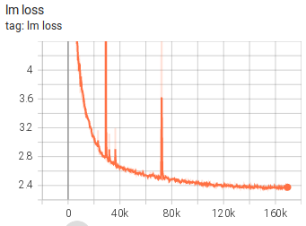

如你所见，这里有很多尖峰，其中一些幅度很大，但它们全都迅速恢复了。

### 缓慢恢复的尖峰 {#slow-recovering-spikes}

下面是一个来自 [IDEFICS-80B](https://github.com/huggingface/m4-logs/blob/master/tr-190-80b/chronicles.md) 训练的缓慢恢复尖峰：

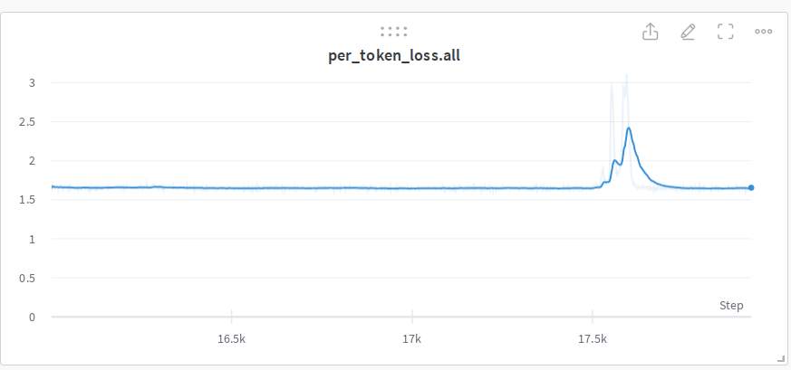

### 未完全恢复的尖峰 {#not-fully-recovering-spikes}

这次 [104B 模型的尝试](https://github.com/bigscience-workshop/bigscience/tree/master/train/tr8-104B-wide)出现了尖峰，开始恢复，但最终没有完全恢复，反而开始发散

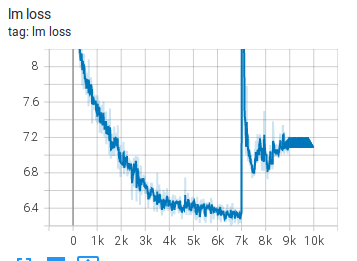

下面是来自 [IDEFICS-80B](https://github.com/huggingface/m4-logs/blob/master/tr-190-80b/chronicles.md) 训练的另一个例子：

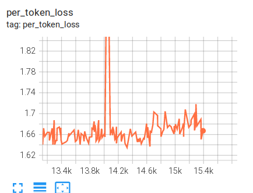

### 非尖峰型发散 {#non-spike-diverging}

下面有几个没有经过尖峰就直接发散的例子

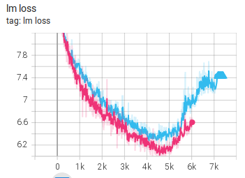

还有几个：

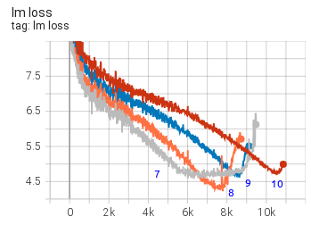

如你所见，每次重启都能取得一点进展，然后模型就发散了。

这些全部来自 [104B 模型的多次尝试](https://github.com/bigscience-workshop/bigscience/tree/master/train/tr8-104B-wide)。

### 多数据集尖峰 {#multiple-datasets-spikes}

在 [IDEFICS-80B](https://github.com/huggingface/m4-logs/blob/master/tr-190-80b/chronicles.md) 训练期间，我们把 2 种不同类型的数据集混合在一起使用：

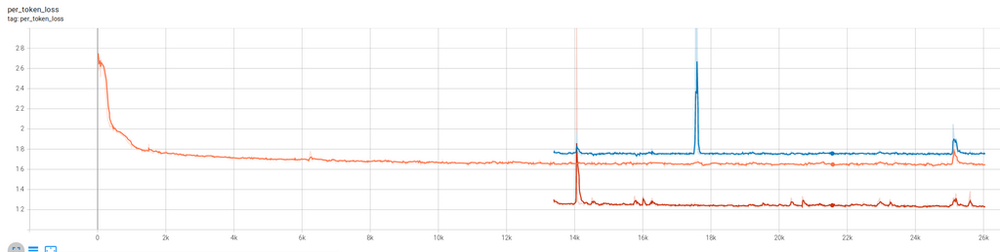

图例：cm4（高位）、average（中位）和 pmd（低位）

可以看到，损失尖峰有时在两个数据集上同时出现，有时只有其中一个数据集的损失出现尖峰。

此时模型正在学习两种不同的数据分布，如你所见，它在两种数据分布上报告的损失值和尖峰行为并不相同。对模型来说，pmd 数据集上的损失要比 cm4 上的容易得多。

## 与断点续训（resume）相关的尖峰 {#resume-related-spikes}

由于硬件故障而续训（resume），或者因为遇到发散而需要回滚（rollback）到更早的 checkpoint，这类情况几乎肯定会发生。如果你的训练软件做不到完美续训——好到让模型察觉不到曾经续过训——就可能会遇到各种问题。

续训最棘手的挑战是恢复各种 RNG（随机数生成器）、把 DataLoader 定位到上次训练中断时所处的索引位置，以及当你使用为你的环境定制的复杂 DataLoader 时，处理其他各种各样的要求。

### 与 DataSampler 相关的问题 {#datasampler-related-issues}

在 [IDEFICS-80B](https://github.com/huggingface/m4-logs/blob/master/tr-190-80b/chronicles.md) 训练期间，我们有一个非常复杂的 DataLoader，它在续训恢复状态时会出现图像与文本比例的波动，因此我们每次续训都会遇到一个小尖峰，随后才会恢复：

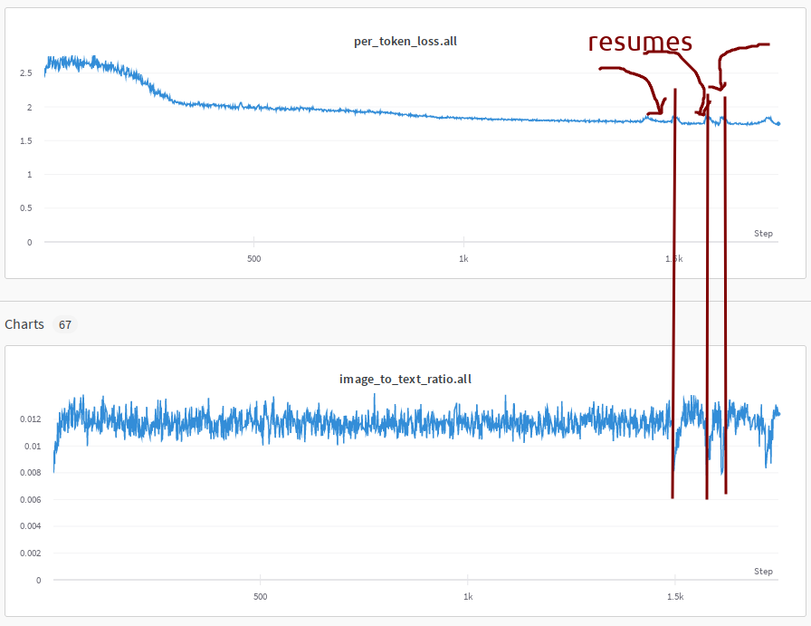

从这里可以看到损失曲线和比例曲线之间的相关性。由于我们不得不续训了十几次，所以看到了很多次这样的尖峰。

### 重复数据的影响 {#impacts-of-repeat-data}

我在训练一个 Llama2 的变体时，见到过一个极不寻常的尖峰：它既没有发散也没有恢复，而是切换到了一个新的、更高的损失水平：

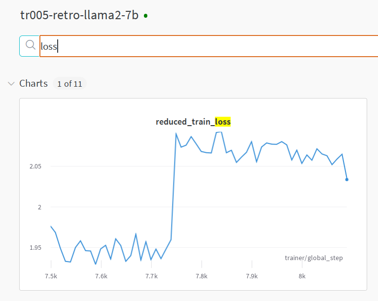

我回滚到异常行为出现之前，然后重新开始。训练先是沿着同样的损失水平继续推进了一段，然后又出现尖峰，并跳到了更高的损失。

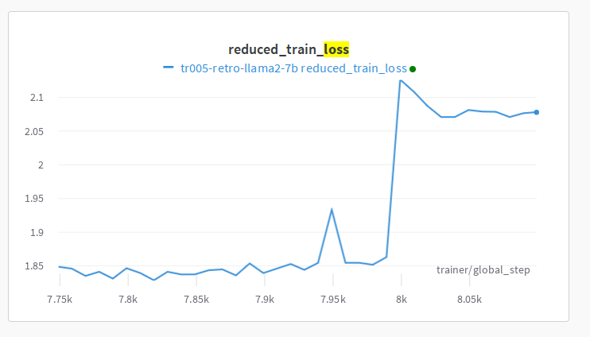

我以前从没见过这种类型的发散。我抓耳挠腮地琢磨了一阵，然后决定从更大的范围来审视这件事。

[wandb](https://wandb.ai/) 在执行了回滚之后不能正确处理续训数据的绘图，也就是说，它会忽略回滚之后的所有新数据，直到步数超过旧数据的步数为止。这迫使我们每次带着回滚续训时都要新建一个 wandb 图表，好让新数据显示出来。而如果你想看到完整的图，就得把它们拼接起来，其中又包含了一些已经不再成立的死数据点。于是我就做了拼接，然后看到了这个疑团：

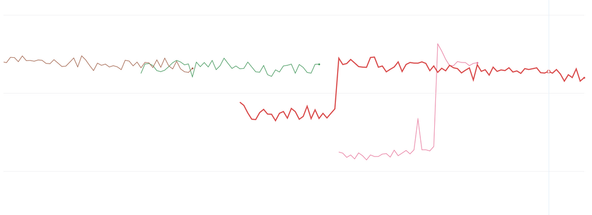

脚注：截至 2025 年，wandb 已经能正确处理这种情况——[回退一次运行（rewinding a run）](https://docs.wandb.ai/models/runs/rewind)即使用 `wandb.init(resume_from="<run_id>?_step=N")` 把历史记录截断到第 `N` 步，并允许你在同一个 run id 下继续向前记录日志；`fork_from` 的作用相同，但会保持原运行完好不变（wandb SDK 0.17.1+；wandb 出于性能考虑推荐使用 fork 而不是 rewind）。有两个限制：它只支持云端——Multi-tenant 和 Dedicated Cloud，不支持 Self-Managed——而且要求步数单调递增，所以不能与非单调递增的 `define_metric()` 一起使用。在自托管环境下，上面说的拼接方法仍然是可行的做法。

在前面两次运行中其实并没有真正的尖峰，损失从一开始就没有上升过。在两次续训中，由于数据被原样重复，它报告的是偏低的损失；直到遇到以前没见过的数据，它才开始正确报告。换句话说，它是在过拟合，报告的是一个虚假的损失。

问题的根源在于数据重复，而且模型显然记住了其中的一部分，所以报告了更低的损失。

这个问题出自 [pytorch-lightning](https://github.com/Lightning-AI/pytorch-lightning) 没有自动正确处理与 DataSampler 有关的续训——基本上，你每次续训时数据流都是从头开始的。当然，这就需要用户自己想办法来补救。你可以更改随机种子，在一定程度上缓解问题、避开完全相同的数据序列，但这仍然会让你用到重复的数据，而对于任何认真的训练来说这都不是你想要的（做消融实验也不行，因为如果你的实验假定 [IID 数据分布](https://en.wikipedia.org/wiki/Independent_and_identically_distributed_random_variables)（独立同分布的数据分布），你的观察结论就会无效）。

脚注：我就[这个问题与 PTL 的开发者讨论过](https://github.com/Lightning-AI/pytorch-lightning/issues/18780)，他们说他们努力想给出一个通用解决方案，但没能实现，所以这个得由用户自己想办法解决。

务必查阅你所用训练框架的文档，确认它能否正确处理 DataSampler 的续训恢复。别等到训练结束以后才发现这个问题——比如你原计划让每个词元只被看到一次、总共看 300B 词元，结果实际上却是把同样的 50B 词元反复训练了 6 遍。

在正式开始训练之前，先做几次续训也能暴露是否存在问题。不过，如果每次续训时数据都会重新打乱，你多半看不到它。只有当种子相同时才会看出来。
