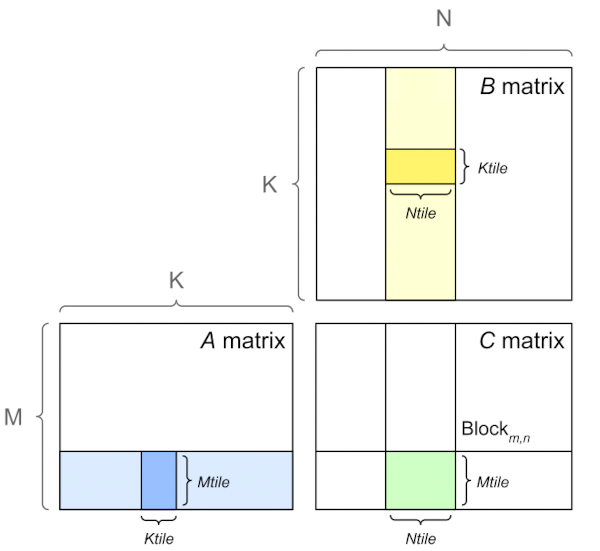
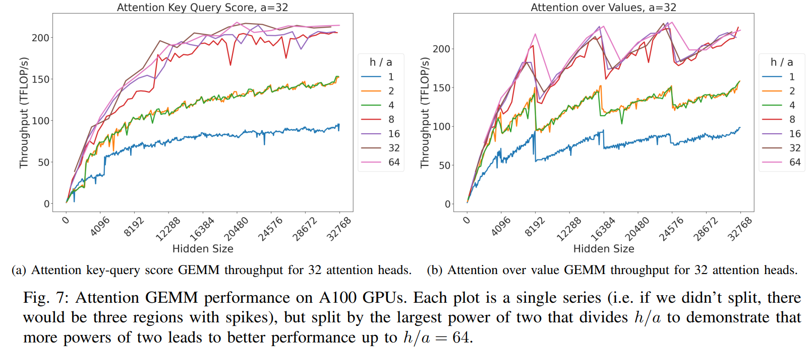
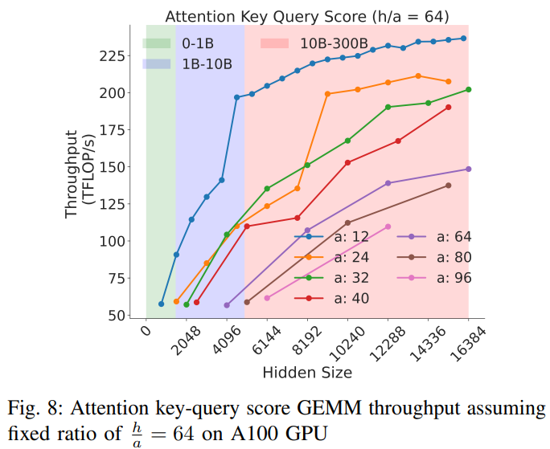
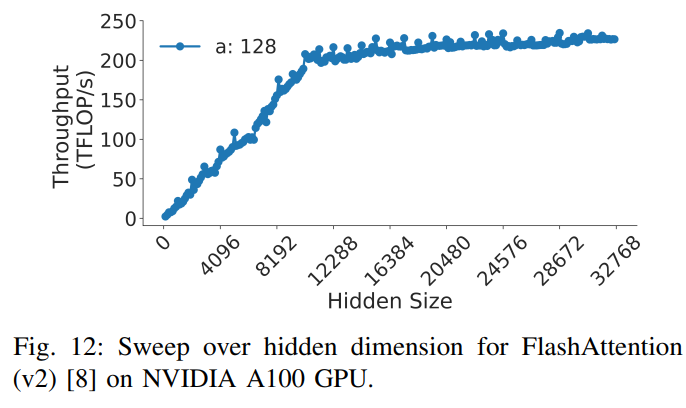
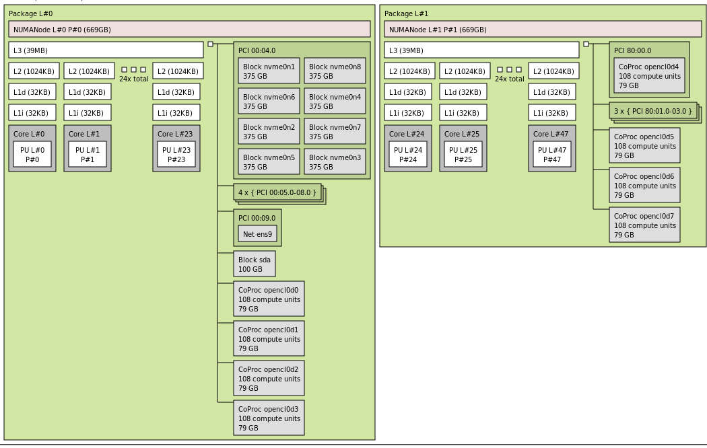

# 软件调优以获得最佳性能 {#software-tune-up-for-the-best-performance}

你让模型训练得越快，模型就能越早完成训练，这不仅对抢先发表成果很重要，还可能省下大量资金。

一般来说，最大化吞吐量就在于运行大量实验、度量结果，并选择其中更优的那个。

在某些情况下，你的建模团队可能会请你选择一些会损害吞吐量、但从整体上有利于模型取得成功的超参数。


## 术语表与概念 {#glossary-and-concepts}

- HFU：硬件 FLOPS 利用率（Hardware FLOPS Utilization）
- MFU：模型 FLOPS 利用率（Model FLOPS Utilization）

### MACs、FLOP、FLOPS 与 FLOP/s 辨析 {#macs-vs-flop-vs-flops-vs-flops}

本节试图厘清常见性能指标的定义及其相互关系。

**MAC 与 FLOP**：

- 1 FLOP（FLoating point OPeration，浮点运算）可以是加法、减法、乘法或除法运算中的一种。

- 1 MAC（Multiply-ACCumulate，乘加）运算是先做一次乘法再做一次加法，即：`a * b + c`

因此 1 MAC = 2 FLOPs。现代硬件通常也能在单个时钟周期内完成 1 次 MAC 运算。

请注意，要从 FLOPs 反过来计算 MACs 的数量，逻辑要反过来，即 MACs = 0.5 FLOPs——这有点令人困惑，因为我们刚说过 1 MAC = 2 FLOPs，但它确实成立——请看：100 FLOPs = 50 MACs——因为每个 MAC 中含有 2 次 FLOPs。

而且，虽然 1 MAC = 2 FLOPs，反过来却不一定成立，即 2 FLOPs 不一定等于 1 MAC。例如，如果你做 100 次 `.5*.6`，那就是 100 FLOPs，而在这里它相当于 100 MACs，因为这里只执行了 MAC 中乘法的那部分。

**FLOP 与 FLOPS 与 FLOP/s**

- 1 FLOP（FLoating point OPeration，浮点运算）指任何浮点加法、减法、乘法或除法运算。

- 1 FLOPS（FLoating point OPeration per Second，每秒浮点运算次数）指 1 秒内完成了多少次浮点运算——参见 [FLOPS](https://en.wikipedia.org/wiki/FLOPS)

后文你还会看到以下缩写：GFLOPS = Giga FLOPS，TFLOPS = Tera FLOPS，等等，因为迅速看懂 150TFLOPS 比看懂 150000000000000FLOPS 要容易得多。

书面使用 FLOPS 时存在歧义——有时人们用它表示运算的总数量，有时它指的是每秒运算次数。后者是最常见的用法，也是本书采用的定义。

在学术写作中常用 FLOP/s 来向读者明确表示这是每秒运算次数。不过这种写法很难转成变量名，因为去掉非法字符后它仍然会变成 `flops`。

在一些地方你可能还会看到 FLOPs，它同样可能指代上述两者之一，因为大小写 `s` 实在太容易写反了。

如果定义有歧义，试着寻找上下文，这应当能帮助你推断其含义：

- 如果它出现在数学公式中，并且除以了时间，那它就是每秒运算次数。
- 如果讨论的是速度或性能，它通常指每秒运算次数。
- 如果谈论的是做某件事所需的计算量，它指的是运算的总数量。


### 将 TFLOPS 用作性能指标 {#tflops-as-a-performance-metric}

在你开始优化训练配置的性能之前，需要一个指标来判断吞吐量是否在提升。你可以测量每次迭代的秒数、每秒迭代次数，或其他类似的时间指标，但有一个更有用的指标，那就是测量 TFLOPS。

测量 TFLOPS 更优越，因为缺少它，你就不知道自己是否已经接近可达到的最佳性能。这个测量能让你了解自己距离硬件厂商标称的峰值性能有多远。

本节我将以 BLOOM 的训练为例来说明。我们使用的是 80GB 的 NVIDIA A100 GPU，并以 bf16 混合精度模式训练。那么让我们看看 [A100 规格](https://www.nvidia.com/en-us/data-center/a100/)，上面写着：

```
BFLOAT16 Tensor Core 	312 TFLOPS
```

因此我们现在知道，如果只在尺寸非常特定的超大 bf16 矩阵上运行 `matmul`，并且不进行与设备之间的数据拷贝，我们最多应能得到约 312TFLOPS。

但实际上，由于磁盘 IO、通信，以及把数据从 GPU 内存拷贝到其计算单元的开销，再加上我们无法一切都用 bf16 完成、有时必须用 fp32（或 tf32）做运算，实际能期望的吞吐量要远低于此。真实数值因加速器而异，但对 2022 年的 A100 来说，在一个复杂的 384 GPU 训练配置中持续达到 50% 以上（155TFLOPS）已经是惊人的可持续吞吐量了。

脚注：2023 年，flash attention 及其他技术的发明把这一标准提高到了 50% 以上。

我们刚开始调优时还不到 100TFLOPS，几周后正式启动训练时，我们设法达到了 150TFLOPS。

这里要注意的关键点是：我们知道很难再往上推多少了，也知道再试图进一步优化已没有意义。

所以，在为大规模模型训练做准备时，有一条通用的经验法则——多方打听一下，在指定的精度下，给定加速器在多节点配置中最多能期望达到多少 TFLOPS——然后持续优化，直到接近那个数值。一旦做到，就停止优化，开始训练。

脚注：对于 80GB A100，2022 年这个数值是 155，2023 年已被推高到约 180TFLOPS。

脚注：计算 TFLOPS 时要记住一点很重要：如果启用了[梯度检查点](#gradient-checkpointing)，算法就不一样了，因为它被激活时会使用更多计算量，必须把这部分考虑在内。通常代价是多走一次前向，但最近已经发现了能省掉其中部分重计算开销的更好方法。

对于解码器（decoder）transformer 模型，下面是一个估算公式，它会略微低估真实的 TFLOPS：

TFLOPS：`model_size_in_B * 4 * 2 * seqlen * global_batch_size / (time_in_sec_per_iteration * total_gpus * 1e3)`

使用激活/梯度检查点时采用系数 4，否则它是 3。对于 100B 以上的模型，激活检查点几乎总是要开启的。

因此 `3*2` 通常被称为“模型 FLOPs”，`4*2` 被称为“硬件 FLOPs”，分别对应 MFU 和 HFU（即模型和硬件的每秒 FLOPS 除以加速器的理论峰值 FLOPS）

```bash
perl -le '$ng=64; $ms=52; $gbs=1024; $sp=127; $seqlen=2048; print $ms*4*2*$seqlen*$gbs / ( $sp * $ng * 1e3)'
```
（ng = GPU 总数，ms = 以 B 计的模型大小，gbs = 全局批次大小，sp = 每次迭代的秒数）

下面是同一个公式，改用 `bash` 环境变量书写，并把 GBS 分解为 `MBS*DP*GAS`（这里的 GAS 当时对应的是 `pp_chunks`，即流水线中的分块数量，但通常 GAS 只是梯度累积步数（Gradient Accumulation Steps）的缩写）：
```bash
echo "($MSIZE*4*2*SEQLEN*$MICRO_BATCH_SIZE*$DP_SIZE*$GAS)/($THROUGHPUT*$NNODES*$GPUS_PER_NODE*1000)" | bc -l
```
（`$GPUS_PER_NODE` = 每个节点的加速器数，因此 `$NNODES*$GPUS_PER_NODE` 就是 GPU 总数——与上面 Perl 单行命令中的 `$ng` 作用相同）

精确的公式见论文 [Efficient Large-Scale Language Model Training on GPU Clusters Using Megatron-LM](https://arxiv.org/abs/2104.04473) 第 5.1 节的公式 3。你可以在[这里](https://github.com/bigscience-workshop/Megatron-DeepSpeed/pull/251)看到相应代码。

脚注：如果只做推理（Inference），则是每层 `24Bsh^2 + 4Bs^2h` 次浮点运算。


#### 自动计算 FLOP {#automating-flop-calculation}

如上一节所述，手工计算 FLOP 很难算对——那些公式中有不少存在错误，而且许多模型的行为会随各种配置设置而不同。所以，要正确得到 FLOP 计数（还要覆盖许多不同的模型架构）可能很棘手。PyTorch 团队开发出一种自动测量 FLOPs 的方法。

```python
from torch.utils.flop_counter import FlopCounterMode

flop_counter = FlopCounterMode(mods=model, display=False, depth=None)
with flop_counter:
    model(**input).sum().backward()
total_flops =  flop_counter.get_total_flops()
```
瞧，FLOPs 就替你算好了！至少理论上如此。实际上，`FlopCounterMode` 已被证明存在多个影响性能和内存使用的问题，截至 2026-08，还不能指望它取代手工计算——所以请预期仍然需要上一节的公式，并把计数器当作交叉验证的手段，而不是当作最终答案。

在我的代码里，我只在第 2 次迭代上运行它（因为第一次迭代很可能包含一些只运行一次的额外计算）。你不需要再重复运行它，可以直接缓存它的值（当然，除非你的情况是各次迭代由于某种原因并不相同）。

那么剩下的就是测量每次具体迭代所花费的时间，把 FLOPs 除以以秒为单位的时间和 `1e12`，从而得到性能 TFLOPS。

```
tflops = total_flops / time / 1e12
```

这样每次迭代得到的数值都会略有不同。


### MFU 与 HFU {#mfu-vs-hfu}

模型 FLOPS 利用率（Model FLOPS Utilization，MFU）和硬件 FLOPS 利用率（Hardware FLOPS Utilization，HFU）估算的是模型 `forward` 和 `backward` 过程中硬件被利用的程度（包括任何同步造成的网络开销，以及可能的 DataLoader IO）。

```
MFU = Estimated_Achieved_FLOPS / Theoretical_FLOPS
HFU = Actual_Achieved_FLOPS / Theoretical_FLOPS
```

HFU 测量的是实际 FLOPS。例如，[梯度检查点/激活重计算](#gradient-checkpointing)技术会把 `forward` 的全部或部分再重复执行一遍，因此实际使用了更多的 FLOS（FLoating point OperationS，浮点运算次数）。而 MFU 忽略实现细节，只计算理论上的计算需求，因此准确度较低。

[Reducing Activation Recomputation in Large Transformer Models](https://arxiv.org/abs/2205.05198) 是一篇了解这些概念的好论文。

`Theoretical_FLOPS` 就是你在官方加速器规格上看到的数值。你可以在[这里](../../compute/accelerator/README.md#tflops-comparison-table)找到高端加速器这些数值的对照表。我们以 H100 为例，它的 BF16 理论值是 989TFLOPS。

现在，假设你测量了实际训练循环的性能，实际达到的 FLOPS 是 400TFLOPS，那么你的 HFU 就是：
```
HFU = 400/989 = 40%
```

如果你没有使用激活重计算功能（即不重复执行 `forward`），你的 HFU 和 MFU 会是相同的。如果你使用了它，MFU 会低于 HFU，因为 MFU 只计算理论上的 `forward`/`backward` FLOPs，而 HFU 还会计算额外重计算产生的 FLOPs。

例如，[Megatron-LM](https://github.com/NVIDIA/Megatron-LM) 公布了以下针对 A100-80GB 的统计数据：

| 模型大小 | 模型 FLOPS 利用率 | 硬件 FLOPS 利用率 |
| :--------: | :---------------------: | :------------------------: |
| 22B        | 41.5%                   | 43.7%                      |
| 175B       | 51.4%                   | 52.8%                      |
| 530B       | 56.0%                   | 57.0%                      |
| 1T         | 56.3%                   | 57.0%                      |

你可以看到，由于 Megatron-LM 在这些训练中使用了激活重计算，所以 MFU < HFU。

更新的 H100+A100 MFU/HFU 数字已发布在[这里](https://github.com/mosaicml/llm-foundry/tree/main/scripts/train/benchmarking#mfu-and-hfu)。

因此，每当你看到有人公布 MFU 或 HFU 数字时，在你确认对方使用了相同的 FLOPS 计算方法之前，务必不要贸然把这些数字与其他类似数字相比。由于 `HFU=Actual_Achieved_FLOPS/Theoretical_FLOPS`，而 `Theoretical_FLOPS` 是固定的，这里唯一的变量就是 `Actual_Achieved_FLOPS`；而它大多数时候是根据参数形状估算出来的，所以外界存在许多版本的计算方法，有些略不准确，有些则非常不准确。编译器也可能影响有效 FLOPs，因为它会优化掉某些运算。此外，你还不知道迭代时间是如何测量的。

回顾一下 `TFLOPS = FLOS / iteration_duration`。因此，要做公平的比较，两个关键要问的问题是：

1. 所用的浮点运算总数是否以相同的方式计算？
2. 时间部分是否背靠背地统计了每次迭代，包括 `DataLoader` 和日志记录，还是只统计了 `fwd`+`bwd` 部分。

只要这两项中有一项或两项不一致，就无法做公平的比较。

不幸的是，大多数时候论文和博客文章只报告 MFU 数字，而不给出其计算方法的链接。

不过，别担心，如果你难以把自己的结果与竞争对手的结果相比较，请记住上面描述的那些测量上的假象（measurement artifacts）。这些假象不会改善最终的吞吐量，因此，只要你始终采用自己选定的同一种方式计算 TFLOPS，你就能立刻看出自己的应用性能是提升了还是下降了，因为对你来说最重要的就是相对数值。

#### MFU 只是一个非常粗略的近似 {#mfu-is-a-very-rough-approximation}

大多数训练/微调方案都使用混合精度，但在计算 MFU/HFU 时用的是速度最快的那种数据格式的计算能力。例如，在 BF16 混合精度训练中，部分计算是用 BF16 完成的，另一些则是用 FP32！但我们测量 FLOPS 时却假设一切都用 BF16 完成，这当然会导致测量非常不准确。理想情况下，应当分段测量每一部分计算，以考虑何时使用了哪种格式。它之所以大致可行，是因为在这些混合精度训练方案中，小格式的计算通常占主导地位。

此外，具体取决于集群的搭建方式——尤其是存储 IO 和网络 IO 的深度参与——同一套软件可能得出不同的 MFU，因为并非所有集群都是等同的。因此，比较自己这一特定配置在优化前后的 MFU 是没有问题的，但要把自己配置的 MFU 与另一个团队集群的 MFU 相比，就非常困难了。


## 如何提高速度并节省内存 {#how-to-improve-speed-and-save-memory}

你能用于批次大小（batch size，BS）的 GPU 显存越多，GPU 执行计算的效率就越高，你处理数据的速度也就越快，从而完成任务的速度也越快。

当然，当你即使 BS=1 也会出现 GPU OOM（显存溢出）、又不想租用/购买更多硬件时，本节就尤为关键了。


下面概述了哪些方法能够帮助提升速度或节省内存

| 方法                       | 速度   | 内存   |
| :----------------------  | :----  | :----- |
| 梯度累积                   | 是     | 是     |
| 梯度检查点                 | 否*    | 是     |
| 混合精度训练               | 是     | 否     |
| 批次大小                   | 是     | 是     |
| 优化器的选择               | 是     | 是     |
| DataLoader               | 是     | 否     |
| DeepSpeed ZeRO           | 否     | 是     |
| Flash Attention          | 是     | 是     |

\* 对于给定的批次大小，梯度检查点会降低速度，但由于它释放了大量内存，从而允许使用大得多的 BS，所以实际上提升了整体速度。


### 模型运算剖析 {#anatomy-of-models-operations}

Transformer 架构包含 3 大类运算，下面按计算强度分组列出。

1. **张量收缩（Tensor Contractions）**

    线性层和多头注意力（Multi-Head Attention）的各个组成部分执行的都是批量**矩阵-矩阵乘法**。这些运算是训练 Transformer 时计算强度最高的部分。

2. **统计归一化（Statistical Normalizations）**

    Softmax 和层归一化（layer normalization）的计算强度低于张量收缩，它们包含一个或多个**归约操作（reduction operations）**，归约的结果再通过一个映射（map）作用到数据上。

3. **逐元素算子（Element-wise Operators）**

    这些是其余的算子：**偏置（biases）、dropout、激活（activations）和残差连接（residual connections）**。这些是计算强度最低的运算。

在分析性能瓶颈时，了解这些知识会有帮助。

本小结整理自 [Data Movement Is All You Need: A Case Study on Optimizing Transformers 2020](https://arxiv.org/abs/2007.00072)


### 模型内存使用剖析 {#anatomy-of-models-memory-usage}

我们已经看到，训练模型使用的内存远不止把模型放进 GPU 所占的那部分。这是因为训练过程中有许多组成部分都要使用 GPU 显存。GPU 显存中的组成部分如下：

1. 模型权重
2. 优化器状态
3. 梯度
4. 为计算梯度而保存的前向激活
5. 临时缓冲区
6. 特定功能的内存

一个使用混合精度和 AdamW 训练的典型模型，每个模型参数需要 18 字节，此外还需要激活内存和临时内存。

我们来看细节。

**模型权重：**

<!---->

- fp32 训练：每个参数 4 字节
- 混合精度训练：每个参数 6 字节（内存中同时维护一份 fp32 模型和一份 fp16/bf16 模型）

**优化器状态：**

- 普通 AdamW：每个参数 8 字节（维护 2 个状态）
- 以 bf16 运行的 AdamW：每个参数 4 字节。参见使用 `AnyPrecisionAdamW` 的[这项工作](https://github.com/huggingface/transformers/pull/21312)。
- 对于像带动量的 SGD 这样只维护 1 个状态的优化器，或 LION、Adafactor（以及其他）：每个参数 4 字节（Adafactor 在 4 字节之外还会使用一些额外内存）
- 像 [bitsandbytes](https://github.com/bitsandbytes-foundation/bitsandbytes) 这样的 8-bit AdamW 优化器：每个参数 2 字节

**梯度**

- 每个参数 4 字节：fp32 精度时如此，某些框架在混合半精度训练时也如此。
- 每个参数 2 字节：非混合的半精度时如此，某些框架在混合半精度训练时也如此。

**前向激活**

- 大小取决于许多因素，其中关键的因素是序列长度、隐藏维大小（hidden size）和批次大小。

这包括前向（forward）和反向（backward）函数传入和返回的输入与输出，以及为计算梯度而保存的前向激活。

以下是每 GPU 激活内存的大致构成：

<!---->

1. 激活工作内存：`dtype_size * num_of_hidden_states_copies * bs * seqlen * hidden_size`
2. 激活检查点内存：`dtype_size * num_layers * bs * seqlen * hidden_size`
3. logits 工作内存：`fp32_size * bs * seqlen * vocab_size`

在以下所有计算中：

<!---->

- `dtype_size`：所用 `dtype` 单个元素的大小，例如 fp8 为 `1` 字节，bf16 为 `2`，fp32 为 `4` 等——完整集合参见[张量精度/数据类型](../dtype.md)
- `fp32_size`：`4` 字节
- `bs`：批次大小
- `hidden_size`：模型的隐藏维大小
- `seqlen`：序列长度
- `num_layers`：模型拥有的层数
- `vocab_size`：词汇表大小

而 `dtype_size * bs * seqlen * hidden_size` 就是 `hidden_states` 张量的大小，因为那就是它的形状 `[bs, seqlen, hidden_size]` 乘以单个元素的字节数。

在下面的讲解中，我们以 Llama-3 架构及其 [8B 配置](https://huggingface.co/meta-llama/Llama-3.1-8B-Instruct/blob/main/config.json)为例：
```
hidden_size=4096
num_layers=32
vocab_size=128256
```

并且设：
```
dtype=bf16 (2 bytes)
bs=1
seqlen=32768
```

我们可以立即算出 bf16 下 `hidden_states` 张量的大小为：`2 * 1 * 32768 * 4096 / 2**30 = 0.25GiB`

第 1 部分。首先让我们计算处理单个层的前向需要多少工作内存：

`activation_memory_per_layer = num_of_hidden_states_copies * dtype_size * bs * seqlen * hidden_size`

`num_of_hidden_states_copies` 通常在 20 到 50 之间，并因模型架构不同而变化。为了对这些变化有个直观感受——我们用 [activation-memory-per-layer.py](benchmarks/activation-memory-per-layer.py) 测量了一批模型，得到的结果是：
```
24.0 "HuggingFaceTB/SmolLM2-360M"
28.0 "meta-llama/Llama-3.1-8B-Instruct"
28.0 "mistralai/Mistral-7B-Instruct-v0.3"
29.8 "deepseek-ai/DeepSeek-R1-0528-Qwen3-8B"
38.0 "Qwen/Qwen3-4B"
48.0 "google/gemma-1.1-2b-it"
```

因此很容易看出，Gemma 在计算单层前向时对 `hidden_states` 的拷贝数量是 SmolLM2 的两倍。

如果各模型的 `hidden_size` 不同，就很难精确地比较它们的内存，但比较 `num_of_hidden_states_copies` 系数是很容易的。

显然，某些架构除了 `hidden_states` 的拷贝之外还会分配额外内存，从 `deepseek-ai/DeepSeek-R1-0528-Qwen3-8B` 就能看出来，它的系数不是整数。

现在回到我们的示例模型：

`activation_memory_per_layer = 2 * 28 * 1 * 32768 * 4096 / 2**30 = 7GiB`（`28` 来自前几段给出的对 `meta-llama/Llama-3.1-8B-Instruct` 的测量输出）。

第 2 部分。既然我们已经知道了每层分配的内存，接下来会发生两种情况之一，取决于是否启用了[梯度检查点](#gradient-checkpointing)：

- 如果启用，那么我们需要存储 `num_layers * hidden_states`。

在我们的示例中就是：`32 * 0.25 = 8GiB`（我们前面已经算出 `hidden_states = 0.25GiB`）。

- 如果不启用，那么激活内存将增长到 `num_layers * activation_memory_per_layer`。

在我们的示例中就是：`32 * 7 = 224GiB`

注意 8GiB 对比 224GiB——差别巨大——因此，显然所有人都会启用[梯度检查点](#gradient-checkpointing)功能，哪怕要付出把前向过程重算一遍的代价。

第 3 部分。最后是损失计算，它通常需要以 fp32 生成出 logits，而这里 `vocab_size` 通常是最大的维度，因此：`fp32_size * bs * seqlen * vocab_size`

在我们的示例中就是：`4 * 1 * 32768 * 128256 /  2**30 = 15.7GiB`（约 16GiB）

你可以看到，对这个模型而言，logits 使用的内存比所有检查点激活加起来还要多。

此外，实践中 `dtype_size` 的系数通常会变成 6 而不是 4，因为 `logits` 一般先以较低精度创建，然后再上转（upcast）为 fp32，所以你同时拥有它的 2 份拷贝，因此 `2+4=6`。

第 4 部分。使用梯度检查点时，所需激活内存的总量 = 计算单层前向所需内存 + 激活检查点内存 + logits 激活内存。不使用梯度检查点时，它是第 2 项与第 3 项之和，即全部前向激活内存与 logits 内存之和。

在我们的示例中：

- 启用梯度检查点：`7 + 8 + 16 = 31GiB`
- 不启用梯度检查点：`224 + 16 = 240GiB`

**临时内存**

此外还有各种各样的临时变量，它们在计算完成后会被释放，但就在那一刻，它们可能需要额外的内存，甚至可能把程序推向 OOM。因此，编码时要有策略地考虑这些临时变量，有时要在它们不再被需要之后立刻显式释放。

**特定功能的内存**

然后，你的软件还可能有特殊的内存需求。例如，使用束搜索（beam search）生成文本时，软件需要维护多份输入和输出。


对于**推理**，计算方式与训练非常相似，只是去掉了优化器状态和梯度。而对于模型权重，只有一个参数量乘数：

- fp32 下 4 字节
- fp16/bf16 下 2 字节
- fp8/int8 下 1 字节
- fp4/int4 下 0.5 字节

关于更低精度和量化格式（包括 fp8、fp6、fp4、整数量化以及 MX 格式），参见[推理章节中的模型权重](../../inference/README.md#model-weights)。

另一个带你了解内存需求及其他要求的好资源是 [Transformer Math 101](https://blog.eleuther.ai/transformer-math/)。

[EAI cookbook](https://github.com/EleutherAI/cookbook) 包含一组[计算脚本](https://github.com/EleutherAI/cookbook/tree/main/calc)，能够根据你的配置和环境，输出给定训练或推理运行的理论内存开销。

还有一个非常好用的、由 Alexander Smirnov 制作的 [GPU VRAM Estimator](https://vram.asmirnov.xyz/)，以及[介绍其工作原理的说明](https://asmirnov.xyz/vram)。


### 额外的 GPU 内存占用 {#additional-gpu-memory-usage}

除了上一节描述的内存占用之外，GPU 显存还有其他消耗者——因此你永远无法把全部显存用于自己的模型。

#### 预加载 CUDA 内核的内存占用 {#preloaded-cuda-kernels-memory-usage}

当 PyTorch 第一次使用 CUDA 时，它可能会占用 0.5-2GiB 的 GPU 显存，从而减少 GPU 的总可用内存。这部分内存不会被 torch 内存剖析器统计到。

为 cuda 内核分配的内存大小在不同 GPU 之间有所不同，在不同 pytorch 版本之间也可能不同。让我们在 cuda 上分配一个 4 字节的张量，看看一开始就用掉了多少 GPU 显存。

使用 `pytorch==1.10.2` 时：
```bash
$ CUDA_MODULE_LOADING=EAGER python -c "import torch; x=torch.ones(1).cuda(); free, total = map(lambda x: x/2**30, torch.cuda.mem_get_info()); \
used=total-free; print(f'pt={torch.__version__}: {used=:0.2f}GiB, {free=:0.2f}GiB, {total=:0.2f}GiB')"
pt=1.10.2: used=1.78GiB, free=77.43GiB, total=79.21GiB
```

使用 `pytorch==1.13.1` 时：
```bash
$ CUDA_MODULE_LOADING=EAGER python -c "import torch; x=torch.ones(1).cuda(); free, total = map(lambda x: x/2**30, torch.cuda.mem_get_info()); \
used=total-free; print(f'pt={torch.__version__}: {used=:0.2f}GiB, {free=:0.2f}GiB, {total=:0.2f}GiB')"
pt=1.13.1: used=0.90GiB, free=78.31GiB, total=79.21GiB
```

旧的 pytorch 在 A100 上“浪费”了 1.78GiB，而新版只用了 0.9GiB——在 OOM 的情形下，找回的这 0.9GiB 可能就是救命稻草。

不过，不要把这理解成一种单向的趋势。这项开销是特定 pytorch 与 CUDA 版本恰好如何打包和加载其内核的副产物，因此在不同版本之间它会朝两个方向变化：从 `1.10.2` 到 `1.13.1` 几乎减半，随后到下面的 `2.1.1` 又略有回升。这里的数字来自 2022-2023 年，保留它们是因为它们说明了这种波动可以有多大——仅仅因为版本变化，同一块 GPU 上就相差接近 1GiB。请把这些数字当作这一现象的演示，而不是用来做规划的依据，并在你自己的 GPU、pytorch 和 CUDA 组合上运行上面那条单行命令，得到真正适用于你的数字。

如果我们想在较新的 pytorch 版本中强制预加载 cuda 内核，就需要 `CUDA_MODULE_LOADING=EAGER`，否则内核会按需惰性加载。但不建议在生产环境中使用这个设置，因为它很可能会使用超出需要的内存。惰性加载的全部意义就在于只加载需要的内核。

使用 `pytorch==2.1.1` 时：
```bash
$ CUDA_MODULE_LOADING=EAGER python -c "import torch; x=torch.ones(1).cuda(); free, total = map(lambda x: x/2**30, torch.cuda.mem_get_info()); \
used=total-free; print(f'pt={torch.__version__}: {used=:0.2f}GiB, {free=:0.2f}GiB, {total=:0.2f}GiB')"
pt=2.1.1+cu121: used=0.92GiB, free=78.23GiB, total=79.15GiB
```
与之相比，惰性模式下的情况：
```bash
$ python -c "import torch; x=torch.ones(1).cuda(); free, total = map(lambda x: x/2**30, torch.cuda.mem_get_info()); \
used=total-free; print(f'pt={torch.__version__}: {used=:0.2f}GiB, {free=:0.2f}GiB, {total=:0.2f}GiB')"
pt=2.1.1+cu121: used=0.47GiB, free=78.68GiB, total=79.15GiB
```
两者相差 450MiB，但这里我们只为执行 `torch.ones` 加载了内核——在实际运行时，随着其他代码使用 torch API，实际分配的内存会介于 0.47 到 0.92GiB 之间。


#### `torch.distributed` 的内存占用 {#torchdistributed-memory-usage}

使用 `torch.distributed` 时，光是初始化就会占走约 1-2GiB 的 GPU 显存——GPU 越多，使用的内存越高。不同的后端很可能会使用不同的内存量。而且这部分内存不会被 torch 内存剖析器统计到。

这里有一个 [torch-dist-mem-usage.py](distributed/torch-dist-mem-usage.py)，它演示了实际的内存占用：

```bash
$ python -u -m torch.distributed.run --nproc_per_node=2 --rdzv_endpoint localhost:6000  --rdzv_backend c10d \
torch-dist-mem-usage.py
[...]
[0] mp: before barrier
[0] mp: MA 0.00 GiB | Max_MA 0.00 GiB | CA 0.00 GiB | Max_CA 0.00 GiB | NV 0.55 GiB | CPU Virtual Memory:  used = 68.79 GiB, percent = 3.4%
[0] mp: after barrier
[0] mp: MA 0.00 GiB | Max_MA 0.00 GiB | CA 0.00 GiB | Max_CA 0.00 GiB | NV 2.00 GiB | CPU Virtual Memory:  used = 69.33 GiB, percent = 3.5%
[0] mp: after 2nd barrier
[0] mp: MA 0.00 GiB | Max_MA 0.00 GiB | CA 0.00 GiB | Max_CA 0.00 GiB | NV 2.00 GiB | CPU Virtual Memory:  used = 69.33 GiB, percent = 3.5%
[0] mp: after dist destroy
[0] mp: MA 0.00 GiB | Max_MA 0.00 GiB | CA 0.00 GiB | Max_CA 0.00 GiB | NV 1.28 GiB | CPU Virtual Memory:  used = 69.25 GiB, percent = 3.5%
[0] mp: after dist destroy
[0] mp: MA 0.00 GiB | Max_MA 0.00 GiB | CA 0.00 GiB | Max_CA 0.00 GiB | NV 1.28 GiB | CPU Virtual Memory:  used = 69.25 GiB, percent = 3.5%
```

因此你可以看到，[CUDA 内核](#preloaded-cuda-kernels-memory-usage)占用了 0.55GiB（第一行的 `NV 0.55 GiB`），而当运行 `dist.barrier` 时又额外消耗了 1.5GiB。如果你在调用 `init_process_group` 时带上 `device_id` 参数，那么额外的内存分配就会转移到那个调用上，`dist.barrier` 使用的内存会更少。
#### 在 `nccl`、`nccl2` 与 `nccl-lazy` 之间做选择 {#choosing-between-nccl-nccl2-and-nccl-lazy}

从 PyTorch 2.14 开始，PyTorch 的分布式包在同一个 NCCL 库之上包含了第二套实现。尽管名字如此，`nccl2` 并不是 NCCL 的第 2 版，也不会取代 NCCL 的集合通信算法。它改变的是 PyTorch 如何创建、拆分、等待和中止这些集合通信所运行的通信器（communicator）。在 PyTorch 2.14 中，`init_process_group("nccl")` 仍然会选择原有的 `ProcessGroupNCCL`；要显式选择新实现，请使用 `backend="nccl2"`，或者设置 `TORCH_DIST_USE_NCCL2=1`，使 `"nccl"` 也解析到新实现。显式的 `nccl-legacy` 名称始终选择原有实现；而 `nccl-lazy` 是 `nccl2` 的一个变体，它不会预先创建通信器，而是在首次使用某个对端（peer）时才为它创建。

在一台空闲的 8 卡 H200 节点上，使用 PyTorch 2.14.0、CUDA 13.0 和 NCCL 2.30.7 测量时，一次 1GiB 的 `all_reduce` 在两种实现下都落在 458 到 466GBps 的 `busbw` 之间，而对同一实现重复运行的波动幅度与两者之间的差距一样大——因此这些测试没有显示出吞吐量差异。两者发出的是同样的 NCCL 集合通信。

可测量的差异在显存占用上。在 `init_process_group` 和第一次 `dist.barrier` 之后，rank 0 的加速卡在 `nccl` 下占用 1.56GiB，而在 `nccl2` 下占用 5.16GiB——多次运行都能复现，并且与是否传入 `device_id` 无关。所以，不要指望切换后集合通信会更快；在采用它之前，请先在你自己的拓扑上测量它的显存开销。`nccl2` 真正提供的是对通信器生命周期的控制：子组在调用 `new_group` 时就建立，而不是等到它们第一次执行集合通信时才建立；并且——通过 2.14 版被标记为不稳定的 API——在某个 rank 死亡之后，可以在原地重建一个组，而不需要重启整个任务。

`nccl-lazy` 适用于每个 rank 只与少数几个对端通信的场景，例如[流水线并行](../../training/model-parallelism/README.md#pipeline-parallelism)，因为从未被使用的通信器就永远不会被创建。对于一个从第一步起就执行集合通信的组，它不会降低峰值显存，因为那个通信器无论如何都会被创建。

参考：[PyTorch 2.14 发布博客](https://pytorch.org/blog/pytorch-2-14-release-blog/)。

#### 显存碎片化 {#memory-fragmentation}

随着模型不断分配和释放张量，显存可能出现碎片化。也就是说，空闲内存的总量也许足够分配比如说 1GiB 的连续内存，但这些空闲空间可能以数百个小片段散布在整个显存中，因此尽管内存在总量上是可用的，除非只做非常小的分配，否则无法使用它。

环境变量 `PYTORCH_ALLOC_CONF` 可以帮上忙，它允许你用更高效的机制替换默认的内存分配机制。更多信息见[内存管理](https://docs.pytorch.org/docs/stable/notes/cuda.html#memory-management)。我发现，当代码进行大量张量重塑（reshaping）——这通常会把显存严重碎片化——时，`PYTORCH_ALLOC_CONF=expandable_segments:True` 极其有用。

### 批次大小 {#batch-sizes}

首先，通常存在两种批次大小：

1. 微批次大小（micro batch size，MBS），也称为每 GPU 批次大小——指单个 GPU 在模型的一次 `forward` 调用中消耗的样本数量。

2. 全局批次大小（global batch size，GBS）——指所有参与的 GPU 在两次优化器步骤之间消耗的样本总数。

模型副本（model replica）指容纳完整模型所需的 GPU 数量。

<!---->

- 如果模型能装进单个 GPU，一个模型副本只占 1 个 GPU。通常这时可以使用多个 GPU 来做 [数据并行](../../training/model-parallelism/README.md#data-parallelism)
- 如果模型装不进单个 GPU，通常就需要某种分片技术——可以是 [张量并行](../../training/model-parallelism/README.md#tensor-parallelism)（TP）、[流水线并行](../../training/model-parallelism/README.md#pipeline-parallelism)（PP），或 [ZeRO 数据并行](../../training/model-parallelism/README.md#zero-data-parallelism)（ZeRO-DP）。

你可以拥有与模型副本数量相同的数据流，也就是 DP 的值。

- 所以在模型能装进单个 GPU 的简单情况下，数据流数量等于 GPU 数量，DP=N_GPUS
- 当模型装不进单个 GPU 时，在 3D 并行的情况下 `DP=N_GPUs/(TP*PP)`，在 ZeRO 并行的情况下 DP=ZeRO-DP。

回到我们的全局批次大小（GBS），它按下式计算：

```
GBS = MBS*DP
```

因此，如果你有 8 个 GPU（N_GPUS=8），MBS=4，并且做数据并行，那么最终 GBS=32，因为：

```
GBS = MBS*DP = 4*8 = 32
```

如果你使用并行度为 2 的 TP（TP=2）和并行度为 2 的 PP（PP=2），这意味着每个模型副本要占 4 个 GPU（`TP*PP`），于是在 N_GPUS=8 时

```
DP = N_GPUS/(TP*PP) = 8 / (2*2) = 2
```
现在 GBS 变为：

```
GBS = MBS*DP = 4*2 = 8
```

如果你的训练设置需要[梯度累积](#gradient-accumulation)，通常需要定义在执行一次梯度累积之前要等待多少步。这个量通常称为梯度累积步数（Gradient Accumulation Steps，GAS）。如果 GAS=4（即每 4 步同步一次梯度），且 TP=1、PP=1、DP=8：

```
DP = N_GPUS/(TP*PP) = 8 / (1*1) = 8
GBS = MBS*DP*GAS = 4*8*4 = 128
```

通常你会希望把微批次大小尽可能调大，让显存接近用满，但又不能太满。

对于大模型，通常没有太多空闲显存来支撑较大的微批次，因此每多装下一个样本都很重要。

尽管为了达到最高性能，序列长度、隐藏维大小以及各种其他超参数最好是较大的 2 的倍数（64、128 或更高），但由于在大多数模型中，计算时批次维度会与序列长度维度展平合并，微批次大小的对齐通常对性能几乎没有影响，或完全没有影响。

因此，如果你尝试用 8 的微批次结果 OOM 了，而 7 能装下——那就用后者，而不是退到 4。批次大小越大，单步中能装入的样本就越多。

当然，当使用数百个 GPU 时，你的全局批次大小可能变得非常大。这种情况下，你可以使用更小的微批次、使用更少的 GPU，或者换用另一种形式的数据并行，让 GPU 的工作效率更高。

### 梯度累积 {#gradient-accumulation}

梯度累积的思路是：不是一次性计算整个批次的梯度，而是分更小的步骤来做。具体做法是：以较小的批次迭代地对模型做前向和反向传播来计算梯度，并在此过程中把梯度累加起来。当累加了足够的梯度后，再执行模型的优化步骤。这样，我们就能轻松地把整体批次大小提高到 GPU 显存根本无法容纳的规模。但作为代价，额外增加的前向和反向传播会让训练稍微变慢一些。

梯度累积步数（GAS）定义的是在不更新模型权重的情况下连续执行多少步。

使用流水线并行时，必须进行很大规模的梯度累积，才能[把流水线的气泡（bubble）控制在最小](../../training/model-parallelism/README.md#naive-model-parallelism-vertical)。

由于有了梯度累积，优化器步骤不必执行得那么频繁，所以这里还会有额外的加速。

下面的基准测试展示了增加梯度累积步数如何提升整体吞吐量（加速 20-30%）：

- [RTX-3090](https://github.com/huggingface/transformers/issues/14608#issuecomment-1004392537)
- [A100](https://github.com/huggingface/transformers/issues/15026#issuecomment-1005033957)

当使用[数据并行](../../training/model-parallelism/README.md#data-parallelism)时，梯度累积还会进一步提升训练吞吐量，因为它减少了梯度归约（gradient reduction）调用的次数；梯度归约通常通过 `all_reduce` 集合通信完成，其代价是被归约梯度大小 2 倍的通信量。例如，在 `DistributedDataParallelism`（DDP）中把 GAS 从 1 提高到 8，网络开销就减少为原来的 1/8，这在节点间网络较慢的情况下，能带来训练吞吐量的明显改善。

### 梯度检查点 {#gradient-checkpointing}

**梯度检查点（Gradient Checkpointing）** 也称为**激活重计算（Activation Recomputation）** 和**激活检查点（Activation Checkpointing）**。

这种方法只与训练相关，与推理无关。

启用梯度检查点，可以拿训练吞吐量去换取加速器的内存。启用该功能后，比如说，transformer 块的输出不再被保留到 `backward` 结束，而是被丢弃，这就释放出了大量的加速器内存。但当然，没有 `forward` 的输出就无法进行 `backward`，因此这些输出必须重新计算。

这个代价当然因模型而异，但通常要付出大约 20-25% 的吞吐量下降；不过由于释放了大量 GPU 显存，你现在可以增大每 GPU 的批次大小，从而整体上提高系统的有效吞吐量。在某些情况下，如果你原本就能在不发生 OOM 的前提下使用一个较小的批次，这样做可以让批次大小翻倍甚至翻两番。（近期论文报告的额外开销高达 30-40%。）

例如，对于 HF Transformers 模型，在你的自定义 Trainer 中可以调用 `model.gradient_checkpointing_enable()` 来启用它；如果你使用 HF Trainer，则可以通过 `--gradient_checkpointing 1` 来启用。

另外也去看看这篇论文：[Reducing Activation Recomputation in Large Transformer Models](https://arxiv.org/abs/2205.05198)，它描述了一种避免大部分激活重计算的方法，从而同时节省内存和计算。

#### 将激活检查点卸载（offload）到 CPU 内存 {#offloading-the-activation-checkpoints-to-cpu-memory}

梯度检查点仍然会在加速器上为每个被检查点的层保留一个张量——即该层的输入，它的 `forward` 就是从这份输入重新计算的。那是 `layers x sequence x hidden` 个元素，在长序列长度下会成为激活内存中最大的部分：Qwen3-8B（36 层，隐藏维 4096）在 128K 词元、bf16 下会保留 `36 x 131072 x 4096 x 2` 字节 = 36GiB 这样的数据。

从 `transformers==5.17` 起，这些张量可以在 `forward` 期间被移到锁页（pinned）CPU 内存中，并在 `backward` 时取回：

```python
args = TrainingArguments(
    gradient_checkpointing=True,
    gradient_checkpointing_kwargs={"offload": True},
)
```

它用 PyTorch 的 [`save_on_cpu(pin_memory=True)`](https://docs.pytorch.org/docs/stable/autograd.html#torch.autograd.graph.save_on_cpu) 来包装模型的检查点函数，因此任何支持梯度检查点的模型都支持这个功能。在 [PyTorch 内存剖析器](../../debug/pytorch.md#pytorch-memory-profiler)的内存剖析结果中可以看到它的效果：把激活检查点卸载之后，加速器内存在整个 `forward` 过程中保持平稳，而不是随每一层攀升，因此增加层数也不再增加内存占用。

只有当激活检查点属于峰值时刻驻留的那些张量时，卸载才会降低峰值内存占用。如果峰值出现在 `backward` 阶段——那时占主导的是梯度——峰值几乎不会变化：Qwen3-1.7B 在 32K 词元下，`forward` 之后释放了 3.5GiB，但其峰值只从 11.13GB 降到 10.16GB。

这里有两个代价。其一，被卸载的张量现在位于 CPU 内存中，在一个节点的范围内会不断累加：Llama-70B 在 3M 词元的序列下，借助 [Arctic Long Sequence Training](../model-parallelism/README.md#arctic-long-sequence-training) 切分到 32 张加速卡上时，仅卸载的激活检查点一项就需要每个节点 915GiB 的 CPU 内存。其二，这些拷贝与计算运行在同一个 CUDA 流上，并且 `backward` 之前没有预取，所以每一步都会变慢。

脚注：截至 2026-10，这是一个低效的实现：两次拷贝都在计算流上运行，`backward` 之前也没有任何预取。[Arctic Platform](https://github.com/Snowflake-AI-Research/Arctic-Platform) 的 [`ActivationOffloadManager`](https://github.com/Snowflake-AI-Research/Arctic-Platform/blob/4f50c5bbea3f1ba102daba675bd480796c6dfea5/arctic_platform/model/implementations/gpu/activation_offload.py#L175) 的开销接近于 0，因为它在与计算流分离的 CUDA 流上做拷贝，使拷贝与计算重叠，并且在每一层 `backward` 之前预取该层的激活检查点。

### 节省显存的优化器 {#memory-efficient-optimizers}

最常用的优化器是 Adam。它及其各种衍生版本每个参数都要用 8 字节（2 个 fp32 张量——每个动量一个），这几乎占到模型、优化器和梯度总内存分配的一半。所以有时候，改用其他优化器也许能帮你在关键时刻解围——前提是它们确实能训练成功。并非所有优化器都适合所有训练任务。

4 字节优化器：

- 有些优化器只需要 4 字节，比如 Adafactor。[LION 优化器](https://arxiv.org/abs/2302.06675)也是如此。

- `AnyPrecisionAdamW`。一些勇敢的先行者尝试用 BF16（不是混合精度！）完成整个训练，优化器也不例外，因此优化器状态每个参数只需要 4 字节。见[这项工作](https://github.com/huggingface/transformers/pull/21312)。提示：这个优化器需要 Kahan 求和（Kahan summation）和/或随机舍入（stochastic rounding），参见 [Revisiting BFloat16 Training (2020)](https://arxiv.org/abs/2010.06192)。这样一来，权重、优化器状态和梯度每个参数总共只需要 8 字节！而不是 18 字节！

2 字节优化器：

- 也有像 `bnb.optim.Adam8bit` 这样的量化方案，它只用 2 字节而不是 8 字节（每个动量 1 字节）。你可以从[这里](https://github.com/bitsandbytes-foundation/bitsandbytes)获取它。安装之后，如果你使用 HF Trainer，只需传入 `--optim adamw_bnb_8bit` 就能启用它！

速度对比见[这个基准测试](https://github.com/huggingface/transformers/issues/22101)。就速度而言：`apex` 的 `apex.optimizers.FusedAdam` 优化器目前是最快的 Adam 实现。自 pytorch-2.0 起，[torch.optim.AdamW](https://docs.pytorch.org/docs/stable/generated/torch.optim.AdamW.html) 增加了对 `fused=True` 选项的支持，这使它几乎与 `apex.optimizers.FusedAdam` 不相上下。

## 模型执行速度 {#model-execution-speed}

### `forward` 与 `backward` 的执行速度 {#forward-vs-backward-execution-speed}

对于卷积层和线性层，反向传播的 FLOPS 是前向传播的 2 倍，这通常意味着大约慢 2 倍（有时更慢，因为反向传播时的形状往往更别扭）。激活函数通常受带宽限制，而且激活在反向传播时往往要比前向传播读入更多数据（例如：激活的前向传播读一次、写一次；激活的反向传播读两次——`gradOutput` 和前向传播的输出——再写一次，即 `gradInput`）。

### 输入数据会影响测量到的速度 {#input-data-affects-measured-speed}

测量得到的单步耗时取决于张量中的*数值*，而不仅仅是它们的形状。高熵的输入每个周期会翻转更多晶体管，消耗更多功率，并可能在与低熵或全零输入根本不会触及的同一功耗/散热限制（envelope）之下，把加速频率（boost clock）拉低——因此同一个内核完成计算的时间，可能与在相同形状的低熵或全零输入上不同。对训练或推理的基准测试来说，这意味着：要为构造输入所用的随机数发生器设置种子（`torch.manual_seed(...)`），并喂入符合真实分布的数据，而不是全零。当分布保持不变时，这个影响很小，但并不为零。完整的说明——包括功耗和非规格化数（denormal）机制以及相关引用——见[输入数据会影响测量到的性能](../../compute/accelerator/benchmarks/README.md#input-data-affects-measured-performance)。这里说的是*时间*测量条件；关于*数值*上的确定性，见[可复现性](../reproducibility/README.md)。

## 向量与矩阵大小的整除性 {#vector-and-matrix-size-divisibility}

论文 [The Case for Co-Designing Model Architectures with Hardware](https://arxiv.org/abs/2401.14489) 研究了 transformer 的规模设置对底层硬件的影响。[配套脚本](https://github.com/EleutherAI/cookbook/tree/main/benchmarks/sizing)让你可以在 NVIDIA V100/A100 之外的硬件上自己跑这些基准测试。

当批次大小和输入/输出神经元数量能被某个数整除时，性能最高效；这个数通常从 8 起步，但也可能高得多。这个数值因所使用的具体硬件和模型的 dtype 而有很大差异。

对于全连接层（对应 GEMM），NVIDIA 提供了关于[输入/输出神经元数量]( https://docs.nvidia.com/deeplearning/performance/dl-performance-fully-connected/index.html#input-features)和[批次大小](https://docs.nvidia.com/deeplearning/performance/dl-performance-fully-connected/index.html#batch-size)的建议。

[Tensor Core Requirements](https://docs.nvidia.com/deeplearning/performance/dl-performance-matrix-multiplication/index.html#requirements-tc) 根据 dtype 和硬件定义了这个倍数。例如，对 fp16 推荐使用 8 的倍数，但在 A100 上是 64！

对于较小的维度参数，还要考虑[维度量化效应](https://docs.nvidia.com/deeplearning/performance/dl-performance-matrix-multiplication/index.html#dim-quantization)，这里发生的是分块（tiling），选对倍数能带来显著的加速。

[The Case for Co-Designing Model Architectures with Hardware](https://arxiv.org/abs/2401.14489) 对分块/波次量化以及注意力头数量提供了更详尽的细节，但要点如下：

### 分块量化与波次量化 {#tile-and-wave-quantization}

符号说明：

- `a`：注意力头的数量
- `h`：隐藏维大小
- `s`：序列长度
- `b`：微批次大小
- `t`：张量并行的规模

先来一点背景知识。

如下图所示，NVIDIA GPU 会把输出矩阵划分成若干区域，也就是分块（tile），并把它们调度到 GPU 上某个可用的流式多处理器（streaming multiprocessor，SM）上（例如，A100 GPU 有 108 个 SM）。每个分块或者说线程块（thread block）都由 Tensor Core 处理，Tensor Core 是 NVIDIA 为快速张量运算引入的。NVIDIA Tensor Core 只适用于维度合适的 GEMM。对于 V100 和 A100 GPU，当 GEMM 的维度 `m`、`k`、`n` 分别是 16 字节和 128 字节的倍数时，Tensor Core 才能得到充分利用。由于一个 FP16 元素占 2 字节，这分别对应维度大小为 8 个和 64 个元素的倍数。如果无法达到这些维度大小，对于 2 字节的倍数，倍数越大，Tensor Core 的表现越好。



内核可以选择的分块大小有很多种。如果 GEMM 的大小不能被分块大小整除，就会有被浪费的计算：线程块必须在 SM 上完整执行，但实际上只需要其中一部分输出。这被称为**分块量化（tile quantization）**效应，因为输出被量化到了离散的分块中。

另一种量化效应称为**波次量化（wave quantization）**。当线程块被调度到 SM 上时，一次只能调度与 SM 数量相同的线程块——A100 上是 108 个，H100/H200 上是 132 个（用 `torch.cuda.get_device_properties(0).multi_processor_count` 测得，所以在使用这里的任何数字之前，请先换成你自己加速器的实际数量）。以 A100 的 108 为例：如果需要调度 109 个线程块，就必须分两轮，也就是两个波次（wave），把线程块调度到 GPU 上。第一个波次有 108 个线程块，第二个波次只有 1 个。第二个波次的延迟与第一个几乎相同，但有效计算只占很小一部分。随着矩阵大小增加，最后一个、也就是尾部波次会增长。吞吐量会上升，直到需要新的一个波次，然后吞吐量就会下降。

这对 transformer 的含义是：对于给定的 `h/a` 比值，需要确保自己处在波峰的有利位置上。如果你使用的是 NVIDIA V100/A100 GPU，我们在 https://arxiv.org/pdf/2401.14489 中已经替你做了这项工作。

下面是注意力头数为 32 时的一个示例：



让 `h/a` 的因子中 2 的幂越多越有利！

### 更多的 SM 会带来更多的 TFLOPS 吗？ {#do-more-sms-give-more-tflops}

设想两台针对某一给定 dtype 完全相同的加速器——每个 SM 的矩阵乘法单元相同，每个时钟的 [FMAs](../../compute/accelerator/README.md#how-to-calculate-theoretical-tflops) 数相同，时钟频率也相同——只是其中一台的 SM 更多。理论峰值随 SM 数量线性增长，因为它的推导方式就是如此——`clock * FMAs_per_clock_cycle_per_compute_unit * 2 * num_compute_units`——而最后一项是 SM 数量的固定倍数：在 NVIDIA 的 Ampere、Hopper 和 Blackwell 上，每个 SM 有 4 个 Tensor Core，AMD 和 Intel 则按他们自己的单元计数。这里唯一重要的是这个倍数是固定的。实际可达的吞吐量并*不*随数量线性增长，其中的差距就是波次量化。

一个 GEMM 会被分解成 `C` 个线程块，对于 `Tm x Tn` 的分块，`C = ceil(m/Tm) * ceil(n/Tn)`。在 `S` 个 SM 上这需要 `W = ceil(C/S)` 个波次，而由于一个波次无论排满与否代价都相同，所以耗时与 `W` 成正比。因此当 `S1 < S2` 时，加速比并不是 `S2/S1`，而是：

```
speedup = ceil(C/S1) / ceil(C/S2)
```

由此画出的图是一条阶梯，而不是一条直线。例如，B300 至少以两种 SKU 出货，分别有 **148** 和 **152** 个 SM——同样的芯片，同样的时钟，SM 之比为 `152/148` = **1.027**：

| 线程块数 | 148 SM 波次 | 152 SM 波次 | 加速比 | 发生了什么                                |
| ------------: | ---------: | ---------: | ------: | :---------------------------------------- |
|           148 |          1 |          1 |  1.000x | 两者都只需一个波次——4 个 SM 空闲          |
|           152 |          2 |          1 |  2.000x | 交叉点——多 2.7% 的 SM 带来 2 倍加速       |
|           296 |          2 |          2 |  1.000x | 没有收益——296 = 2 x 148 恰好填满 148      |
|           304 |          3 |          2 |  1.500x | 再次到达交叉点                            |
|          3584 |         25 |         24 |  1.042x | 真实的 transformer MLP 形状，见下文       |
|         50000 |        338 |        329 |  1.027x | 趋向 1.027x 的 SM 比值这一渐近线          |

脚注：线程块也被称为协作线程阵列（Cooperative Thread Array，CTA）

仅仅由于形状不同，多 2.7% 的 SM 换来的收益从**毫无用处**到 **2 倍**都有可能。当工作不足一个波次时，多出的 SM 无事可做。在交叉点上，较窄的那部分要为一个几乎空的第二波次付出代价，损失可达 2 倍。一旦两者需要的波次数相同，它们就又打平了，而且此时*更宽*的那部分浪费得更多：在 `C = 296` 时，148 SM 的那颗芯片恰好排满两个波次，而 152 SM 的那颗在第二个波次里空着 8 个槽位。只有当 `C` 增大时，优势才逐渐稳定到 SM 的比值上——在 3584 处仍差 1.4%，到 50000 时误差已在 0.03% 以内——这就是为什么厂商在巨大的矩阵乘法上标称峰值，因为那是阶梯唯一平坦的地方。

`3584` 这一行对应的是你实际会跑的形状：Llama-3.1-8B 在 8K 词元下前向传播中 MLP 的 up-projection。`hidden_size=4096` 和 `intermediate_size=14336` 给出一个 `8192 x 14336` 的输出，按 `128 x 256` 的分块计算就是 `64 * 56` = 3584 个块，32 层中每层一次。它落在 1.027x 比值*之上*——阶梯是从两侧跨过这个比值的，而不是从下方逼近它。

所以，不知道你的形状，**SM 数量并不能告诉你吞吐量的优势**；在一个部件上调试好的形状，在另一个部件上可能正好落在交叉点的错误一侧。要确定自己的位置，请数出你的线程块数，再除以你自己的 SM 数量。

标称峰值是**整颗芯片的总量**，绝不是单个 SM 的速率：B300 的 2250TFLOPS bf16 是全部 148 个 SM 一起达到的成绩，平均每个 SM 约 15.2。只占一个波次的矩阵乘法只受那个每 SM 速率的限制。

**而且 SM 数量取决于 SKU，所以标称峰值也会随之变化。** NVIDIA 给出"完整 GPU 实现"有 160 个 SM，同时附带说明"实际可用的 SM 数量和 HBM 容量因 SKU 而异"——这与 [cache 表](../../compute/accelerator/README.md#caches)中记录的一代之前的情况如出一辙：`GH100 full implementation` 是 144，而 `H100 SXM` 是 132。被测的两款 B300 SKU 都低于完整的裸片（die），而且一款 B200 SKU 也读出来是 148。把每个标称数字除以 148 再折算到 152 个 SM，就得到另一款 SKU 有资格标称的数字：

| dtype | 标称值 | 每 SM（/148） | 152 个 SM 时 |
| :---- | --------: | ------------: | ---------: |
| bf16  |      2250 |         15.20 |       2311 |
| fp8   |      4500 |         30.41 |       4622 |
| mxfp4 |     13500 |         91.22 |      13865 |
| nvfp4 |     13500 |         91.22 |      13865 |

每种 dtype 都按同样的 1.027x 变化，由此得到一个推论：**NVIDIA 为 `B300 SXM` 只公布了一组数字，而两款真实存在的 SKU 不可能同时符合这组数字。** 如果 2250 属于 148 SM 的那颗芯片，那么 152 SM 的那颗有资格标称 2311；如果 2250 属于 152 SM 的那颗，那么 148 SM 的那颗只能达到 2191。所以，不附带 SM 数量的标称峰值，对以该名称出售的两款芯片中的至少一款来说只是近似值。注意这里的不对称：*标称*峰值上那 2.7% 的差距是精确的，而*实际可达*吞吐量的差距是上面那条阶梯——完全取决于形状，可能是毫无收益、2 倍，或者 2.7%。

要获取你的加速器的 SM 数量：

```bash
python -c "import torch; p=torch.cuda.get_device_properties(0); print(p.name, p.multi_processor_count)"
```

### 注意力头的数量与大小 {#number-and-size-of-attention-heads}

通常，在不造成准确率退化的前提下，把 `h/a` 的比值保持得尽可能大，在计算上是最高效的。[The Case for Co-Designing Model Architectures with Hardware](https://arxiv.org/abs/2401.14489) 中有一张展示这种效应的很好的图：



### Flash attention {#flash-attention}

如果你在使用 [Flash Attention](https://github.com/Dao-AILab/flash-attention)，好消息！这些 MHA 的尺寸约束已经替你处理好了。你唯一的约束是让 `h/a` 的比值足够大，以便让 GPU 的核心满负荷运转：



你运行的*是哪个版本*，与是否使用它同样重要，因为每个大版本都针对一代加速器——FA3 针对 Hopper，FA4 针对 Blackwell——在更新的硬件上跑旧版本，就意味着新架构的特性无人可用。本书实测了这个差距：在一个 8B 的因果注意力形状上，B200 上的 FA4 对比 H200 上的 FA3，**在 8K 序列长度下 `forward`+`backward` 达到 1.88x，到 32K 升至 1.95x**，而硬件之比是 2.28x——所以注意力已经接近上限，*不是*限制这次特定升级的因素。完整对比以及产生这些结果的脚本见 [FA3 vs FA4](../../insights/when-to-upgrade-gpus/README.md#worked-example-meta-llamallama-31-8b-training-step-fa3-vs-fa4)。

陷阱在于芯片与内核之间的脱节。完全可用的 FA4 过了好几个月才出现——上文做测量时它还处于 beta 阶段——在那之前的退路是 FA2，而 FA2 在 Blackwell 上非常慢，恰恰是因为它无法利用新架构。所以，新的加速器可能已经上架安装，但它的注意力内核还没就绪，这样你实际能运行的版本就成了升级的制约条件，而不是升级中的一个细节；[软件支持：过早切换的代价](../../insights/when-to-upgrade-gpus/README.md#software-support-the-cost-of-switching-too-early) 把这一点视为一道硬性门槛。HF Transformers 会通过 `attn_implementation` 针对每种加速器自动选择后端，所以要检查它实际选择了哪个版本，而不要想当然地以为用的是最新的。
### 基于 SwiGLU 的 MLP {#swiglu-based-mlp}

PaLM、LLaMA、Mistral 等模型使用 SwiGLU 激活函数，取代了更为常见的 GLU 激活函数。

基于 SwiGLU 的 MLP 在其激活函数中包含一个额外的可学习矩阵。在那里，MLP 模块包含 3 个矩阵而不是原来的 2 个。为了保持 MLP 模块的总参数量不变，提出 [SwiGLU](https://arxiv.org/abs/2002.05202) 的论文建议改用 `dim_mlp = 8/3*dim_attn`，而不是通常的 `dim_mlp = 4*dim_attn`。[与硬件协同设计模型架构的理由](https://arxiv.org/abs/2401.14489)这篇论文给出了如何寻找隐藏维度（`h`）取值以获得最佳 `matmul` 性能的建议，而如果你使用 `8/3*h`，很可能会得到一个慢得多的 MLP 模块，因为 `8/3` 会破坏所有的对齐。

要克服这个问题，只需要认识到 `8/3` 这个系数只是一个建议，因此完全可以寻找其他接近的系数，从而得到形状更好的 MLP 矩阵。事实上，如果你看一下公开可用的 LLama-2 模型，它的 7B 变体使用的系数是 `11008/4096 = 2.6875`，这与 `8/3 = 2.667` 相当接近；而它的 70B 变体则使用了一个大得多的系数 `28672/8192 = 3.5`。这样一来，70B 变体的 MLP 模块就包含了比不使用 SwiGLU 的典型 transformer 模块多得多的参数。

既然我们知道推荐的系数并不精确，而且好的 `h` 已经选好，那么就可以接着寻找一个接近的、仍然能让 MLP 中的 GEMM 达到高性能的优秀系数。运行一次暴力搜索后发现，Llama-2-7B 的中间层尺寸（intermediate size）确实是其取值范围内性能最好的尺寸之一。

这里有一个 [swiglu-maf-bench.py](benchmarks/matrix-shape/swiglu-maf-bench.py)，它很容易改写以适应你的用例；在训练将要运行的目标硬件上跑过一遍之后，你就能找到 MLP 的最佳隐藏尺寸。

我们在 H100 上以 `h = 4096` 运行它：

```bash
./swiglu-maf-bench.py
Wanted the closest to 10922 d_ff value that leads to the highest TFLOPS (d_hidden=4096)

Searching 50 steps in the range of 10822 .. 11022
Results: baseline, followed by near-by best performing d_ff results:

 d_ff  tflops mlp_params
-------------------------
10922  272.73 134209536
-------------------------
10944  398.38 134479872
10848  395.62 133300224
10880  395.52 133693440
10912  395.16 134086656
11008  395.01 135266304
```

很容易看出，`8/3*4096=10922` 会带来相当慢的性能。而 `10944` 只比 `10922` 大 `22`，却让 `matmul` 获得了高达 46% 的加速。输出中还打印了对应的 MLP 总参数量，以防你想选择稍慢一些但参数量不同的取值。


### 模型尺寸的最终建议 {#final-recommendations-for-model-sizing}

完整的建议如下：

1. 词表大小能被 64 整除
2. 微批次大小尽可能大
3. `b*s`、`h/a` 和 `h/t` 应能被 2 的幂整除
4. `(b*a)/t` 应为整数
5. `t` 应尽可能小
6. 对于 SwiGLU，在 `8/3*h` 附近搜索性能最佳的隐藏尺寸

### 延伸阅读 {#additional-reading}

- [矩阵乘法喜欢什么样的形状？](https://www.thonking.ai/p/what-shapes-do-matrix-multiplications)


## NUMA 亲和性 {#numa-affinity}

[非一致性内存访问（Non-uniform memory access, NUMA）](https://en.wikipedia.org/wiki/Non-uniform_memory_access)是一种用于多处理的计算机内存设计，其中内存访问时间取决于内存相对于处理器的位置。由于现代服务器拥有不止一个 CPU，为了获得最佳性能，与相应 CPU 位于同一 NUMA 节点的加速器，其进程应当绑定到同一个 NUMA 节点。

首先，让我们来理解 NUMA 节点意味着什么。

下面是一台典型的 8 卡 A100 服务器的 NUMA 节点示意图：



可以看到，它有 2 个 CPU，每个 CPU 定义一个 NUMA 块，每个这样的块包含一组 4 块 GPU。GPU 就是那些标着 `CoProc` 的灰色块，各有 108 个计算单元（SM）和 79GiB 的显存。

脚注：该图由 [hwloc](https://github.com/open-mpi/hwloc) 的 `lstopo a100.png` 生成。

如果你使用了超线程（Hyper-Threads），那么应当使用 `lstopo -l`，以便正确显示 HT 核心数。例如，如果你有 2 个 NUMA 节点、8 块加速器、104 个物理 CPU 核心和 208 个逻辑核心——也就是（每个 GPU `208/8=26` 个 HT 核心）——那么 HT 核心的归属将是：

- gpu0..3 `[0, 1,  2, 3, ...,  51, 104, 105, 106, ..., 129]`
- gpu4..7 `[52, 53, 54, ..., 103, 156, 157, 158, ..., 207]`

你会先得到物理 CPU 核心的编号，然后才是其余的 HT 核心，所以才会出现这种奇怪的间隔。

如果这是一台 NVIDIA 节点，另一种查看 CPU 亲和性的简单方法是运行：

```bash
$ nvidia-smi topo -m
        GPU0    GPU1    GPU2    GPU3    GPU4    GPU5    GPU6    GPU7    CPU Affinity    NUMA Affinity
GPU0     X      NV18    NV18    NV18    NV18    NV18    NV18    NV18    0-51,104-155    0
GPU1    NV18     X      NV18    NV18    NV18    NV18    NV18    NV18    0-51,104-155    0
GPU2    NV18    NV18     X      NV18    NV18    NV18    NV18    NV18    0-51,104-155    0
GPU3    NV18    NV18    NV18     X      NV18    NV18    NV18    NV18    0-51,104-155    0
GPU4    NV18    NV18    NV18    NV18     X      NV18    NV18    NV18    52-103,156-207  1
GPU5    NV18    NV18    NV18    NV18    NV18     X      NV18    NV18    52-103,156-207  1
GPU6    NV18    NV18    NV18    NV18    NV18    NV18     X      NV18    52-103,156-207  1
GPU7    NV18    NV18    NV18    NV18    NV18    NV18    NV18     X      52-103,156-207  1
```
在这台 8 GPU 节点上，你可以看到 `CPU Affinity` 列，它告诉你哪些核心与第一组和第二组 GPU 位于一起，以及 `NUMA Affinity` 列。

既然已经清楚各种计算组件被划分在 2 组或更多组中，为了达到最佳性能，我们需要确保这些组件在所属的组内通信，避免任何跨组通信造成的串扰。例如，如果 gpu0 属于 NUMA 节点 0，那么驱动这块 GPU 的进程应当只使用 NUMA 节点 0 的 CPU 核心。

同样的原则也应适用于网络或任何你能控制的其他组件。

不过根据我目前的实际经验，如果你的作业几乎不怎么消耗 CPU，这一改动对整体性能的影响很小；但如果大量使用 CPU，它可能相当有效果。反过来说，如果做最有效率的事情很容易，那么哪怕再微小的改进，在长时间的训练作业中也可能会不断累积，所以值得去实现，依我之见（IMHO）。

### NUMA 进程绑定 {#numa-process-binding}

把进程绑定到正确 NUMA 节点的 CPU 核心上有多种方法。

#### numactl {#numactl}

最常用的工具之一是 `numactl`，它在启动新进程的同时设置 NUMA 亲和性。

例如，我们来看看它如何与 `torchrun` 启动器集成。

该启动器目前需要一个辅助工具 [numa-set.sh](benchmarks/numa/numa-set.sh) 来完成 NUMA 亲和性设置。将其下载并设为可执行之后，你就可以用下面的命令获得正确的 NUMA 亲和性：

```bash
torchrun --nproc_per_node=8 --role : --tee 3 --no-python ./numa-set.sh your-program.py
```

注意：你的系统上需要安装 `numactl`，这个工具才能工作。

例如，下面这样就能验证分配是否正确：
```bash
torchrun --nproc_per_node=8 --role : --tee 3 --no-python ./numa-set.sh python -c \
'import os; cores=os.sched_getaffinity(0); print(f"{len(cores)} visible cpu cores: {cores}")'
```

在拥有 208 个 HT CPU 核心的系统上，你很可能会看到：

```
[:0]:104 visible cpu cores: {0, 1, 2, 3, 4, 5...
[:1]:104 visible cpu cores: {0, 1, 2, 3, 4, 5...
[:2]:104 visible cpu cores: {0, 1, 2, 3, 4, 5...
[:3]:104 visible cpu cores: {0, 1, 2, 3, 4, 5...
[:4]:104 visible cpu cores: {52, 53, 54, 55, ...
[:5]:104 visible cpu cores: {52, 53, 54, 55, ...
[:6]:104 visible cpu cores: {52, 53, 54, 55, ...
[:7]:104 visible cpu cores: {52, 53, 54, 55, ...
```

前 4 块加速器使用了前一半的 CPU 核心，另外 4 块使用后一半，这与前面关于正确设置的说明一致。

如果你去掉 `./numa-set.sh`，就会得到：

```bash
torchrun --nproc_per_node=8 --role : --tee 3 --no-python python -c \
'import os; cores=os.sched_getaffinity(0); print(f"{len(cores)} visible cpu cores: {cores}")'
```
你会看到全部 8 个进程都能看到全部 208 个 CPU 核心：
```
[:0]:208 visible cpu cores: {0, 1, 2, 3, ...
```

于是每个进程都能访问任意 CPU 核心——就可能发生串扰，从而引入一点性能开销。


#### os.sched_setaffinity {#ossched_setaffinity}

当然，你也可以在程序启动之后再修改 NUMA 亲和性。你已经看到了用 `os.sched_getaffinity` 获取当前设置，对应的 `os.sched_setaffinity` 则用来修改它。

```python
import os
os.sched_setaffinity(0, [0, 1])
```
这里我们告诉系统：运行该脚本的进程（`0`）只能使用 CPU 核心 `0` 和 `1`。

所以现在只需要弄清楚如何用程序化的方式为每块加速器的进程获得正确的 CPU 集合。用 [pynvml](#pynvml) 的做法如下。

#### pynvml {#pynvml}

如果你使用的是 NVIDIA GPU，`pynvml`（`pip install nvidia-ml-py`——模块的导入名仍然是 `pynvml`）在获取 GPU 的各类信息方面会非常有用，而且不需要调用 `nvidia-smi`——在这里，我们将用它根据给定的 GPU 索引告诉我们正确的 CPU 亲和性。

在 [numa-set-pynvml.py](benchmarks/numa/numa-set-pynvml.py) 中你会发现一个可用的辅助函数，你可以在训练循环的最开头这样调用它：
```python
import os
gpu_index = int(os.environ.get("LOCAL_RANK", 0))
set_numa_affinity(gpu_index, verbose=True)
```
要在初始化 `DataLoader` 之前调用它，好让各个工作进程（worker）使用正确的 CPU 核心！

通常，进程的本地 rank 等于 GPU 索引，但如果使用了 `CUDA_VISIBLE_DEVICES`——这一点可能就不再成立——如果你用了它，就需要把进程 rank 重新映射到实际的索引：

```python
gpu_index = int(os.environ.get("LOCAL_RANK", 0))
if "CUDA_VISIBLE_DEVICES" in os.environ:
    ids = list(map(int, os.environ.get("CUDA_VISIBLE_DEVICES", "").split(",")))
    gpu_index = ids[gpu_index] # 重新映射
```

另一个坑是 `CUDA_DEVICE_ORDER`，它通常默认为 `PCI_BUS_ID`；如果你混用了不同型号的 GPU，也可以把它设置为 `CUDA_DEVICE_ORDER=FASTEST_FIRST`，但在高端服务器环境中，你几乎不可能遇到这种情况，所以可以放心地忽略这一点。


#### srun {#srun}

如果你使用的是 SLURM，并且愿意用 `srun` 而不是 `torchrun`、`accelerate` 等作为启动器，它会自动替你完成所有绑定工作。完整的启动脚本见[这里](../../orchestration/slurm/launchers/srun-launcher.slurm)。

要让它支持 NUMA 亲和性，你只需要添加这 2 个头：
```
#SBATCH --gres-flags=enforce-binding
#SBATCH --ntasks-per-socket=4
```

`--ntasks-per-socket=4` 假设你有 2 个 CPU 插槽（socket）和 8 块加速器——即每个插槽 `8/2=4` 块加速器。

这是一个更精确的方案，因为它会给每个进程分配自己的一组 CPU 核心，而不是简单地把 NUMA 节点 0 的全部 CPU 核心都给驱动加速器 0-3 的进程、把 NUMA 节点 1 的 CPU 核心给驱动加速器 4-7 的进程。

#### 特定启动器 {#specific-launchers}

各种启动器对 NUMA 亲和性设置的支持情况如下：

- [HF Accelerate](https://github.com/huggingface/accelerate) 有一个标志 `--enable_cpu_affinity`，把它加到 `accelerate` 的启动命令上，它就会替你完成这件事。自 `accelerate>0.28.0` 起可用。
- [torchrun](https://github.com/pytorch/pytorch) 没有这个功能，但我在这一[节](#numactl)中展示了怎么做。
- srun 已在[这里](#srun)讲过。


## DataLoader {#dataloader}

### 异步 DataLoader {#asynchronous-dataloader}

默认设置是 `num_workers=0`，这意味着每当你调用 `next(iter(dataloader))` 时，数据都是实时主动获取的——也就是说会有 IO 开销，而且如果有任何数据变换，它们同样会实时执行——这些都会阻塞加速器的计算。

解决办法是通过设置 `num_workers > 0` 来使用异步的 `DataLoader`。通常，除非你的 `DataLoader` 极其慢，2 个工作进程就够了：

```
DataLoader(..., num_workers=2, ...
```

这样，当调用 `next(iter(dataloader))` 时，数据应当已经完成了所有变换并位于 CPU 内存中。它仍需要被拷贝到加速器内存——要加快这一步，参见[锁页内存与非阻塞设备拷贝](#pinned-memory-and-non-blocking-device-copy)。

下面这个基准测试模拟了一个较慢的数据变换：[num-workers-bench.py](benchmarks/dataloader/num-workers-bench.py)

```
num_workers=0: average time: 5.388
num_workers=1: average time: 3.900
num_workers=2: average time: 1.333
num_workers=3: average time: 0.839
num_workers=4: average time: 0.875
```

可以看到，在这个具体例子中，速度随着工作进程数增加而显著提升，直到 3 个工作进程为止。如果 `DataLoader` 非常轻量、几乎不做什么工作，差别会小得多，但 0 个工作进程总会带来最大的开销。

通过测量你的作业的性能，你可以尝试更小和更大的值来微调这个数字。但要记住，每个工作进程都可能消耗大量 CPU 内存。所以在拥有 8 块加速器的节点上使用 2 个工作进程，就意味着多出 16 个进程。如今的计算节点通常有数百个 CPU 核心和 TB 级的 CPU 内存，因此支撑大量工作进程的资源应该是充足的。过去则完全是另一回事。

另外要注意，由于任何数据变换都是异步、提前完成的，在这种情况下 CPU 和内存的速度并不重要。例如，在 2 个工作进程的情况下，只要下一次迭代的数据准备所花的时间少于 2 次计算迭代的时间，`DataLoader` 就不应该成为瓶颈。

要小心，使用 `num_workers > 0` 时你有时会遇到问题——pytorch 的 Issues 里有几个相关的问题多年都没有解决，涉及工作进程挂起。尤其是在同时存在 2 个 `Dataloader` 的时候。事实上，我们在 BLOOM-176B 训练期间就遇到过这个问题：训练的 `Dataloader` 用 2 个工作进程运行良好，但一旦加上评估用的 `Dataloader`，就会随机挂起——我们在没能查明原因之后，只好采用变通办法：只在评估时使用 `num_workers=0`，并把评估做得非常少。最终我们完全停止了评估，转而对保存下来的中间检查点做 lm-harness 风格的异步评估，这同时也加快了训练过程。

案例研究：在 IDEFICS-80B 训练期间，我们使用的是流式（streaming）`Dataloader`，它的表现非常差，每个工作进程都会消耗巨量的内存，内存占用还经常飙升；我们大约有 1TiB 的 CPU 内存，却没法启动足够多的工作进程——于是 `Dataloader` 成了瓶颈。当时我们没有时间找到更好的方案，所以就这样完成了训练。


### 锁页内存与非阻塞设备拷贝 {#pinned-memory-and-non-blocking-device-copy}

把以下两项组合起来：

1. `DataLoader(pin_memory=True, ...)`
2. `batch.to(device="cuda", non_blocking=True)`

很可能会让 `DataLoader` 不那么容易成为瓶颈。

1. 启用锁页内存（pinned memory）可以让从 CPU 到加速器内存的数据传输更高效。
2. non-blocking 允许计算和数据搬运在一定程度上重叠，从而进一步提速。

这里有一个展示差异的小型基准测试：[pin-memory-non-block-bench.py](benchmarks/dataloader/pin-memory-non-block-bench.py)。我在一块 A100 80GB-PCIe 上运行时，输出是：
```
pin_memory= True, non_blocking= True: average time: 0.459
pin_memory= True, non_blocking=False: average time: 0.522
pin_memory=False, non_blocking= True: average time: 0.658
pin_memory=False, non_blocking=False: average time: 0.646
```
可以看到，`pin_memory=True`+`non_blocking=True` 是一个值得做的改动。

更多背景可以阅读 [1](https://docs.pytorch.org/docs/stable/notes/cuda.html#use-pinned-memory-buffers) 和 [2](https://developer.nvidia.com/blog/how-optimize-data-transfers-cuda-cc/)。

注意：

- 锁页内存会被操作系统特殊对待：在总可用内存不足时也不允许被换出，因此它减少了其他程序可用的内存总量。所以要谨慎使用。
- 我记得有过几次，人们报告使用锁页内存时出了问题——我想多数情况是系统本身的 CPU 内存就很少，或者使用了过多的锁页内存，导致操作系统开始大量换页。
- 如果你测量了自己的[每次迭代 TFLOPS](#tflops-as-a-performance-metric)，就可以对比有和没有这些改动时的吞吐量，选择效果最好的方案。如果你把 `DataLoader` 的开销与 `forward/backwards`（前向/反向）以及计算后的收尾工作（通常是日志记录，有时会出奇地慢）分开测量，会更容易看清影响。


## torch.compile {#torchcompile}

`torch.compile` 通过把你的模型追踪（trace）成一张图并为其生成融合内核，来同时加速训练和推理。它随 PyTorch 2.0 发布，截至 2026-08，生态中很大一部分已经默认运行它，但在任意模型上获得可观的加速仍然不是自动的——追踪器必须能够"看到"你的代码，这正是需要下功夫的地方。

### 收益出现在哪里 {#where-it-pays-off}

回顾[模型运算剖析](#anatomy-of-models-operations)中的三个类别，因为它们在编译下的表现非常不同：

1. **张量收缩（tensor contractions）** 已经分派给运行在接近硬件极限的厂商 GEMM 库，所以编译器在这里几乎没有可赢的收益。`mode="max-autotune"` 会搜索 Triton 的 matmul 变体，偶尔能胜过厂商库，但这是最没有希望的一类。

2. **统计归一化（statistical normalizations）** 和 3. **逐元素算子（element-wise operators）** 才是收益所在。这些操作是内存带宽受限的，而不是计算受限的：每个操作都要从 HBM 读取输入，只做很少的算术运算，再把结果写回去。在 eager 模式下，这个往返开销每个操作都要付出一次。把一串这样的操作融合成单个内核，就只需为整条链付出一次。这就是 `torch.compile` 对 transformer 所做工作的主体，也是由许多小操作构成的模型比以大 matmul 为主的模型获益更多的原因。

因此，你能期待的加速比取决于步骤时间中有多少花在第 2、3 类工作上。先用 [PyTorch 性能剖析工具](../../debug/pytorch.md#profilers)做性能剖析，然后再编译。

当你受内核启动开销限制而非受带宽限制时，还有另一个独立的收益：`mode="reduce-overhead"` 会把一个步骤捕获为 CUDA graphs，然后重放一次启动序列，而不是发出成千上万次单独的内核启动。这一点在小批次大小和低延迟推理解码阶段最重要——那时加速器空闲着，等待 CPU 给它喂数据。它的代价是内存，因为被捕获的图会固定（pin）它的缓冲区，而且它需要静态形状。

在单块 NVIDIA B200、`torch=2.13.0+cu130` 环境下做的两组测量（取自 2026-08-09）框定了这个范围；在两组测量中，`forward` 行都是 `no_grad` 下的推理，而两个反向行都启用了梯度检查点（gradient checkpointing，一种激活重计算）——在这个规模上这是标准做法，也正是它让 8B 的步骤能放进单块 GPU 的显存。第一组是短序列上的小模型——Llama 3.2 1B（`NousResearch/Llama-3.2-1B`）、bf16、SDPA、批次 1 x 序列 512——每个步骤只有几毫秒，因此时间主要花在内核启动开销以及第 2、3 类受内存带宽限制的工作上。这是 `torch.compile` 最占便宜的情形。以下是预热（warmup）之后的稳态步骤时间，括号中是相对 eager 的比率：

| 工作负载         | eager  | `torch.compile()` | `mode="reduce-overhead"` | `mode="max-autotune"` |
| :--------------- | -----: | ----------------: | -----------------------: | --------------------: |
| 前向（推理）     |  8.1ms |      3.4ms (2.4x) |             1.9ms (4.2x) |          2.0ms (4.1x) |
| 前向+反向        | 48.8ms |     12.6ms (3.9x) |             8.1ms (6.0x) |          8.0ms (6.1x) |
| + AdamW 步骤     | 58.8ms |     18.7ms (3.1x) |            17.6ms (3.3x) |         17.5ms (3.4x) |

第二组是长序列上的大模型——Llama 3.1 8B（`meta-llama/Llama-3.1-8B`）、同样的 dtype 和注意力后端、批次 1 x 序列 8192——每个步骤长达数百毫秒，其中几乎所有时间都花在第 1 类的大 matmul 上，而这些 matmul 在厂商 GEMM 库上已经跑在接近硬件极限：

| 工作负载         | eager   | `torch.compile()` | `mode="reduce-overhead"` | `mode="max-autotune"` |
| :--------------- | ------: | ----------------: | -----------------------: | --------------------: |
| 前向（推理）     | 152.4ms |   155.6ms (0.98x) |          155.8ms (0.98x) |       154.8ms (0.98x) |
| 前向+反向        | 590.7ms |   630.2ms (0.94x) |          629.2ms (0.94x) |       633.7ms (0.93x) |
| + AdamW 步骤     | 637.3ms |   673.8ms (0.95x) |          671.4ms (0.95x) |       680.0ms (0.94x) |

两张表之间的差距就是全部的教训。小的、受开销限制的模型获得了最高约 6 倍的收益；大的、计算受限的模型则毫无收益——每种编译模式的结果都落在 eager 的百分之几以内，而且这里还在更慢的一侧。编译并没有失败；只是它根本没有可消除的东西。1B 模型上有两种效应叠加。第一，它的普通步骤受内核启动和带宽限制，因此把这许多小内核融合起来本身就是巨大的收益。第二，两个反向行启用了梯度检查点，它会丢弃激活值，并在反向传播期间重新计算整个前向传播——所以这些步骤中的每一个都要运行两次前向。在这么小的模型上，那次额外的前向传播本身就受启动开销限制，而编译能以与原始内核几乎同样的低成本融合重计算出的内核，吸收了其中的大部分——这就是为什么 `forward+backward` 和 `+ AdamW` 行显示的加速比只运行 `forward` 的行更大。

在这个序列长度下的 8B 步骤中，这两种效应都不存在：GEMM 已经以 cuBLAS 的峰值性能运行并占据主导，检查点带来的重计算只不过是更多同样已逼近峰值的 matmul，而编译本可以消除的启动间隙，相对于半秒长的内核来说只是舍入误差。这就是三种编译模式都收敛到同一个约 0.94x 的原因——`max-autotune` 的 Triton matmul 搜索在这些形状上打不过 cuBLAS，而 `reduce-overhead` 的 CUDA graphs 消除的是一项本来就微不足道的启动开销。所以，可期待的加速比跟你的步骤在多大程度上受带宽或启动开销限制相关，而这正是[收益出现在哪里](#where-it-pays-off)一节的性能剖析想告诉你的：由许多小操作构成的模型，或以小批次、短序列运行的任何模型，获益最多；而大形状上的稠密 matmul 作业获益最少——有时甚至是负收益。

冷启动成本是真实存在的，而当稳态收益很小或不存在时，它恰恰决定了编译到底值不值得。在全新的 Inductor 缓存下，默认编译下第一个 `forward+backward` 步骤耗时约 22 秒（1B）和 47 秒（8B），在 `max-autotune` 下则升到 83 秒（1B）和 168 秒（8B）。在 1B 模型上这笔开销很快就能收回：默认编译每个步骤节省约 35 毫秒，所以大约 600 步就与 eager 打平，之后的每一步都是净收益。而在 8B/8192 这种情况下，没有任何稳态节省可供摊薄——编译后的步骤还略慢一点——所以编译时间是纯粹的成本，在这个形状上永远回不了本，这是"对十步的冒烟测试来说是致命的"这句话最尖锐的版本。优化器步骤不会增加编译的开销：编译模型才是开销所在，一旦前向/反向的图已经建好，把 `opt.step()` 纳入计时范围并不会触发重新编译——注意 `+ AdamW 步骤` 行上接近于零的冷启动耗时，因为同一次运行中较早的 `forward+backward` 用例已经把图建好了。编译本身也会随着 PyTorch 各版本的发布而改进，所以这些绝对毫秒数——以及 8B 结果是正是负——只能视为这个工具链当前状态下的结果，而不是模型的固有属性。

如果你想自己动手实验，两张表都出自 [torch-compile-bench.py](benchmarks/torch-compile-bench.py)：一个遍历各个工作负载和模式的循环，为每个单元格新建一个模型，在反向工作负载上启用梯度检查点（这也让 8B/8192 的步骤能放进单块 GPU 的显存），把第一个步骤的耗时作为冷启动成本、把后续步骤的平均值作为稳态来计时，并为每种模式打印一行，附上相对 eager 的比率。模型、序列长度、批次、随机种子和模式列表都是文件顶部的变量（`SEED = 42`）；上面的 8B 数字是默认设置，1B 表则来自取消那两行 `NousResearch/Llama-3.2-1B` / `SEQ = 512` 的注释（批次保持为 1）。随机种子固定了随机的输入词元，使重复运行时看到相同的数据。

### 难在哪里 {#what-makes-it-hard}

追踪器必须把你的 `forward` 变成一张图，任何它无法追踪的东西都会成为一次**图断裂（graph break）**——它会编译自己能编译的部分，对无法追踪的部分回退到 eager，然后再开始一张新图。每次断裂同时也是一条融合边界，所以一个有很多断裂的模型可以在 `torch.compile` 下"工作"，却几乎没有任何收益。依赖数据的控制流、`.item()`、`print` 和不受支持的操作都会造成图断裂。

另一个陷阱是**重新编译（recompilation）**。编译出的图是针对追踪时遇到的形状特化的，所以一个新的序列长度就会触发一次重新编译，而这种情况只会发生有限的次数（`torch._dynamo.config.recompile_limit`，默认为 8），之后编译器就会放弃那个函数，此后一直按 eager 运行它。变长批次是最常见的原因，而且很普遍——所以如果你的输入形状会变化，`torch.compile(model, dynamic=True)` 是标准的应对办法。它会预先编译一张与形状无关的图，放弃一些峰值性能来换取永不重新编译。在形状会变化时把它当作默认选择，而不是等你注意到重新编译之后再拿来补救。

这两个陷阱都不神秘——两者都可以打印出来：

```bash
TORCH_LOGS="graph_breaks,recompiles" python train.py
```

它会针对造成每次断裂的那行你的代码报告该断裂，并针对每次重新编译报告未通过的守卫（guard）。`torch.compile(model, fullgraph=True)` 会把断裂提升为错误，这是以最快速度一次找出所有断裂的方法。

编译本身会在第一个步骤上消耗时间（墙钟时间），在任何使缓存失效的改动之后还会再来一次。当模型由同一个模块重复 `n` 次构成时，只编译这个模块而不是整个模型会大幅削减这部分开销，因为编译器只做一次工作，然后在每一层复用。

如果你试了但事情不顺利，你可以：

1. 向 PyTorch 团队报告这个问题，最好附上一个小型的可复现示例
2. 通读 PyTorch 自己的 [torch.compile 排障指南](https://docs.pytorch.org/docs/stable/user_guide/torch_compiler/torch.compiler_troubleshooting.html)，它与编译器同步维护，上面每一种失败模式都有对应的章节，你可能能让一些问题正常工作，并且可能仍需向 PyTorch 报告一些问题

请使用较新的 PyTorch 版本——编译器在各版本之间的进步很大，你在旧版本上碰到的问题，在当前稳定版上可能并不存在。

## 自动垃圾回收 {#automatic-garbage-collection}

Python 会根据内部启发式规则周期性地执行自动垃圾回收。在成百上千块加速器以同步方式协同工作的 LLM 训练场景中——如果不同的 rank 哪怕只是走了稍微不同的代码路径，自动垃圾回收就可能在不同时刻被不同的 rank 触发。这意味着一个或多个 rank 在执行这一操作时会比其他 rank 慢，从而成为掉队者（straggler），拖慢整个集体。

通常可以通过研究 [MFU 图](#mfu-vs-hfu)看到这一点：其中会出现向下的尖峰。

如果你的训练遇到了这种情况，可以用下面的代码禁用自动垃圾回收：
```python
import gc
gc.disable()
```
放在训练程序的开头，然后按你希望的间隔手动执行垃圾回收。例如，在一次训练迭代中调用一次：
```python
import gc
gc.collect()
```

更多细微之处请参阅 [`gc` 的手册页](https://docs.python.org/3/library/gc.html)。
## 内存剖析工具 {#memory-profiler-tools}

在这一章中，我们讨论了某项功能应该以 MB 为单位占用多少内存的理论计算。但现实中情况往往并非完全如此。你按某个模型大小和批次大小做好了规划，可真正开始使用时，却突然发现内存不够了。因此，你需要结合实际代码和模型，看看哪一部分占用了多少内存，哪里算错了，或者还有哪些额外的、被遗漏的开销没有被计入。

为此你会想用某种内存剖析工具（memory profiler）。市面上有各种各样的内存剖析工具。

我开发过一个好用的工具，可以快速、轻松地剖析每一行或每一个代码块，它就是 [IPyExperiments](https://github.com/stas00/ipyexperiments)。你只需要把代码加载到 jupyter notebook 中，它就会自动告诉你每个代码块分配/释放了多少 CPU/GPU 内存。例如，如果你想看看加载一个模型占用了多少内存，然后执行单个推理步骤又额外占用了多少内存——它还包括峰值内存的报告。
